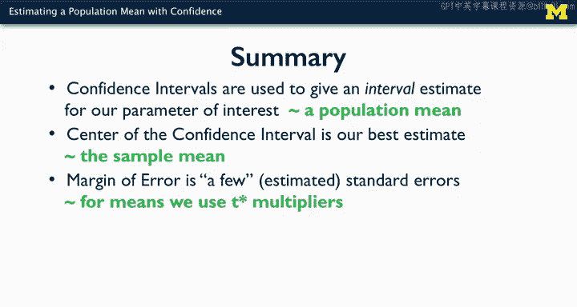

# 密歇根大学《使用Python的统计学（理解并可视化数据、因果推断、建模）｜Statistics with Python》中英字幕 - P47：13_总体均值的置信估计.zh_en - GPT中英字幕课程资源 - BV1dV411Q7j3

Hello， in this lecture， we're going to continue。Learning how to estimate population parameters with confidence。

But now， our response is going to be quantitative instead of a categorical one。

Instead of trying to estimate a population proportion that have some characteristic。

 we instead are going to be wanting to learn about population mean。

To facilitate learning about a population mean with confidence， we're going to use our cartwhe data。

We had 25 team members and colleagues， all adults， who were asked to perform a cart wheelhe。

Now there were a number of variables that we measured。

 but one of them of interest was the cartwhe distance。

So this was defined as being the distance from the forward foot as you're preparing to do the cartwheel。

To the distance of the final foot and most forward position when you completed that carw。

The cart wheel distance。So our research question of interest。

I what is the average cartwel distance in inches for adults？

Our population then would be defined to be all adults。

And the parameter of interest now is a population mean the mean cartw distance。

 which we do represent here by the Greek letter mu。So this is a question that's of interest。

It is that we have some data available， we've measured it over a two day time frame using the same measuring device and all done on carpet。

We also want to estimate this average cartw distance。

 we want to know what it is it's a descriptive question of interest。

 so we're going to look for constructing a confidence interval。

 a confidence interval for this mean cartw distance for our population of all such adults。

 and we'll do that at a 95% level of confidence。So let's take a look at our data。

 here's just a glimpse of some of the data， some of the different variables that were recorded。

 we have our cartwhe distance variable there that's highlighted。

Now one of the first things we should do with a quantitative response is， of course。

 make a nice graph to visually look at what that data is telling us。

We have our histogram on the left and then our QQ plot on the right。Now。

 the histogram is showing us that the cartwhe distances that were traveled were from below 70 inches up to well over 110 inches。

We do also see a little bit of a right skewed shape in our distribution。

And that's further verified when we look at our Q， Q plot where that tail is off a little bit on the lower end。

We do need to have a normal model or a bell shape model is a reasonable model for our response and our population in order for our comp intervalable procedures to be reasonable。

But we also do have a sample size here of 25 observations。

 which is starting to be large enough for us to rely a little bit on that central limit theorem result。

Now that we've looked at the graphical summaries， let's turn to our numerical ones。

Here's a summary of some of those values that we want to extract， that we have 25 observations。

The actual smallest distance traveled was 63 inches。

The largest distance traveled from doing a cartw was a hundred and 15 inches。

The average for our 25 measurements was a little over 82 inches。

And then we also have pulled out here the standard deviation，15。06。

So this value tells us that indeed the measures of cart wheel distances varied。

They varied from that mean of 82，82。48 inches， and that average distance of how those values varied from the mean is about 15 inches。

Now， if I had to give you a guess at what I think that population mean might be for distance traveled for all such adults。

 I would certainly give you that 82。48 inches is my best estimate。That's our sample mean。

But we know that if we were to do this study again， what if we took another 25 adults。

 had them do their cartwhe measure their distances。

And did this whole procedure and summarize the data。

 are we going to keep getting that same sample mean of 82。48 inches every time？No。

 it's going to vary。But we have talked about how that sample mean varies。

We're talking about its sampling distribution。What are the possible values for the sample mean and how do they vary to remember what kind of shape and characteristics that sampling distribution is going to have。

Well， if we have that original population that we took our data from。

 that the model for that response is approximately bell shaped or normal。

Then the distribution of our sample means coming out will be mal shape2。

We saw that our distribution for our population responses was looking like it might be right skewed based on the sample we had。

 so we do have to rely on instead that our sample size being taken might be large enough to be able to still get that these averages。

 these possible sample means are going to be approximately bell shaped。

Now there's a couple of cool features about this sampling distribution。First look at the center。

That center is at that Greek letter mu。Which is telling us that even though the sample means from one study to the next are going to vary a bit。

 they vary right around and on average， are equaling mu。

So we're talking about unbiased estimate here。Then the other neat feature about this distribution is that we need to have a better understanding about that standard error。

 that spread of the distribution， the fact that some of those values are above and below。

The standard deviation of a sampling distribution of a statistic is called a standard error of that statistic。

And when we're dealing with the sample mean as our statistic。

 that standard error ends up having this expression。On the top， we have sigma。

That is the true standard deviation for that population of all cartwheel distances。And on the bottom。

 we've got that factor of the sample size， square root of n。

So the variability or accuracy of our sample mean depends on these two features。

 how much variation was in the original population of measurements that we took our data from。

And how much data do we take from that population？Certainly a nice feature is that the sample size is on the bottom。

 So what's going to happen to this standard error。If we were able to have a larger sample size in our repeated study。

Well， that standard error will be smaller。Giving us that our sample means would vary less from that true mean。

Now， the drawback of this expression is that we can never calculate it。That sigma on the top。

 that true standard deviation for our population of all cartwhe distances for all adults。

 We don't know what that is。And unless we can look at the entire population of measurements。

 we couldn't calculate it。So we are going to have to come up with an estimate of this measure of variability。

 this standard error。And use what we have。We did take some data from the population。

 We have some measurements of cart will distances。 We can measure the variability in that sample with our sample standard deviation S。

 And we're going to use that instead and replace our sigma with S。

So then we're going to be talking about having an estimated standard error rather than the actual standard error。

 but at least to something we can calculate and use to form our confidence interval。

So if you remember from our conference interval basics， the structure is pretty much the same。

 we have our best guess， plus or minus a margin of error。

A bestsquecuss will hopefully be that unbiased point estimate coming from our data。

And that margin of error is almost always looking at being a few estimated standard errors。

The few is going to kind of characterize how confident we want to be in the process。

 itss appropriate multiplier based on the confidence level in our sample design。

And usually the confidence level that's often picked is 95% confident。

That corresponds to a 5% significance level。So how about if we want to do this for a population mean。

 what would be those calculations needed to do to get a confidence interval for a population mean？

Well， we're going to have our best estimate being the sample mean。

Our margin of error will have that same structure。So we have x bar as our best estimate。

 we have our estimated standard error using that S on top。 But what about that few。In this case。

 we are not going to require that you have to have a large sample size in order to conduct a confidence interval for a population mean。

 unlike the requirement for a large enough sample size in proportions。

And since we're using S instead of sigma in that estimated standard error。

 we're going to have to adjust for that few。 It's no longer going to be able to be just that 1。

96 value that we were using when we were doing inference for proportions。This multiplier。

 this few is going to have to be coming from a different distribution called a T distribution。

 which is going to be indexed by some idea of how much data we have and minus-1 degrees of freedom。

To give you a few for what these multipliers look like， if we do want to be 95% confident。

And we have a sample size of 25 as we do here。Then the multiplier is going to have to be a little bit more than 2。

2。064 in order to have that 95% confidence level attained。But with a larger， larger sample size。

 our sample standard deviation is going to be a better estimate of that true standard deviation。

 and our multipliers will start to reflect that and get closer and closer to that 1。

96 type value we were using when we were doing the procedures earlier。

So let's get to our confidence interval。We had our sample mean 82。48 inches， our best guess。

 our point estimate。 we have our standard deviation that came from our sample。

And we know our multiplier for 95% level of confidence。

So let's substitute some of those values in and start doing a little bit of those calculations。

Turns out that our margin of error then is going to be plus or minus about6，6。22 inches。

Going each way from our best estimate of that sample mean。Our conference interval。

 our 95% confidence interval for the population mean cart will distance。Is going to range from 76。

26 inches up to over 88 inches， 88。7。Now that we have calculated our confidence interval。

 let's turn to the two important things for writing up a little bit about our results。

Being able to interpret the interval itself。And being able to explain to someone what that 95% level of confidence really means。

The interval is giving us a range of reasonable values for our parameter。

So a nice sentence to explain what those two numbers that we just calculated that former interval mean。

Let's convey the confidence right up front with 95% confidence。

The population mean cart will distance for all adults is estimated to be between。

The two numbers that we calculated。We've got context。

 We've got clearly what parameter we're trying to estimate here。

 and we've conveyed the level of confidence that we are using。

Any value that's between these two numbers is what we would consider to be reasonable for our population mean carval distance。

But that phrase of with 95% confidence might need to be explained a little bit too。For that。

 we have to remember that the confidence we have is in our procedure that we're using。

We have to imagine that if we were to repeat the procedure over and over and over。

Each time taking our 25 measurements and generating that next 95% conference interval estimate。

We would have a lot of confidence intervals。Each of them with a 95% level of confidence behind them。

What do we expect about that collection of intervals？

we'd expect 95% of those resulting intervals to contain that parameter。

 That population mean cart will distance。Each one interval either does or does not contain that parameter。

But we'd expect 95% of the intervals to do so。That is why we have confidence in the one result that we are providing that came from our one sample。

So in summary。Conference intervals are used to give us an interval estimate for what our parameter of interest might be。

 and for this set we've gone through how to estimate a population mean。

The center of our compete intervals will be at our best estimate。

Estimate a population mean with a sample mean。The plus or minus the margin of error will be some few standard errors that are estimated。

And when we turn to inference about means， we're going to have to use a slightly different multiplier to adjust for that we are estimating that standard error and that we may have a small sample size。

 they T star multipliers。

The underlying assumptions that are needed for our confidence interval。

 for a population mean to be reasonable， to be valid。

 while the data needs to be representative of that larger population considered a random sample。

And the population of responses。All of our cartw distances。

 when we assume that the model for that population of responses is bell shaped or normal。

But we do have a little asterisk next to that one， which is that if the population model of responses is not normal。

 but we have selected a nice， reasonably large sample size。

The average for a large sample size that ends up being approximately normal。

 sample means based on a large sample size are approximately normal so that CLT can sometimes help out on that second assumption。

And finally， after the computing， that confidence interval estimate is important to know how to interpret appropriately that interval with some context and the level of confidence that was used。

