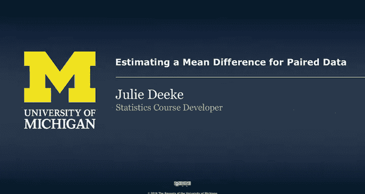
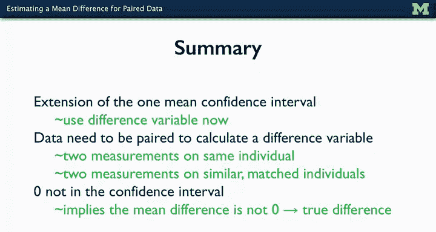

# 密歇根大学《使用Python的统计学（理解并可视化数据、因果推断、建模）｜Statistics with Python》中英字幕 - P48：14_配对数据均值差异估计.zh_en - GPT中英字幕课程资源 - BV1dV411Q7j3

Welcome back in this video we'll be talking about estimating a mean difference for paired data。

To start with， we'll be looking at T education levels this is data that's been gathered from Twin Day a festival held in Twinsburg。

 Ohio annually since 1976 our variable of interest will be the education level of twins。

Now in this case， we'll have the education level of an older twin and a younger twin。

These two variables can't be looked at independently because they're matched。

 we're looking at two individuals from the same set of twins。

 so we want to look at them simultaneously。This is the main idea of what paired data is when we have paired data。

 we want to treat the two sets of values simultaneously。

 we can't look at them separately because they're matched in some way。

So there are a couple of other ways that paired data can arise。

 the first is that you might have two measurements collected on the same individual， for example。

 you might ask a person to write their name with their dominant and their non- dominant hand。

 it's the same person， same name， just two different hands。You might be interested in， for example。

 the length of fingers for piano players on their dominant and non dominant hand or their right in their left hand to see how those are different。

Or you might be interested in a measurement pre and post treatment。

 so an individual is measured before some treatment and then takes a pill and is measured again after some treatment。

In addition to being collected on the same individual。

 we might have measurements that are collected on matched individuals in some way。

 so in this case we have the twin data， we have our individuals that are matched because they're twins。

These individuals don't necessarily have to be people。

 they could be something like candles In this case we might be looking at candles， for example。

 we might be interested in two different wicks， and we might match candles based on their height or other characteristics to see how those wicks burn in these different sets of candles。

Finally， we might have individuals that are matched because they're related to each other。

 for example， a son and a grandfather。Or something like that。

 you might also have individuals that are matched or better。

You might also have individuals that are matched based on some other characteristic， so for example。

 age， gender， and weight if you're looking at a weight loss program。

So in each of these cases we'll need to come up with a new variable。

 we'll look at the difference of measurements within pairs so that we're directly comparing between those two individuals or those two measurements that are captured together。

In our case， our research question is， what is the average difference between the older twins and the younger twins self reported education？

Now the older twin might say that they're older， so they're more motivated and that they have more education。

 while the younger twin might claim that they've had less pressure put on them。

 and so they end up achieving more education。In this case。

 our population will be all identical twins， we'll only be looking at identical twins for this survey。

And our parameter of interest will be the population mean difference of self reported education level。

 this is muus sub D。Now here we do have to specify what way we're calculating that difference。

 in our case it'll be the older twin minus the younger twin in terms of their education。

And that difference is what leads us to use that subscript D。

 you'll see that throughout this presentation， you'll see that we use that subscript D quite often to indicate that we're looking at a difference variable。

And finally， our goal here is that we'd like to construct a 95% confidence interval for the mean difference of self reported education for that set of identical twins。

So to start off with， let's look at a sample of data that we might have。

 keeping in mind that we're taking the older twin minus the younger twin's education levels。

So for example， with this first line， we see that the older twin has 16 years of education as does the younger twin。

 so that difference is zero。For that second line， we see the older twin is slightly more educated。

 so they have 18 years compared to the younger twin 16 years。

 and that difference that too indicates that the older twin has two more years of education than the younger twin。

Now if we go to the last line here， we see that in this case the younger twin actually is more educated。

 as we can see from that negative2， so that negative sign in front of the two indicates that the younger twin is the one that has the higher education level。

Looking at a quick summary of what those differences look like。

 we can see that we have 340 observations and there's quite a peak at zero， in fact。

 as one might expect， almost three fourths of the twins have the same education level。

 their difference is zero years。However， we do see a difference in education levels ranging from negative 3。

5 years， indicating that the younger twin has three and a half years more of education to four years。

 indicating that the older twin has four years more education than the younger twin。😊，In addition。

 we can do some extra calculations， we find that the mean is 0。08 years。

 and the standard deviation is 0。76 years。So going into that confidence interval calculation。

 we can remember that the basic form of a confidence interval is the best estimate plus or minus the margin of error。

Now we can go ahead and substitute in our sample mean difference plus or minus a few estimated standard errors like we did before Now this formula here should look pretty familiar to you this is the same general formula as the formula for the confidence interval for a single mean。

The only thing that's really different here is that we have that subscript D。

 both for the sample mean and for the sample standard deviation。

 so we are using the differences to calculate the standard deviation in the sample mean。And again。

 because we're estimating that standard error， we do need to use that T distribution to calculate our T star。

So that means we have a slightly heavier tail and our confidence interval will be a little bit more conservative because we have estimated that standard error。

So now looking at that formula using the mean and standard deviation of the differences that we've already calculated and going to some software we can find out that the T star we should use with 340 observations is 1。

967， we can go ahead and substitute all of those numbers into our formula。And go through。

 make do a couple of calculations， and we find that our confidence interval goes from 0。0025 to 0。

1652 years。😊，So thinking now about how we interpret that confidence interval。

 we've calculated that confidence interval， but now we need to interpret it。

 this confidence interval， if you remember， is a range of reasonable values for a parameter。

 the population mean difference。So with 95% confidence。

 the population mean difference of the older twins。

 le the younger twins self reported education is estimated to be between 0。0025 years。And 。

1652 years。I'm going to give you a second to think about what this confidence interval means in terms of。

 do you expect there to be a difference between the older twins and the younger twins education from that confidence interval？

So keeping in mind that we go from 0。0025 years to 0。1652 years。

 we see that both ends of our confidence interval are on the positive side。

 so all of the values within the confidence interval are on the positive side。

That indicates that with 95% confidence， we actually expect the older twin to have had more education。

 since a positive value indicates that the older twin does have more education。However。

 these values are all pretty close to zero， so we see that that education level jump for the older twin might not be a huge increase。

 but that there is some increase there。嗯。So now let's go back to that IVQ question。

 is there a mean difference between the education level of twins？

If our education levels are generally equal between the two twins。

 then the difference for each of our individuals is going to be generally equal and our mean difference will be zero。

If her education levels are unequal in general between twins。

That indicates that our difference shouldn't have a mean of zero。

 that there is some difference in those two education levels。So like I said before。

 we'll look for zero in the range of reasonable values In our case。

 our range of reasonable values was entirely positive， there were no negative values。

 so zero isn't within that range of reasonable values。

 indicating that it seems like the education levels are unequal between the older twin and the younger twin。

Now we do have a couple of assumptions that we should check before we actually perform this calculation。

 we do need to assume that we have a random sample of identical twin sets。

 we also need to assume that the population of differences is normal。

 we did look at that histogram earlier and they looked roughly normal roughly bellshad but we also do have a large enough sample size we have 340 observations in our sample。

 and so this can help us bypass that assumption that assumption of normality isn't quite as important with the large sample size。

😊，So to summarize in this video we've seen that we are extending the one mean confidence interval to paired data。

 so now we're using that difference variable rather than the collected variable to calculate our confidence interval。

 but it's the same general procedure as that one mean confidence interval。

We do need our data to be paired to calculate a difference variable This happens in one of two ways primarily we have either two measurements taken on the same individual or two measurements that are on similar matched individuals。

 individuals that are matched in some way before data collection。And finally。

 we've looked at what it means of zeros in that confidence interval or not。

 in our case zero was not in the confidence interval。

 so that implied that the mean difference is not zero。

 that there is some true difference between the education level of twins。

