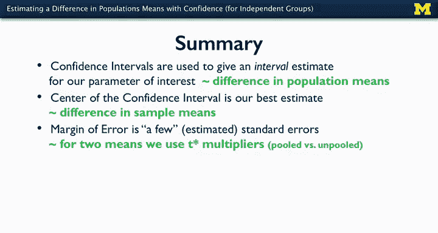

# 密歇根大学《使用Python的统计学（理解并可视化数据、因果推断、建模）｜Statistics with Python》中英字幕 - P49：15_独立样本的总体均值差异置信估计.zh_en - GPT中英字幕课程资源 - BV1dV411Q7j3

Hello and welcome back Today we're going to learn how to estimate a difference in population means with confidence for two independent groups。

 we've seen how to do this for one population mean and one population proportion。

 Now we're going to look into comparing two groups and their populations。

Let's start out with a research question， considering Mexican American adults ages 18 to 29。

 living in the United States do males and females differ significantly in mean body mass index？

So first we're going to look at our population， the population specified here is for Mexican American adults。

 again， ages 18 to 29， living in the United States here since we're going to compare two separate populations。

 males and females， we sample these based on the gender from the overall NHANS data set and get our two populations of interest。

The parameter of interest， body mass index， or oftentimes referred to as BMI。

 is measured in kilograms per meter squared。 It's a way to quantify the tissue mass in a person's body and help classify them as underweight at weight or overweight。

The symbols we're going to use for this parameter of interest are mu 1 and mu 2。

 here we want to find the difference of them， so we'll be using mu1 minus mu 2。

As far as which one's going to be one and which one's going to be two in theHAnes data set。

 gender is labeled as one for males and two for females， so throughout this lecture。

 if you see Subscript 1， that's going to represent the male population and if you see Subscript 2 that's going to represent the female population you can also see here just from these few sampled rows that we've filtered so race is only Mexicanam Americanic adults and we're only including ages 18 to 29 in our data set。

The BMI is listed in the second column and that goes to the tenth place。

If we run some basic numerical summaries， we can get the mean standard deviation。

 minimum and maximum value and sample size for both the meal， male and female subgroup。

 We also have shown the box plot here on the right。

 what we're really interested in in this comparison are the two means of these populations here we've just got sample means。

 and that's going to give us our best estimate to start out with。

That sample mean is going to change from sample to sample。

 and that's going to help create our sampling distribution。Just a side note。

 the saying difference in two sample means can get a little wordy at times。

 so if I say sample statistic， this is going to reference that difference in two sample means。

 so for the sampling distribution of our sample statistic。

 that's going to vary from sample to sample and that's going to vary around our true population mean difference。

 which is that mu1 minus mu 2。If models for both populations of responses are approximately normal or if our sample sizes are large enough。

 the distribution of the difference in sample means is going to be approximately normal as well。

 So again， this picture here depicts a normal distribution。

 this is going to be all possible values of our sample statistic here or our difference in sample means how much is this going to be vary is going to help be determined by our standard error。

The standard error is a value that on average， tells us how far our sample statistic is going to fall from our true parameter。

 and that's shown by the calculation here。Unfortunately we don't know the true values for those population variances as denot by sigma。

 so the best that we can do is we're going to estimate this with our sample variances。

 so we have S1 squared and S2 squared are the variance for the male group and the variance for the female group。

All right， so let's start to create this confidence interval。As we've seen before。

 the confidence interval is going to start with the midpoint as our best estimate。

 and we're going to add and subtract a margin of error to both of these sides。

 The best estimate is going to be our unbiased point estimate In this scenario， again。

 that best estimate is going to be the difference in our sample means or x bar 1 minus x bar 2。

The margin of error， or the way I like to think about is a little bit of wiggle room to account for that variability we saw in the sampling distribution is going to be a few estimated standard errors。

 and we saw that estimated standard error on the last slide， But what do we mean by a few。

A few is going to be a multiplier that we use， and this is going to be pulled from a specific distribution based on a desired confidence level for two means we're going to be using a T distribution。

 and for this example we're going to be using a 95% confidence level。

 which is equivalent to a 5% significance level and a hypothesis test。

When figuring out this margin of error， there's two different approaches that can be used with the two means。

U。Confidence interval。First we have the pooled approach if the variances of both of our populations are close enough。

 we're going to assume them to be equal， so here we don't know these true variances again。

 so looking at our sample variances and the spread of each sample。

 we can see if this assumption will hold。If we don't think this assumption will hold。

 we can simply use the unpoolled approach and drop this assumption。

So let's start with an unpooled confidence interval calculation。 Again。

 we have our best estimate plus or minus our margin of error。

 We said that best estimate was the difference in sample means。

 and that's given by x bar 1 minus x bar 2。 We already showed that standard error formula。

And that we have the variance for the sample。Of the male group divided by the sample size for the male group。

 plus the variance for the sample female group， divided by the sample size for the female male group。

 and we take the square root of that。Now we again what do we mean by a few here。

 Well that's going to be our multiplier and for this we're going to use a t star multiplier。

 we're going to use a t distribution with a certain degrees of freedom。

To calculate the exact degrees of freedom， you can use the Welch's approximation。

 That formula can get a little complicated， though。

 So if technology is not readily available and you're working on this by hand， you can use a simple。

 conservative approach by taking the smaller of the sample sizes and subtracting one from them。

The other approach we have was that pooled confidence interval calculation。

 this is where our variances are close enough in our samples that we can assume that our variances for the populations are similar。

 and then we pool that variance together。So again， we have that same difference in sample means。

And then we're going to plus or minus a few estimated standard errors。

 The estimated standard error for pooled is going to change now。

 So instead of having that original calculation， we now have our pooled standard deviation out in front and we multiply that by the square root of the inverse of our sample means or sample sizes。

 sorry。Now again， we're going to use the same T star multiplier。

 but it's going to come with different degrees of freedom。Here with the pooled version。

 we're going to simply add the two sample sizes together and subtract two。And again。

 this approach is used only if we can assume that the population variances are equal。Okay。

 so let's head back to our example and work through it。

So there's a couple assumptions we need to check first。

 The first of these assumptions is that we have a simple random sample for both of our populations here again。

 that's the male and female groups that we're looking at。Because of the way Nhannes is created。

 we're going to go ahead and assume that we've got a simple random sample for the purposes of this example。

 There are other complex sampling designs that we talk about outside of this lecture， but again。

 here we'll just assume a simple random sample。We also need these two samples to be independent from one another。

 And here we're going to assume that is the case as well， too。

 both the males and females can't really be matched up specifically or paired specifically in either way。

 So we'll just assume that the two samples are independent from one another。

The next assumption we need to check is the normal assumption。

 we said earlier that the models for both populations of responses need to be approximately normal。

 One way we can do this is by looking at the histograms as shown on the left here or the quantile quantile plots shown on the right。

The histograms on the left should both appear approximately bell shaped。

 which is what would give us the tell of a normal distribution。On the QQ plots on the right。

 this compares the sample quantiles that we have with the quantiles of a normal distribution。

So what we're really looking for is that all these dots。

 all these data points fall on that middle line， that middle line running through the center of that graph shows a normal distribution。

 so the closer we are to that， the closer we are to a normal distribution。

As we can see from both of these， they're fairly close to normal。

 but there is some slight to moderate skew， especially in the female group there。

 as we can see from the deviations from that quantile quantile line。So。

We model do need the models for both populations to be normal。

 but here because we have such a large sample size。

 we can apply the CLT or the central limit theorem and continue anyways。The the methods behind these。

 this two sample T test is pretty robust， especially the larger sample size you have。 And here。

 because both of our sample sizes are well over 200。

 we're going to go ahead and apply the C LT and move forward anyways。

 we'll see later on in other lectures， different ways to handle non normal data。

The other assumption we need to check is that variance assumption。

 and this is going to tell us whether we use the pooled or unpooled approach。So what we can do here。

 we can look at both of the IQs from the box plot or the interquartile range。

 and we can look at the sample standard deviations that we have。

 The sample standard deviations appear to be very similar and those IQRs or that box portion of the box plot appear to be very similar in height。

So because of that， we can say that these are similar enough where we can make this assumption of equal population variances。

 so we'll go ahead and use the pooled approach。So if we have that pooled approach equation that we had earlier from a previous slide。

 we can start to plug in our values here， the big thing， the T star multiplier。

 we're going to use a value of 1。98。As your sample size increases， your degree of freedom increases。

 and this value will approach 1。96， we do have a fairly large sample size。

 but we're going to just err on the conservative side and use a value of 1。98。

 This value can be found from multiple T tables online and again。

 depends on both your degree of freedom and your confidence level Here again。

 we're using a 95% confidence level。So let's start to plug in some values。We can see our。

Difference in sample means on the left side of the equation。

 we've got that T star multiplier we talked about， and then that estimated standard error on the far right。

As we start to solve for this， we see that we do have a small difference in the sample means。

And we've got some wiggle room attached to that on the right side。

The final confidence interval that we're going to create is negative 0。

385 kilograms per meterd to positive 1。865 kilograms per meter squared。

So now we're going to do a quick IVQ。 We showed you using the pooled approach。

 but now we want to check just to make sure if that assumption really didn't hold with equal population variances。

 what the unpooled approach would look like。 And if with the unpoolled approach。

 our interval matches what we found here， we find that we have pretty robust results。

 So now take a moment and calculate the unpooled variant。

 the unpooled confidence interval for this problem。Okay。

 so as we can see with the unpoled confidence interval that you just calculated。

The two intervals that we have are both very， very similar。 They don't deviate by much。

 So we can say that our results are fairly robust， whether we assume equal variances or not。

So now how do we interpret the interval that we just found？

This interval is given from negative 0385 to positive 1。865。 What do we mean by this。

 This interval is a range of reasonable values for our parameter。 So， again。

 we're looking to find the true difference in our population means。

 And we've just got this estimate based off of our sample。

 So what we could say about this is that with 95% cent confidence。

 the difference in mean BMI between males and females for all Mexicanam American adults living in the United States。

 ages 18 to 29。😊，Is estimated to be between negative 0。385 kilograms per meter squared。

And positive 1。865 kg per meter squared。 So this range gives us all the values that we could expect our parameter be based on the procedure that we just used。

Now what do we mean by this 95% confidence in the beginning of the statement Well。

 this is our confidence level and basically what we're saying is if we repeated this procedure again and again and again。

 taking the same sample size， getting different samples and every time we created a new confidence interval for those samples。

 we would expect 95% of those resulting intervals to contain the true difference in population mean BMI。

 so we're 95% sure about the process we used that we capture that true value that we're after。

So in summary， confidence intervals are used to give us a range of reasonable values for our parameter of interest。

 and here with this example， our parameter of interest is the difference in two population means。

The center of this interval is going to be our best estimate。

 and that's always going to be from our sample statistic。

 and here that is our difference in sample means。The margin of error or that wiggle room that we need to account for the variability is going to be a few estimated standard errors。

 and both of these will depend on which approach we use， whether it's pooled or unpooled。

The assumptions that we need to check when doing this performing this analysis is that we need both random samples to be two simple random samples。

 and we need them to be independent from one another。

We also need the populations of those responses to be normal。If we don't have normality。

 a large N helps and we can move forward with the CLT as we saw in our example。

We then check for that assumption of equal variances and that helps us decide whether we're pooled or using the pooled or unpooled method。

Finally， know how to interpret that interval that you find and the confidence level behind it。

 there's minor differences between the two and that will be important in analysis to come。

