# 密歇根大学《使用Python的统计学（理解并可视化数据、因果推断、建模）｜Statistics with Python》中英字幕 - P4：3_访谈：现实中的统计学应用.zh_en - GPT中英字幕课程资源 - BV1dV411Q7j3

Hello， my name is Brenda Guerson Today we have two special guests， Brady West and Ammbush Turi。

They're here to share their connections too and their passions about statistics with Python。

冇 welcome。Thanks thank you we'll start with Brady here's your official title。

Research Assiate professorfe at the Sur Research Center of the Institute of Social Research at the University of Michigan。

So share with us a little bit about what you really do Yeah that's a mouthful so that's a lot to say I mean the key part about that title and the research associate professor is the research part of it so my primary responsibility is to write research proposals apply to different funding mechanisms via the government or via private corporations and secure funding to perform basic research I do research and survey methodology and survey statistics so that's primarily what I'm doing is writing those proposals and if I'm lucky enough getting some of those proposals funded and so then that funding then covers my time to develop original methodology write papers describing that methodology it supports some of our students so that's good so when I obtain funding it can help fund students while they're here at the university and my position is a little bit unique most research track professors on campus their primary responsibility as research but I'm in a unique position at ISR which you mentioned where we also have a teaching program and。

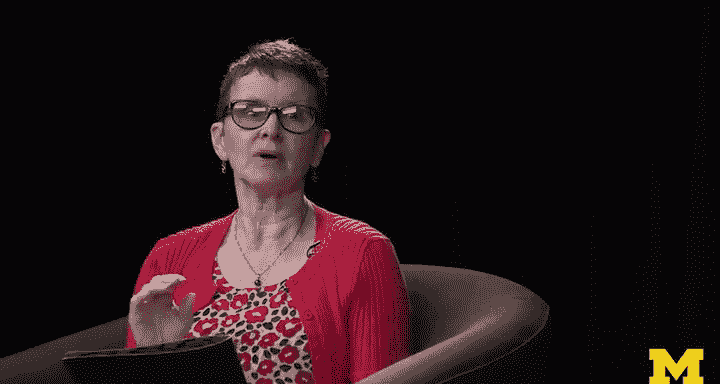

Methodologies， so we offer graduate degrees， master's degrees。

 doctorate degrees in survey methodology。So in addition to writing proposals working on basic research we also teach usually one class per semester so I'm responsible for pretty much teaching throughout the year I also teach in the summer program that's over at ISR so teaching is a big part of that position as well so I'm a little bit different from most research professors on campus and that I also have a large teaching responsibilities so a lot of my work involves kind of balancing teaching and mentoring of students and developing new materials from my courses with that kind of basic research objective and collaborating with other researchers on campus so that's kind of the short summary of everything I do but it's really exciting I'm working a lot of different stuff I love working with students I love survey statistics so I have fun every time I come to work so that's wonderful How about a project that you've been working on either recently or maybe just one that was more interesting to you sure so for my dissertation I work with a fairly famous statistician worldwide names Dr。

 Rodd Little。

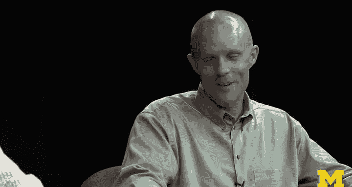

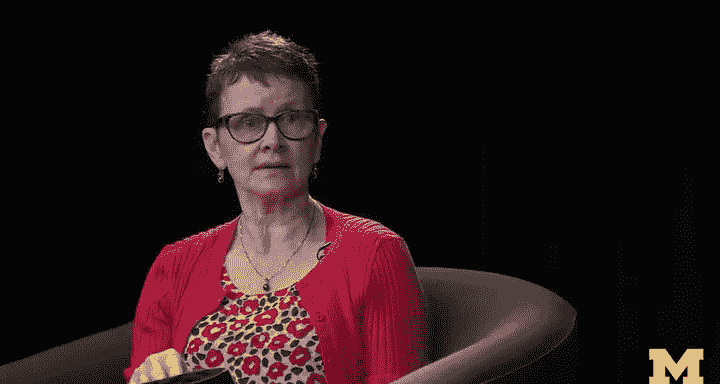

And I wanted to set up another grant or apply for another grant where I could work with Rodd and kind of extend some of the stuff I was doing on my dissertation so we were fortunate to get some funding from the NIH to do some research that again was extending work I had done with Rod on the dissertation we have a paper out in this particular area but it's on assessing potential bias in non-probability samples So one of the things I'm doing for this specialization is talking about the difference between probability and non-probability sampling and Rod and I are developing original metrics together with my other colleague Phil Boonstra and my students Jingwei who and Chen Chen we're working together to develop these original measures of how much bias there might be in a given non-prob samples So for example if you try to collect data from people on Facebook or you recruit people via Facebook or you try to analyze data from Twitter or something of that sort are there good theoretically。

metrictrics that we can use to quantify the potential bias and estimates that we try to produce from those kind of non-standard data sets that don't come from a welldesigned probability sample where it's fairly straightforward to compute estimates so so I'm really excited to be working on that and we're actually working with another large project at the Department of biostatistics here at Michigan something called the genes for good project over biostatistics they recruit people for that project via Facebook and we approach the primary investigator of that project to see if we could apply the methods that we were proposing to assess potential bias in his project and they do a lot of measurement of important risk factors for cancer they collect a lot of genetic data and we're working with that genetic data so I'm learning all about genetic data and things called polygenic scores and trying to quantify what's on the genome it's really fascinating but we're using those data to see if the genes for good project is producing measures。

that are more or less in line with another benchmark probability sample called the Health and Reti St。

 so the Health and Reti study collects the same genetic data。

 we want to look at the HRRS genetic profile and see how that compares to the genes for good genetic profile and then that's going to give us a chance to employ those metrics that are working on with RoD so。

Really fortunate position， another opportunity to work with students work on some novel contributions。

 so that's pretty exciting。 That's just one of the projects I've been working on recently。

 So so you're still always learning aren't you always learning I mean that's the thing about this kind of position and really statistics in general is that there's never a dull moment You're always learning something new a new way to apply statistical methods something in the real world that could benefit from a good statistical analysis' like I said。

 every day I come to work and have fun So it's cool wonderful Thank you All right ambush。

 let's turn to you。

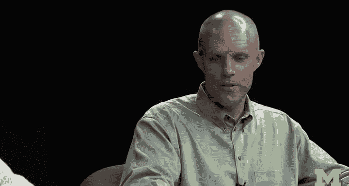

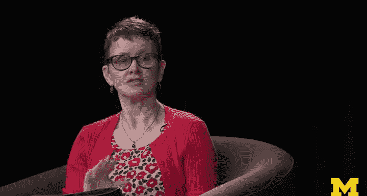

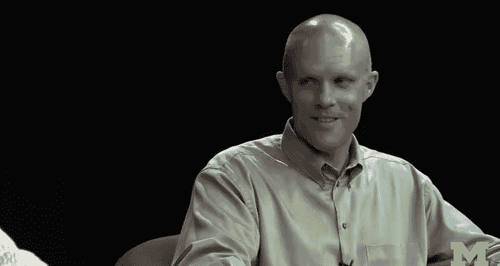

Your official title is Assiate Professor of Stas and Associate professorfes of Electrical engineeringing and Comp Science at the University of Michigan。

 so share with us a little bit about what you really do right yeah I get that question a lot like how are you a professor of statistics and computer science actually the two disciplines have been moving closer and closer together especially because of the data science movement so my field of research is machine learning。

which historically came out of efforts in artificial intelligence and the idea was that if you want to create intelligent machines。

 you probably will have to make them learn on their own。

 you cannot just program everything so computer scientists started looking at how to make programs that learn from experience and youret have to program everything and now machine learning is everywhere it's in our phones it's on Google it's on Facebook and as the field of machine learning evolve。

It it has been moving closer and closer to statistics。

 which is why now my primary appointment is in the Department of statisticstistics。

 but I'm involved in a lot of interdisciplinary activities like the undergraduate Data science major which is now already being offered at the University of Michigan and then in fall 2018 we launch the master's program in data science and data science is all about blending computationalal thinking。

With inferential thinking。In the service of some problem in whether it's in science or business or whatever field of application it is。

 so that's why I have positions in both departments All right how about a project that you have then been working on either recently or just one that you found very interesting Yeah so actually when I joined Michigan one of the exciting things for me was I got to work with Susan Murphy and she was just beginning to entered this area called mobile health which now I have also picked up a significant interest in so one of the exciting things that happened was we submitted a mobile phone app for gathering data in for addiction research and one app in a national competition sponsored by NIDA which is the National Institute on Dr abuse and one study which is going on currently is the intern health study it's led by Professor Se in the Department of psychiatry and this is study that's helping us understand how。

L mood or even depressive symptoms develop in medical interns because medical internship as you might imagine。

 is very very stressful long working hours， no fixed schedule。

 they go through a lot of emotional ups and downs so a good fraction of medical health interns develop depression and so we've given them smartphones and we're collecting mood data activity data。

 sleep data and this data will be used to further understand how we can predict maybe we can predict the depressive episode before it happens and then you can start to intervene so I'm really excited about my work in mobile healthow that's great's cool So speaking of data then one of the data sets that we're going to be using in this course a lot of data sets are going to come from NHAs Brady。

 maybe you could share a little bit about the history of NHAs or some cool facts about Sure so NHAN stands for the National Health and Nutrition Examination survey and that's one of the major nationwide health studies that the government the Centers for Disease。

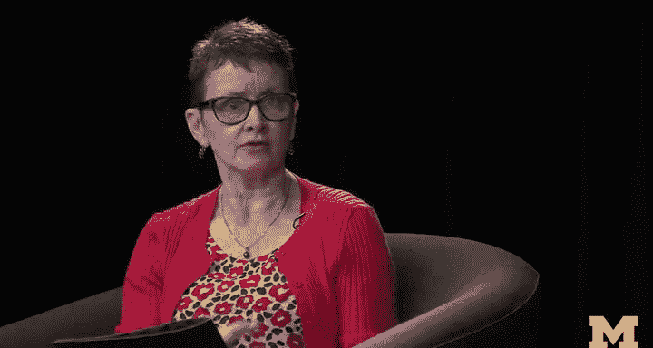

conducts to try to understand the health of the US population and emerging health needs。

 health disparities among different subgroups and so forth and so a lot of the data sets and this specialization will be variations of the unHAS data that are collected on a continuous basis pretty much every two years One of the cool things about NHAS it's a nationwide survey so it requires drawing a national sample of individuals from within their households。

And NHAs， it's a really good example of what's called a cluster sample。

 so instead of just randomly selecting individuals from all over the nation。

 there's random selection of geographic areas from all over the nation and then individuals are randomly sampled from those areas and invited to take part in the main survey now the main NHAN survey involves physical measurements。

 a sample of peoples has physical measurements collected like blood pressure。

 other blood characteristics， body weight， things of that sort and some individuals are only asked to answer questions about their medical history so to actually conduct these physical measurements on these randomly sampled individuals from all over the nation CDC drives these giant semitrailers full of medical equipment and trained professionals who can collect these types of measurements they drive these giant semitrailers to these randomly sampled geographic areas and then the randomly sampled people from those areas and invite them to come again participate in this data collection have these measurements。

Colected and so forth。 So it's a really good example of a cluster sample because the CDC couldn't just drive these giant semi trailerilers to individual households and show up in the driveway and say。

 hey we're here for your measurements like they need to be able to just drive them to an area and then work with a good random sample of people in that area so NHAS is an extraordinarily important source of data and the health of the United States population。

 but at the same time it's a really good teaching example of the importance of cluster sampling and how you can get a good representative sample by sampling geographic areas but it's out of necessity in the case of NHAs because of the equipment that they're using to collect really good measurements on health it's a unique feature of that survey but it's a very important survey the data have very important real- worldor implications for health policy and so forth So good teaching example but a very important data resource for the larger population and researchers can just download NHANS data and generate national estimates of various relationships or characteristics。

diistributions on certain variables so incredibly important source of data for researchers and that's a big reason why we're using it in this class there's a lot of interesting measures and in this specialization the participants are going to be able to play around with the NH data and make some interesting inferences about the population so great teaching tool very important resource for the entire US Wo that we have this data available it's been ongoing for a very long time and continues just to be an excellent source of information about the health of the larger US so。

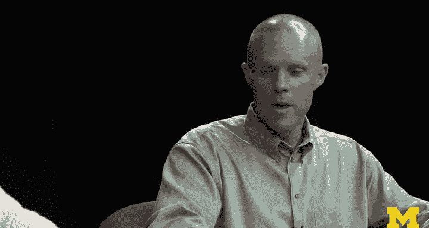

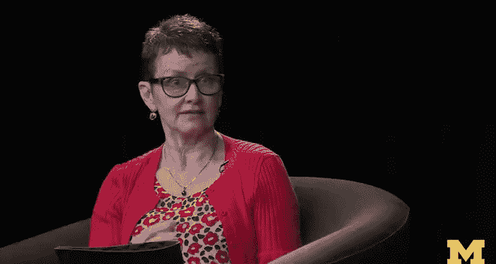

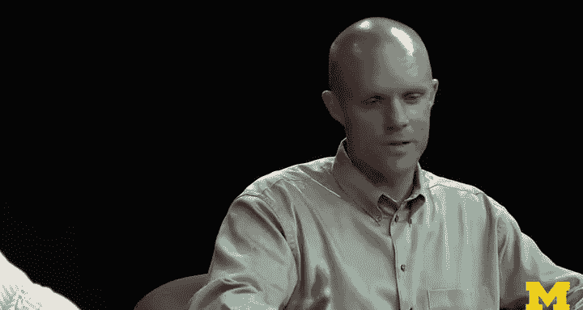

All right， so this is a course that's statistics with Python now I already see your eyes sparking up you are a passionate user of Python aren't you ambush absolutelyutely yes I in fact I teach a PhD level course。

 which is part of our PhD course sequence， the computational sequence and it's also very popular with masters student。

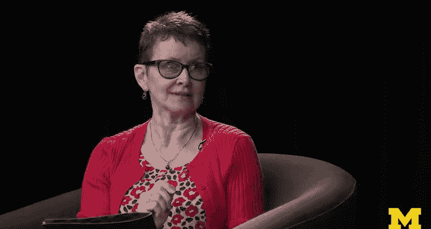

And。I used to use MatTlab a lot and the entire field of machine learning used to use a lot of MATlab。

 but what happened is Python which was originally developed as a general purpose language slowly with the community efforts it gained an excellent ecosystem of data science and numerical and scientific computing tools like libraries like NI and SciP and pandas so now there is is a terrific ecosystem of Python libraries that work just out of the box and there's an amazing community online。

😊，You can ask questions， you can answer questions， that's another way to learn and one of the reasons I love Python it's an excellent language to teach because it can be picked up very quickly。

You can the language sort of grows with you so there is little effort in getting started but there's no limit to where you can go whether you want to do mobile phone development or you want to do web development or you want to do data science Python works across a lot of different problem areas so I love it that sounds good I can see your ice spark when you talk about this。

All right， my next question is for both of you。You have both done a lot of consulting and research over the years。

 so what would be something that you wish everyone would either know or everyone would keep in mind as they're thinking about doing their own research。

I guess I'll start I've had the really good fortune of working for many years at a consulting group here at the University of Michigan and that's where I learned a lot of my love for applied statistics is in working with different clients through CcarR as it's called and I guess one thing I would say from nearly 20 years of consulting with graduate students and faculty and staff at the university is that when you're thinking about designing a research project。

 you should never be afraid to seek help at the very beginning of the project it's a lot of faculty and researchers they think that they know everything and that you can you you can pull off everything on your own without any assistance。

 but especially if you want to conduct highqu research you really need to have a conversation with statisticians if you want to conduct a survey survey methodologist people who have expertise in all different dimensions of the research that you have in mind so you talk to a statistician how big of a sample size do I need what are the analytic techniques that I ultimately want。

To use to answer my research questions What are the instruments that I need to design in order to collect data from a given population trying to do all that stuff based on like a one semester course that you've had in the past it's probably not going end well so it's really nice that the university provides a place like Ccar where researchers can come you know at ground zero and have a conversation and say well this is what I really want to do。

 these are the research questions I want to answer how best can I design this research project and then consultants can say well' you know here's the instrument that you want to use here's how you would design the questions here's how you can prepare for the data sets that you're ultimately going to be collecting here's the analysis plan that you're likely going to employ to answer your research questions but it always it always kind of makes me shiver a little bit when people come in and there's 75% of the way through the design and they have a whole bunch of flaws in the design that could have been saved if they had just had a conversation initially So I guess my recommendation to researchers。

especially if you're going to be doing a lot of statistical analysis is to talk to somebody at the very beginning and make sure that you get sound advice moving forward with the design because that'll save a lot of time and solve a lot of problems right up front that if you wait too long it could have severe implications for actually trying to conduct that research so having that conversation up front is really important with people who have expertise in other areas that you might not specialize in。

Very good advice Ammbush anything to add to that Yeah I mean I completely agree with whatever Brady said。

 I want to bring up another issue which I think is very timely which is the ethics and responsibility especially with the data driven decisions you know and algorithmic decision making there are decisions being made about whom to send to prison or whom to recruit or whom to fire and there has to be some kind of accountability you can say yes an algorithm is making the decisions but but there have to be mechanisms in place so that if there is is a problem then things can be investigated。

And so my point is researchers， when you do your research。

 there has to be some amount of effort also put into the ethics of it and what impact it will have on society。

And funding agencies know this。 So you probably know that NSF when it。Excepts grant proposals。

 it not only judges them on intellectual merit but also broader impacts。

 so I think in today's world it's very important for scientists and researchers to think about what is the broader impact of my work beyond just the technical research that you're doing and you know we'll probably have self drivingiv cars very soon so what happens if there's an accident who's responsible。

So I think concerns about responsibility， trust， privacy， fairness。

 all of these things are very important right now， excellent points， yes。Alright。

 let's kind of touch back on teaching Brady you shared with us that you do some teaching there two。

 so I know that's one of my passions also so explain maybe a little bit more about some of the things you get to teach and perhaps something that is you know the best part of that teaching role that you have。

Well， just thinking about what I've done in the past year。

 I started off in the fall teaching a course that I actually designed from scratch on applications of statistical modeling。

 so this is for graduate students and PhD students that presents a variety of modeling approaches that they might not learn about in basic stats methods or regression classes so things like multi-level modeling。

 structural equation modeling， building classification and regression trees。

 longitudinal data analysis， I wanted to give them exposure to each of these different kinds of applications。

 of statistical modeling， and so in that course they had to come up with a research question in each of those four major areas find a data set that they wanted to work with to try to answer that question and then fit some of these models。

 specify the models that they were fitting， interpret the results of that model fitting process and ultimately write for papers over the course of a semester that would describe the results of the analysis and some of our students have tried to turn these papers around into actual publications。

Working with them on that so and you know they have to provide an appendix showing all the code that they use in each of those papers so they're learning about how to write appropriate code。

 they can use whatever software they want， so they can use R。

 they can use Python you know whatever software they'd like to employ but they just need to demonstrate that they've mastered the use of these models for addressing research questions so I designed that class because our faculty felt that was an area that was lacking in our curriculum and it's been a joy to teach some semesters I let them form big teams。

 some semesters I've let them work on their own I'm still kind of tinkering with that a little bit but it gives them a chance to collaborate in working on these kinds of modeling projects so that's a fun course to teach and then this past winter semester I taught applied sampling so this is a class where we teach applications of sampling from larger populations and so techniques like stratified sampling cluster sampling how to work with weights that are computed when you select a probability sample things of that sort very applied focus and it gives students in survey methodology expertise。

In designing a sample from scratch like a nice scientific probability sample that they can use to generate good inferences about populations as part of that course。

 they have a sampling project where they have to work with a team and develop a memorandum that describes a sample design for addressing a given research problem or the demands that a client would have and that they they're asking for a sample what kind of design would you use so they get that experience as well and then I mentioned I teach over the summer in the ISR summer Institutet on survey research techniques and that's actually happening right now I'm teaching a course on survey data analysis so dealing with data from complex sample designs like how to use weights and estimation how to make population inferences based on survey data again very heavy software focus so we have a lab so we oversee kind of one on one what students are doing in the lab and how they're approaching data sets and performing analyses so a lot of students like that class because again they get good takeaway techniques that they can use when they actually sit down with survey data and they want to they。

handle it correctly and make good population inferences so those are three courses and we just started a new research education program。

 a series of short courses on something called responsive survey design so this is a very data drivenven survey design where you're modifying survey design parameters as a data collection proceeds making decisions about like changing modes of data collection like switching from face to face to mail or mail to the web things of that sort you're trying to figure out what design features work best for certain individuals based on patterns what's been happening in the data collection and and that's a really cool new area and survey methodology and we were given a grant from NIH called our 25 mechanism that funds the development of these kinds of research education program so we just taught 11 short courses on various aspects of responsive design over the past couple weeks and this is the first time that we've rolled out the entire program so between the analysis course。

And teaching all of these helping with all these 11 short courses。

 we had a variety of visiting instructors， I actually taught four of them but it was still a lot of work to get oversee everything。

 but everything went really well we're going through the evaluations right now and we're trying to introduce these ideas of adaptive and responsive survey design to non-statisticians non-serv methodologists fields that will benefit from these techniques we learn a lot about it but we want to try to disseminate the word about how this can save money during data collection improve efficiency and things like that so it's really exciting it was a little bit intense over the past couple weeks but it was really exciting to kind of get this off the ground and like I said we're going through the evaluations right now so I think everybody was really happy and we're gonna to keep it going it was a fiveyear grant to really bring this program to life and we're pretty excited about it so this was the second year and we're gonna to see how everything went so teaching those non-statisticians so that they can know what questions to ask when they come in early exactly that getting back to the original point so they understand all these design implications and they know the questions。

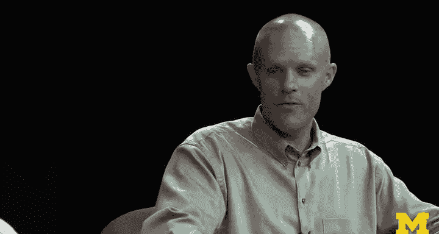

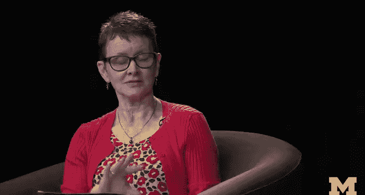

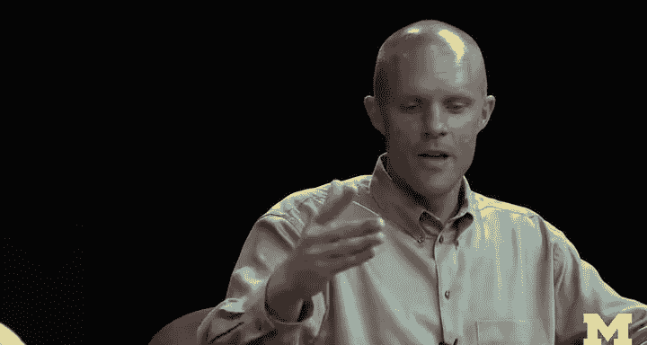

To ask up front when they're thinking about their own research。

A Bo about some of the courses that you've taught Yes I have taught introduction to probability I have taught introduction to R for data science and I already mentioned the Python course so as you can see I teach a lot of programming based courses and the fun part about teaching a programming based course including the one that we are here for is you immediately see that students can do something with it you know you give them this very powerful tool programming language access to data sets like NHS。

And it's this students will come back to you and say look you know this is what I did and that just is just a beautiful thing to see I've had instances where a student came up and said you know because of the skills in our or Python I got this job or I got this research experience so it's good to see that growth and the other part I love about teaching is and that's really the secret which if you're outside academia maybe you don't know is that most people teach not because they want to teach but because they want to learn right so the best way to learn something is to teach it and it exposes all the flaws and all the holes in your knowledge brutally so while preparation can be very intense but after you finish teaching you you do feel that you've grown as a learner by teaching it very very true。

So you know I do some teaching too I teach that introductory stats course thousands of students a little different than your maybe individual classes with hands on more。

 but one of the things I do to try to break up my lectures is to offer them some chance to try out their knowledge with some clicker questions so it's wonderful I think it's amazing when the students start working on that and they start talking to each other in this large classroom setting and you can just see the percent of students getting the right idea behind that question increase by that dialogue and discussion that they have with each other now are either of you aware of what I do to incite my students to motivate them to do their best on those clicker questions I've heard I promise them a cartwheel that they get 100% correct on a clicker question and there have been some classes that have received a few cartwhes and some not but very interesting one of the data sets we have in our course is a cartwheel data kind of a fun one to explore a little bit but we had a number of our colleagues on our team and a few other people do a cartwheel and we measured number of。

How far they travel to complete a cartwhe， different characteristics that might be related to that and a quality rating of how quality of that cartwhe on the scale11 but you know I think we're missing a few data points I don't think we have your data quite yet so we'll talk about that after the interview All right well let's maybe wrap up then with some advice so what kind of advice would you give our learners whether it's with respect to learning statistics。

 taking this course。

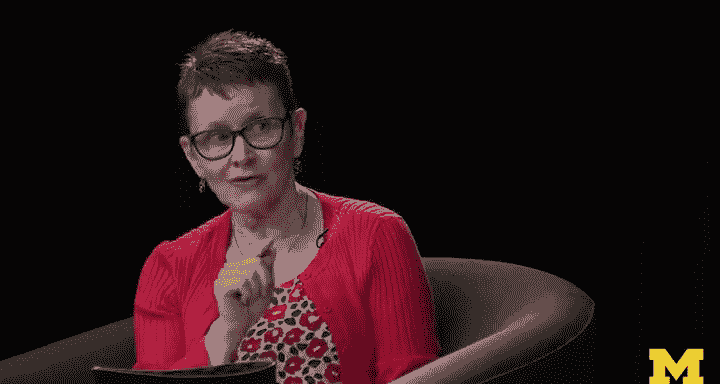

Learning Python， what would be something that you'd like to share with them maybe from your own personal learning experiences because as we've been talking。

 we are constantly learning as we do our teaching in our research activities too so any basic advice I would really second something that Mbuush just said is that and one of my favorite professors that I ever had Julian Fairway used to be here in the Department of statistics U of M now he's at Bath University in the UK he said you're never going to really learn statistics until you sit down and do it。

I mean it's one thing to watch the videos and say all those concepts make sense。

 but until you get your hands on some data and you sit down and you write a little bit of code。

 you try to actually do some analyses， interpret the results of those analyses。

 Sta isn't something that you want to just have a conceptual grasp of you want to make sure that you have the key concepts down but you're also well versed in how to actually get something done sit down with some data。

 run some analyses， make sense of those analyses so I think the most important piece of advice I want to give is that take advantage of the opportunities to take some of these data sets。

 run some analyses， understand what the code means what it's doing for you and the more and more that you practice with writing your own code。

 learning how to manage data， manipulate data， understand where the data are coming from。

 the better of a statistician or a data analyst that you're going to be in the long run because the practice really makes perfect and I think that that's especially true with statistics。

 make some mistakes run some code and see some error messages， only until you start。

Do it and going through that process is it really going to click and I think that's the most important advice I can give is even going above and beyond like the data sets we have in the specialization go find some other data and try to run the same techniques and realize that you know what wow I can apply these techniques to all different kinds of data sets and make some really interesting conclusion so actually sitting down and doing it is necessary and I told this to clients for many years I can speak till I turn blue about the right things that you should be doing but until you actually go do it you're not really going to reap the benefits that statistics can offer so that'd probably be my advice following up on Julian's advice。

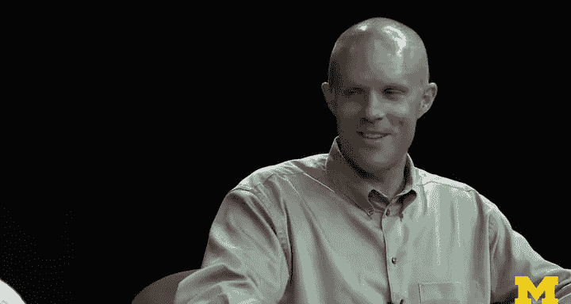

Ammbush， anything to add do add because you said all the right things。

 maybe I can just reinforce the message。Just say it in different words。 So first of all。

 student as a student never be。Afraid of making mistakes， mistakes are precisely what？

You know lead to success and there are amazing technologies these days in terms of you know seeking help so one should not be afraid of seeking help there'll be discussion boards I assume within the course there's also the broader community and you know if you listen to the news it feels like all bad things are happening but good things are happening all the time there's Wikipedia there's so many free resources。

 Python and R both completely free open source languages so there is just this is life feel like the golden age for doing data science there's just so much out there there is really no limit so yeah so。

😊，Don't be afraid to make mistakes， seek help and help help others that's another great way to learn is to offer help on something that you know as we learn by teaching。

 we learn by helping each other very good definitely excellent。

Well I want to thank our two guests today， Brady West and Amburi for sharing their experiences。

 for sharing their passions about statistics with Python。

