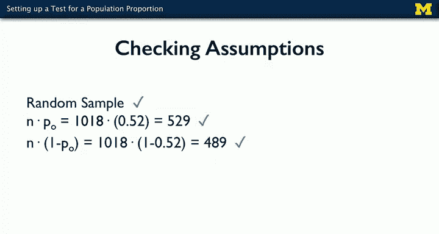

# 密歇根大学《使用Python的统计学（理解并可视化数据、因果推断、建模）｜Statistics with Python》中英字幕 - P50：16_单总体比例检验框架构建.zh_en - GPT中英字幕课程资源 - BV1dV411Q7j3

Yeah。

Hello and welcome back。 In the past we've talked a little bit about testing hypotheses and today we're going to start delving into what that really means。

 So to begin， why do we want to do hypothesis tests？Well。

 typically we have a question and that question could be。

 could the value of the parameter be blank so we could have some idea of what it could be。

 but we're not sure if that's correct or not。And then with that question。

 we use data to try and support that claim or maybe go against that claim。For today's lecture。

 we're going to look at an example and run through a one- proportion hypothesis test of a CS MoT children's Hospital poll。

 and so in this poll it was a national poll on the issue of children's health and particularly sleep habits。

 so we'll be looking at an example of lack of sleep in teens or teenagers。Our research question。

 we were given the background information of in previous years。

 52% of parents believed that electronics and social media was the cause of their teenager's lack of sleep。

 do more parents today believe that their teenager's lack of sleep is caused due to electronics in social media。

 So with this background， we first want to define what our parameter of interest is and our population。

 So we have a population of parents with a teenager， and that's ages 13 to 18。

And our parameter of interest here is going to be P or the population proportion。

And the main goal is we want to test for a significant increase in the proportion of parents with a teenager who believe that electronics and social media is the cause for lack of sleep。

So with any hypothesis test， you first want to start with your hypotheses。

 so you make these before you even collect any data and so that's so that you're not influencing what you believe。

So the first hypothesis is called the null hypothesis H not。

 and for us in that background it said that in previous years。

 52% believed that the lack of sleep was caused by electronics。

 so we're going to have H n being P equals 0。52。The second hypothey。Is going to be the alternative。

 And that will be P And then something。52。 So this question mark here could be less than greater than or not equal to。

 Which one would it be。So our alternative will be greater then。

 and the reasoning for that is in the previous slide， the background in said significant increase。

 and so that means we're looking for a P actually going to be greater than 0。52。

And a nice concluding statement in on the hypothesis is to state what P really is。

 if you just gave those hypotheses to someone they'd ask。

 well what is P so P is the population proportion of parents with a teenager who believe that electronics and social media is the cause of their teen's lack of sleep。

And finally， we want to set a alpha or a significance level， which typically this is 0。05。

 this is basically the cutoff point of when we found something to be significant if we get a P value which we'll talk about later that is less than 0。

05。And now we go out and collect our data， so the Mos Po came back and said that a random sample of 1018 parents with a teenager was taken and 56% said they believe electronics and social media was the cause of their teenagers' lack of sleep。

And before we go any further with this， we first need to check some assumptions。

So the first assumption we need to check is we need a random sample of parents and the second one that we'll be checking is if our sample size is large enough and that ensures that we have our sample proportions being a normal distribution and how we check a large enough sample size is we want to see if n times p is at least 10 and n times 1 minus p is at least 10 so it's like where there are at least 10 people that said yes and where there are at least 10 people that said no to the question。

And of course we don't know what P is exactly， so instead of using P we're going to kind of use a pseudo P which is P not and that is the null population proportion so under the null hypothesis we believe our population proportion to be this。

 which for our case is 0。52 and our n again was 1018。So now we check these assumptions。

 so our random sample in our problem statement it was given to us。

 so we got a nice check there and then next to n times p n and n times 1 minus p n。

 we want to see if these are at least 10 with P n being 0。52。So we go in and we calculate it out。

 we get 529 and 489， so with a sample size of 1018， that's a pretty large sample。

 but you might have a smaller sample of like 30 and then you would want to make sure that these are satisfied to be at least 10。

And again， that ensures we have a normal distribution of our sample proportion。

So now we've set up our hypotheses， we've checked our assumptions。

 and now we can go on to actually running the test and seeing if we have significant results or not。

