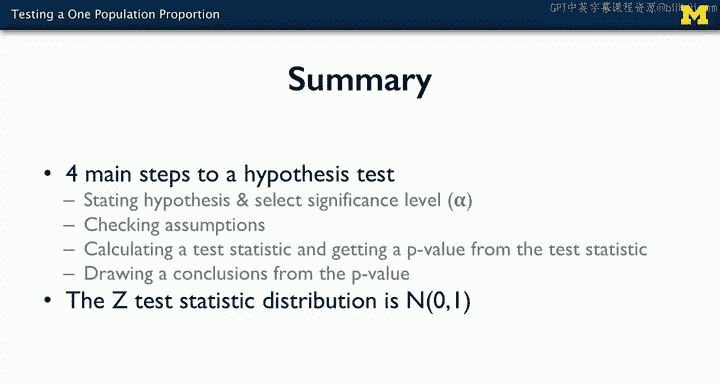

# 密歇根大学《使用Python的统计学（理解并可视化数据、因果推断、建模）｜Statistics with Python》中英字幕 - P51：17_单总体比例假设检验.zh_en - GPT中英字幕课程资源 - BV1dV411Q7j3

So now we've set up our testing for one population proportion。

 and now we're actually going to test it by calculating a test statistic and then getting a P value and finally making a conclusion off of that P value。

So just to reiterate， we set up our hypothesistheses to be a null hypothesis P equaling 0。52。

 alternative hypothesis being p greater than 0。52 because we wanted to see if there's a significant increase。

 and this is where P is the population proportion of parents with a teenager who believe that electronics and social media is the cause of their teenager's lack of sleep。

And the last step we wanted to select a alpha or significance level。

 which typically is going to be 0。05， and we'll use that as one of the last steps in the hypothesis test to make our conclusion。

And from the poll， we got a best estimate of P， which is P hat to be 0。56 of a sample size of 1018。

So we've now got our hypotheses， we checked those assumptions and now we are going to calculate a test statistic。

 which a test statistic that is determined by taking our best estimate。

 subtracting the hypothesized estimate and dividing by the standard error of the estimate。

So for our case of a one proportion test。We're going to have something that looks like this P hat minus p divided by the standard error。

 so we know P has 0。56 p again， was that under the null hypothesis what we believe p to be。

 and so that's 0。52 and then we have the standard error。

So here the standard error you might want to write it like so standard error of P hat is equal to the square root of p times 1 minus p divided by n。

 but again， we don't exactly know what p is， but we have a pretty good guess and that guess is p not and so really this standard error should be written。

As standard error of P hat is equal to the square root of p times 1 minus p divided by n。

And so what this is， we call this the null standard error。

 so under the null hypothesis we have this standard error for our P hatAT。Using these two equations。

 P hat minus P not divided by the standard error， and we know what our null standard error is。

We can calculate our test statistic。So putting everything in 0。56 minus 0。

52 divided by the standard error， which happened to be 0。0157。We get a Z test statistic of 2。555。

And so this test statistic， I call it a Z testistic because we are under a normal distribution and so whenever we have proportions。

 it's going to follow a normal distribution again as long as our sample size is large enough。

What does this Z test statistic really mean， though。Interpreting it， we could say。

This Z testistic means that our observed sample proportion is 2。

555 null standard errors above are hypothesized to population proportion。And so we took our sample。

 we subtracted out the hypothesis and then divide it by the standard error。

 so we get the number of null standard errors。So let's talk a little bit more about this test statistic。

 the Z test statistic is just another type of random variable。 it has its own distribution。

That distribution is going to follow a normal 01。And the reasoning why it's a normal01 is our original data was normal。

 and now we've just centered and scaled that original data。

And so what that looks like is if we have our equation here。

 the numerator is what's centering our data， we're subtracting out the hypothesized mean。

And then when we divide by the standard error， we are scaling our data。

 and so we go from some normal distribution and then we are just kind of manipulating it to become a normal 01。

 and then that is the distribution that the Z test statistic follows。

So now that we have the Z test statistic， we can find a P value from it。

And so here I have a normal01 curve so I could。Mark in the center，0。

 and then one standard error would be equal to  one。 so I could mark out one here。To。

And a three out there。So we have a Z test statistic again， of 2。55。

And we want to find our P value from that。So on this chart。

 I'm going to mark I' going to put a big line where 2。55 approximately is about。

And if you recall our H。Was P greater than 0。52。So this greater sign here is very important because that tells me I want all the values that are greater than my test statistic。

So if I shade in this area to the right of where I drew that big vertical line。

 this shaded area will be my P value。And to get that P value。

 you either have to plug it into a programming language like Python or you could go and look it up in what's called the Z table。

 and so here if I looked up the value of 2。55 Z test statistic， I would get 0。0053 as my P value。

Now we have our P value， we can come up with a conclusion with it。So。We have a P value 。0053。

 and we notice that that's less than the alpha we said earlier in the hypotheses。

 so because it's less than our alpha of 0。05， that means we will reject the null hypothesis that p equals 0。

52。So basically， we got a result that was very unlikely to occur。 So now our initial assumption。

 we're starting to not really believe it quite as much。

And now that we've said we are going to reject the null。

 we just want to provide one kind of summary conclusion statement。

 and that would be something that looks like this， there is sufficient evidence to conclude that the population proportion of parents with a teenager who believe that electronics and social media is the cause for lack of sleep is greater than 0。

5 or greater than 52%。So here。It's kind of summing everything up。 We got our P value。

 We either reject or we fail to reject。 So failing to reject is when we have a P value being greater than our alpha。

And then we have a conclusion statement based off that either rejection or failing to reject。

And that is the end of your first hypothesis test。 And again， this is all for one proportion。

 So in future tests， they'll be a little bit different。 Some of the assumptions might be different。

 the hypotheses will be different。 The test statistic is always going follow that same form。

 but it will just kind of slightly change the values that you need to put in。

 So to summarize what we've talked about in this example of a hypo test。

 we learned if there are four main steps， So we state our hypotheses and select a significance level。

 which is alpha。 We check our assumptions。We then calculate a test statistic and we get a P value from that test statistic。

 and finally we draw a conclusion from that P value。In addition to this。

 we also talked a little bit more about the Z test statistic distribution and how it's a normal 01 because we centered and scaled our initial distribution。

 which was also normal。

And in future cases， you aren't always going to have a Z test statistic。

 we'll see other ones like the T test statistic in future lectures。

