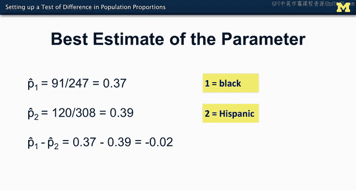

# 密歇根大学《使用Python的统计学（理解并可视化数据、因果推断、建模）｜Statistics with Python》中英字幕 - P52：18_双总体比例差异检验框架构建.zh_en - GPT中英字幕课程资源 - BV1dV411Q7j3

In this video， we're going to be talking about setting up a test of differences in population proportions。

 so just setting up the hypothesis test in the next video we'll go through the actual calculations。

To start with， we will be looking at data that was collected by CS Mot Children's Hospital now they collect a lot of national polls on issues related to children's health and safety and this particular one is talking about water safety and in particular looking at swimming lessons。

So the question of interest is， is there a significant difference between the population proportions of parents of black children and parents of Hispanic children who report that their child has had some swimming lessons？

To start， let's think about what our populations are in this case。

 our population will be all parents of black children ageged 6 to 18。

 and we have a second population， the population of all parents of Hispanic children age6 to 18。Now。

 our parameter of interest will be P1 minus P2， so the difference in those two population proportions。

And in this case， because we do have two different populations。

 we need to identify what the two groups are， we have these subscripts of the one and the two and in our case we're letting group1 be the parents of black children and group two be the parents of Hispanic children we'll use that throughout this video。

And now our question of interest is we'd like to test for significant difference in the population proportions of parents reporting that their child has had swimming lessons and we'll do this at the 10% significance level Now remember that we do need to set that significance level before we look at any of the data so this is done first。

Now we'll set up our hypotheses。First we'll think about our null hypothesis。

 our null hypothesis always has to have that parameter of interest， so our P1 minus P2。

And the null hypothesis also always has to have the equal sign。Now， typically。

 because we're looking at a difference in population proportions。

 we'll be checking to see if those population proportions are equal or not equal。

 so typically the null value in our null hypothesis will be0 looking for P1 minus P2 equals0。

Now this isn't exactly what we want to show typically what we want to show is in our alternative hypothesis。

 P1 minus P2， and we want to relate it to0 now it can't have an equal sign。

 but it can have a greater than less than or does not equal。

 depending on if we want to see if one group， it has a higher proportion。

 a lower population proportion， or just if the two population proportions are not equal。

So I'll let you think about， do you think that the symbol that should replace that question mark is a greater than less than or does not equal？

Now， in this case， it should be a does not equal because we are looking to see if there is a difference in our population proportions。

 so we don't care what direction it is， we just want to see if there is a difference。

And then like the research question said， we're looking we're testing this at the alpha equals 0。1%。

OrWe're testing this at the alpha equals 10%， or alpha equals 0。1。Now we'll look at the data。

 so Mo's Children's Hospital went ahead and gave us some survey results。

 we know that a sample of 247 parents of black children aged 6 to 18 was taken。

 and 91 of those parents said that their child has had some swimming lessons。

We also know that we had a sample of 308 parents of Hispanic children aged 6 to 18。

And 120 of those said that their child has had some swimming lessons。

So this provides us with quite a bit of information and enough that we can go through and calculate the difference in the population proportions。

😊，Now， before we actually do this， we do want to check our two assumptions that we have。

The first assumption is that we have two independent random samples really this does need to be told to you there aren't ways once you've been giving the data that you can go back through and check for that so in essence we need to know from MoT that they have collected two independent random samples。

Our second assumption is that we need large enough sample sizes to assume that the distribution of our estimate is normal；

 That is we need n1 times P hat， n1 times 1 minus P hat， and2 times P hat。

 and N2 times 1 minus P hat all to be at least 10。In this case。

 our P hat will be a common sample proportion。This common sample proportion does need to be calculated and this is different from if you remember back in the confidence interval video。

 we could look at the number of yeses and the number of nos in each category in this case we have to do a calculation。

😊，So first we need to estimate the common proportion。

 we'll use this by finding the sample proportion， and then we make sure that we would expect at least 10 yeses and at least 10 nos in each of our samples。

So to start with we'll go ahead and calculate that common sample proportion What we do is we take the total number of yeses and divide that by the total number of people that we talk to。

 so in this case we have 91 plus 120， the number of yeses in both of our two groups。

 and we divide that by 247 plus 308 the total number of people that we talk to。In this case。

 we see that the common proportion is 0。38， that overall across our two different samples。

 38% said that their childhood had some swim lessons。Now we can go ahead and calculate this 0。

38 and multiply that by each of our two sample sizes and we'll also do 1 minus of 0。

38 and multiply that by each of our two sample sizes I've gone ahead and done that calculation for you we see that we have 94 153 117 and 191 as are four different calculated。

😊，Products and in each of these cases， these values are greater than 10。

One thing to note is that if this assumption is not met。

 we can perform different tests that bypass this particular assumption。

 we'll go through that at the end of the next video To start with。

 we'll go ahead and calculate our best estimate of the parameter。

 Remember our parameter is the difference in the population proportions P1 minus P2。

And our best estimate of the parameter will be P hat 1 minus P hat2 just substituting in those sample proportions for the population proportions。

So to start with we'll calculate our two sample proportions。

 P hat1 will be the number of parents of black children who have said that their child has had swimming lessons divided by the total number of parents of black children we talked to。

 this is 91 divided by 247。And we see that we have a sample proportion of 0。37。

Now we'll do the same thing for our second group for the parents of Hispanic children。

 and we find that our sample proportion for the parents of Hispanic children is 。39， so pretty close。

We'll go ahead then and calculate P hat 1 minus P hat 2。

 substituting in those values that we've just calculated。

 and we see that the difference is negative 。02。Meaning that the population or the sample proportion for black children is smaller than the sample proportion for Hispanic children。

So now that we've gone through and set up our test in the next video we'll look at how to actually calculate that test and come up with a conclusion and decision based on the values here。

