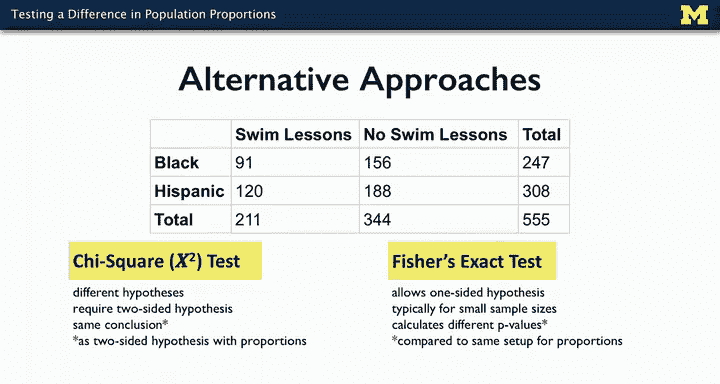

# 密歇根大学《使用Python的统计学（理解并可视化数据、因果推断、建模）｜Statistics with Python》中英字幕 - P53：19_双总体比例差异检验.zh_en - GPT中英字幕课程资源 - BV1dV411Q7j3

嗯。Welcome back in this video we'll finish up the hypothesis test that we started in the last video。

 testing to see if there's a significant difference in the population proportion of parents of black and Hispanic children who have reported that their child has had some swimming lessons。

So to recap from last video we set our hypotheses， our null hypothesis was that we had no difference in population proportions。

 or in other words， that our two population proportions were equal。

Our alternative hypothesis was that our two population proportions are different。

 that there is some difference in the population proportion of parents of children who are black and Hispanic and have had swimming lessons。

😊，Now we're testing this at an alpha equals 0。1 level。

 so we want to compare a P value to an alpha of 0。1。Now， if you'll also remember。

 we have our best estimate of the parameter， we estimated our P hat1 at 0。37， our P hat 2 at 0。39。

And we calculated those difference in our two sample proportions， and that is negative 0。02。

We had also calculated our common sample proportion as 0。38。Now to calculate our test statistic。

 we'll go ahead and look at the generic framework for a test statistic Ty we want our best estimate。

Minus our hypothesized estimate and divided by the standard error of our estimate。

 in this case our best estimate is P hat 1 minus P hat 2。

 it's our best estimate of our parameter P1 minus P2。

Now our hypothesized estimate can be found in the null hypothesis here we had P1 minus p2 equals 0。

 so we'll substitute in0 for the hypothesized estimate。

 this is typically the case when we're looking at any difference in parameters。

We also have the standard error of our estimate， in this case we'll be looking at the standard error of P hatAT。

This is the square root of P hat times 1 minus P hat times 1 over n sub 1 plus1 over n sub 2。

 typicallyy you'll be using a calculator or computer to calculate this。

 but I wanted to give you the formula in case you ever needed to do it by hand。

Now we can go ahead and substitute in the information that we know into our formula for the test statistic。

😊，So we can go ahead and we know the difference in our two sample proportions is negative 0。02。

 we calculated that before。And I've gone ahead and substituted in the values for P hat and1 and N2 in the standard error formula and calculated our standard error as 0。

041。If we go ahead and divide our estimate， divided by the standard error of our estimate。

 we find that our Z， our test statistic is negative 0。

48 Now what does that test statistic mean I'll give you a chance to think about the interpretation of the test statistic really quickly。

All right， so let's think about what that test statistic means Rz is negative 0。

48 and so that means that our observed difference in sample proportions is 0。

48 estimated standard errors below our hypothesized mean of equal population proportions。

That gives us a sense of where our sample falls， but let's look at what the P value is and what that means because we have a Z test statistic that will be distributed according to a standard normal distribution。

In other words， it's a normal distribution。So it'll be。A bell shaped distribution。

With a meme at zero。And a standard deviation of one。

So I'll go ahead and put values at one a negative one between those negative one and 1。

 we should have roughly 68% of our data。😊，Now our test statistic is negative 0。48。

And we need to figure out how to calculate our P value。

 to calculate our P value from our test statistic， we need to look to see where we shade and we decide that based on the alternative hypothesis。

In this case， our alternative hypothesis was p1 minus p2 does not equal 0。

 so we want to see how far away we are from zero， that means that we want to shade as far away from zero as possible。

And that if we are negative or positive away from zero， it's the same。

 so we also want to shade our two sided hypothesis， we want to shade both sides of this distribution。

Now we can go through and calculate the area that's shaded。And we find that our P value。

Is equal to 0。63 Now you can calculate this with tables or with the formula card。

 you can also go ahead and use a computer to calculate this。Now， based on our P value of 0。63。

 we need to compare that to our alpha of 0。1 to decide what to do in this case。Now 0。

63 is larger than 0。1。And that means that we will fail to reject the null hypothesis。

 This doesn't mean that we accept the null hypothesis， but we can't reject it。

Now that again means that we don't have evidence against equal population proportions。

 so our null hypothesis was that we have equal population proportions and we don't have evidence against it。

 it doesn't mean that it's necessarily not the null hypothesis。

 we just don't have evidence against it。Formerally， based on our sample and our P value。

 we fail to reject the null hypothesis in this case we conclude that there is no significant difference between the population proportion of parents of black and Hispanic children who report their child as head swimming lessons。

In essence， this means it seems like those two population proportions are roughly equivalent。

 it's not like it seems like black children or Hispanic children have more less swimming lessons than the other group。

Now there are a couple of alternative approaches that I want to show you。

 we can use the data in our sample could be given in a two way table rather than as proportions。

 so we can see within each of our samples how many groups had had swim lessons and how many children had not had swim lessons。

In this case， we can make a two way table with all of those values on the inside and our totals on those outside edges One thing that we can do with this is a high square test。

There are some differences between the chi square test and this test for the difference in population proportions。

For the chi square test， there are slightly different hypotheses。

 so the actual phrasing in the hypothesis would be different。

 you'd typically be looking to see if there's a difference in distributions。

 although there are a couple of other ways that you can formulate it within a chi square test。

In addition， chi square tests really only work if you have a two sided hypothesis。

 so it's only equivalent if you had P1 minus P2 does not equal0 in the alternative hypothesis。

 if you had P1 minus P2 greater than0 or less than zero， a chi square test won't be the same。

In general， though， you will have the same conclusion。

 your P value should be the same in the chi square test as in the difference in population proportion test。

 as long as you did have that two sided alternative hypothesis。Now there's one other option。

 the Fisher's exact test， I mentioned this briefly in the last video。

 but the Fisher's exact test allows you to calculate the test if you have small sample sizes。

 you can do this for larger sample sizes， but the calculation takes quite a while。

 however with small sample sizes you can perform the fishser's exact test and the Pvalue calculation doesn't take too long。

In this case you can have a one sided alternative hypothesis， it doesn't have to be does not equal。

 can be greater than or less than。It does calculate slightly different P values so it doesn't use the assumption for the normal distribution for your test statistic。

 so you have to calculate it slightly differently， but in general you end up with something that's fairly close to the same P value as if you made the assumptions and really if we have large enough sample sizes。

 the P values do end up being exactly the same。😊。

So in general in this video we've talked about how you calculate a hypothesis test for a difference in population proportions we found in our case that there doesn't seem to be a significant difference in the population proportion of parents of black children and Hispanic children who have had swimming lessons。

 it seems like black and Hispanic children might have swimming lessons at the same rate。

We also talked about a couple of alternative approaches that you can take if you don't meet certain hypotheses or certain assumptions。

 or if you need a different way of calculating your hypothesis test。😊。

