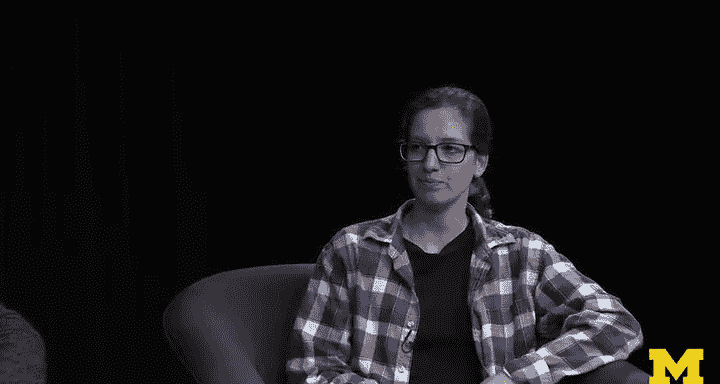
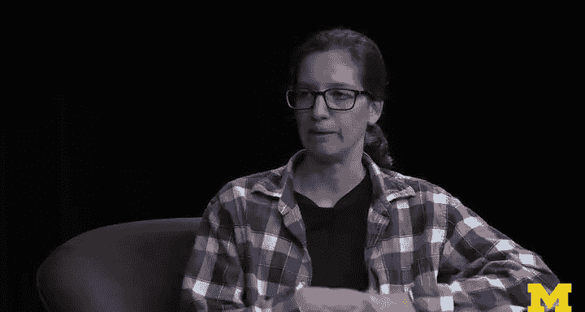
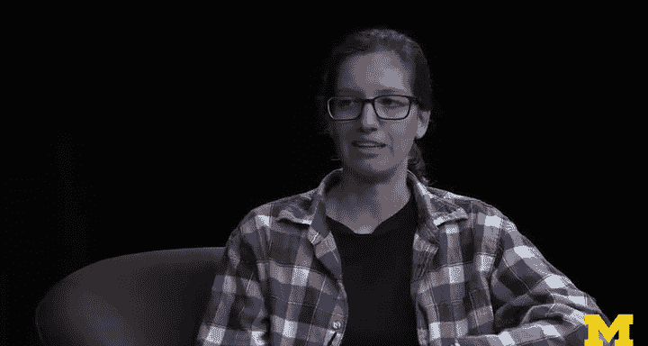
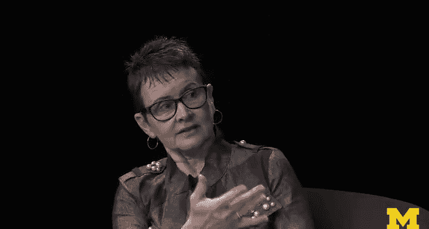
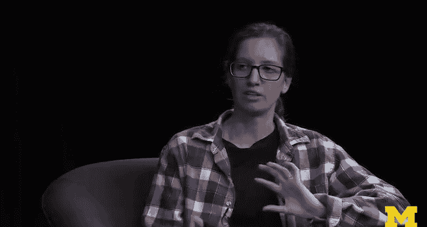
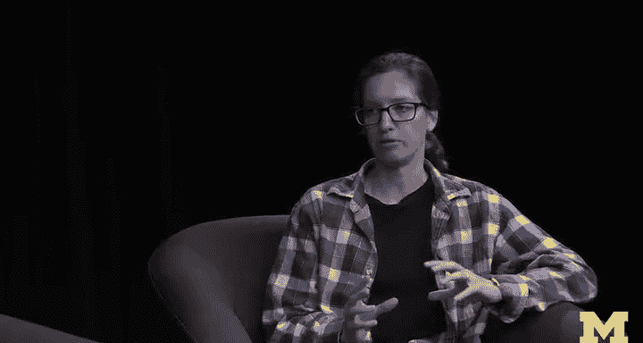
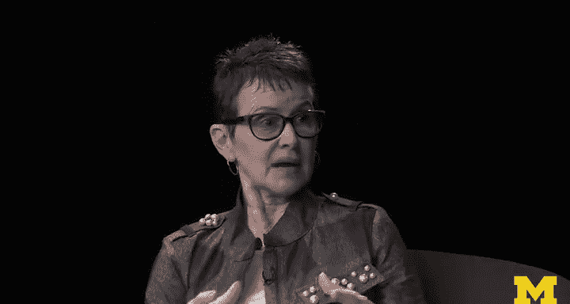

# 密歇根大学《使用Python的统计学（理解并可视化数据、因果推断、建模）｜Statistics with Python》中英字幕 - P54：20_访谈：P值、P值操纵及其他.zh_en - GPT中英字幕课程资源 - BV1dV411Q7j3

Yeah。Welcome。Today we get to welcome two special visitors。

Fellow course developer and team member Lauren Ni， currently a graduate student PhD candidate in our statistics department at the University of Michigan。

And then we have Tim Vanderey。He is a doctoral candidate at Lyon University in the Netherlands。

 and currently here at the University of Michigan is a visiting research scholar。

They're here to share their discussion and ideas about P values， P hacking。

 and to keep the Pas going， proposals， good proposals。

 good practices for our reporting of research results。So in this course。

 we have turned now to some statistical inference techniques。

 We have studied a little bit of confidence interval estimation and hypothesis testing。

This is where we state competing theories， we gather our data。

 summarize it in the form of a test statistic， and convert that to a corresponding P value。

So probably a good place to start would be to ask you to sort of fill in the blank。

A P value is blank。Maybe a little bit about how you might explain what a P value is more generally。

 the big idea。

Let's have Laura start Okay， I will start then when I'm explaining to a student what a P value is。

 I usually say。😊，This is all in the context of hypothesis testing。

 so you even know an alternative hypothesis。And you have to in describing PI。

 you say if the null hypothesis is true， so we're assuming that it is the ground truth。😊。

Then the P value is the probability of getting the statistic that you did out of your data。

Tim， would you like to give your what I I like to add to that UC when I explain a P value。

 I like to call it a measure of surprise？Specifically not a direct measure of evidence because it isn't really to some extent。

 but a measure of surprise， so you need the nop。And the P value then the higher the P value。

 the less surprise you should be and the lower the P value， the more surprised you should be。

 because that means that your data is not what you would expect。

 given that the new hypothesis is true， So it's being surprised about the data。

 not about hypothesis that's important And also I think this analogy is clear that if you are surprised if the P value is low。

 that doesn't necessarily then。Tells you a lot because you still have to work out it that surprised what it is。

 But you know that you should be surprised。 and if you shouldn't be surprised， well。

 that' that's just it。So kind of along with that， then we need to think about not only what is a P value measuring what it is。

 but also what it's not。Some misconceptions， so AP value is not blank。

How much you fill that in？One of the biggest concerns I get is that the P value will actually tell you how likely it is that your data is true and that is not what it gives you because you're completely taking away that assumption about the nu hypothesis being true。

 I'm just assuming that。😊，Given the whole world as it is。

 but you really need to be having that assumption that the no hypothesis is true to be getting any information about it。

Yeah， I I will absolutely think that's the biggest biggest issue people have with P values also maybe more generally that it's telling us something about hypothesis。

 it isn't telling us only something about data assuming that how a hypothesis is true and then we can use some like inverse inference in a sense and do make some suggestive claims about hypothesis but directly speaking it's just about data the probability of data of course we already kind of know the probability of data because it's one we have the data in front of us so we know the data is true。

Yeah， I think that's one of the most important things to remember。

Some feel that the P value is actually trying to quantify。

How much that no hypothesis might be true or how much the alternative is true in reality。

 those are statements that are either true or false。

 so it's not the probability of a theory being true。

 it's the probability of the data under a certain theory。

And how about the idea that it doesn't tend to measure then？

What that effect might be if it is a small P value， what does that mean？Well。

 I will come back to the surprise thing again because I think so we can be sure that we have that we can be surprised。

 but the next question is okay why theP values are small and there are a lot of reasons for this a lot of possible reasons so there's not one reason being or it can only be small when the know hypothesis hypothesis is false the are other reasons as well。

It has to do with how much power do you have， how the sampling go。

 what kind of analysis strategies have you used， so all kinds of more implicit assumptions built into the whole model that you use which eventually produce a peer value。

You have to take all the way into account to when you start interpretling a be value。

And so for example， one， if you want to make claims based on P values。

 one of those things is that you we have to repeatedly do tests because P values and inferential statistics in general。

 at least frequent statistics only operates in this。

Sort of imaginary worlds of long run experiments of infinite repetitions。

 so you can also need to do multiple studies， calculate multiple P values based on multiple data sets。

 and then we can really start homing in。 okay， this gives us a good description of reality and there's no hypothesis is not a good predictor of the data we get。

 So we're going build a better hypothesis That is a better predictor。

Each one study is either right or wrong when we make that decision in a sense yeah and that's fine as long as we do multiple studies right right and so we need to see the building of that evidence so another thing that I want to add to this is the misconception is that having a really low P value could mean statistical significance but it doesn't necessarily mean practical significance so it could be that your mean is above 10 but it's only above 10 by like 0。

001 Yes it could be very statistically significant like you were for sure that it's above 10 given your data。

But what does that really mean in the world， maybe it doesn't give you。

 maybe the drug wasn't really that much better than the previous one and it's not worth it to pursue making it。

Yeah absolutely and even on top of that， you almost guaranteed to get very small P values if you have very large samples for example。

 in my work where I use data fromOOs a massive amounts of data and then even if like the true value of some kind of difference or an effect is like 001 you might still get a very low P value because it's not exactly zero and that's in the hypothesis and say so yeah that's not a very good explanation but overall actually is the best explanation because the roof value so small so close to the real zero。

Um， so yeah， it it can be a bit misleading sometimes if you forget all the other things that can cause low P values。

 very good， very good。So moving on from P value to our second P of P hacking。

We've seen over the past few years a lot of interesting discussions about views of P values。

 the idea of P hacking， so Tim， what does it mean when we say a P value is hacked？

Good question again a very general initial answer would be whenever we we can no longer interpret the P value as like by its mathematical meaning by its mathematical definition。

If you can interpret it any more like that， then it's hacked one way or another and like a thousand ways to hack it so for example。

 very maybe the most well known way to hack a P value。

Is so you have one data set of a study can be experimental or observational and you just run as many tests as you can and sometimes we call exploratory analysis。

 sometimes we just call be hackcking but you're running tens。

 maybe hundreds of different analysis then hey， one of those is significant you're happy and that's the one you report。

But then we can no longer interpret a P value in its original meaning。It's still a true P value。

 that single specific analysis is correct， but to interpret a P value。

 we need the big pictures well we need food transparency of all those analysis that we' done。

 we need to know everything that has been done to that data so then we can no longer interpret a P value as it's supposed to be interpreted and it's attacked。

So what are some of the other consequences then of P value hacking？

Or if we can no longer interpret it as it should be。

We just can't do anything with it anymore because we don't know what it means and that has a big consequence because then the study we did basically becomes uninformative。

 it's like yeah， we did something but with then we kind of messed up this portion and now we're no longer sure how we can interpret this anymore so it becomes useless or uninformative most of the time and that's just a waste of energy and money right。

So。Pe hacking is more prevalient。 And what about。Is it possible to accidentally？PHc too。

Maybe not so obvious when you're be hackcking you can do it without your knowing it You you got some thoughts Yeah。

 I would say that most scientists have inadvertently p hacked on some research during their entire career if not multiple times without knowing it because a lot of the times when you're looking at data you have a general assumption and a hypothesis that you're testing and you could get something really close and you say。

 oh well what if I look at this variable instead or the subset of people and it may seem reasonable to you then it is reasonable because you have data and you want to look at it but you didn't have that。

These research ideas in the first place and so you're kind of like poking around until you get a value that you say。

 okay， it really means something。But it doesn't actually mean something。

 it really just means that you're looking at multiple different questions and that's diluting your P value essentially。

 so I think for the most part it is an inadvertent thing and you wouldn't know necessarily when it's happening unless in retrospect when you come back and say oh okay。

 so what else got I did my same study and got a different result， how did this come about。

 maybe it's because I was looking at too many different questions。😊。

Mmhmm。So。P hacking is only for P values or can you have P hacking of other statistics and other numbers oh you can hack anything you want sadly because again with the general definition as long as we can no longer interpret a value as it's supposed to be interpreted。

By my definition and it's hacked so you can do that to averages in a sense。

 which it's not an inferluential statistic but you can still hack it in a way that you can present it as a mean while it's not actually a mean so for example。

 if you took out some outliers and said okay we're going to look at this data without outliers well you're choosing which outliers or how to define those outliers so that in itself as a hacking and you still end up with a mean then but it's not an original meaning and if we interpret it as a mean of the data and we don't know that what those values were all the outliers were removed。

 it's not really mean in the original sense of the word so you might be mislatch you can interpret it in that original manner。

And that's how we are often somewhat misled because we don't necessarily know all the decisions that were made along the way or what choices the researcher took as they started their investigation that's not always part of what we read in a research study right up to and it affects any kind of numbers so often what I hear or see people do is like yeah for example the P value was just above significance or a P value was hacked that significant now like okay we're going to ignore the P value because that's now like shady。

 which is going to use know the effect sizes for example。

 the parameter estimations but then they didn't realize that all the same factors that affected the P value also affected all this under numbers so you can't really rely on effect size estimate either because it might be hacked。

By the same reasons that heed the P value right all the choices are made affect many of the numbers that are reported not just that P value if some forces drive down the P value。

 it's going to drive up the parameter estimates and it's going to lower the variance， for example。

So there are certainly some issues around P values and the possibility of P hacking。啊。

People have argued we should abandon P values altogether， Some journal even decide to ban them。

 So what do you think do we need to just get rid of P values？ Do they still have some merit。

Is it more of the watching for the misuse and making sure we're using them in appropriate ways。

 what are your thoughts？It's a tough question， which I've been struggling with for a few years。

 I think。In assist banning P value seems very silly initially it's like banning averages。

 for example， like like because people misuse it， for example。

 like sure people misuse means or people misuse percentages， for example。

 I don't think that's reason to ban them from like an academic journal。

I do think it's extremely important to make systematic changes in a way we engage with data analysis and that we actually are fully aware of all the assumptions based into infferluential statistics specifically P values and make sure that we do so for example on a much larger scale engage with preregistration which is many people argue and requirement for value P value use but pre-registration good question and so it actually comes back to what you said earlier about but the many choices we often make and data analysis that then inadvertently were kind of hacking the P but the choices we make。

嗯。So。If you。You run a study and before you have like a fake idea of hypothesis and then you get the data and then you start running some hypothesis tests you still have a lot of flexibility and without knowing you often will end up running multiple studies you making all kinds of very subtle choices which all affect the P value the number gives you but also the interpretation thereof。

Because if you decide to like we're going to add 10 more participants and then rerun the test。

 that's become part of the way you should interpret that specific P value you're getting。

So if you really want to have a pure untainted P value。

 you should before you get the data preregister and it means writing down basically the whole sampling plan。

 all the methodological choices you're making as much as you can sort of a protocol protocol and as much as you can as explicit as you can。

 the more the better you can do a very minor version as well。

 but the better define is better define is better。🤢，And then afterwards， you follow the protocol。

And then you really have a confirmatory test of the hypothesis you were testing instead of a much more exploratory test and the more something is exploratory。

 the more the P value becomes undefined in a sense， so it's more of a scale。

 like it's un hacked yes or no， but's degree of the degree of undefinability in a sense。

 the degree of uncertainty we have， but if it's like fully preregistered。

 that's the real pure P value where we know exactly like if you do this again by following this protocol。

Then you know， then you cannot make others claims。 but if there was a lot of freedom。

If we don't really know which decisions were made， it becomes harder to say。

 well if you do this exact exact study again， but we don't really know what that exact study was and that is the part of the definition of P value running that study over and over again if the study was repeated over and over same thing。

 not always the same though exactlyact very good All right， Laura。

 let's have you chime in on that idea of whether we should get rid of P values and this idea of more transparency。

I'm going to kind agree with what Tim said that we shouldn't get rid of them completely。

 but this kind of jumps onto the whole reproducibility issue as well。😊。

A lot of studies have that paper that comes out they say oh we got this P value。

 but they don't include in the methods all the steps they did， they only include in the methods。

 the step got them this P value so if instead you include you know all the tests that you did and say we tried this。

 it didn't work we tried this it got this P value that we would have a lot more information of what actually went on that test we could reproduce it better and then also people reading it could get a little bit more context of how to interpret the P value that you're given。

😊。

That definitely leads into sort of our final P。 the idea of having some good proposals。

 good practices。 A couple years ago， AsA American statisticalt Association provided a statement on P values。

 One of the principles in that statement was proper inference requires full reporting and transparency。

Now Tim， you， we've had some assignments in this course that are related to food。

 one of them being pizza， and you've also had a connection to some pizza publications。

And I'm going to quote a part of your last line of your abstract from one of the articles regarding that。

We hope that our analysis will encourage readers。To undertake their own efforts to verify published results。

And that such initiatives will improve the accuracy and reproducibility of the scientific literature。

So that sort of lenss with this idea that we should end with， I think。What can we do better？

Maybe from a couple different perspectives because we have some of us that are learners that are more on the consumer side reading those research reports and studies that are summarized in news today。

 we have others that are going to be doing their own data analysis。

 you know for their own purposes but not necessarily publishing them and then we have our scientific researchers out there too so looking for some advice。

 maybe small steps in the right direction， maybe more larger reform ideas。

 but let's end with some good ideas that we can all strive for a little bit more in the work that we do。

Yeah， so one of the things that you can do to。Check hunt reproducibility is if you're running a certain analysis。

 there's different methods that you can use and you can use these multiple different methods and see if you get the same output right so you can use。

😊，If you like take clustering for example， there's a bunch of different clustering methods and you might say。

 oh here's the output I get for one doesn' it match these five other ones If it does。

 it's probably a good sign that there's something there versus if you only get your output from like one very specific set of variables and you make a little tweak and it changes a lot then it's not a very robust method and you might need to。

You know， like do another experiment to test your hypothesis more thoroughly and say， okay。

 does this really mean anything？One thing that's useful to be able to do that I hope more people do in the future is post your data publicly and post your methods publicly so this allows amateurs who want to kind of like figure out how data science works and you know just try it out on their own you can look at code that researchers have posted and the data they posted and see if you can get the same results as they got maybe even try a few different analyses and see what you get from it。

 so this is a great way to learn something it's a great way to see if analyses are reproducible for research which is something that needs to be done more often because most times when a paper comes out and it gets published everyone's like yeah that's great but it's gonna to go with it and never check it again until10 years later someone says I'm not really sure about that you know having everything be open access really provides a lot to the community in every way。

😊。

Yeah I fully agreed of that for example， even when it's not really possible sometimes to publicly share data because of sensitive information。

 I'm still very surprised by the fact that when we very few articles。

 very reviews do not get access to the data and they do not get access to the analysis and they have no way of verifying the results that are reported。

 they can read about it but then we can only read what we read and we don't know what we're not reading。

 so I'm still baffled by that fact that we're not actually actively verifying those analysis。

I think trust is very important， but also。Ferifying things is also important and those go very well together being transparent being yeah。

 radical transparency， absolutely， that's one of the key foundations of scientific progress， I think。

For consumers， because you also ask that what can consumerss do that's maybe even the hardest question because you're much more on the outside。

 you can' change what those people are doing so you just kind of stuck with what people give you。

And I think again， it's good to try to find that radical transparency and rely more on research where they share that data and analysis because then you can be more confident in those results。

 also looking explicitly for replications for。Experiment studies that were repeated across years by different people。

So not to focus too much on an individual paper。 but it's tricky， it's hard。

 like even for people who are trained in this， it's still very hard。

One of the things that we are trying to strive for just in our course is being able to provide the data that we're working with。

being able to provide the code that was used to generate what we are producing and showing to our learners out there so that they will be able to see that's a good practice to keep track of what was done with the data and have the ability to go back and check what was done why were those observations removed you have the code that verifies that's what was done with the data along the way so just general data analysis practices of keeping track of your code。

 keeping a good log of what is done Yeah it's amazing it's very important I often say that the thing that statistics is。

Almost entirely useless。What I mean with that is is clarify E hour of course this requires clarification what I mean is that we have a very long called a chain of evidential reasoning and statistics is one of those links in a chain and it's a very important one。

 but it becomes relatively late in the process。😊，And it relies on the integrity of all the previous chains。

 previous links in the chains。 So for example， if something went wrong。

With the data collection or data storage or all those other steps we can't rely on statistics to fix that and it will still give us numbers as output so it also doesn't really account as a good way to verify the integrity of the previous steps。

It it's completely reliant on that quality so if you've done a study in the right way。

 handle the data in the right way， maintain a logbook。

 documenting all the steps that you did and did not take in that case statistics。Awesome。

 it's amazing， it's great。I feel like I need to add a caveat in there because yeah please do there are statistics out there that the main point of them is to tell you how good is your data actually and should you be using it to get these other statistics Yes no that's a very good point I'm relatively to black and white fiction so thank you for addition and there are absolutely ways to deal with like low quality data but it's all post hoc in a sense it's like fixing something that should not be broken in the first place。

Yeah， thank you for it's uploaded through。Well， certainly。

Things are changing in the internet these days are changing the way we distribute， we discuss ideas。

 change the way we gather and share our data and the results。

We know that a single analysis is not always going to give us a definitive answer， right？

We see in a lot of papers。

That they write at the end， more study is needed， very common phrase， there's always more to learn。

And I know that I have today learned a lot more and I appreciate you taking your time to share your thoughts。

 your views on these important issues， giving us all if I can keep that food theme going some good food for them so thank you thank you for having us。

