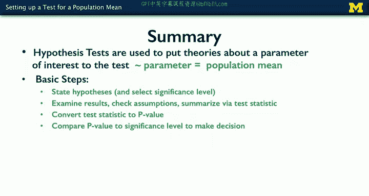

# 密歇根大学《使用Python的统计学（理解并可视化数据、因果推断、建模）｜Statistics with Python》中英字幕 - P55：21_基于置信度的单总体均值检验.zh_en - GPT中英字幕课程资源 - BV1dV411Q7j3

Yeah。

Welcome。In this lecture， we're going to continue our discussion about how to test theories about population parameters。

Now our parameter of interest is going to be a population mean because the response of interest is going to be quantitative。

We'll motivate an example by looking at our CAtwhe study data。We had 25 team members。

 all adults who were asked to perform a cartwhe。One of the variables of interest was cartwheel distance。

The distance that they were able to travel when they started the cartwel to when they completed it。

Perhaps we're designing an area where cartwheels will be performed and we want to make sure we're giving adequate space。

Reseer has a question of interest。Is the average cartwel distance in inches for adults more than 80？

So our population of interest is all adults。The parameter of interest is the population mean cart will distance。

And we'll denote that parameter with the Greek letter mu that just represents that's the mean of all cartw distances for all adults in our population。

We would like to perform a test regarding what the value of that population mean cartal distance might be。

One of the first steps then in performing our tests is to make sure we're defining the two theories。

 the two competing theories called the null and alternativetern hypothesis。

The null theory will be that the population mean cartal distance is indeed 80 inches。

And the alternative， the research's question of interest is that the mean for this population might be greater than 80 inches。

Now， sometimes we write these hypotheses in a little more compact notation。

The age just represents hypothesis or theory。H 0 or H null for that null theory and the alternative。

 which will be showing a particular direction， either looking for greater than less than or perhaps two sided。

 In this case， we're interested in knowing whether the average caral distance is more than 80 inches。

In the compact notation， we're using that Greek letter mu for our notation of that population mean。

 And we're making sure we're citing what that population mean is。

I'll also note that the equal is in that null theory。

We really could write these as the alternative being greater than 80。

 and that null hypothesis being less than or equal to 80 because that's really what we are testing。

But if we end up showing that our data supports that we're greater than 80。Well。

 that date is also going to support that we're much greater than 79 or 78 or anything smaller。

 So we really only have to be concerned with that 80 as our null value。

 Are we significantly more than 80 inches。Before we move on and look at the data。

 we also want to make sure we establish how much evidence do we require before we'll be convinced to go against that null and in favor of the alternative theory。

For that， we need to set our significance level for the test。The standard significance level is 5%。

Which is basically establishing that the results need to be so unusual under that null theory。

That we would see those results are more extreme， no more than 5% of the time。

So if the results are more extreme or more unusual than that 5 percent。

 we will reject that null and go with the alternative theory。

Step  two should be this start looking at our data， examine the results， check some assumptions。

 and then summarize our data through a statistic。So here's the numerical summaries of our 25 cartwhe distance measurements。

Of interest here is that the mean of our sample is 82。48 inches。Certainly。

 that looks to be more than 80。But our question will be， is it significantly more than 80？

We do know that that mean of 82。48 inches is our mean of our sample。

 and if we were to the study again with another 25 adults， we might get a slightly different answer。

So we have to establish whether that 82。48 is significantly larger than the 80 inches in our null theory。

Before we actually conduct the test， though we should also examine some of the assumptions。

The main assumptions for doing the test for a one sample， T test for a mean。

 is that the sample could be considered a random sample。

And then that the model for our population of all cartwhe distances can be seen to be bell shaped or normal。

Now， that normality condition is not quite as crucial if our sample size is large enough because we'll be able to rely on that central limit theorem。

But we should still graph our data and take a look at what it wants to say to us。

So here is a histogram。And a Q， Q plot of our 25 cartw distance measurements。

And both of these graphical summaries are showing some modest deviations from that bell curve or normality condition。

However， we do have 25 observations。 It's a reasonable sample size starting to be somewhat large enough。

So that we could say that CLT， that central limit theorem。

Is still going to allow us to have our sample mean。

The model for the sample means be approximately normal。

So that initial normality condition for the original population isn't quite so crucial。

So let's now take our data and summarize it in an appropriate way。

The basic statistic that we're going to look at is that sample mean it was 82。48 inches。

It is larger than 80 inches， but is it significantly greater than that hypothesized mean of 80 inches。

Two and a half inches， I that big or small？We know that if we were to do the study again。

 we would get different sample mean values out that even if the null hypothesis were true and the true mean was really 80 inches。

 we will tend to get sample means that vary around it。 sometimes above， sometimes below。

 So is this difference that we're seeing out here at 82。48 inches。Significant。

 or is it just a value that's reflecting that natural variability in a sample mean。

So to measure how far away sample means tend to be from that true mean。

 we would need to know the standard error of the sample mean。

That is reflecting the variability in those different estimates that could arise。

But there's a problem with that expression， since we do not know the population standard deviation Sigma for the original population of all measurements。

 for cartw distances， we're not going to be able to compute this actual yardstick or distance measure。

We will have to still use our data that we have， our sample of 25 observations。In that sample。

 we have a variety of different cartw distances， and we can measure the variability of our sample and use that sample。

 standard deviation S。In our standard error expression。So we will be able to use as our yardstick。

 an idea of how far away sample means tend to be from whatever that true mean is。

Our estimated standard error。So now we're ready to form that measurement that helps us decide how compatible is our data with the null theory。

We will look at our best estimate， our sample mean。

We'll compare it to the null value of 80 to see how far away it is from 80。

And we'll use in the denominator the yardstick that we can measure and get from our sample that estimated standard error。

We had 82。48 inches， as our sample mean。 It was a little less than 2 and a/ half inches above that 80。

 And with the right yards stick in the bottom that estimated standard air， this test statistic。

 this standardized quantity comes out to be 082。Think about how we might interpret that0。

82 as our test statistic value。Our test statistic， our T statistic turned out to be 0。82。

If we look at the structure of how that statistic was formed。

 it is looking at the distance on the top， how our sample mean compared to the hypothesized or nu value of 80。

In terms of estimated standard errors on the bottom。Our sample mean was above 80 inches。

 but it was only 0。82。Standard errors above， not even one estimated standard error above the hypothesisthesized value。

That's not that different from that，80 inches。Now， every test will have a test statistic。

 and since it's hard to keep all those distributions for our test statistics in line。

 we often convert our test statistics to a probability value that will measure whether this distance we're seeing here is unusual or not。

So step three is to determine if the null hypothesis were true。

Would a test statistic value of only 0。82 be unusual？

So unusual that we might want to reject the null and say that's not a reasonable theory。

 or is it still somewhat compatible with that theory。What is the probability？

Of seeing a test statistic like we got， 082 or something more extreme。

 if we really assume the null hypothesis is true。Well， for that。

 we need to know what model our test statistic follows。

And T test statistics end up following A T distribution。

With a certain degrees of freedom to index which distribution we're working with。

Tea distributions are still somewhat bell shaped。 They just have a little thicker tails than our normal distributions we were working with in the past for testing about proportions。

And the degrees of freedom indicate how thick those tails are。

The other thing to keep in mind is this idea of what is more extreme。

Since our theory was that we might be bigger than 80 inches， our direction was to the right。

 the more extreme will be measured as as large or larger in that upper tail。

So let's look at a picture of that P value。Here is a t distribution with 24 degrees of freedom。

 25 minus1。And along the axes， we have various test statistics values that are possible。

Our test statistic of 082 is noted， and we have shaded here the probability that represents this P value。

 How likely is it to get 0。82 or something more extreme。Larger。

Well that probability is actually pretty high， it's 0。21。Little more than 20 per cent the time。

 You would see the result we got or something more extreme if H not were really true。

It isn't that unusual。Seeing the results we got is actually quite likely under that null theory。

So we take this probability value that's now on a probability scale。

 and we make an evaluation of it to make our decision in the same way for all tests。

If our P value is big compared to our significance level。

 we do not have enough evidence to reject the null。We say we fail to reject that null theory。

If the P value turned out to be small， less than or equal to the significance level。

 saying that our data was more unusual than what we required it to be under H n to convince us to reject it。

 Well， then we'd reject H n。 But here are P values quite large。Our conclusion might be written that。

 based on our estimated sample mean of 82。48 inches。

 were not able to support the theory that the population mean cart will distance is greater than 80 inches。

Not enough evidence to reject the null in favor of that alternative theory。

We're going to tie this back into the other inference technique of confidence intervals。

Compet intervalables give us a range of reasonable values for our parameter。

So we're going to look at a confidence interval at the 90% level of confidence。

Cause if we had 90 per cent as our area in between， that is going to leave 5 per cent in each tail。

 total of 10。And we're doing a test of hypotheses with a 5% significance level in our upper tail。

So the appropriate multiplier to give us that 90% level of confidence。Will be used。

 and the conference interval turns out to go from 77。Two little over 87 inches。

This is a range of reasonable values for what we think the population mean might be。Now。

 our theory was that the population mean might be equal to 80 inches or is it significantly greater？

And even though our sample mean was greater than 80 inches。

When we extend and allow for the variability that sample means will have。

 we dip down below that 80 inches。The 80 inches is inside are comp interval of reasonable values for this population mean cart will distance。

 We cannot refute that 80 and support that it's significantly greater than 80 because the entire interval is not above the 80 inches。

And finally， a comment about our assumptions。 We noted that the cart will distance distribution seemed to be a bit skewed。

If we're not convinced that the normal models reasonable and were a little sceptical about our 25 observations being large enough。

 there are alternate techniques that we could use。 nonn parametric tests that don't assume normality。

One of those analogs for the one sample tea test we've performed is called the Wix Coxen signed rank test。

 which will use the median as its measure of center or location rather than the mean。

In performing that test， we would calculate a test statistic and we would get out another P value。

And use that to make the decision in the same way we have in the past。

The Wacoxin rank signed rank test result would give a P value much bigger than 0。05 also。

We would fail to reject the null hypothesis in this case。

 that the median cart will distance is 80 inches。 We could not go in favor of that alternative。

 that it's greater than 80。So the conclusion that we've made is robust to potential violations of that normal condition。

We might summarize then that our population of interest for all adults。

 regardless of the assumptions that are made and which inference approach we might use the confidence interval or the hypothesis test。

We do not have sufficient evidence to support that the population mean cartal distance is more than 80 inches。

In summary， then we have conducted a hypothesis test。

 we've put some theories to the test about our parameter of interest。

 here the parameter was a population mean response。

Basic components of hypothesis test is to make sure you state those theories and select that desired level of significance you're going to be using up front。

Then start looking at your data， examine the results。Use them to check certain assumptions。

And summarize your data into a test statistic。Something that measures how compatible is your data with the null theory。

To see if you're compatible with that inol theory or unusual。

We'll convert that test statistic value to an actual probability value that allows us to make our decision more efficiently。

 comparing that P value to our significance level。

In order to make that judgment。 and if the P value is small。

 less than or equal to our significance level， we reject the theory。

 We had very unusual results under the null leading us to reject that theory。

If that P value is larger than the significance level， as we saw in our example。

 we were not able to reject that null。 We failed to reject that null theory。

 not enough support for that alternative。There are assumptions for every test that we do in in our one sample T test for a population mean two basic ones。

 That is， how did you gather your data， Can you consider that being representative of your larger population of interest in a simple random sample。

And was that population of interest with all those responses。Normally， distributed。 bell curve。

If your sample size coming from that population that you take out is large enough。

 you might be able to call out that central limit theorem to help you out and not worry about that second assumption quite as much。

And finally， important to be able to take the results of our test and be able to interpret them。

 Do we understand what a P value is measuring， can we use it to form a decision and write out an appropriate conclusion about the parameter of interest with some context。

