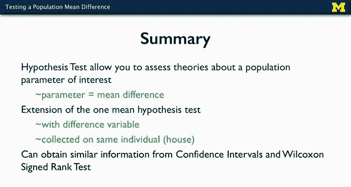

# 密歇根大学《使用Python的统计学（理解并可视化数据、因果推断、建模）｜Statistics with Python》中英字幕 - P56：22_总体均值差异检验.zh_en - GPT中英字幕课程资源 - BV1dV411Q7j3

In this video， we'll be talking about testing a population mean difference。

 so looking at paired data。To start with， we'll be looking at home renovations。

 we have 20 homes that are remodeling their kitchens and requesting cabinet quotes from two suppliers。

We're interested in knowing， is there an average difference in cabinet quotes from these two suppliers？

So I'll let you think about we are in the paired data section。In what way are these quotes paired。

 or in what way is our data paired？In this case， because we have two measurements taken for each home。

 we have two measurements on the same individual， so we're paired or matched based on the individual。

 based on the homes。And we want to see if there is an average difference in cabinet quotes from these two suppliers。

So we'll be looking at our variable of difference in cabinet quotes Now in this case。

 we've defined this as supplier A less supplier B， or supplier A quote minus supplier B quote。

And our research question again is is there an average difference between the cabinet quotes from the two suppliers。

 so in essence， is our difference is the mean difference zero or not zero？In in this case。

 our population will be all houses。And our peri of interest will be that population mean difference of cabinet quotes mu sub D。

 and remember that D subscript indicates that we are looking at the difference。And again。

 that difference we've defined as supplier A minus supplier B。

 we always need to specify what way we're calculating a difference。

And now we'll go ahead and test for a significant mean difference in cabinet quotes at the 5% significance level。

 so we've specified the alpha that we'd like to use。Our hypothesisses here。

 our null hypothesis is our mu sub D equals0， we're testing to see if there is an average difference between these two suppliers。

Now what about the alternative hypothesis， what should be the symbol that we use for mu sub D。

 is it greater than less than or does not equal zero？In this case， we're looking at does not equal 0。

 we don't have a clear indication of which supplier we expect to be more expensive or less expensive。

 so we're just looking to see is there any difference， is the mean different from0。

 not necessarily looking for a specific side。And again， we specified our alpha in the setup。

 we're looking at a 5% significance level， so our alpha equals 0。05。

Let's get a quick look at what that data look like。

We have values for supplier A and supplier B for each house。

 and we can also calculate that difference， so for that first line。

 we see that there's a $55 difference that supplier A is $55 more expensive than supplier B。

We can look at all of these difference values and look at the sign on them that sign indicates which supplier is more or less expensive now it looks like in almost all cases。

 supplier A is less expensive， except for in that fifth row where we see a difference of negative $6。

And keep in mind that because we're looking at paired data。

 we are really going to be looking at that difference variable。

 that's what we'll use to calculate all of our sample statistics in order to test that population mean difference。

So really quickly， one way that you can look at this data is to look at the a scatterpl of supplier A quotes versus supplier B quotes we can see that they are quite correlated。

 so it seems like there is some correlation between the house and the quote that supplierli A and supplier B are providing。

From this， it's hard to tell which one is more expensive， but that's what we'll do the test for。

Now for our assumptions before we perform the test。

 we need to assume that we have a random sample of differences， I。e。

 a random sample of houses that we're looking at now we are looking at those differences within those houses。

 but having a random sample of houses should also indicate that we have a random sample of differences in those two cabinet quotes。

We also need to have the population of differences be normally distributed。

So we'd like the population of differences to be normally distributed。

 we can get the assumption if we have a large sample size。

 about 25 or more in this case we only have 20 observations。

 so we'll look to see if it seems reasonable that the population of differences is normally distributed。

We can look at a normal Q， Q flat。Typically， you would hope to see that all of our points fall along a straight line。

In this case， the line wouldn't be perfectly straight that connects all of these points。But。

 in general。The line should be relatively straight。

And given that we have 20 observations that's close to that 25。

 plus our points fall roughly along that straight line， this is a reasonable assumption。

 we can go ahead and assume that we have the population of differences normally distributed。

So now let's get a quick look at what our data look like。

We can look at this histogram of the differences in cabinet quotes。

 keeping in mind that because we have paired data， we're always looking at that difference variable。

We see that it does look roughly bell shaped， it's not perfectly bell shaped。

 but does look roughly bell shaped。We can also summarize this， we have 20 observations。

We see that the minimum difference is negative $30。

 indicating that supplier A is $30 less expensive in one of our houses。

 and the maximum difference is $90， indicating that at the maximum supplier A is $90 more expensive than supplier B。

We also can see that the median is $13。50， our mean is $17。30。

 and our standard deviation is $28 and roughly 50。Using all of the summary statistics。

 we can go ahead and perform the test for the population mean difference。So to start with。

 we'll think about calculating a test statistic。If we assume that the sampling distribution of the sample mean difference is normal。

 then we can use that T test statistic being the best estimate minus our hypothesized estimate。

 and divided by the estimated standard error of that estimate。So in this case， we'll be using a T。

Equals the sample mean difference。So x bar sub d mine is our hypothesized estimate of 0。

 We found that in the null hypothesis of mu sub d equals 0。

And divided by our estimated standard deviation S subD。

For the differences and dividing by the square root event。We can go ahead and plug in。

All of the important information that we have from those summary statistics。

 so 20 observations are mean of $17。30 and our standard deviation of roughly $28。50。

And go ahead and perform that calculation， we end up with our T equals to 2。72。

Now think back to how you interpret a test statistic。

This means that our observed mean difference is 2。72 estimated standard errors above our null value of0。

 or our hypothesized value of0。This is quite high。But in order to tell exactly how high that is。

 we need to look at what the P value is。Because we have a T test statistic。

 we know that it'll follow a T distribution， and in this case it'll have 19 degrees of freedom。

 we have 20 observations， we take 20 minus1 to be 19， and that's how we get the 19。

Now to get the distribution for the P value， we'll go ahead and draw a t distribution。

 it looks very similar to that normal distribution。

 it just has slightly heavier tails because we have used that estimated standard deviation rather than using a true population standard deviation。

And here I'll go ahead and add。Some values to my X axis。And now we know our T test statistic。Is 2。72。

To get our P value， using our alternative of mu sub D does not equal to zero。

 what area should we shade？Should we shade the area to the right of the 2。72 to the left of 2。72？😊。

Or that two sided the both of the sides from 2。72 and above and negative 2。72 and below。In this case。

 because of alternative hypothesis。Is mus of D does not equal zero。

A3 is just as extreme as a negative3， it's just as far away from zero， and so we'll shade both sides。

We'll show the area。Above that 2。72 and the area below the negative 2。72。

Now you can go ahead with technology or with a table to look and calculate what that area is that we've just shaded。

 this will be our P value。In this case， our P value is going to be 0。014。

That means that we would observe a test statistic as extreme or more extreme， only about 1。

4% of the time， so it's pretty unlikely that we get a test statistic that large。

Now using our P value of 0。014， we should compare that to our alpha or significance level of 。05。

We see that 。014 is less than 0。05。So that indicates that we should reject the null hypothesis。

 we have enough evidence against the null hypothesis that we can reject it。😊，In other words。

 we have evidence against the null hypothesis that the mean difference in cabinet quotes is equal to zero。

Formerally， based on our sample and our P value， we reject the all hypothesis and conclude that the mean difference of cabinet quote prices for supplier A。

 less supplier B is significantly different from zero。Now。

 if we wanted to get a sense of in what way it's different from zero。

 we might look at a 95% confidence interval。If you think back to last week。

The formula for the confidence interval is x bar sub D。

 the sample mean difference plus or minus t star。Times S sub d。

 the sample standard deviation for the differences divided by the square root of n。

We can go ahead and plug in the values for our mean standard deviation and anT star that we've calculated to be 2。

093 based on that n equals 20。😊，And we find that our confidence interval goes from $3。97。

 roughly $4 to $30。63， roughly $30。50。And here we find that zero is not in our range of reasonable values for the mean difference in cabinet prices。

In this case， because all of our values are positive。

 that also indicates that supplier A is probably more expensive than supplier B。

But because zero is not in that range of reasonable values。

 that indicates that the mean difference is reasonably not going to be zero。Now。

 if normality didn't hold that assumption of normality that the population of all differences is normal。

 we can use the bullcoxin sign rank test。I'm not going to go into details into the process。

 know that instead of testing for the mean， it's testing to see if the median is different from zero。

And in this case， I've used technology to tell me that the P value is equal to 0。02。In this case。

 again， we're going to reject the null hypothesis。And we'll conclude that the median difference in cabinet quotes。

 supplierli A less supplier B is different from zero。

So this is the same general conclusion that we had from before。

 we found that the mean difference is different from zero。

 and in this case we're finding that the median difference is different from zero。😊，But again。

 those two conclusions are very similar。We're finding the same general conclusion in both of these cases。

So to summarize， a hypothesis test allows you to assess theories about a population parameter of interest。

In our case， we're looking at paired data， and so our parameter of interest will be that mean difference。

 New subD。This is an extension of the one mean hypothesis test。In this case， though。

 we're using that difference variable， so from the two variables that we've collected。

 we've actually calculated a difference variable rather than using the variables that we've collected from the sample。

😊，And in this case， our variables were collected on the same individual。

 so our difference is a within house difference from that same individual。

And we've seen that we can obtain similar information and similar conclusions using those confidence intervals and the Wilcoxine sign R test to support our conclusions from the hypothesis test。

