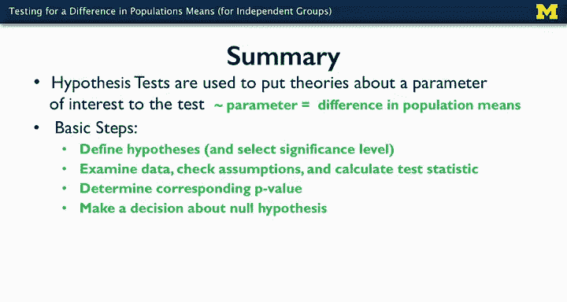

# 密歇根大学《使用Python的统计学（理解并可视化数据、因果推断、建模）｜Statistics with Python》中英字幕 - P57：23_独立组别总体均值差异检验.zh_en - GPT中英字幕课程资源 - BV1dV411Q7j3

Yeah。

Hello and welcome back Today we're going to learn how to run a hypothesis test for a difference in population means we've already seen how to do that for a single population mean and a single population proportion now we're going to compare to independent groups and see if there's a significant difference between the two。

So let's start out with a research question， and this is the same one we saw in a previous lecture working on the confidence interval for this problem。

Considering Mexican American adults ages 18 to 29， living in the United States。

 do males have a significantly higher mean body mass index than females？

Our population of interest here is specifically Mexican American adults aged 18 to 29。

 living in the United States， and our two individual populations from this overarching population will be the male and female subgroup。

Our parameter of interest here is body mass index or BMI。

 and that's measured in kilograms per meter squared。

 It's a means of quantifying tissue mass in order to classify an individual as underweight。

 at weight or overweight。The notation we'll use for this is mu 1 minus mu 2。

The task we're going to perform today is an independent samples T test regarding the value for the difference in mean BMI between males and females。

 we're going to actually see if we have a significant difference between these two populations。

The steps to perform a hypothesis test are as follows。 First。

 we're going to define the null and alternative hypotheses。

 Then we're going to go through examine our data， check our assumptions and make sure those hold。

 and then finally calculate a test statistic for our data。With that test statistic。

 we're going to determine the corresponding P value and we'll talk more about that in the future slides and finally make a decision based off this P value about our null hypothesis。

So let's jump into step one， defining the hypotheses。Here。

 our null is going to be that there is no difference in mean BMI between the populations of males and females for Mexican American adults living in the United States。

 ages 18 to 29。Our alternative is going to be that there is some significant difference in mean BMI。

 So our null here， as we run this hypothesis test， we're going to assume the null is true until we can provide enough statistical evidence towards our alternative hypothesis here。

Shorthand way of writing these two statements is with mu 1 and mu 2。 Again。

 mu 1 here represents the population mean BMI for males。

 and mu 2 represents the population mean BMI for females。

Our null is that they're equal to each other， and our alternative is that they are not equal to each other。

Another common way of writing this is that the difference in these means is equal to0 and the differences in the means is not equal to0。

For the test today， we will use a significance level of 5%。

So step  two we're going to examine the data and again。

 here we filtered the data to only include race of Mexican Americans and only include adults that are aged between 18 to 29。

 As mentioned previously， NHANs codes gender as male for one and female for two。

So if we look at some summary statistics， we have our mean standard deviation。

 minimum and maximum values， and also our sample sizes for both the male and female groups。

 we've got box plots of both distributions on the right just to give us a good idea of the overall quartiles and layout of these distributions。

What we're really interested in here is testing if these two means are significantly different or not。

Just looking at them， there's a difference of 0。74。

 but we're going to see if this is big enough to be a significant difference or not。

So now we have to move on and check our assumptions， some of the assumptions that we need to check。

 first， we need to make sure that samples are considered simple random samples。

 and for the purpose of this example， we're going to assume just that there are more complex sampling designs out there。

 but again， here we're just going to assume that they're simple random samples。

We need to make sure that the samples are independent from one another。

 we need to make sure that that those datas for males and females aren't matched up specifically or can't be paired in any way。

 and here all we've done is split the data based on gender so we have no reason to believe that they're dependent。

Finally， we need to make sure that both populations of responses are approximately normal。

 so let's check that now with our data。On the left side。

 we have our histograms for both male and female and on the right side。

 we have our Q Q plots or quantntile quantntile plots for males and females。 The graph on the left。

 we want to look kind of bell shaped to represent a normal distribution。 and the graphs on the right。

 We really want the data points to follow that line running down the middle。

 That line represents a normal distribution。 So the closer those data points are the more normal our distribution appears here we can see that there are there is quite a bit of deviation for the female group。

 especially in that bottom right plot。A little bit less so for the male group in the Q Q plot。

 So it's a little bit closer to normal。But we do have very large sample sizes for both these groups over 200。

 so this normality assumption isn't as crucial。 we can apply the central limit theorem and move on anyways。

 also when running a hypothesis test for two means。

The results are fairly robust if you have this large sample size。

 so we're going to go ahead and move forward without this normality assumption。Okay。

 so now we're going to calculate the test statistic。 We've got an alternative hypothesis created。

 and we're going to get our test statistic from our data。

 The best estimate at this sample mean difference is 0。74。

 and we want to know is our sample mean difference of 0。

74 significantly different than our hypothesized value of 0 The way we can do that is with a test statistic。

So what is a test statistic， It's a measure of how far our sample statistic is from our hypothesized population parameter in terms of estimated standard errors。

 So we're going to use that estimated standard errors value to get a measurement for how far away our sample statistic is。

 And this is going to be done entirely assuming that the null is true。 again。

 until we have enough evidence against it， we're going to assume that there is no difference in the mean BmiI values。

 And the further away the sample statistic gets， the less confident we'll get about that null hypothesisthesized value。

 and we might start to believe it's something different。So the actual calculation。

 we're going to take our best estimate， we're going to subtract our hypothesized null value and divide by our estimated standard error。

And remember that estimated standard error for two means can change depending on which approach we're going to use。

The two approaches that you can use are the pooled approach and the unpooled approach。

 The pooled approach can be used if the variances of the two populations are assumed to be equal。

With that， we'll look at our sample data to see if we can make this assumption。

 The unpolled approach will be used if we can't make this assumption and we drop it。

So the pool approach what the test statistic will look like。

 we've got our best estimate up in the top left。 We've got our hypothesized value of 0。

 and then we've got our estimated standard error below。 and since we're pooling the data。

 we're going to use that pooled standard deviation denoted by SP or written out in full。

 we have our final equation for the test statistic。For the unpooled approach。

 we don't have that pooled standard deviation， so we've got a slightly different estimated standard error for our denominator。

The numerator is gonna stay the exact same as the bold approach。

So now let's decide whether we're going to use this pooled method or the unpooled method。

 If we look at the standard deviations， they're both very similar。

 They're only a02 off or so we can also examine the box plots to see if the spread of the data is the same。

 And if we look specifically at the IQR that middle 50% of the data。

 those both appear very similar in height。 So we're going to go ahead and say that these are similar enough where we can use the pooled approach and assume that those population variances are equal between males and females。

So let's start plugging in our values。 It's kind of a little bit of work。

 but it's just plugging and chugging。And we'll find out that our test statistic value turns out to be about 1。

30。 So what does this 1。30 really tell us， It tells us that our difference in sample means is only 1。

30 estimated standard errors above our null difference of 0 kg per meter squared。

But now we want to know is this far enough where we should reject our null value of 0， or is it not？

So if the null hypothesis was actually true， if those population means war 0。

 would a test statistic of 1。30 be unusual enough to reject the null。 And with that。

 we're going to calculate our P value。 And what is our P value。

 It's the probability of observing a test statistic of 1。3 or more extreme。 And here。

 all of this is going to be done again， assuming that that null hypothesis is true and that those population means are actually equal。

So we're going to。Calculate this probability using a t distribution where the degrees of freedom for this distribution are N1 plus N2 minus2。

And when we draw this out we're going to have to check both sides。

 this is a two sided alternative hypothesis because our alternative is not equal to。

 so we have to check both the upper and lower tail of our distribution。

This is what the distribution would look like with its corresponding sample size and the degrees of freedom of 495。

We see that we shade both above our positive test statistic value and below the negative test statistic value。

We get a final P value as seen in the top right corner of 0。1942。So what does this mean。

 so this means that if the difference in population mean BMI between males and females was really zero。

 so if that null hypothesis was true。Then observing a difference in sample means of 0。

74 or something more extreme is fairly likely。 There's almost a 20% chance of seeing that。

So because this value is so large， we're going to go ahead and fail to reject the null。

 it's larger than our significance level， so there's very weak evidence against this null hypothesis that the means are actually equal。

So what's our decision based on this P value， we said we fail to reject the null。

 so our final conclusion is that based on our estimated difference in sample means。

 we cannot support that there is a significant difference between the population mean BMI for males and the population mean BMI for females。

 for a given population here， which is Mexicanam American adults living in the United States。

 ages 18 to 29。If we think back to a prior lecture where we created the confidence interval for these results for this data。

We see that our 95% confidence in it was negative 0。385 to positive 1。865。

Our null hypothesisthesized test value was 0 kg per meter squared。

 and that falls within our interval。 Remember that this interval is a range of reasonable values for that true population indiffer。

 So because0 is contained in our interval， it seems like it could be a reasonable value。

 and we find that our confidence intervals agree with our hypothesis test results。So in summary。

 hypothesis tests are used to put theories about a parameter of interest to the test here that parameter is the difference in population means。

The basic steps for performing this hypothesis test， first we're going to define our hypotheses。

 then we're going to examine our data while checking our assumptions and calculating our test statistic。

With this test statistic， we'll determine our corresponding P value。

 and then finally we'll make a decision based on this value。

The assumptions for the two sample T test for population means。

 are that we need both sets of data to be two simple random samples。

 and they need to be independent from one another。We need to make sure that both populations of responses are normally distributed。

 and if not， we need to make sure we at least have a large sample size so we can apply the central limit theorem。

Whether or not our population variances are equal is also crucial in determining whether we use a pooled or unpooled approach。

And finally， we need to know how to interpret the P value， the decision， and our final conclusion。

 these are all very important when conducting a hypothesis test。

