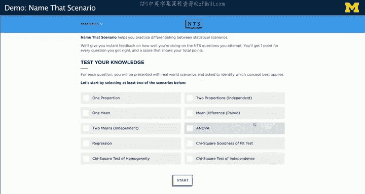

# 密歇根大学《使用Python的统计学（理解并可视化数据、因果推断、建模）｜Statistics with Python》中英字幕 - P58：24_情景识别演示.zh_en - GPT中英字幕课程资源 - BV1dV411Q7j3

Hi， my name is Laurarens and I'm a PhD student here at the University of Michigan today I'm going to give you a short demo on how to use name that scenario。

Name that scenario as an open access website that allows you to practice your skills differentiating between statistical scenarios。

 you can access it on the coursees Supplementary Material page。

This is the front page that you'll get to when you get there。

 go ahead and enter your email address and a password。

 and then you'll be asked to give a name for your account as well。We're going to use mine today。

So go ahead and click on statistics， the only possible option。

And you'll see a bunch of different statistical scenarios。

 so you'll need to choose at least two because you can choose as many as you want I'm going to go ahead and choose the one proportion and two proportion。

😊，So on each round you're going to be given 10 questions and it'll keep track of your points overall。

 let's do these first couple together。A new seaTs layout is being considered。

 a survey is posted on the webp page for sea toolsols asking if users want a new layout if at least 40% of respondents want a new layout。

 the development team will implement the changes， so this one proportion or two proportions。

I'm thinking it's only one proportion because we're only considering one thing。Great， got it right。

 You can see on the bottom here that regardless if you get it correct or not。

 you're going to be given the explanation so you can check your reasoning。😊。

We'll do one more together。A university has two campuses。

 they want to know whether students are more likely to participate in student organizations on one campus versus the other。

😊，They took random samples of undergraduates from each campus and asked if they were involved in student organizations。

So because this is asking about two different campuses。

 I'm going to go ahead and think this is two proportions。Great， got it right again。

I'm not going to make you deiate other questions with me because you got to practice on your own。

 but we are going to kind of skip through and randomly pick them into the end so I can show you some of the summary statistics that you'll get。

For every round of 10 questions， these questions are drawn from a bank without replacement。

 so you'll never get any repeats in one single round。Okay， now that we finished。

 you can see that we have a session summary so out of our what。😊。

Four questions on one proportions I got half right， which sounds about right。

 considering I guess on most of them。But I did pretty well for the two proportions I got five out of six correct and you can see that in total I got seven out of 10 correct questions on the round with seven points for the round total and if you keep using this website it will keep track of all of your points that I've gotten。

😊，Once you're done， you'll go back to the main setup and you can choose any other scenarios to differentiate between now you're all set to try it out yourself。

