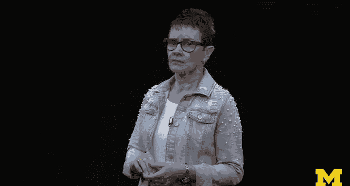
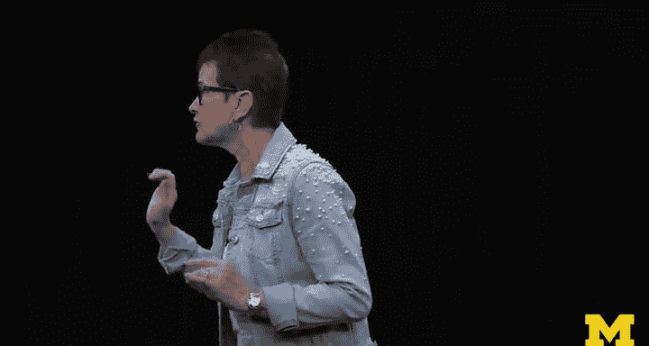

# 密歇根大学《使用Python的统计学（理解并可视化数据、因果推断、建模）｜Statistics with Python》中英字幕 - P59：25_巧克力与骑行实践任务.zh_en - GPT中英字幕课程资源 - BV1dV411Q7j3

嗯。Our next assignment is a great opportunity to put some of the statistical inference concepts into practice。

We'll do this by reading and communicating the results of a published study。

You've been hired by the U。S cycling team。To help them train for an upcoming race。

 the head trainer read an article on the effects of consuming dark and white chocolate on a number of different outcome variables during cycling。

The trainer was specifically interested in how regular consumption of chocolate affects the total distance covered during an all out sprint。

And if the type of chocolate consumed， dark versus white matters。

We'll provide a summary of some of the results， which will include some confidence interval estimates and some P values。

The trainer knows you have statistics background and wants your help on understanding and interpreting these results。

You're asked to write a memo to the trainer addressing his questions。

You will not be asked to recompute or verify the results， so no detailed formulas or computations。

 instead you will focus on interpreting the results。Finally。

You'll include the recommendation for or against， including chocolate into a cyclist diet。

You'll find the results。A reference to the original study。

And more specific instructions within the assignment itself。

Now the greatest value of this assignment comes after you submit your memo。

 you'll have the awesome experience of reviewing several of your peers work。

You'll see how they addressed and explain certain results well and others perhaps not as well。

We've seen that learners who receive thoughtful feedback are able to more accurately reassess their own understanding。

So give the kind of comments you want to get。Provide thoughtful and helpful feedback that is courteous and professional。

Thanks for listening to this overview。And enjoy your chocolate and cycling peer review experience。

Remember， you're not supposed to eat the chocolate while riding the bike， be careful。

