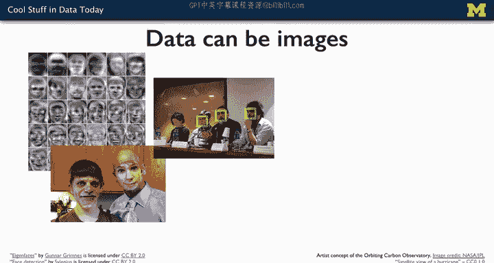
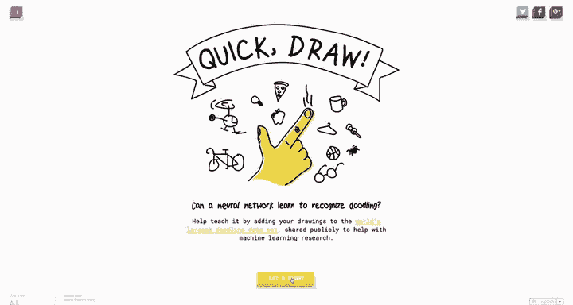
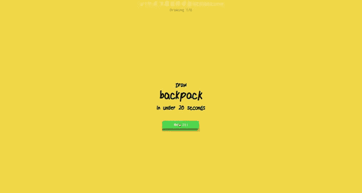
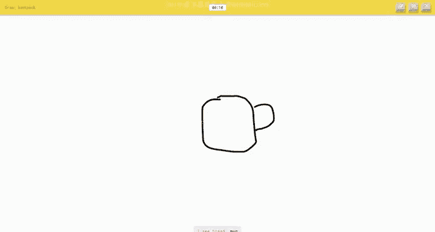
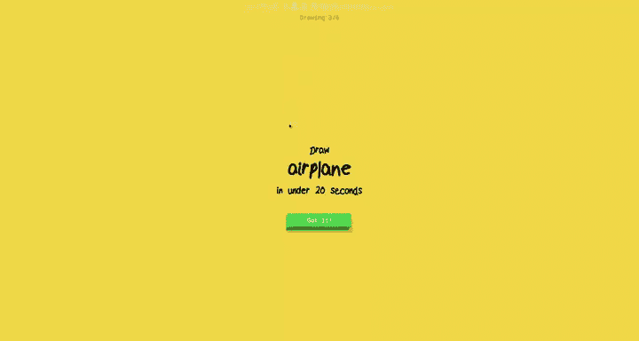
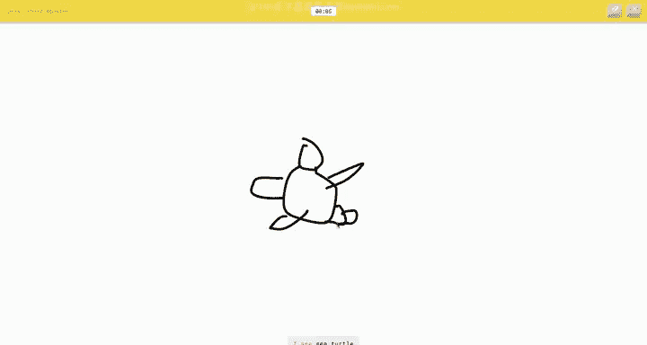
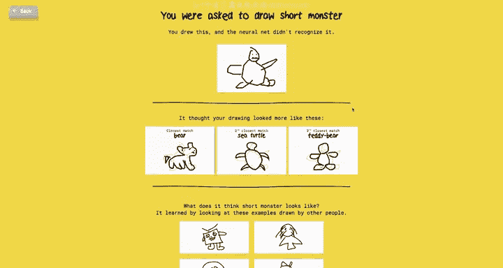
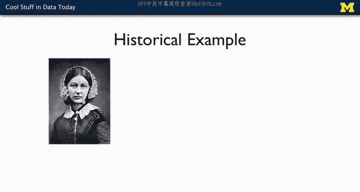

# 密歇根大学《使用Python的统计学（理解并可视化数据、因果推断、建模）｜Statistics with Python》中英字幕 - P5：4_数据中的精彩发现.zh_en - GPT中英字幕课程资源 - BV1dV411Q7j3

嗯。Hi， I'm Julie Dekey， I am a PhD candidate in the statistics department at the University of Michigan。

 my research is primarily on applications to single cellll RNA sequencing data。

 so figuring out ways to tease out batch effects and other things like that and one of the things that first drew me to statistics is that you can tell stories from numbers and extract all sorts of information from these numbers that can be quite complex at the offset。

Today we'll be talking about cool stuff and data， but data can be anything。

So first data can be numbers this is what oftentimes people will think about when they think of data you'll think about a spreadsheet or something like that one data set that we'll be using throughout this course is the national health and nutrition examination survey or NHAS this is collected by the Center for Disease Control and you might think of data as the spreadsheet that comes from this data so you'll think of a form that has a lot of numbers in it。

 for example， a lot of these variables are a little hard to understand。

 but the third one stands for gender and has numbers representing whether the person is female or male。

Beyond data as numbers， data can also be images。One thing that can be done is if you have a lot of faces。

 there's this idea called eigenfaces and this represents your faces in numbers and so researchers can look at the faces in an image and represent them in numbers and do a lot of really neat things with them。

 for example， in Snapchat， there's the idea of face swapping and these eigenfaces are really helpful in identifying where faces are and changing where those faces are on specific people。

There's also facial recognition， so there are things within a lot of smartphones when you're taking pictures。

 they'll put boxes around faces so that you can identify where the faces are to make sure they have the right level of accuracy and resolution in the picture。

 there's also things in Facebook， for example， where when you upload pictures。

 you can use facial recognition software to tag the people who are in those images。😊。

Beyond that， we can use satellite images for a lot of different things。For example。

 we can try to estimate where coastline is or how much forest there is in a specific area of land。

We can also track storm systems， there are things where we can track both the storm systems as they're progressing。

 and then also look back to see how much damage a storm system has caused。

One quick thing that I'll show you is this quick draw with Google。

 I'll give you a chance to watch me do this and then I'll let you practice this on your own。

So with quick draw， we're trying to draw a doodle that can be recognized。

 so first I'll be drawing a backpack。

And as I draw， the system will try to recognize what it is。

And now it's seen that I've done a backpack。

You can watch it on the bottom of the screen to see what the system is seeing。And here。

As I add more parts to it， it can figure out that I have an airplane。

Now I'm supposed to draw a short monster。I'm not quite sure what that is。

So you can see here that after all of these attempts。

 I was able to recognize the first three drawings that I had but that couldn't recognize the last three。

 and if I want to figure out how others drew a short monster correctly。

 I can see that they drew short monsters that mine looked closest to a bear。

 a sea turtle or a teddy bear， but you can tell that。

Look at what the neural net understood from your drawing and go from there。

Returning back to the idea of what other forms data can take， data can also be words。

There is this idea of looking at the entire text of Harry Potter and estimating what a sample chapter might be for example。

 Bonik did this recently and they generated Harry Potter in the portrait of what looked like a large pile of ash what they did is they went through the entire text of all seven Harry Potter books and used various algorithms and predictive text forms to generate a new chapter in Harry Potter it's a really cool read if you like Harry Potter so something you should definitely check out but it gives a sense of what you can do with this data that's contained within words。

In addition to that， there's this idea of electronic health records。

 there are a lot of words in your health records， but they do contain a lot of different data about you。

 they also you can match your health records between different locations based on name and other identifying characteristics。

 and so this allows somebody to get a really good sense of your entire health history from different locations of your health records。

Beyond that， there's the idea of document classification and so one thing that can be done is if you look through an entire document and you're trying to classify。

 for example， where it belongs in a newspaper， you could look through that document。

 look at the words that are used， and estimate whether it belongs in the business， the sports。

 or the local section based on the words that are used。Similarly。

 all of our words have all of these meanings and embeddings contained within them。

 so they have different connotations as you read the words and these can be used in a lot of different ways。

 there's also this idea of debiasing these word embeddings in papers like Manist to computer programmer as womenist to Homemaker we want to try to make those word embeddings potentially debiased if there are some biases located in them。

😊，Finally， data can be audio， so you can think of all of the sound that you're creating as various data formats。

 some of the things that can be done if you've heard a song on the radio and you want to know what it is。

 Shazam and other applications on very smartphones as well as the internet can identify where that sound is coming from and place that audio。

 typically giving you the song title and artist。You can also use various Adobe suiteite applications to do some voice editing this will allow you to change up how your voice sounds and also to relocate various aspects of your voice and finally there are some applications recently that have worked on voice replication the idea here is that if you have a clip of a person saying something like 50 words。

 maybe a little bit more than that， you can do some edits and create a voice that sounds like the person saying everything that they need to say and so you can have this theoretical person saying all sorts of clips and changing their voice around so it sounds like somebody is saying something when they're not。

Finally we'll conclude with a historical example many people know Florence Nightingale as the founder of nursing。

 she was a nurse in the Crian War， one of the things that a lot of people don't realize is that she also is one of the big founders of statistics so when she was going through and doing her nursing。

 she really advocated for collecting a lot of information on the patients as well as understanding what all of this data has contained within it one of the things that Florence Nightingale did is that she systematically recorded information about each of the soldier patients that she had。

She looked at then a coxcomb graph is what she called it。

 it's really the foundation for a lot of the graphs that we use currently， whether it's time series。

 box plots or pie charts， and she looked at the causes of mortalityities in the Army。

 looking at causes including preventable deaths from diseases。

 deaths that occurred from wounds and overall mortality and comparing how these mortality rates changed both over time and how these different death rates changed based on the season。

Based on this， we can see that there are a lot of really cool applications for data today and that data really is everywhere around you。

