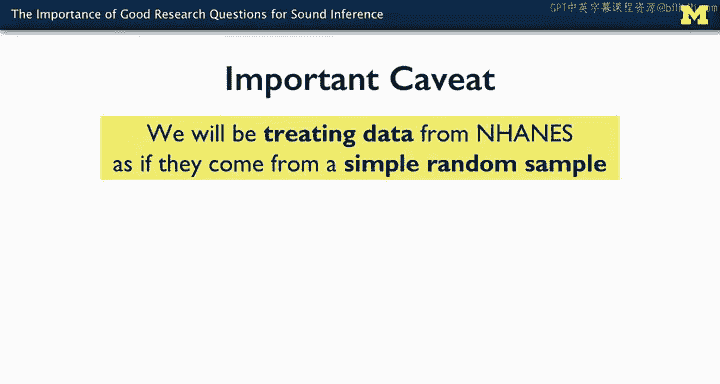

# 密歇根大学《使用Python的统计学（理解并可视化数据、因果推断、建模）｜Statistics with Python》中英字幕 - P60：26_优质研究问题对可靠推断的重要性.zh_en - GPT中英字幕课程资源 - BV1dV411Q7j3

嗯。

Okay， so right now we're going to talk about the importance of defining good research questions for making sound inference。

 so the overall idea here is that if we want to start applying statistical procedures to data。

 we have to have a good idea of what question we're answering in the first place。

 so we're going to talk about some examples and then moving forward。

 we're always going to refer back to a research question when we go through these different examples Okay。

 so we're going to review the importance of well- formulated research questions for quality statistical inference。

We're going to look at examples of different inferential approaches using the NHANS data to address explicit research questions。

 so like I mentioned we're always going to look back and say okay。

 exactly what research question are we trying to answer？And in these different examples。

 the examples will be supplemented with working Python code so you can go through run the code。

 replicate the analysis results and follow along with the different inferential examples。

 but we always want to make sure that we're answering a good well formulated research question when we perform a statistical analysis okay so a little bit about good research questions well we know data are everywhere these days。

 big data， small data sets， design studies， process data it's really easy to find a data set and electronic version of a data set import it into some statistical software and run some analyses。

 we can get data very easily from many different sources， or again we could design studies。

 design survey samples and collect data from populations。But wherever we get the data from。

 inferences based on those analyses， they're going to tend to miss the mark if we don't have a well formulated research question underlying the study that we're trying to perform。

 so we have to ask the question what really defines a good research question？

So some key aspects to think about when we're defining a research question。

 first of all what is the target population of interest。

 it's a really good idea to write down a very clear and concise statement of what the target population of interest is and then make that clear when you're writing your research question。

Second is the research question descriptive or analytic now what's the difference between those so a descriptive question we might be interested in the mean income in a specific population。

 so we're interested in estimating a descriptive parameter。

 the average income for that population or we might be interested in more of an analytic question analytic questions generally referred to the relationship between different variables。

 so for example， we might be interested in the relationship between income and quality of life in a specific population。

 so not just estimating a mean or a total or a standard deviation but rather quantifying the relationship between two variables。

 those types of questions are generally referred to as analytic。Third。

 has the question been asked before and will the new study add knowledge that didn't exist before。

 so many studies build on prior studies that may have been asking similar questions。

 but we need to make it clear whether the question has ever been asked before and what exactly the new study is going to be adding to the knowledge that we already have about this particular topic。

And then fourth， are the variables readily available measured appropriately or feasible to measure using well establishedablished tools so we need to make sure that it's going to be possible to actually collect the data that we're interested in are we using appropriate measures for what exactly it is that we're trying to measure we're going to talk a little bit more about that with different examples but we need to make sure that the variables that we're interested in we're interested in are readily available and straightforward to measure and we need to make sure that what we're measuring is actually capturing the concepts that we have in mind that we wanted to measure okay so good research questions we think about these four properties that we just discuss and if we craft the research question following those four essential properties or aspects that we just went over and we use an appropriate statistical procedure that's well aligned with that research question given the four properties we can make very good inferences related to that question but we need to make sure all five of these things go together。

The four key aspects that we just talked about and choosing an appropriate statistical procedure。

 that will lead to good inferences。The absence of a good research question and just blindly running analyses。

 we bring a data set into some software and just start running different analyses。

 generating different results， writing up those results。

 if we do all this and the absence of a good research question。

 this could very easily lead to poor insights and incorrect decisions。

 we need to make sure that the analyses that we're running are well aligned with a carefully crafted research question that will maximize the quality of the inferences that we make。

So here's a bad question what is the relationship between academic performance and summer internship success。

 so sounds straightforward on the surface， we're interested in an analytic question。

 what's the relationship between these two variables， one called academic performance。

 one called summer internship success， but let's break this question down a little bit more detail。

First of all， what's the target population， well， we have no idea。

What population is the author of this question talking about。

 we really have no idea the way the question stated。Second of all。

 is the question descriptive or analytic， well we see that the author is interested in the relationship between performance and success。

 so this would be framed as an analytic question， that's good because it's making clear what type of analysis the author wishes to perform。

Third， while answering the question provide new knowledge again， we have no idea。

 the question just states that we want to look at the relationship between performance and success。

 it doesn't say whether it's adding on to any existing knowledge。Number four。

 how are performance and success even measured Well again。

 we have no idea what measure of academic performance does the author have in mind is it GP is it final exam performance I it class attendance I it being able to make adequate progress towards a major we really have no idea what about success what defines the success of a summer internship is it finishing the internship I it getting a positive evaluation from whoever your supervisor was at that internship。

 we really have no idea how these different concepts are going to be measured the way that this question is written so pretty much this question only hits on one of the four key properties of a well- written question。

 so definitely we need to rethink how to write this。

Here's a good question that we're going to build on as we go through different examples using the unhaned data。

When considering Hispanic adults age 18 plus the United States in 2015- 2016。

 what is the difference between males and females in mean systolic blood pressure。

 so a little bit extra words， but those words are providing additional detail about what we're interested in。

 so let's break down this question。First of all， what's the target population。

 well in this case that's clearly defined， we're talking about Hispanic adults age 18 and above in the United States in 2015。

- 2016， so the target population becomes clear the who， the what， the when and the where。

 that's the population that we want to make conclusions about。Number two。

 the objectives are clear this this particular question is focused on a descriptive comparison of means。

 we want to calculate the mean systolic blood pressure for both males and females and then compare those means for this particular target population。

Number three has the question been asked before， we don't know on the surface。

 the way the question' has been stated， probably but perhaps for other years。

 we're making it clear that we're interested in generating new knowledge from 2015 and 2016。

 maybe based on a recently collected or recently available data set。

 we're getting new knowledge for this specific population in these specific years。

And then number four， the measures are made clear， so we have gender。

 we want to compare groups defined by male and female or sex。

 and then we also have systoic blood pressure， so it's clear that we're measuring this physiological characteristic and we want to calculate the averages of systoic blood pressure for each of these two groups and compare them。

So additional detail here makes the objectives of the study clear and this is a good question that we can build on when choosing an appropriate statistical procedure。

 so good questions make it very easy to choose inferential procedures。

Let's suppose that we have a data set collected from a sample of Hispanic adults age 18 and above in the United States in 2015- 2016 in this case。

 that sample is going to be the NHS 2015- 2016。And we want to compare means between two groups。

 males and females on a continuous variable of interest， systolic blood pressure。

 okay given this information， the inferential procedure that we would likely choose is an independent samples T test this type of test allows us to compare means in two independent groups on a continuous variable of interest。

Now an important caveat moving forward， we're going to be treating the data from the NHANs as if they come from a simple random sample。

 so moving forward when we start to introduce applications of the statistical procedures that we'll be talking about in this particular course we're going to start simple and we're going to assume that the NHANS data come from a simple random sample。

Now。As we learned in course1， when talking about where data come from。

 remember that complex sample design features for probability samples like the NHAN sample generally need to be accounted for in inferential procedures we'll talk more about complex sample survey analysis later。

 but as we're introducing these procedures and the basics of applying these different procedures。

 we're going to assume that the NHAS data come from a simple random sample and start simple with examples of these procedures later on in the specialization。

 we're going to revisit these same examples and take the complex sampling features of the NHANs into account and the analysis when generating estimates when making conclusions about the populations so when we talk about these different examples we're more or less setting a baseline under the assumption of a simple random sample。

 generating our estimates performing analyses later on we're going to account for complex sampling features and revisit the conclusions that we make about these target populations。

