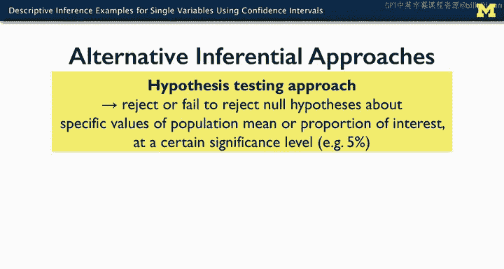

# 密歇根大学《使用Python的统计学（理解并可视化数据、因果推断、建模）｜Statistics with Python》中英字幕 - P61：27_单变量描述性推断：置信区间实例.zh_en - GPT中英字幕课程资源 - BV1dV411Q7j3

Okay， so now we're going to start getting into some examples of these different statistical procedures that we've been learning about so far in this course and we're going to start with some examples of making descriptive inferences for single variables using confidence intervals so one way we can make inference in running these procedures is by generating confidence intervals for parameters of interest and we're going to see some examples of that in this particular lecture。

So example number one， generating confidence intervals for proportions。

 so here's our research question and again， we want to provide a very clear detailed research question that hits on all four of those aspects that we talked about when we discuss formulation of good research questions。

So our research question for this example is what proportion of non-hispanic African Americans age 18 plus in the United States in 2015- 2016。

 so making that target population very clear， had systolic blood pressure greater than 130 millimeters of mercury so this proportion would generally quantify higher blood pressure。

 this indicator of having systolic blood pressure greater than 130 MMHG would generally indicate hypertension。

 and we want to see what proportion of this specific target population has systolic blood pressure greater than this threshold。

So the inference approach that we're going to demonstrate in this example is computing a 95% confidence interval estimate recall the lower and upper limits for this population proportion now we want to be very clear right up front here when you generate a confidence interval estimate the confidence interval is not for an estimate。

 it's for a population quantity， it's for a parameter that we're trying to estimate so anytime that we say we're generating a confidence interval。

 it's for a parameter of interest or a population quantity。

 it's not a confidence interval for an estimate now we're estimating the confidence interval。

 but the actual interval is for a population quantity or a population parameter。

So step one in this kind of approach， we want to estimate that population proportion so we want to calculate our point estimate that's going to be used to form the confidence interval so first of all think about the information we need for a proportion the number of black respondents with non-missing data on the first systolic blood pressure measurement in the NHANS data is 1135 so this is the size of our sample of black respondents with valid data on systolic blood pressure。

So our best point estimate， assuming again a simple random sample of black adults。

 that sample proportion is 465 divided by 1163 or 0。

4097 so there were 465 black adults who had systolic blood pressure greater than or equal to 130 MMHG so the resulting proportion we just calculate what fraction of the sample size had that particular hypertension value and that fraction was 0。

4097 so our estimate is that 40。97% of all such black adults in 2015-2016 had systolic blood pressure greater than 130 MMHG that's our point estimate of the population parameter of interest。

 40。97% of all such black adults that fell into this category so that step one is calculating our population estimate。

Step two is computing the estimated standard error of that population estimate so recall that the standard error is the square root of the sampling variance of that sample proportion or in other words this is the standard deviation of the sampling distribution recall from course one。

 if all possible sample proportions like this had been estimated from repeated samples of size 1135 black adults。

 so how variable would these different estimates of the proportion be if we drew repeated samples of the same size。

 1135 and to get the standard error we take the square root of that sampling variance or again talk about the standard deviation of the sampling distribution。

So we calculate our estimated standard error as follows using the estimate of the population proportion and using the sample size。

 so the resulting standard error is 0。0146 and again that's our estimate of the standard deviation of the sampling distribution if we had drawn many。

 many simple random samples of size 1，135 and calculated that same proportion in each of those repeated samples。

 but this is the beauty of this kind of approach because we only need one sample and we can estimate the standard deviation of that sampling distribution。

Step 3， we form the confidence interval so given our best point estimate and the margin of error。

 we can write down the confidence interval Now how is the margin of error form recall that we take a few estimated standard errors in either direction around the point estimate generally with a large sample size like we have here 1135 to form a 95% confidence interval we would use a multiplier of the standard error of 1。

96 some people round it up to 2 we're going to use 1。

96 so we say plus or minus two standard errors essentially that gives us roughly a 95% confidence interval so using the technically more precise 1。

96 value to form this 95% interval the lower limit is formed by taking the point estimate minus that multiplier times the standard error we get 0。

3811 the upper limit is formed by taking that same point estimate and then adding the multiplier times the standard error that gives us 0。

4383 and that defines our confidence interval。So let's make a couple more statements about this confidence interval。

 the 95% confidence interval for the population proportion， remember， not for the estimate。

 but for the population proportion of nonhispanic African Americans age 18 plus in the United States in 2015- 2016 with systolic blood pressure greater than 130 MMHG is written as 0。

3811。4383， so we write out the two limits of that confidence interval。Now what this means。

 we say 95% confidence， this is a 95% confidence interval。To be perfectly precise。

95% of intervals formed in this way， the way that we just formed it。

 the point estimate plus or minus the margin of error are expected to cover the true population proportion assuming that the Nhannes is a simple random sample。

 So again， under the idea of repeated sampling if we were to draw these samples and calculate these confidence intervals in the same way for each of those samples point estimate plus or minus the margin of error we were to do that over and over and over again。

 form a whole bunch of intervals。95% of those intervals would be expected to cover the true population proportion that we're trying to estimate that's how we would interpret this kind of confidence interval。

Our inference says， for example， if the hypothesized proportion was 0。35。

 so say the people who were funding this study were speculating that the proportion of non-hispanic Africanam Americanican adults in the US was actually 0。

35， our 95% confidence interval suggests that that hypothesized proportion is not a plausible value。

 why because that hypothesized proportion does not lie within the limits of that confidence interval。

 so we don't view that as a plausible value using this 95% confidence level。

 so what this really tells us is that we have evidence against that hypothesized proportion and in fact we have evidence that the proportion of African- Americanan adults who have systolic blood pressure greater than 130 is actually higher than 0。

35。Okay so that was an example of a proportion， let's think about an example of forming a confidence interval for a mean。

 so a different descriptive quantity based on one variable so here's our new research question。

 what was the mean systolic blood pressure for nonhispanic African Americans age 18 plus in the US in 2015- 2016 so before we were estimating the proportion that had systolic blood pressure greater than 130 MMHG now we want to estimate the mean for this target population so same inial approach we're going to provide a 95% confidence interval estimate or the lower and upper limits for the population mean not for the estimated mean but for the population mean。

So following the same steps， first step， we estimate the population me。

 the number of black respondents with nonmissing data on the first systolic blood pressure measurement again。

 1，135 just as before with the proportion our best point estimate assuming a simple random sample of black adults that sample mean is 128。

252 so we calculate the meme of all those blood systolic blood pressure values and the resulting estimate is 128。

252 again， assuming a simple random sample for now we're going to revisit the use of sampling weights later。

Our interpretation would be that our estimate of the mean systolic blood pressure for all such black adults in 2015- 2016 was 128。

252 MMHG。Step2， we calculate the estimated standard error of that estimated means so same approach as we follow with the proportion。

 we want to estimate the standard deviation of the sampling distribution if all the possible sample means in repeated samples of 1135 were obtained so the sample standard deviation of the 1135 blood pressure measurements is 19。

958 remember that's the standard deviation of the actual values of the blood pressure measurements so how variable are those different values we calculate the variance。

 take the square root of that variance that gives us the sample standard deviation so that's the standard deviation of the actual values on blood pressure remember we're trying to estimate the standard deviation of the sampling distribution of all possible mean estimates if we had drawn repeated samples of the same size so to calculate that estimated standard error or the standard deviation of the sampling distribution of repeated estimates of means we take the standard deviation of the values。

I pressure from our sample， 19。958 and divide by the square root of that sample size， 1135。

 that's how we estimate the standard error。The resulting value 0。592 MMHG。

 so that's the standard error that we use to form the confidence interval。Step 3。

 we form the confidence interval again， point estimate plus or minus the margin of error for a 95% confidence interval。

 where're again using this multiplier of 1。96 lower limit。

 we take the point estimate of the mean minus the multiplier times that estimated standard error that gives us 127。

091 upper limit， we take the point estimate add the multiplier times the standard error that gives us 129。

413， and we have our 95% confidence interval。So our 95% confidence interval for the population mean systolic blood pressure of this target population is 127。

091， 129。413 so thinking a little bit more about what that implies again， same interpretation。

 95% of intervals formed in this way in repeated samples of the same size would be expected to cover the true population proportion。

 so if we do this over and over again， we're going to cover the true population mean 95% of the time in repeated samples。

So thinking again about inference， if the hypothesized mean was 128 MMHG， that was our hypothesis。

 the 95% confidence interval that we formed suggests that 128 is a plausible value for the mean， why。

 because that hypothesized mean lies within the limits of the confidence interval。

 unlike the case of the population proportion， so 128 is certainly a plausible value allowing for sampling variability。

So we're going to talk about alternative inferential approaches。

 we're going to talk about hypothesis testing where we either reject or fail to reject some null hypotheses about specific values of population means or proportions of interest at a certain level of significance so a 5% level would correspond to these 95% confidence intervals we'll see examples of that coming up in another lecture。

In this lecture we've been focused on confidence intervals and the advantage of intervals is that they provide a range of plausible values for a descriptive quantity of interest like a population mean or a proportion。

 so we're not just rejecting or failing to reject a particular hypothesis。

 but rather we get a range of plausible values under a certain level of confidence and we've seen that in the two examples so far。

