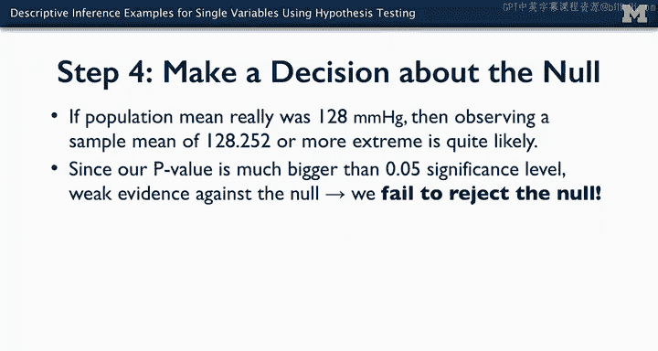

# 密歇根大学《使用Python的统计学（理解并可视化数据、因果推断、建模）｜Statistics with Python》中英字幕 - P62：28_单变量描述性推断：假设检验实例.zh_en - GPT中英字幕课程资源 - BV1dV411Q7j3

。Okay， so in the previous lecture we talked about the use of confidence intervals to make descriptive inference for population parameters based on single variables。

 now we're going to present some examples of using hypothesis testing to make inferences again based on descriptive quantities computed using single variables。

So our first example， we're going to revisit this idea of calculating one population proportion and making inference about that proportion。

 We're going to look at a one sample test for a proportion so our research question is stated as follows。

Did 33% or one third of non Hispanic African Americans age 18 and above in the US in 2015。

2016 have systolic blood pressure greater than 130 M MH G。

 or was the population proportion different than one third。

 So this is our kind of hypothesized value， that population proportion。

033 or 33% of the target population meeting this threshold。

 having systolic blood pressure greater than 130 M MH G。So our inference approach。

 unlike with the confidence intervals， we're going to perform a one sampled test or a one sample test two tailed to either reject or fail to reject the null hypothesis that the population proportion is 0。

33， so we're going to do a one sample hypothesis test and a twotailed testing approach where the alternative hypothesis is that the population proportion is different from 0。

33。So step1 in the hypothesis testing approach， we have to clearly define the null hypothesis and the alternative hypothesis。

 so our null is that the population proportion， which we'll call P is 0。33。

 The alternative is that the population proportion is not equal to 0。33 so it could be larger。

 it could be smaller。The alternative allows the proportion to be either greater or less than 。

33 and this is， again， what implies performing a two tailed test we allow for evidence in either direction away from that null hypothesis value。

 It also means that we need more evidence against an null hypothesis in order to reject it。

For this particular test， we also need to set our significance level。

 so we're going to set our significance level at 5% or 。05 as a type 1 error rate。

 so the probability of rejecting the null hypothesis if it's actually true is 0。05。

 we're going to set that pre low and that's what we mean by the significance level。Okay， so step two。

 once we've clearly defined our null hypothesis， our alternative hypothesis and the significance level。

 now we want to compute the test statistic that's going to allow us to make a decision about that null hypothesis。

 So our best point estimate assuming a simple random sample of black adults。

 the sample proportion is 465 divided by 1135 or 0。4097 like we saw in the previous lecture。

The test statistic that we would form for testing our null hypothesis in this case。

 we would do this assuming that the sampling distribution of the estimated proportion is normal。

 We form this Z statistic， as you see here。That Z statistic is defined as the 0 estimate 0。

4097 minus the null hypothesis value， which is 0。33 divided by the standard error under the null hypothesis。

 So notice that we're using 0。33 to estimate the standard error in the denominator of this test statistic。

 we use the standard error assuming that the null hypothesis holds。 We want to see how unusual。

 That best estimate is relative to the null value allowing for the sampling variability that we would expect to see under the null hypothesis。

 The resulting value of the test statistic is 5。71。So what does that 5。71 mean。

 it means that the estimate is more than5 standard errors from the 0。33 null value， that's a lot。

 so that's a lot of allowing for sampling variability。

 our actual point estimate based on the sample is pretty far away statistically from the null hypothesis value。

So step three， we have our test statistic， now we want to determine a P value that can be used to make a decision about that null hypothesis。

So if the null hypothesis were true， would a test statistic value of z equal to 5。

71 be considered unusual enough to reject the null。

 do we have enough evidence against the null given this test statistic。

The P value is the probability of seeing a test statistic of 5。71 or more extreme than that。

 assuming that the null hypothesis holds or that the null hypothesis is true。

So if that null hypothesis is true， that test statistic Z follows what's called a standard normal distribution with mean 0 and variance 1。

 You see a picture of that off on the right hand side of this particular slide。

 So that test statistic follows this distribution and we want to calculate a two tailed test。

 given that the alternative hypothesis is that the proportion could be greater than 0。

33 or less than 033。 So we want to see how extreme that test statistic is in both tails of this distribution。

 So we look at the probability of this standard normal z value being greater than 5。

71 or less than negative 5。71。 So both tails that's the whole idea of a two tailed test because again。

 we're allowing that proportion to either be greater than the null or less than the null。

And the probability of being gray than 5。71 or less than negative 5。71。

 those areas in the far right and the far left of the tails of this distribution。

 that probability is essentially 0。 So if the null hypothesis is true。

 the probability of seeing a Z statistic this large or larger is essentially 0。 In other words。

 there's really no evidence at all in favor of the null hypothesis。

 it's very unusual to see a value like this， if the null hypothesis was 0。33 was actually true。

So then step 4， we make a decision about the null。 If the population proportion really was 0。33。

 then observing a sample proportion of 0。4097 or more extreme is highly unlikely。

 Since our P value is much lower than our 0。05 significance level。 remember。

 we chose that significance level 0。05。 if our P value drops below that stated significance level。

 we have evidence against the null hypothesis and we would therefore reject the null hypothesis。

 In this case， So if the P value that we compute is less than the stated significance level。

 we have evidence against the null hypothesis and we would reject it。

So based on the estimated proportion of 0。4097， we support that the population proportion is not 0。

33 and likely the population proportion with systolic blood pressure greater than 130 MMHG is likely larger。

 much larger than this 0。33。Okay， so now we're going to turn to the idea of a mean and apply the same basic approach using the hypothesis testing idea so now our research question is was the mean systolic blood pressure for non-hispanic African Americans age 18 and above in the US in 2015。

 2016 equal to 128 MMHG or was the population mean different from 128， so again。

 this twotailed idea we're allowing for the mean to be greater than 128 or possibly lower than 128。

Our inference approach， we're going to perform a one sample test again too tailed to either reject or fail to reject the null hypothesis that the population mean is 128 MmHg for this target population。

 So step 1 again， we define the null and the alternative。 The null is that the population mean。

 which we'll call me in this case， is 128 MmHg。 The alternative is that the population mean is not equal to 128 MmHg。

 so it could be larger， could be smaller。 so again。

 the alternative hypothesis allows the mean to be greater than or less than 128 MMmHG。 Again。

 we would employ a twotailed test where we need more evidence against a nu hypothesis in order to reject it。

 Again， we'll choose a significance level of 5%。 but as someone designing a study。

 you could choose that significance level to be whatever you wanted it to be。

 you just have to be very clear about what it is up front In this case， again。

 we're choosing 5% or a 0。05 type 1 error rate。Step 2。

 we compute the test statistic in the same general approach。 Our best point estimate。

 recall from the previous lecture， assuming a simple random sample of black adults is that the sample mean is 128。

252。 So that's our best point estimate of the mean。

 Our test statistic then assuming a sampling distribution of estimated means that's normal。

 We use this t statistic。 Our students t distribution。 So the best estimate is 128。252。

 We subtract the null value， which is 128。 and then we divide by the estimated standard error recall that the standard deviation of blood pressure values was 19。

958。 and we divide that by the square root of the sample size or 1135 to get the estimated standard error。

 The resulting value of the t statistic is 0。425。 So what does this mean It means that our best point estimate is less than half of a standard error from the null value of 128。

 So we're pretty close to the null value。For sampling variability。

 we have more evidence in support of that null value。 Step 3， given that test statistic。

 we determine the P value。 So if the null hypothesis was true。

 would a test statistic value of only t equal to 0。425 be unusual enough to reject the null。

 The P value， again， is the probability of seeing a test statistic of 0。425 or more extreme。

 assuming that the null hypothesis is true。So if the null hypothesis was true。

 this T statistic follows what's called a student t distribution with degrees of freedom equal to the sample size -1 or 1134。

 and again， we use a two tailed test。 Now look at if you look at this picture on the right hand side of the slide Student t distribution looks a little bit like a normal distribution。

 they're similar in appearance， but they're also defined by degrees of freedom。

 according to the sample size。 and again， for a two tailed test。

 we want to calculate the probability that a student t statistic with 1134 degrees of freedom is either greater than 0。

425 or less than negative 。425。 So we look at the probability of being more extreme in both tails of the student t distribution。

 again， given the alternative hypothesis that the mean is not 128。 The resulting P value。

 if we add up those areas and the tails of the2 distribution above 0。425 or below negative 0。425。

 That's 0。3175。系。So what that says is if the null hypothesis is true。

 the probability of seeing this test statistic or something more extreme is about 0。32。

 So pretty common that we would see something like this。

 if the null hypothesis where it was actually true。 So step 4， we make a decision about the null。

 If the population mean really was 128 mmhg than observing a sample mean of 128。

252 or more extreme is actually quite likely， unlike the case of the proportion。

 So since our p value is much bigger than the 0。05 significance level。

 we have very weak evidence against the null hypothesis and we would choose to fail to reject the null。

 notice that we're not accepting the alternative。 We're just making the decision that we fail to reject the null hypothesis。

 So we have evidence in support of the null hypothesis given the small T statistic and the large P value。

 So based on our estimated mean of 128。252， we cannot。

The idea that the population mean differs from 128 MMHG。

 We have support in favor of the null hypothesis that that mean is certainly a plausible value for the population mean。

So what's next we've talked about a confidence interval approach for descriptive parameters and we've talked about a hypothesis testing approach for descriptive parameters Next we're going to talk about how to make inferences about differences between subgroups so not for overall population means or proportions but rather differences between subgroups so we'll talk about forming confidence intervals for differences in means and proportions and we'll talk about hypothesis testing approaches for comparing means and proportions。

