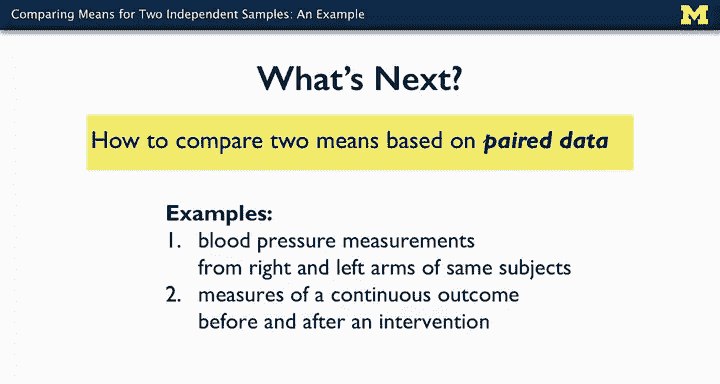

# 密歇根大学《使用Python的统计学（理解并可视化数据、因果推断、建模）｜Statistics with Python》中英字幕 - P63：29_两独立样本均值比较实例.zh_en - GPT中英字幕课程资源 - BV1dV411Q7j3

Yeah。

Okay， so now we're going to turn to examples where we're interested in comparing different subgroups in the population rather than estimating one overall population quantity。

 now we're going to talk about research questions that involve comparing two independent subgroups and we're going to start with some examples of comparing means for two independent samples so focusing on means in particular。

 and then we'll talk about confidence interval and hypothesis testing approaches for these types of comparisons。

Okay， so our example is going to be a comparison of means in two different subgroups。

 and here's our research question。Considering African American adults living in the United States in 2015- 2016。

 did males and females have significantly different mean systolic blood pressure。

 so we're making our research objective clear we want to compare these two independent groups。

 males and females， in terms of their means on systolic blood pressure。

 and we have a very specific target population in mind。

So here are the different approaches that we're going to use to making inference about this difference in the means。

 first we're going to form a confidence interval for the difference in the two means。

 so recall previously we were forming confidence intervals for a population mean and a population proportion now we're going to form a confidence interval for a difference into population means。

Next， we're going to perform a two sample T test for the difference in the two means。

 so same inference idea， we want to make a decision about a null hypothesis that the two means are the same。

 and we want to see if we have evidence in support of the idea that the two means are actually different。

And very important for these types of inferential approaches when comparing subgroups。

 we want to make sure to check the assumptions that are underlying some of these different tests that we're using to compare the subgroups。

Okay， so the first approach that we're going consider is forming a confidence interval for that difference in the means。

 So we start assuming simple random sampling。 again。

 We'll turn later to incorporating complex sample design features， but to start simple。

 Let's assume that the Nhans provides a simple random sample from this target population。

 We calculate our point estimate of the mean for males it's 131。01。

 And the standard deviation of the values for males is 20。59。 Remember。

 that's the standard deviation of the values on the variable of interest。

 not the standard error of the estimated mean。 And our sample size for males is 536。

 Sam idea for females。 The mean for females is 125。79。 So just on the surface already。

 It seems like females have a notably lower mean than males。

 but we're gonna to see if that's a statistically significant difference。

 The standard deviation for females is slightly lower。Then that for males， recall again。

 that's the standard deviation of the values of the variable of interest for females。

 and we have a slightly larger sample size of females， 599。

Our best point estimate is that the difference in the sample means is simply the difference between the two means that we just computed。

 so the difference between those two subgroup means is 5。22 MMHG。

So we would interpret that by saying that in 2015- 2016。

 we estimate that the mean systolic blood pressure for all male black adults was 5。

22 MMHG higher than that for all female black adults， okay so that tells us that yes。

 male black adults had a higher meanme， but we want to know whether it's a significantly higher mean or whether that just is sampling noise or sampling variability。

Okay， so in forming a confidence interval， we look at the two standard deviations and we see that the sample standard deviations are similar。

 so it seems like an assumption that both groups being compared have the same variability in the values of interest seems like it would hold。

 but we're going to check that as part of the analysis and decide whether we can pool those two standard deviations together or whether we should treat them separately in forming the confidence interval。

Okay so let's look at some graphs just to check some of these assumptions that we're making here about the values in each of the two groups。

 So you see the panel on the lefthand side of this particular slide males are in the first column and in the first row you see histograms of the values on systolic blood pressure in the second row you see what are called normal Qq or quantile quantile plots plotting the sample quantiles of blood pressure against theoretical quantiles that would be expected under a normal distribution So in the histograms we expect those histograms to look like a bell-shaped curve if the variable is normally distributed and what we end up seeing is a right sw you see that long right tail of the histograms for both males and females we have a small number of very large values on systolic blood pressure so it doesn't seem exactly like those distributions are normal and we see more evidence of that in the normal Qq plots you see that if these values followed to normal distribution all those points the blue points and the yellow points。

would lie on that straight line， that straight line indicates a normal distribution。

 but instead the distribution of values it deviates from that straight line。

 so you see that right skew again， the deviation from the expected normal distribution。

 so the normality assumption can be important for a two sample T test comparing different means and it looks like it might be a little bit questionable here so we're going to check the robustness of our results to allowing for normality or having a violation of normality okay。

In addition here we have fairly large sample sizes， so in the case of a two sample T test。

 a large sample size， slight deviations from normality like we're seeing here。

 it's not going to make that big of a difference for the two sample T tests。

 so it tends to be pretty robust to these slight deviations from normality。

 especially if we're dealing with large sample sizes。

 and we can rely on the central limit theorem in the case of having large sample sizes to perform these kinds of tests and form intervals in this way。

 but we're going to come back to this idea of potential violations of assumptions of normality when we do our actual testing。

Here's a plot side by side box plot that shows differences between these two subgroups。

 males and females in terms of the variability of the systolic blood pressure measurements and what we see in this plot is that the first box plot which is for males males are coded one on the gender variable and in Has we see some evidence of slightly higher variance for males so an assumption of constant standard deviations in the two groups also seems like it might be a little bit suspicious here so we want to check the robustness of our results to different assumptions about the variances in these two groups are they the same or are they different。

 we're going to look at the analysis both ways but it's important to check these kinds of assumptions visually using these kinds of plots before you jump into forming these kinds of intervals or performing these kinds of tests comparing groups so approach one。

 we're going to form a confidence interval for that difference in the means and recall from previous lectures how we form that confidence interval we take our best point estimate。

The difference we add or subtract a multiplier usually 1。

96 for a 95% confidence interval assuming a large sample size。

 multiplied by the standard error of the difference so we do need to form the standard error of the difference one way we can calculate the standard error of the difference in the means is by pooling or saying that the standard deviation is the same in each of those two groups and following that approach our 95% confidence interval for the difference is 2。

91 7。53 so remember that a value of 0 for the difference in the means would mean that the two means are identical。

The males and females have the same mean this 95% confidence interval does not include zero。

 so we would infer that we have evidence of a significant difference between males and females。

 males having a higher meme， zero does not seem like a plausible value for this difference using a 95% confidence level。

Now what happens if we assume that the two groups have unequal standard deviations in terms of the systolic blood pressure measurements or in other words。

 no pooling of the standard deviations following this approach you see that the 95% confidence interval hardly changes at all now the intervals 2。

90 7。5 for its ever so slightly a little bit wider if we allow for unequal variance so we would arrive at the same conclusion that interval does not include zero either so we have evidence against the idea that the two means are similar to each other so we would conclude that males have a significantly higher mean than females using this confidence interval approach and our result is robust to possible violations of that assumption of constant variance。

Okay so that's a confidence interval approach to making inference about the difference in the subgroup means let's now consider what's called a two sample T test or a hypothesis testing approach for making inference about this difference in the means so as before our first step is to clearly define the null and the alternative hypothesisses if we're using a hypothesis testing approach so our null hypothesis is that males and females have equal population means the alternative is that males and females have different means males could be higher than females or females could be higher than males so the alternative allows the male mean to be either greater or less than the female mean so again we're going to use a two-tailed test where we need more evidence against the null hypothesis in order to reject it and we're going to use a significance level of 5% or a type 1 error rate of 0。

05 once again as we did before with hypothesis testing but again you could change that if you want to use a lower or a higher level for your particular study。

Okay， key assumptions for the two sample T tests comparing these meaning， first of all。

 a normal distribution of blood pressure in each of the populations being compared now remember from our prior plots this may not be reasonable。

 we looked at those histograms， we looked at the normal QQ plots and we saw deviations from normality in each of the two groups。

 so we're going to check the robustness of our two sample testing approach to potential violations of this assumption of normality。

Second， we assume that there's the same standard deviation in each of our two populations。

 this seems somewhat reasonable and these two sample testing techniques can be robust to violations of that assumption。

 but we're going to examine the results both ways， pooling the standard deviations and not pooling the standard deviations。

Okay， so carrying out the two sample T test， calculate the test statistic representing the point estimate minus the null hypothesis value divide by the standard error of that estimate。

 the resulting T statistic which follows a student t distribution with 1133 degrees of freedom is 4。

436 now why is it 1133 well we're estimating 2 means so we have the sample size 1135 minus 2 instead of just minus1 so that T statistic is 4。

436。And the p value for that t statistic is less than 0。001 very small again。

 So the probability of seeing a t that large or more extreme if the null hypothesis is true is very。

 very small So because that p value is less than 005 we reject our null hypothesis of equal means and conclude that the means are different Now this approach assume pooling。

 so what happens if we don't pool， allowing for different state deviations， again。

 our test statistic very， very similar 4。417， slightly different degrees of freedom when we allow for unequal variance。

 but still a large number for the student t distribution， the resulting p value again very。

 very small， less than 0。001 So we would arrive at the same conclusion。

 the result here that we reject the null hypothesis that the means are the same is robust to possible violations of this assumption of constant variance in the two groups Now what about that normality assumption remember we were assuming that the systolic blood pressure。

measurements followed a normal distribution in each of these two groups so if you're not convinced that the variable of interest follows the normal distribution in each of the populations that you're comparing。

 you can consider what's called a nonparmetric test that does not assume normality so the two sample T test assumes that the variable follows the normal distribution that's a parametric distribution a nonparmetric test doesn't make those kinds of distributional assumptions so the nonparmetric analog of this two sample T test that we just performed is called the man Whitney test or the man Whitney U test what this test does is it compares the locations of the distributions of the values in the two subgroups using medians we're not comparing the mean but rather we're comparing the median we're comparing the general location of the distributions based on the media。

Okay so we can perform that man Whitney test， we're going to see how to do that in Python as part of the lecture and the result of that test again a P value less than 0。

001 so we once again have very strong evidence against the null hypothesis that the two distributions have the same location we would reject the null hypothesis that both distributions have the same locations so again like we saw with not pooling these standard deviations we see that our conclusion of a difference in location between these two groups a difference in central tendency of the systolic blood pressure measures is robust to potential violations of normality so we want to be careful。

We want to check these assumptions and make sure that our conclusions are robust。

 they hold up either way no matter what assumptions we're making here。

So we have consistent evidence of a robust difference in central tenencies of these two distributions。

 regardless of the assumptions that we're making， and regardless of the approach to inference that we're using。

 the hypothesis testing approach or the confidence interval approach。

So what's next we talked about here comparing means into independent samples next we're going to talk about how to compare two means based on paired data。

 so we're estimating the means for two variables that are correlated with each other for one reason or another。

 for example we could be talking about blood pressure measurements from the right and left arms of the same individuals and we want to compare the right arm mean to the left arm mean or we might have measures of a continuous outcome that that were collected before and after some type of intervention and we want to see what happened to those means before and after the intervention of interest and see if there's a significant difference in those means。

 so in our next lecture we're going to talk about how to compare two means based on these kinds of paired data。

