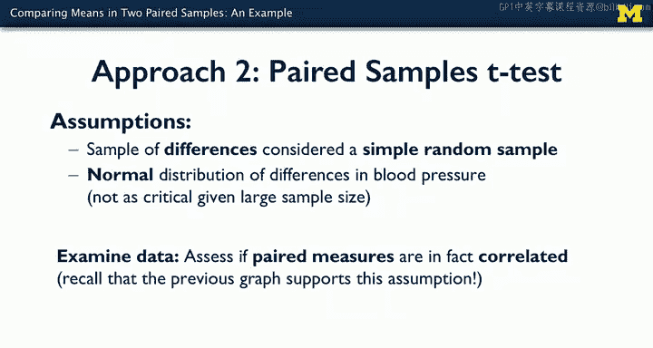

# 密歇根大学《使用Python的统计学（理解并可视化数据、因果推断、建模）｜Statistics with Python》中英字幕 - P64：30_两配对样本均值比较实例.zh_en - GPT中英字幕课程资源 - BV1dV411Q7j3

Okay， so we're continuing with our week four discussion of different applications of the techniques that we've been learning about and in this lecture we're going to talk about how to compare means into paired samples。

 so we'll look at an example of comparing means and samples of data that are correlated with each other。

So our example， we're going to look at some NHANS data where researchers want to make sure that measures of blood pressure collected in the NHAS are reliable across different subgroups。

 so it turns out that each NANS respondent has two different measures of blood pressure collected just to assess the reliability of these different measurements and come up with an overall average for a given individual。

So the research question that we're attacking today is for female Hispanic adults living in the US in 2015。

 2016， so that's our specific population of interest。

Did these two measures of systolic blood pressure differ significantly from each other。

 our expectation， if these are two reliable measures of blood pressure coming from the same individual。

 is that these measures of blood pressure would not differ systematically across the two different measures。

So the different inference approaches that we're going to consider to address this research question。

 first of all， we're going to form a confidence interval for the mean difference second we're going to perform a paired samples T test for the mean difference。

 and third we're going to make sure to check assumptions for each of these different techniques so check the assumptions that underlie the use of these different techniques。

So first approach we're going to form a confidence interval for this mean difference。

 so the steps that we need to do this， first of all。

 we would compute the difference in the systolic blood pressure measurements for each of the women in this population。

 so the difference is going to be defined as the second systolic blood pressure measurement SP2 minus the first systolic blood pressure measurement which is SP1 in this case。

So if we do that calculation for each of these women and we take the average of all those differences。

 the resulting mean is negative 0。977， and the standard deviation of those differences is 4。

848 and we have a total of 911 women in this subpopulation。

So our best point estimate of that mean difference is negative 0。977 MMHG。

 so how would we interpret that， we would say that in 2015- 2016。

 our estimate of the mean difference in systolic blood pressure measurements for all female Hispanic adults was negative 0。

977 MMHG。So that seems like a big difference， on average what that means is that the first measurement of systolic blood pressure was larger by nearly one unit。

 one MMHG， which is fairly large for what we expect to be very similar measurements。

 so let's examine the data more and check some assumptions underlying these techniques that we're going to use。

So here we see some graphs。 The first graph is a histogram showing the distribution of the differences that we computed for the women。

 So you see a histogram that presents the distribution of those blood pressure to minus blood pressure1 differences。

 you can see that roughly it looks like it's center at  zero。

 but it does seem to be shifted a little bit to the left of zero in terms of the overall central tendency。

 Second， you see a normal quantile quantile plot。 and if the distribution of differences was normal。

 we would expect all the data points to lie on that 45 degree lime that we see in this particular plot and we see that the distribution of points deviates a little bit from that 45 degree lime。

 which would be indicative of a normal distribution so we have some slight concerns about deviations from normality and if we have a large sample size like we have in this case with 911 women we can usually rely on the central limit theorem and this assumption of normality is not as criticalNonetheless。

 we're still going to check what would happen if we allow this assumption of normality to be violated。

We're going to check the sensitivity of our results to relaxing that assumption。

Another examination of the data is to simply generate a scatter plot showing systolic blood pressure measure2 on the Y axis and systolic blood pressure measure1 on the X axis and see if these two measures are in fact correlated with data recall that we're using procedures for paired data so there's an assumption that the values on these two variables are in fact correlated with each other and by looking at the scatterpl we see strong evidence of a correlation between these two measures of systolic blood pressure the piercing correlation coefficients actually 0。

966 so there's a very strong linear association between these two paired measures so there's clear evidence that the two measures are actually paired and this supports the use of paired sample procedures like the paired sample T test for these data。

So let's continue with approach one where we form a confidence interval for that mean difference。

 so recall that in forming a confidence interval we're going to take that best point estimate and we're going to add or subtract a margin of error to form the interval and how do we form that margin of error。

 we add or subtract a few estimated standard errors to that overall best estimate and we'll talk more about what a few means in a second。

So our sample mean of the 911 differences in the blood pressure measurements was， as we saw earlier。

 negative 0。977 that's our best estimate。Our sample standard deviation of the 911 differences was 4。

848 MMmhg。 so to translate that into an estimated standard error。

 recall that we take the standard deviation of the differences and we divide by the square root of the sample size。

 which again in this case was 911。 So the result of that calculation is 0。

161 mmhg as the standard error of this estimated mean difference and recall that that standard error describes the standard deviation of the sampling distribution。

 So again， if we had gone out and taken many samples of size 911 and calculated that estimated mean difference for each of the samples。

 0。161 would be the standard deviation of that distribution of estimated mean differences。

So if we look at the sample mean difference relative to its standard error。

 it seems like that sample mean difference is actually quite large relative to the standard error。

 and again， that gives us some concern about the fact that this is actually a fairly large mean difference allowing for sampling variability。

So putting all that together， we form a 95% confidence interval for the population mean difference and systolic blood pressure of all female Hispanic adults living in the US in 2015- 2016 as negative 1。

292 and negative 。662 and remember that few standard errors we multiplied that standard error of the mean difference by about 1。

96 to form the 95% confidence interval， so we add or subtract 1。

96 times that estimated standard error to arrive at this result。

So what does this 95% confidence interval mean Well， the interval does not include0。 And remember。

 under a null hypothesis that there is no difference in these means。

 it would mean that the mean difference is， in fact 0。

 and the fact that the 95% confidence interval does not include0 suggests that there is， in fact。

 a significant difference。 plausible values for this mean difference。

 allowing for sampling variability range from negative 1。292 to negative 。

662 and clearly that interval does not include 0。 So our inference from this result would be that we have evidence that the first measure tends to be significantly larger than the second measure for this specific subpopulation。

 So in light of this evidence， we might ask why this would be。

 and this might go back to the Nhans data collection procedure。

 maybe there was some reason that the first measurement tended to be larger than the second measurement。

 but we would need to pursue reasons for this result to have emerged。

So let's consider it a different approach using a paired samples T test。

 Our null hypothesis in the case of this T test is that the population mean difference in measurements is 0。

 so that's our null In other words， the two measurements are identical to each other on average the alternative hypothesis in this case is that the population mean difference is not zero or in other words。

 the two measurements are different on average So the alternative allows the first measurement to be either greater than or less than the second measurement on average and this supports the use of a twotailed test for this particular test of the null hypothesis and for this hypothesis test we're again going to be using a significance level of 5% to be consistent with calculation of the 95% confidence interval so again that means that our type 1 error rate would be 0。

05 and any P values for this test less than 0。05 we generally would have evidence against the null hypothesis。

What assumptions are we making， Well first of all， we assume that the sample of differences is a simple random sample。

And second of all， we assume that there's a normal distribution of differences in blood pressure。

 and again， this is not as critical， given the fact that we have a large sample size and we can rely on the central limit theorem in this particular case。

But we're still going to examine the data and see if the paired measures are in fact correlated。

 so recall from the scatter plot that we looked at a couple slides back。

 this graph definitely supported this assumption it seems like these two measures of cystystototic blood pressure are certainly correlated。

So here's the result of that paired sample T test we talked about the mechanics of this kind of paired sample T test in an earlier lecture。

 our result under the stated assumptions， our t statistic is negative 6。

082 the degrees of freedom for this t statistic are 910 which is just the sample size minus1 for estimation of the mean difference and the resulting p value for that T statistic is less than 0。

001 so it would be extremely unlikely to see a t statistic this extreme if the null hypothesis was actually true。

 so given that that Pvalue is less in 0。05 we would reject the null hypothesis and this supports the idea that the population mean difference in the systolic blood pressure measurements is not equal to0 so again taking the T test approach we have evidence that the first sytoic blood pressure measure tends to be significantly different than the second systoic blood pressure measure on average for this particular population。

Now recall we had some slight concerns about deviations from normality in terms of the distribution of these differences that we computed for these women。

 so as an analyst， if you're not convinced that the differences follow a normal distribution。

 you can consider what's called a nonparmetric test that does not assume that the differences follow a normal distribution。

 so we're not making parametric distributions about the distribution of the differences we're not making assumptions that that distribution is normal。

So the nonparmetric analog of the paired samplesles T test is called the Will Coxon signed rank test and what this test does is it uses the median to examine the location of the distribution of the differences as opposed to again。

 assuming that the differences follow a normal distribution。

 we're not making a parametric assumption about the distribution of these differences。

So here's the result of this test and again there's accompanying Python code to see how to generate these results the Willkxen sign rank test result has a P value again that's very small。

 less than 0。001 so in the case of this particular nonparmetric test we would reject the null hypothesis that both measures have identical medians again we're referring to the median rather than the mean of the differences。

So the conclusion is that our result， our conclusion that the two measures do in fact have significantly different means。

 that conclusion is robust to potential violations of normality so we have consistent evidence really no matter how we look at it。

 that the two measures of systolic blood pressure differ significantly for this population and this is regardless of the assumptions made and the approach used for making that inference。

 it really does appear on multiple fronts that the two measures are not in fact reliable and that there is a significant difference in terms of the values of the two measurements。

So what are we going to talk about in the next lecture。

 well now we're going to think about how to compare two proportions based on independent samples。

 so we're going to shift our applications from a comparison of means to a comparison of proportions in two samples that are independent of each other。

