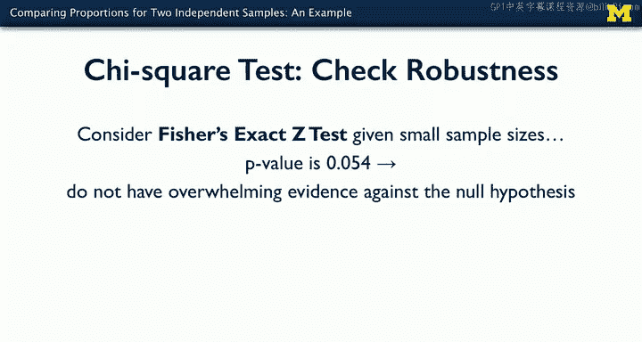

# 密歇根大学《使用Python的统计学（理解并可视化数据、因果推断、建模）｜Statistics with Python》中英字幕 - P65：31_两独立样本比例比较实例.zh_en - GPT中英字幕课程资源 - BV1dV411Q7j3

Okay， so in this lecture， we're going to turn our focus to comparing proportions rather than means for two independent samples。

 so we'll consider an example of this inferential approach。Okay。

 so for our example of comparing proportions in two groups。

 here's a new research question that we haven't considered previously。If we focus on elderly。

 Hispanic adults， so by definition here we're talking about adults who are ages 80 and above living in the United States in 2015。

 2016， we want to know if the proportions of males and females who smoked very significantly。

 so is there a difference in the proportions of males and females who smoke in this specific subpopulation in terms of how many people smoke in the two groups。

So our inference approach is we're going to form a confidence interval for the difference in the two proportions of individuals who smoke。

 we're going to perform a chi square test to test the significance of the difference in the two population proportions。

 and again， as in previous applications， we're going to make sure to check our assumptions carefully。

So first approach， we're going to try to form a confidence interval for the difference in these two proportions of males and females who smoke。

 so we analyze the data and for the males， the proportion of males who smoke in this specific subpopulation is 0565 or 56。

5% of the males in this subpopulation smoked but noticed sample size that's a key difference in this case study relative to some of our other applications。

 we only have 16 male Hispanics who are ages 80 and above for this analysis so of these 16 56。

5% indicated that they smoked in the NhanAnes。Among the females， we have a slightly larger sample。

 but still only 32 individuals， and among the females。

 we find that one quarter of the female smoke or 。25 is our proportion。

So the key aspect of this example is that we have small samples of males and females that we're using to try and make inference about this population difference in the proportions。

So we have our estimates。 again， the male proportion is 0。565 based on a sample of size 16。

 the female proportion is 0。25 based on a sample of sizeus 32。

 Our best point estimate of the difference in the sample proportions is 0。565 minus0。25 or 0。

315 So how do we interpret this best estimate we would say that in 20152016 we would estimate that the percentage of all male elderly Hispanics who smoked was 31。

5 percentage points higher than for all female elderly Hispanics Notice that I didn't say 31。

5% higher that would be a different result the difference in these two percentages is 31。5 or 31。

5 percentage points So we have to be careful with that kind of interpretation when comparing two different proportions。

Okay， so on the surface， this seems like a big difference。

 but we want to try to make some formal inferences about this difference based on our small sample。

 So let's evaluate some of the assumptions that we're making in comparing these two proportions。

 First of all， is the sampling distribution of the difference in the sample proportions normal。 Well。

 this is probably not going to be the case because we have such small sample sizes in each of the two groups。

 so we can't really rely any longer on the central limit theorem and assume a normal sampling distribution for the difference of the sample proportions。

 So this assumption is unlikely。 and this is mainly a product of the small sample sizes。Second。

 do we have at least 10 outcomes， either you're a smoker or a nonsmor in each of the groups。

 and the answer to this is no because the sample sizes are so small， and in fact。

 the problem is with the males where the sample size is so small。

Number three are the two samples independent， well in this case the answer is yes。

 because we're talking about mutually exclusive subgroups。

 males and females in this specific target population。

And number four are the observations within each of the two subgroups independent。

 we're going to make that assumption for now we're going to revisit the idea of dealing with complex sampling features in the NHAs a little bit later in this week。

 but for now we're assuming that the 16 and 32 observations in each group are in fact independent of each other。

Okay so let's proceed with forming a confidence interval。

 we calculate an estimated standard error of the difference in the proportions using the calculation that you see here。

 so our estimated standard error of this difference。

 we would multiply the proportion for males by 1 minus that proportion and divide by the sample size。

 then we would do the same thing for females， we would add that to the result for males and take the square root of the whole thing that gives us an estimate of the standard error of the difference in the proportions or 0。

146。We then determine the few， we talk about again adding or subtracting a few standard errors from our point estimate。

 so we determine the few as being a critical value for a 95% confidence interval for a difference in proportions。

 again we're going to use a critical value of 1。96。

Then we add and subtract this margin of error from the best estimate of the difference， so we take 0。

315 plus or minus that critical value 1。96 for a 95% confidence interval multiplied by 0。

146 and again we're assuming now that the sampling distribution is normal in performing this calculation。

The resulting 95% confidence interval for the difference in the population proportions is 0。027。598。

 So again， we see a case where the confidence interval for the difference in the proportions does not include zero。

 which would correspond to our null hypothesis that would mean that the proportions are not different from each other if their difference was zero and based on this 95% confidence interval 0 just doesn't seem like a plausible value。

 but notice that the lower limit of the confidence interval 0。027 is approaching 0。

 so it doesn't seem like our evidence is particularly strong in this case， but using a 95% interval。

 the fact that this interval doesn't include 0 would lead us to believe that there is a significant difference。

 assuming that all the different assumptions that we're making actually hold。

So we want to check the robustness of that result and given the concerns that we have about these assumptions mainly due to the small sample sizes in each group。

 we can use small sample techniques and one approach that we can use in this case is to compute what's called an exact 95% confidence interval for the difference in the population proportions this approach doesn't rely as heavily on these assumptions but it is much more computationally intensive so you'll see some accompanying Python code to generate this kind of exact 95% confidence interval and the calculations will just take a little bit longer when you run this kind of analysis in Python。

The resulting exact 95% confidence interval looks pretty similar to the confidence interval that we form based on these assumptions。

 so you can see the lower limits 0。015， the upper limits 。574。

 So we really arrive at a very similar result， although that lower limit is approaching0。

0 still doesn't seem like a plausible value for the difference in the proportions。

 So it does seem like despite the small sample size。

 we have evidence of a significant difference in these two proportions。

 the evidence just is not as overwhelming， again， given that the lower limit is coming close to 0。

Okay， so approach two， let's consider a chi square test for comparing these two proportions。

Our null hypothesis in this case is that the two population proportions are equal。

 so an equal percentage of males and females in this particular subpopulation smoke。

The alternative hypothesis would be that males and females have different population proportions who smoke。

So the alternative in this case， like our similar applications。

 allows the male proportion to be either greater than or less than the female proportion。

 and this again leads to the need for a twotailed test of the null hypothesis。

 we again would need more evidence against the null hypothesis in order to reject it and we're again going to use the significance level of 5%。

 although you could change that for any given study if you want to make it lower。Okay。

 so let's revisit some of the assumptions for the chi square test。

 we assume that the expected counts under the null hypothesis in each cell of the 2 by2 table that would be defined by this analysis。

 so we have males compared to females in terms of the proportion that smoke and the proportion that don't smoke。

 those are the four cells of the table that the data would define and we would assume for the chi square test that under the null hypothesis where the two groups have equal proportions we would expect to see five cases or five people in each cell of that two by2 table。

Okay， so we in this case， we see that this assumption is in fact met if the overall sample rate of smokers is 17 out of 48。

 48 was our total sample size， 16 plus 32 and in total， 17 of those 48 individuals were smokers。

If we applied that overall proportion of smokers to both males and females。

 we would expect to see about six of the 16 males who are smokers and we would expect to see 11 of the 32 females as smokers。

 so in all four cells of this twox two table we would actually have more than five individuals so that assumption seems justified in this particular case so that seems okay despite the small sample sizes and we are going to assume that within each of these two groups we have independent observations on this indicator of whether or not you smoke so it seems like we're okay barely but we're okay with our assumptions in this particular case for the chiqua test。

Okay， so we run this chi square test and again you'll see accompanying Python code that allows you to generate these values the resulting test statistic is chi square equal to 4。

554， the degrees of freedom for the chi square statistic are one。

 which is the number of rows in that table minus1 times the number of columns in this table minus1。

 which is just one by one in the case of this two by two table。

And the P value for that chi square statistic， the probability of seeing a chi square statistic that large or larger if the null hypothesis was true is about 0。

033。 so if we were using a strict 5% level of significance we would in fact reject the null hypothesis in this case because the P value is less than 0。

05 and this supports the conclusion that the population proportions of smokers are in fact different from each other but again。

 this isn't overwhelming evidence if we had initially selected a 1% significance level and our type 1 error rate was 0。

01 instead of 0。05 we would have failed to reject the null hypothesis so again。

 we do have evidence at the 5% level but this evidence is not overwhelming and if we drop the significance level we again wouldn't have evidence of a significant difference。

Okay so again we want to check the robustness of the result like we did with an exact 95% confidence interval for the difference in the proportions。

 we're going to consider Fser's exact Z test as another small sample solution to this issue of comparing proportions in small samples so when you run this fiser's exact Z test the resulting P value is actually 0。

054 so that P value does not provide very strong evidence against the null hypothesis again allowing for these smaller samples so we're close to that 0。

05 cutoff if we were using a strict 5% level of significance so again our conclusion would be that we don't have overwhelming evidence against the null hypothesis when we're running an exact test for the small samples。

So what kind of conclusion would we make in this particular case study we have weak evidence of a significant difference in the population proportions of smokers for elderly。

 male and female Hispanics living in the US in 2015- 2016 remember we always want to make our target population clear when making these kinds of conclusions so overall we have weak evidence of a difference in these proportions of people who smoke among males and females in this population but we can definitely include the caveat with that interpretation that we had very small samples to work with in generating these estimates in estimating the difference in the proportion so overall we had limited statistical power to detect this difference and we could see in most of our approaches we still had weak evidence of a difference despite the small sample sizes。

So some notes to keep in mind。If the same difference in proportions， remember is a big difference，31。

5 percentage points， if that same difference were to emerge with larger sample sizes in each of these two groups。

 we more than likely would find it significant， regardless of what significance level we were using 。

01。05， it wouldn't really make a big difference。 So if these proportions held up in reality。

 and they still existed with larger samples， This is a pretty big difference。

 This is what we would call a very large effect size in practice。 So in practice。

 this is a big difference in proportions。 And this is where we have to carefully weigh statistical significance versus practical or real world significance。

 And this overall would still be considered a big difference despite Fer's exact Z test or some of the weak evidence that we had。

 This is a pretty notable difference in the proportions who smoke。With the small samples though。

 we need to allow for a larger degree of uncertainty in our analysis due to these small samples。

 so we allow for more sampling variability given the small samples in each of these two groups and that's what we did with these robust tests that we perform so overall weak evidence but again with larger samples more than likely this difference would be significant。

