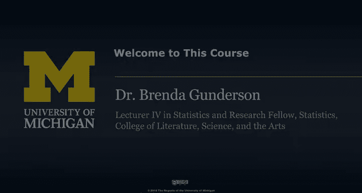

# 密歇根大学《使用Python的统计学（理解并可视化数据、因果推断、建模）｜Statistics with Python》中英字幕 - P66：0_欢迎来到课程.zh_en - GPT中英字幕课程资源 - BV1dV411Q7j3

Yeah。

Welcome to fittingtting statistical models to data with Python。

This is the third course in a larger statistics with Python specialization。

Each course building upon knowledge from the previous courses to give us a well rounded view of what statistics is。

 what statistics can do。While also allowing us to apply what we learn with Python。

This particular course has four parts。In part one， we'll get an overview of what does it really mean to fit models to data。

And what are some of the considerations， such as the type of variables and the role they play in the study？

How to handle missing data appropriately。How to account for the study design in fitting models。

The importance of having clearly defined objectives and being able to measure that prediction uncertainty。

On the。Computing side， we're going to see an introduction to the landscape of Python statistics。

 and we'll be using Jupiter notebooks to help guide us through our modeling experience。In part two。

We'll start looking at two basic types of regression， linear and logistic。

We'll learn how to fit these models， how to assess how well they fit。

And how to interpret the results in the context of the data。

We'll be working with the cartwel data set。We'll be predicting cartw distance from a person's height。

And on the logistics side， wherere measuring a binary outcome variable will predict the probability of completing a cart wheel based on a person's age。

We'll get to hear from a couple of colleagues as they discuss the differences between association and causality。

We'll also see the importance of data visualization。By looking at the data source， it doesn it。

In part three， our focus will be on multiline and marginal models。

We'll see how random effects can be accounting for the dependency in our variables。

 and the GEE or generalized estimating equation technique will allow us to handle those marginal models。

Some of the examples we'll look at is predicting the probability of person having ever smoked。

And looking at interviewer effects in a study about people's perception and trust in police。

In part 4。We get to see a broad base of special topics。

These will include different sampling designs and whether or not to include survey weights in our modeling process。

We'll see some examples of random forests。And some in depth case studies on the Bayesian techniques。

Where the language of Bayesian modeling is called Stan。Throughout the course。

 you'll have the opportunity to assess your knowledge in a number of ways。

And we'll give you a lot of readings and resources to do some deeper dives in these different concepts。

Along with some hands on opportunities， playing with some interactive web applets。And of course。

 there'll be a lot of Python based tutorials to guide us through this modeling experience。

You'll be hearing from a number of our team members as they share their insights and perspectives。

On fitting statistical models to data。