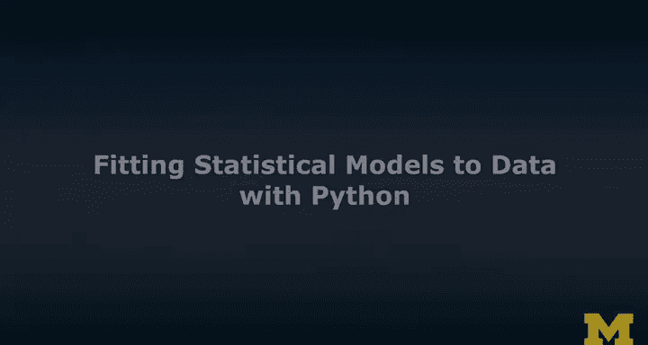
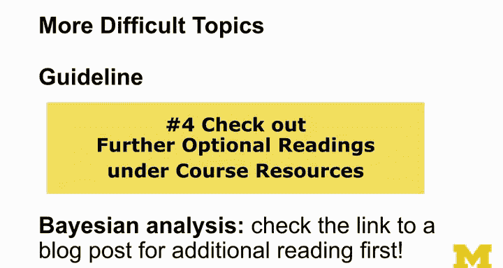
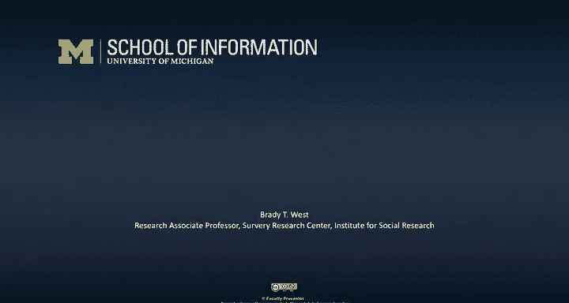

# 密歇根大学《使用Python的统计学（理解并可视化数据、因果推断、建模）｜Statistics with Python》中英字幕 - P67：1_使用Python拟合统计模型指南.zh_en - GPT中英字幕课程资源 - BV1dV411Q7j3

Hello and welcome to the third course in the Staistics with Python specialization。

 fittingtting statistical models to data with Python。

 whether you have taken the two previous courses in the specialization on understanding and visualizing data with Python and inferential statistical analysis with Python。

 or this is the first course in the specialization that you're taking。

 we look forward to working with you and hearing from you。

This course presents interactive content on how to fit statistical models to data sets using the Python software。

 The content builds on what we've learned from the first two courses in the specialization。

 So we assume going in that your' comfortable working with Python to visualize and manage data。

 You know how important it is to understand where data come from and your comfortable testing hypotheses and performing basic descriptive analyses using the Python software。

 We're going to build on all of these ideas in this course and learn more about how to make inference about the relationships between variables based on statistical models that have been fitted to data。

 This is where statistical truly becomes a lot of fun。

 But learning the material does take repetition and careful attention。😊。

This course will once again make heavy use of Jupiter notebooks。

 The purpose of these notebooks is to illustrate and demonstrate concepts covered during lectures using Python。

 The notebooks are going to be listed after a series of lectures for a given week。

 So for this course in particular， you're going to see case study notebooks。

 walking you through examples and practice notebooks。

 enabling you to practice actually fitting the models using Python。

Itll be especially important in this course to take advantage of our advice on taking the first two courses in the specialization。

 As a first guideline， we strongly encourage you to work through the Python model fitting examples in your notebooks while you have the video lectures from this course。

 explaining the concepts of fitting models open at the same time。

 either on another monitor or on your machine you should pause the video lectures frequently and try fitting models in the Jupiter notebooks to reinforce the model fitting concepts。

 Here's an example of what we mean。 You can see in this picture here that on the laptop。

 we have the video open， showing the lecture on a particular model fitting concept。

 And then in the background on a PC， we have the Jupiter notebook open。

 allowing you to practice fitting some of the models。 So again。

 we would recommend pausing the videos at certain points and trying out some of those concepts in in the Jupiter notebooks that have been prepared for you that will give you practice using。

😊，Tif。Because this material is building on the material in the prior two courses。

 we want to make sure that learners take care in following the video examples of using notebooks to fit models and that you practice these techniques while watching the video lectures。

 You're going to see several case study notebooks and practice notebooks that we have prepared for you to work with。

 and past learners have found that having these open for practice during the video lectures is especially important for this course on fitting models to data。

 We feel that this will optimize your learning experience in this course and give you the best practice in actually fitting models。

 Again， please pause the conceptual lecture videos frequently to try things in Python as you go。

 One of my favorite statistics professors ever。 Doctor Julian Farraway。

 who's at the University of Bath， shared a very important lesson with me about fitting statistical models。

 The only way to really learn statistics is by actually doing it in making these recommendations for this particular course we are following。

😊，FwaysWe want you to practice fitting models a lot in this course。

 and the notebooks and quizzes have been designed to give you this practice。So related to that idea。

 as a second guideline， we've prepared a variety of in video questions or IvyQes for you to reinforce the concepts in the video lectures。

 These Ivy cues will give you additional practice with interpreting output and results。

 and they reinforce many of the conceptual points that have been emphasized in the lectures。

 please pay careful attention to the detailed answers that have been prepared for you if some of the concepts are still unclear。

As a third guideline， please make sure to post questions when they come up and check the archive frequently asked questions and discussion forums a lot。

 There are lots of people who are out there who are eager to help you learn these different modeling concepts so as a third guideline。

 make sure to check the discussion forums a lot as you are going through the material。Finally。

 please take note of the additional readings and resources that we have prepared for you。

 We will also be introducing Bayesian statistical analysis in the last week of this course。

 This is the most advanced material that you will encounter in this specialization。😊。

This is a popular and powerful approach to performing statistical analyses。

 but it is different from the approaches that we have discussed so far in the first courses。

 We would strongly encourage you to review this blog post。

 providing a simple introductory overview of Bayesian analysis before you start engaging with this content。

😊，We would also welcome your questions， comments and feedback on this course。

 We are always striving to make this material more engaging and more accessible。

 Please do not hesitate to ask questions in the discussion forums and reach out to the instructors with any more complex questions。

😊。

Now， please enjoy your overview of fitting statistical models with Python and have fun。

