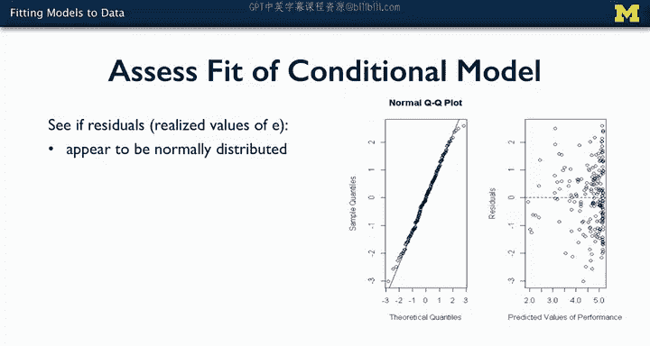

# 密歇根大学《使用Python的统计学（理解并可视化数据、因果推断、建模）｜Statistics with Python》中英字幕 - P68：2_拟合模型至数据的含义解析.zh_en - GPT中英字幕课程资源 - BV1dV411Q7j3

Yeah。

Okay， so welcome to Cose3 in the Sta with Python specialization In this third course。

 we're going to be focusing on statistical modeling and fitting models to data。

 so to get started with this course in this first lecture。

 we're going to talk about what we mean by fitting models to data。So when we fit models to data。

 our goal is to fit statistical models to the data that we've collected in an effort to help answer our research questions。

So to be clear up front， we're not fitting data to models。

 What we're doing is we're fitting models to data。 We specify models based on theory or subject matter knowledge。

 and then we fit those models to the data that we've collected and the idea here is that the variables in our data set follow distributions or have certain relationships and the models that we fit to the data sets。

 describe those distributions or describe the relationships。So why do we fit models to data？Well。

 there could be a number of reasons。 First of all， our interest might be an estimation of the distributional properties of different variables。

 potentially conditional on the values of other variables。

 So we might want to estimate means of distributions。

 We might want to estimate the variances of distributions。

 We may want to estimate the quantiles of distributions for certain variables。

 And that's part of our objective partially in fitting models is to estimate these distributional properties。

We may also want to concisely summarize relationships between variables and make inferential statements about those relationships。

 so what is the relationship between a given predictor and a given dependent variable that we're interested in we're going to talk about all these terms a lot more over the course of this week。

Third， we may be interested in prediction。 We may want to predict the values of variables of interest。

 conditional on the values of other predictive variables。 And in addition to that。

 characterize the uncertainty in those predictions。

 You hear a lot in the popular press about the ability of different models to predict the outcomes of election or to predict the outcomes of sporting events or to predict what's going to happen with the weather or to predict what's going to happen in the stock market。

 All of those predictions are based on statistical models。

 where the focus was to predict the values of certain outcomes of interest。

Our focus in this course is going to be on parametric models。

 so what that means is that we're estimating the parameters that describe the distributions of variables that we're interested in。

Given the data that we've collected， we suggest that a variable of interest follows a certain probability model。

 so a very common and popular example is assuming that values on a continuous variable of interest。

 something like blood pressure or exam performance or something like this。

 We might assume that the values on that variable of interest following normal distribution。

 This is an example of a parametric model， and that normal distribution is defined by what are called parameters。

In the case of a normal distribution， we might be interested in the mean of that normally distributed variable。

 In addition to the variance of that normally distributed variable。

 These are two parameters that define that model that we're assuming for a variable of interest。

 and we wish to estimate the values of those parameters。

 in part to answer research questions about the distribution of a given variable。

 So fitting a normal distribution to a given continuous variable。

 That's one example of fitting model， fitting a model today that we've collected。

So we estimate the model parameters and the sampling variance associated with those estimates and together with that information we can make inference about the parameters that define the model that we're fitting so recall in course2 we talked a lot about different approaches to making inference。

 forming confidence intervals， testing hypotheses， we're going to be revisiting all those ideas。

 but now our focus is going to be on testing hypotheses or generating confidence intervals for the parameters that define these models that were fitting to data。

So coming up in this lecture， we're going to look at an example of specifying a probability model given a welldefined research question and then estimating the parameters of that model to help answer the research question。

 we're also going to introduce the idea of assessing model fit In other words。

 does that model seem to fit the observed data well。

 we're going to talk about techniques in this course for assessing the quality of model fit and making sure that the model is providing a reasonable summary of the relationships and the distributions of the variables that we've collected。

So here's an example to illustrate this idea of fitting a statistical model to data。

 suppose we're interested in some measure of test performance for college students and the relationship of test performance with age。

 so our variable of interest is test performance and suppose that that range is anywhere between0 and  eight points and can take on a number of values between those endpoints。

0 and 8。A possible predictor that we're interested in to answer a research question is age。

 and we standardize age with respect to the mean and the standard deviation of age。

 We want to know if age can predict the value of test performance。Furthermore。

 we believe that age has what's called a curvallinear relationship with performance So in other words。

 for moderate values of age or know near the mean or the median。

 we expect performance to be best on the test， but for smaller or larger values of age。

 we expect performance to be worse， we have a working theory that defines this curline relationship and we want to collect some data and fit a model to those data。

 estimate the parameters of that model and test this working theory。So our goal。

 or our goal' plural is to one， estimate the marginal mean of performance across all the ages。

 so we might have a descriptive objective， Just estimate the average test performance regardless of age。

 and then two， we wish to estimate the mean performance conditional on age。

 so we wish to estimate the relationship of age with mean test performance。Okay。

 so we're going to consider two different modeling approaches。

 We're going to start with what's called a mean only model for test performance。

 We're going to assume that test performance follows a normal distribution overall。

 defined by a particular mean and defined by a particular variance。

 So based on this particular model， we're estimating two parameters。

 the mean of that normal distribution and the variance of that normal distribution。

 We think that a normal distribution represents a good model for the observed values on test performance and we're only interested in modeling the overall mean。

For our second objective， conditional on age， we believe that performance follows again a normal distribution where the mean is defined by a quadratic function of age。

 So if you recall back to algebra and calculus Not this function of age。

 we say a plus B times age plus C times age squared。

 So there are three parameters defining this relationship， A， B and C， in addition to that。

 we estimate the variance， conditional on age， how variable is test performance given a particular value of age。

So we relate test performance to age with this quadratic function。

 and this quadratic function captures our theory about the curvalinear relationship between age and test performance。

 so we're expecting to see some kind of U shaped or inverse U shaped relationship of age with test performance。

 and this is a conditional model for test performance。So here's the data。

 We collect 200 observations on test performance， and we start with some simple descriptive plots。

 We examine the marginal distribution of performance for these 200 observations via a histogram and a normal quantile quantile plot and you can see those images here。

 So in the histogram we see that that distribution looks roughly normal for the different values on test performance。

 And if we look at the normal quantile quantile plot we see that all the observed values lie on that 45 degree line。

 which would be suggestive that that this particular variable does indeed follow a normal distribution。

 So it seems like the normal distribution is a reasonable model for the values on test performance。

Now let's look at that relationship。 We want to visualize the relationship between age and test performance using a scatter plot。

 so we plot test performance on the y axis and standardized age on the X axis so note that the values of standardized age ranged between negative 3 and 4。

 So if we look at this scatter plot just visualizing the relationship。

 it does seem like we have this inverse u shapeped relationship between age and test performance。

 so at least descriptively there is some support for our theory regarding this curvilinear relationship。

 So scatter plots are extremely useful for getting an initial sense of the relationship between two variables。

So let's start by fitting the mean only model In the mean only model。

 we fit a regression model to the performance data。 In this course。

 we're going to be talking a lot about regression models。

 we're going to look at a couple examples in this lecture。 In our first regression model。

 we're regressiongressing test performance on a simple mean。

 So we're saying that performance can be predicted by a mean denoted by M plus an error denoted by E。

 So the first parameter in this model that we want to estimate， which is an unknown constant is M。

 This is the marginal mean of test performance regardless of age across all the different ages。

Then again， E is the random error that defines each observations's deviation from the overall meme。

 So not every student is going to have test performance that's equal to the overall mean。

 There's going to be random variability around that overall meme and these errors capture that random error aside from what would be predicted based on the overall meme。

 And we assume that these errors are normally distributed with a mean of0 and a variance of sigma squared。

 So there's that second parameter。 The variance of test performance。

 and that variance enters in by describing the distribution of these random errors that denote the deviations of the individual observations around the overall meme。

 So here we've specified a model and define two parameters that we want to estimate the meme and the variance。

Okay， so we fit this regression model， we're going to talk about how to do that using Python and we can see that the estimate of the overall marginal meme is 4。

57 points。 so that's our estimate of that meme。 So the average test performance is 4。57 out of 8。

 In addition， we can estimate the standard error of that estimated mean it's 0。10 points。

 This supports that the overall mean is nonze。 if you think back to course2。

 we could think of a test statistic by looking at the estimated mean divided by its standard error and this would lead to a rejection of that null hypothesis that the mean is equal to 0。

 so it clearly seems like the mean is nonze。Furthermore。

 we see that the estimate of sigma squared at the variance is 1。82。

 so that's the estimate of the second parameter we have our estimates of the mean and our estimate of the variance。

Okay， we made an assumption though， we assume that those errors valid in normal distribution。

 so we need to check that assumption， that's a key assumption that was part of the specification of our meanly model and we need to check it。

So we assessed the fit of this mean only model。 Did the normal distribution seem to be a good fit to the collected data。

 So we do this largely by looking at residuals。 These are the realized values of those random errors。

 those ease in the model。 And the residuals are defined by the observed performance for a given individual minus the overall estimated mean that's defined by the model。

 So we examine the realized residuals via a histogram and a normal Q Q plot to see if that normal model is a good fit for the data。

 are those errors normally distributed。 And when we look at the histogram of the residuals and the normal Q Q plot here。

 those look remarkably like the descriptive plots that we started with。

 And it seems like that assumption of normality for the errors makes good sense based on these plots。

 Now， if the normal model was not a good fit for the observed test performance data。

 we would see large deviations from normal distributions in these realized residuals。

 And this is an example of checking model fit。Now， let's fit the conditional model。

 So now we fit a regression model that's more complicated than that simple mean only model。

 What we're doing now is we're regressing performance on both age and age squared。

 So you see this equation here。 This defines a regression function where we relate performance to age。

 So performances on the left hand side of that equation on the right hand side。

 we say that performance is equal to a linear combination of those three parameters， A B and C。

 and then age and age squared。 Again， we assume that the errors in this model。

 which capture the deviations from what would be predicted based on age and what the actual performance measures were。

 we say those errors again follow a normal distribution with a mean of0 and variance sigma squared。

 So A B and C are three parameters that we wish to estimate these are called regression coefficients。

 These are coefficients that describe the relationship of age with performance。 In addition。

 E is a random error。 We assume that those errors， again， are normally distributed。😊。

And we want to estimate the variability of those errors， just like we did in the mean only model。

So we used software like Python to fit this model and generate estimates of these parameters。

 And in the yellow box here， you can see the parameter estimates。 Our estimate of a is 5。11。

 So when age is equal to 0， which means basically the age is equal to the overall meme because it's standardized。

 we would expect the test performance to be 5。11 with a standard error of 0。10。

 Then the estimate of B， the linear portion of this quadratic relationship is 0。

24 with a standard error of 0。06 and the estimate of C。

 which describes the acceleration in performance as a function of age or deceleration in this case。

 is negative 0。26 with a standard error of 0。03。 So if you look at the ratios of these estimate to the standard error is just a foreshadow testing hypotheses about regression coefficients。

 all of these would seem to be non0， using some of the ideas that we learned about in course 2。

 In addition， our estimate of sigma squared， the variance is now 1。29。 And remember。

 this is a conditional variance。 once we condition on a。

How much unexplained variability is there in the test performance measures captured by those random errors？

Now we're not done after we fit this model， we want to assess the fit of this model。

 and if you look at the dashed red line in this particular plot。

 that shows predicted values based on this fitted quadratic function。

 So we see this curline relationship。 That's the fit of this particular model to the observed data visually it looks like a good fit。

 but we want to look at some diagnostics to make sure that this fit is reasonable。

So we assess the fit of the conditional model by looking at the residuals or the realized values of E。

 just like we did for the mean only model。 And again， looking at the Qq plot。

 they do appear to be normally distributed。 So it seems like that assumption that the errors follow normal distribution makes sense。

 In addition， we look at the residuals in that second plot in the panel here。

 And you can see that the residuals are more or less symmetrically distributed around 0。

 you see that dashed line at 0 in this scatter plot。 and the residuals have constant variance。

 Remember， we assume that those errors were normally distributed with mean 0 and constant variance sigma squared。

 So we see that there are a lot of residuals centered around the overall mean about 5。0。

 But in general， regardless of what the predicted value of performance is on the x axis of that scatter plot。

 We see a fairly constant spread in those residuals， which is an assumption that we're making。

So the model fit looks good。 We could predict performance well， give and standardized age。

 But the question we're going to look at in this course is can we do better。

 Can we add other predictors like soci demographicmographics like race。

 ethnicity or prior education or socioeconomic status。 So far。

 we're just looking at the relationship of age with test performance。

 So can we explain some of that variability that we see in the plot to the right。

 where there's still a lot of variance in the residuals。

 Maybe that's due to other possible predictors。😊，Now。

 let's think about a model that doesn't fit well。 What if we fit a misspecified model to the data where we weren't careful with our theory and in specifying the model。

 And we assume that there is a linear relationship of performance and age。

 So you see the fit of that linear relationship in the first plot here that dashed red line。

 It really doesn't look like that's as good of a fit as we saw with the curline relationship in the initial model that we fit。

 The model fit just looks poor given given the scatter plot here。

 We also note that the residuals are not symmetrically scattered around0。

 You see that there's more or less a curline relationship of the residuals with the predicted values of performance。

 So it seems like we've misspecified this relationship and we're not capturing the curline relationship in these data。

 We also have very poor predictions of test performance when standardized age is low or standardized age is high。

 So we're really missing the overall relationship here。

 And this is an example of a misspecified model and how the。

Pearance of those residuals as a function of predicted values of performance would indicate that we have misspecified the model。

So what did we see in this kickoff lecture and what's coming up in this first week， First of all。

 we've introduced the idea of fitting parametric models to data and assessing model fit。

 We will be talking about different types of variables interested in modeling that we are interested in modeling。

 different types of data sets， depending on the study design and the implications of those design features for modeling and different approaches to estimation and inference when fitting the models。

 and we're going to discuss a variety of specific examples of modeling in great detail over the course of this third course。

