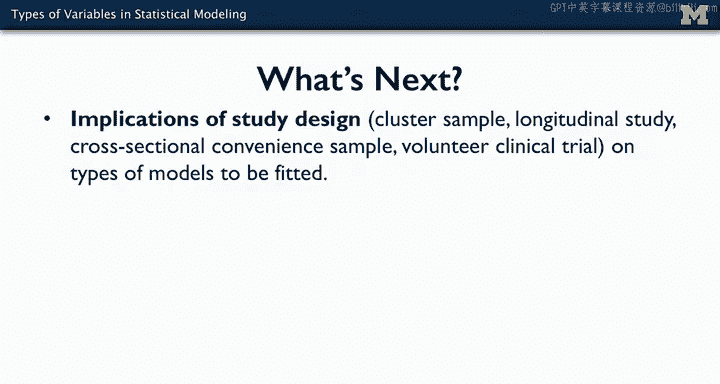

# 密歇根大学《使用Python的统计学（理解并可视化数据、因果推断、建模）｜Statistics with Python》中英字幕 - P69：3_统计建模中的变量类型.zh_en - GPT中英字幕课程资源 - BV1dV411Q7j3

Yeah。

Okay， so welcome back in this lecture we're going to consider types of variables in statistical modeling。

 so we're going to continue with our overview discussion of fitting models to data by thinking about the different types of variables that we might be interested in modeling and the implications of the type of variable for the models that we're fitting。

 we're going to talk about some key concepts in specifying models as part of this lecture and think about what to do with different types of variables when we're thinking about models for data。

So just to review some of the concepts that we learned about in prior courses in this specialization。

 we need to think carefully about the types of variables that we've collected when summarizing data。

 So remember， we talked about categorical variables， these take on a small number of discrete values。

 these could be variables like gender， race ethnicity， political party preference， region。

 binary indicators of events， etc ce， So we need to ask。

 are the categories of these variables ordered in any ways。

 So do the numeric categories have any meaningful ordering or are they simply discrete values like race ethnicity or region of the country。

Then we thought about continuous variables。 Remember these variables take on many possible values。

 So some examples include height age， income， blood pressure and the questions we asked about these types of variables were what does the distribution look like。

 What's the shape of the distribution， What's the center of the distribution。

 What is the spread look like， and is that variable normally distributed。

 or does it seem like a different distribution might make sense for that continuous variable。

 So these are important questions to ask about these two different broad types of variables that we might collect in a given study。

Now， when we talk about fitting models to data， we can think of other classifications of different variables and an important dichotomy when fitting models to data is the dichotomy between dependent variables or DVs and independent variables or IVs。

 So let's talk about dependent variables or DVs So other potential names depending on the field that you might be working in for dependent variables could include outcome variables response variables andogenous variables or maybe even more generally variables of interest。

 These are the variables that we are interested in modeling so we want to specify a model for dependent variables possibly as a function of other predictors or independent variables Our main objective is to model distributional features of these variables of interest as a function of other independent variables。

 So in other words， the distributions of dependent variables depend on the values of these other independent variables。

So what do we mean by independent variables or IVs。

 some other names that you might hear for these types of variables include predictor variables。

 covariates， regressors or exogenous variables， these are all really referring to the same thing these are the variables that are being used to predict the values on the dependent variables of interest when we fit models to data we examine the distributions of dependent variables that we're interested in conditional on the values of these independent variables that's our objective。

So a little bit more about dependent variables again， we want to model the DV。

 which is a variable of primary interest as a function of other theoretically relevant IVs。

 so the independent variables that we decide to include when defining the conditional distribution of the D。

 all of that's informed by our theory and our research questions and the questions that we really want to answer So our research question defines what the dependent variable is and what the independent variables are。

So this involves selecting a reasonable distribution for the dependent variable。 So for example。

 we could say that conditional on the values of the independent variables。

 the dependent variable follows a normal distribution。 That's one possible choice。

 It's not the only choice。 And then we define the parameters of that distribution， for example。

 the mean or the variance， as a function of or conditional on the independent variables。

 And we saw an example of this in our kickoff lecture。

 So the dependent variables could be continuous。 They could be categorical。 they could be binary。

 We choose a reasonable distribution， given the type of dependent variable that we've collected。

 and then we model the features of that distribution as a function of the values of the independent variables。

So as an example， we might assume that blood pressure is normally distributed。

 where the mean blood pressure depends on a person's age， their body mass index， or BMI。

 and their gender。 those could be three independent variables。So independent variables or IVs。

 these are theoretically relevant predictors of the dependent variables and we're interested in estimating the relationships of the IVs with the DVs。

 we're really going to emphasize that a lot in this course we want the choice of independent variables to be informed by our theory and our subject matter knowledge。

So independent variables might be manipulated by a research investigator， so for example。

 in a randomized experiment， we might randomly assign different cases that we're studying to either receive an intervention or a treatment or be assigned to the control group in this case group would be a predictiveor variable in the model that we're thinking about for the data。

Or the independent variables could simply be observed， not manipulated by an investigator。

 but just observe values in some type of data collection in these types of observational studies。

 where all the values in the variables are simply observed。

 It's more difficult to make causal inference about the relationships between variables。

 That is one variable causes the other。 In a lot of observational studies are primary focus is just on describing relationships。

 In randomized experiments， we have a little bit more power to make causal inference about the relationships of predictors like group with the dependent variables of interest。

If the independent variables are continuous， we can estimate functional relationships of those IVs with distributional features of the dependent variable。

 so recall from our first lecture， we were estimating the distributional features of a normal distribution for test performance as a function of age and we fitted that curlinear model to test performance as a function of age。

 so recall the scatter plot in the fitted model from our initial lecture。

If the independent variables are categorical， on the other hand。

 we could compare groups defined by the categories of those independent variables in terms of distributions on the dependent variables。

 so we're going to see some examples of how to do that as well。

Our best practice when thinking about categorical independent variables is to avoid estimating functional relationships of categorical variables。

 something like race， for example， with our dependent variables of interest。

 Now why is this the case Because actual values of categorical independent variables may not have any numerical may not have any numerical meaning。

 So if we coded race in our data set as values of 1，2，3，4 and 5。

 we can't really look at a scatter plot and look at the relationship of numeric race with something like test performance because those numbers don't mean anything。

 they're just referring to unique categories of race。

 So our objective with most categorical independent variables is to compare groups in terms of distributional properties of the dependent variable。

Now we may also talk about control variables when we talk about fitting models to data， remember。

 our goal is to estimate parameters that describe the relationships of independent variables with dependent variables。

So in randomized study designs， we attempt to ensure that the randomized groups。

 again one group might be a treatment group， another group might be a control group。

 we want to ensure that these randomized groups are balanced with respect to other confounding variables that may have a negative impact on estimation of our relationship of group with the dependent variable。

In nonranized or observational designs， the groups that define the independent variable may not be balanced。

 So randomization is a tool that we can use in study design to make sure that the values on all other variables of interest that may be related to the dependent variable are equivalent between the two randomized groups treatment and control and we lose this control when we talk about observational designs。

 So just as an example， in an observational study， males generally may weigh more than females and an analysis that looks at the relationship of gender as an independent variable with some other dependent variable that's related to weight may not yield clear estimates of the gender dependent variable relationship because there's other confounding variables in this case。

 weight that could have an influence on that relationship of gender with the dependent variable。

 So it's more difficult to control for this confounding problem when we have observational studies and randomization is a tool to avoid this confounding problem。

So when we fit models， we include several different independent variables。

 in the example that we just talked about， we might include weight as a predictor of our dependent variable。

 in addition to gender to effectively adjust for this confounding problem。

 So we're including the relationship of that confounding variable with our dependent variable to get a better sense of the relationship of gender with the outcome。

 when we adjust for values of the confounding variable。

 So if we're interested in comparing the distribution of blood pressure， for example。

 as a dependent variable between males and females。

 and we know based on our subject matter knowledge that weight is related to blood pressure。

 we could include weight in our fitted model as a control variable。 Now。

 this is just another independent variable， we're just adding another independent variable。

 but from a theoretical perspective， it's a control variable because what that means is we can control for the value of weight when talking about the relationship between gender and blood pressure。

 So then given the inclusion of this。Control variable in the model we can make inference about the gender blood pressure relationship given a value for weight。

 so conditioning on a value for weight if we have a male and a female and they both have the exam weight。

 the exact same weight， what would be the difference in means between males and females that's the idea of including these control variables to adjust for confounding and we're going to see a lot of examples of doing this。

Another key point when thinking about variables in fitting models is missing data。

 so it's very important before we start fitting models to data that we conduct simple descriptive and bivarirate analyses of the distributions on the dependent variables and the independent variables and a key aspect of this is checking for missing data on both the dependent variables and the independent variables。

Lwise deletion is a concept that refers to the case where units of analysis in our data set with any missing data on any of the independent variables or the dependent variables will be dropped from the analysis。

 This is generally a default in the software that we use to fit models such as Python。

 So what this means is that we could have 10 different independent variables and one dependent variable。

 All it takes is one missing value on one of those 10 independent variables for that entire unit of analysis to be dropped from the model fitting analysis。

And what happens is if the cases that get dropped due to this missing data problem are systematically different in some way from the cases that are ultimately analyzed when fitting the model。

 we could be introducing bias in the estimates of our relationships。

 and certainly we don't want to do that。 So we need to carefully consider if the cases that get dropped due to missing data are somehow systematically different from the cases that are retained to ultimately fit the model。

so if units with missing data are identified in descriptive analyses。

 we can compare the units with missing data， which would be dropped in listwise deletion to the units that have complete data。

 which would be retained in terms of distributions on variables that are fully observed。

 So if we fully observe gender for the entire sample that we've collected we could compare cases in terms of their distribution on gender and see if there are any noticeable differences。

 and this is simple we could use the techniques that we learned about in course2。

 so we could compare missing and nonmissing cases in terms of distributions on gender。

 possibly using a chi square test again， to see if there are noticeable differences in those two groups。

If there is evidence of differences， we may need to consider other techniques to get around this missing data problem Iutation is one possible approach where we can predict the missing values of those variables that have missing data as a function of other variables in the data set that's one possible approach and we'll revisit this over the course of the next series of lectures。

So what's next in our next lecture we're going to talk about implications of study design for the models that we fit。

 so remember from our first two courses we could have a cluster sample。

 we could have a longitudinal study， we could have a cross- sectional convenient sample。

 we could have a volunteer clinical trial， there are a variety of study designs that we use to collect data。

 and we need to think about the implications of study design for the models that were're fitting。

We need to recognize that study designs can affect the properties of our collected data。

 and the models that we fit to the data need to reflect these properties。

 so just as a simple example， if we collect repeated measurements of the same dependent variable from the same people over time。

 the repeated measurements of that dependent variable are going to be correlated with each other within an individual and we need to account for that correlation in the model that we specify for a given set of data。

