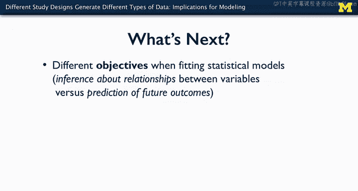

# 密歇根大学《使用Python的统计学（理解并可视化数据、因果推断、建模）｜Statistics with Python》中英字幕 - P70：4_不同研究设计生成的数据类型及其影响.zh_en - GPT中英字幕课程资源 - BV1dV411Q7j3

Okay welcome back so we're continuing our discussion of an overview of fitting models to data and some of the main ideas when we talk about fitting models to data with a discussion of different study designs and how different designs can generate different types of data and when we think about this association of study design features with the data that we collect。

 we have to think about the implications of our study designs for the models that we ultimately fit to the data。

 so our overall idea here is that different study designs generate different types of data and this has implications for the models that we fit to data。

So let's review what we learned from the first couple of courses and remember we talked a lot about where data come from when we fit statistical models to data。

 it's critically important to understand how the data were generated。

 remember we emphasize this a lot in the first two courses and this becomes especially important when we talk about fitting models to data so the data may have been generated from a carefully designed probability sample that featured cluster sampling perhaps the data came from a convenient sample or a non-probability sample maybe the data came from a longitudinal study or from a simple random sample。

 or maybe they arose from a natural or organic process。

 we have to be well informed about where the data came from before we start thinking about fitting models to data and we need to consider whether the features of these study designs need to be accounted for when we specify models for variables of interest。

So why does this matter when we fit a model to a particular variable in a set of data against some dependent variable of interest。

 our goal is to estimate the parameters that best describe the distribution of that variable。

 so so far we've introduced simple examples of estimating the means and variances of dependent variables possibly conditional on the values of other independent variables but another key aspect of estimating the distributions of variables of interest is the possibility that different values on a dependent variable of interest may be correlated with each other for one reason or another and oftentimes different types of study designs can introduce those correlations between different values on the same dependent variable and this may be a feature of the data that we need to account for when specifying our models。

So if aspects of the study design that generated these data affect these parameters。

 we need to account for these design aspects when fitting the models。

So let's think about simple random samples。 we talked about this idea in course1 when we talked about different types of sampling plans。

 simple random samples or SRS from carefully defined populations generally produce observations on a variable of interest that are independent and identically distributed so remember we introduce this term IID all the different values that we collect in a simple random sample are independent of all the other values and we assume that these values on a variable of interest arise from an identical distribution This is the IID idea。

So when we fit models to data from a simple random sample。

We select distributions for the variables of interest with the important property that all the observations in the data that we have for that variable of interest are independent。

 So we assume that the different values on that dependent variable are unrelated to each other。

 If the data did， in fact， come from a simple random sample。So here's an example。

 Suppose that we're interested in measuring the happiness of individuals。

 and we collect a series of observations on a happiness scale in a simple random sample。

 We might assume that these observations on the happiness scale come from a common normal distribution with some meme and some variance and zero correlation between any two randomly selected observations。

 So all the observations on the happiness scale are completely independent of each other and they follow an identical normal distribution。

😊，If we were to estimate the standard error of the estimated mean happiness。

 recalling some of our examples from the earlier courses， we would compute that standard error。

 assuming that the observations are independent of each other。

 So the sampling distribution for that estimated mean happiness would have a certain expected appearance if simple random samples were in fact selected and these observations were independent of each other。

So in a simple random sample， we ultimately have more unique statistical information and the more unique statistical information that we have。

 because all these observations are independent， the smaller our standard error is going to be that sampling distribution is going to shrink。

 And what that means for us is that we have more precise estimates。

 So this is certainly a nice feature of simple random sampling。😊。

So depending on the research question， if we were interested in modeling the difference in mean happiness between males and females。

 we might fit a model to the data that does not assume that observations all came from the same distribution。

 so for example we might say that the mean of a normal distribution of happiness scores depends on gender。

 so there's a different mean depending on whether we're a male or a female。

 the mean of the normal distribution shifts depending on gender。

But once we condition on gender in our model， all of the observations on the happiness scale are independent and have the same variance that might be a property of our model。

So another type of common study design is clustered samples。

 so clustered samples arise from study designs that generate clusters of related observations。

 these could be hospitals， clinics， schools or neighborhoods。

 you can see in the picture here we might select two neighborhoods here circled in red from some larger geographic area。

 you can see all those households are tightly clustered together。

Because observations from the same naturally occurring cluster will tend to be similar to each other。

 We need to account for this correlation when fitting a model to the data。

 and this is unlike models for simple random samples。 Now， when we're dealing with clustered samples。

 different values on a dependent variable of interest may be correlated with each other because those values come from the same cluster that was part of the study design。

So here's an example， if the study design produced several observations of happiness from selected neighborhoods。

 observations within the same neighborhood may well be correlated with each other。

And a model that we specify for happiness would potentially include additional parameters that capture this within neighborhood correlation。

 So we allow observations on happiness within the same neighborhood to be correlated with each other In the models that we've considered so far in our examples。

 we've just assumed that all the observations are independent。

 But we're going to talk about how to fit models to correlated data like this。😊，Now。

 it's important when we think about the standard error of an estimated meme。

 that standard error would reflect this correlation and recall from our discussion of complex samples that when we do have a clustered sample。

 we have less unique independent information because some of our observations are correlated with each other。

 We don't have as much independent information as we would have in a simple random sample。

 So because we have less unique information， This leads to a higher standard error。

 there's more variability in that sampling distribution。

 depending on what clusters are ultimately sampled for the study。

Another common study design is longitudinal。 so in longitudinal data。

 we collect repeated measures of the same variable collected from the same unit over time。

 and because we're measuring the same unit of analysis over time。

 these observations are likely correlated with each other。

 So you can see in this example graph here on the right hand side。

 The values for a given individual we see I D 1，2，3，4 and 5。

 the values for a given individual over time tend to be consistently high or they tend to be consistently low。

 So there's a within subject correlation in the values that are collected。 And again。

 like in clustered samples， the recorded observations on the variable of interest are no longer completely independent of each other。

So models that we fit to repeatedly measured variables in longitudinal studies need to account for this within unit correlation。

 very similar to cluster sampling， so we estimate additional parameters in that model that describe the within unit correlation and we're going to talk about how to do this。

So it's important to make this distinction between dependent and independent data we're going to keep revisiting this throughout this course and fitting models to data。

 so it's important to make a distinction between models for dependent data where we have correlated observations due to some feature of the study design。

 for example， cluster sampling or longitudinal measurement and independent data where observations are completely independent of each other and they may or may not arise from a common distribution。

So we're going to keep revisiting this dichotomy when we think about appropriate models for data。

The whole point here is that we want the best possible model for a given variable。

 and that best possible model should reflect important study design features that affect the distributional properties of our variables of interest。

So what's next， we're going to talk about different objectives when fitting statistical models。

 so we introduce the ideas that we might fit models to make inference about relationships between variables or we might fit models to predict future outcomes and we're going to talk about that difference in objectives coming up we're also going to introduce alternative approaches to fitting models and making inference about parameters that define the models specified for observed variables So recall we introduce the ideas of frequent inference and Bayesian inference in course2。

 we're going to come back to this idea as we talk about model fitting approaches。

