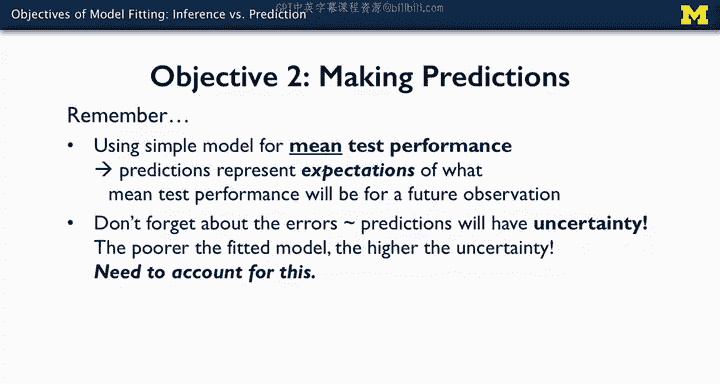

# 密歇根大学《使用Python的统计学（理解并可视化数据、因果推断、建模）｜Statistics with Python》中英字幕 - P71：5_模型拟合目标：推断与预测.zh_en - GPT中英字幕课程资源 - BV1dV411Q7j3

Okay， so welcome back to our week one discussion， presenting an overview of fitting statistical models to data using Python。

In this lecture we're going to be talking about key objectives of model fitting and these include making inference about the relationships between variables or making predictions of future outcomes。

 so we're going to present an overview of these two objectives。

So we have these two main objectives when we want to fit statistical models to data， first of all。

 we might be interested in making inference about the relationships between the variables in a given data set that might be one main objective。

A second main objective might be to make predictions or forecast future outcomes based on models that were estimated using historical data。

 So this is used a lot in the popular media when you hear about making predictions of future events。

 those are all based on statistical models。So let's consider our first main objective making inference。

 We'll revisit an example from earlier this week where we were looking at age or a standardized version of age as a potential predictor of performance on a test。

 And remember， test performance could range between 0 and 8 points。 And remember。

 we fitted this model that allowed the relationship of age with test performance to be nonlinear。

 We see this nonlinear relationship of age with test performance where for moderate values of age。

 we see the highest expected test performance。😊，So remember。

 the regression model that we fitted to describe this relationship said that performance was a function of both age and age squared。

 and we were interested in estimating the parameters A， B， and C。E， remember。

 is the error or the actual performance minus the predicted performance based on our model。

 and that predicted performance is calculated using the regression function。

 which is defined by a plus B times H plus C times age squared。

 That regression function defines the expected mean of performance as a function of age。

 The errors then are normally distributed with mean 0 and constant variance。

 depending on a value of age。 So again， we say that the mean performance。

 The model that we're specifying for performance defines the mean to be a plus B times H plus C times age squared。

😊，So if our objective is to make inference about the relationship between age and performance。

 we're interested in examining estimates of the regression parameters， A， B and C。

 Once we have estimates of these regression parameters and their standard errors， we can。

Test hypotheses about whether parameters are equal to 0。

 or we can form confidence intervals for these parameters and determine whether or not the value of0 is contained within the confidence interval to make inference about whether the predictor age is important。

So remember our model is performance is defined by a plus b times H plus C times H squared。

 plus those errors where the errors are normally distributed with mean 0 and constant variance sigma squared So we fit our model using Python or some other software and our parameter estimates are A is equal to 5。

11 B is 0。24 and C is negative 0。26 and you see the corresponding standard errors for these parameter estimates based on the analysis。

For each parameter， we could calculate a test statistic to test the hypothesis that that parameter is equal to0。

 so if that parameter is equal to 0， that basically means that it's not important in defining the mean of performance。

So our test statistic is going to be the parameter estimate minus0 divided by the standard error of the parameter estimate。

 where zero again corresponds to our null hypothesis。So for parameter B， for example。

 we would calculate a T statistic again defined by the estimate minus 0 divided by the standard error。

 and that works out to be 0。24 divided by the standard error 0。06， which is 4。

The estimated coefficient for age， therefore， is four standard errors above 0 above that null hypothesis value。

 This is a very big difference， and it would be very unlikely to see a parameter estimate this large if that null hypothesis actually held。

 So as a result， we would reject the null hypothesis that that parameter B is equal to 0 and conclude that this is a significant result。

 So the parameter B is definitely non-ze in defining this relationship。

We could compute test statistics for parameters A and C in the same way to assess if they are significant。

So here are all the estimates again。 And then in the blue box。

 you see the corresponding test statistics for A， B and C。

 And we can see that all these test statistics are very large。

 if the null hypothesis were to actually be true。 So for each parameter， that test statistic。

 which represents a large distance from the null hypothesis。

 would suggest that the null hypothesis that the parameter is 0 would be strongly rejected。

 So we would conclude here or infer that the relationship between age and performance is， in fact。

 significant。 if both B and C were no different from 0 when looking at those test statistics。

 we would infer that age does not have a relationship with performance， but that's not the case here。

Okay， so we want to make inference about relationships， let's think about the estimate of a。

 which was 5。11 with a standard error of 0。10。A represents the mean test performance when age is equal to the overall mean in the data set。

 the overall mean age that is。 So this suggests that the average test performance at this age is 5。

11 points， and this average test performance is significantly different from 0。

 So people at the average age definitely have a non0 mean test performance。

Let's think about that parameter B， the estimate of b was 0。24。

B represents the expected rate of increase in test performance when the standardized age is equal to 0。

 we have that special interpretation because we have age squared included as a predictor in the model。

 so we have this nonlinear relationship， this quadratic relationship that's defined by a parabola。

So this is positive and significantly different from zero so this suggests that that initial rate of increase when standardized age is 0 is significant and positive。

Now， let's think about C。 C was negative 0。26 with a standard error of 0。03。

 C represents the nonlinear acceleration in performance as a function of age and captures the extent of this nonlinear relationship。

 So the negative value means that after initial acceleration。

 additional increases in age reduced test performance。

 and this aspect of the nonlinear relationship is significantly different from0。

 So this defines that overall nonlinear or curline relationship that we saw for the fitted model。

So if we think about it， what if the estimate of C was not significantly different from0。

 that suggests that the relationship between performance and age is actually linear because if that parameter C is equal to0。

 that means that the relationship is just defined by a plus B times H and intercept and a slope。

So if C was not significantly different from zero based on our test statistic。

 we would have evidence of a strictly linear relationship between performance and age。

 and clearly that's not the case here。So let's think about our second main objective。

 It could be to make predictions based on the models that were fitting。

 So the scatter plot on the right shows predicted values of test performance as a function of age based on the fitted regression model。

 so we can write down that regression model here in the yellow box。

 We would say that performance is defined by 5。11 plus 0。24 times age minus 0。

26 times age squared plus some error。 So given this model。

 we could plug in values of age to compute predictions of test performance。 And again。

 the graph shows the fitted line， the dashed red line represents the expected values of performance as a function of age based on the fitted model。

So here's an IVQ， we can think about using the fitted regression model to predict the performance of standardized age or when standardized age is equal to positive1。

So let's think about what that predicted performance would be using our model。

 we plug in a value of 1 for age， so we would calculate 5。11 plus 0。24 times 1 minus0。

26 times 1 squared that gives us a predicted value of 5。09 points for performance。

 and we can see where that prediction would fall on the dashed red line in the plot to the right。

So does 5。09 points make sense with the plot， yes it does again， we would predict a value of 5。

09 by plugging in a value of 1 unstandardized H， and you can see that in the visualized relationship。

So remember， we could use a simple model to calculate mean test performance based on a simple model where we don't have age as a predictor。

 we could calculate expectations of what the mean test performance would be for any one future observation。

But we can't forget about the errors。 These predictions will all have uncertainty。

 So the poorer the fitted model， if we're not describing that relationship between age and test performance well。

 the more the uncertainty。 So if we had fitted a very simple model for performance。

 where we didn't have age as a predictor， we would just make the same prediction for everyone。

 regardless of their age， they would have the overall mean on the dependent variable。

 But there's going to be more uncertainty associated with those predictions when we include predictionors in defining the meme。

 we reduce that uncertainty and we have more precise predictions。 Either way。

 when we make predictions， we need to account for this when describing those predictions。

So we could also make predictions of something else aside from the meat， we could predict。

 for example， the 95th percentile， but the key is whenever we make a prediction based on a fitted model。

 we also have to describe the uncertainty associated with that prediction。

 So observations are going to bounce around that predicted value in reality。

 and we have to describe the amount of uncertainty associated with that prediction。

Okay so we talked about these main objectives of fitting statistical models to data we could be interested in making inference about the parameters that define our model and describing relationships between variables。

 or we might be interested in making predictions of future observations based on the fitted model So what's coming up next we're going to talk about how to compute those parameter estimates when we fit models to different dependent variables。

We're also going to talk about how to test hypotheses inform confidence intervals and make inferences and also make predictions in more detail。

 This was just an overview。 And remember， we always need to assess the overall quality of the model fit when we're fitting models to data and we're going to discuss different schools of thought about model based inference。

 and mainly this boils down to a discussion about the difference between frequentist inference versus Bayesian inference。

 So we're going to talk a lot more about all these topics coming up shortly。

