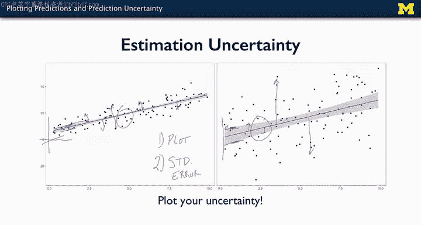

# 密歇根大学《使用Python的统计学（理解并可视化数据、因果推断、建模）｜Statistics with Python》中英字幕 - P72：6_预测值及预测不确定性绘图.zh_en - GPT中英字幕课程资源 - BV1dV411Q7j3

。

Hello everyone， Today we're going to be talking about plotting predictions and prediction uncertainty and always making sure that we check the variance of our data。

So as an overview， most modeling and statistics is concerned with estimating this mean function。

 This kind of point estimate of the model， its our best prediction given our model。 And today。

 visualization of uncertainties is often as important or more so than the prediction itself。

 And I want to drive this home to make sure that we don't blindly fit models。

 but we actually kind of see what's going on with the standard errors。

And we eventually kind of build up a picture of this。So to get this started。

 I want to start talking about kind of a little case。 Imagine that you're a data scientist。

 Imagine you're a statistician and imagine that I plotted my data。

 and I saw the scatter plot to the right。 Your boss comes in。 He ends up saying， hey。

 I need you to fit this model before we go home。 I have some past data。 I have some new data。

 I want to be able to make some predictions。so I plotted the data， my boss says， hey。

 you a linear model seems like it'll be okay。 you should definitely fit one。

So that's exactly what I'm going to do。So I go down。

 I know that a linear model is of the form y equals a plus bx and I am up fitting in and I end up seeing hey。

 my slope parameter is approximately 2。97。 and whenever I end up fitting it， my intercept term is 5。

43。So I know fitting this data， I now can go about making predictions for my boss。

 He hands me the new data。 Everything should be fine in the world。RightThe problem is。

 is that all of a sudden， right before I'm about to go home。

 he ends up pulling me back into the room。And hes up saying， hey， before you go。

 we have this other set of data。Right， we had this other set of data。

 It may have been from another data source。 It could have been from a different sensor。

And what we we end up doing is we naturally we're going to plot in。

 we're going to see if a linear model still seems like it's going to make sense。

 we may want to run it on this data as well。RightSo I'm going to fit this linear model again and I'm going to get the line in blue。

But something's interesting， right， So I see the form of the equation。 y equals a plus B X。 I fit it。

 I get a slope of 2。97。 I get an intercept of 5。43。And we needed to pause， and we needed to say。

 wait， wait a second。Wasn't this model。Exactly equivalent to the one that I got before。

And this is something that we need to watch out for。 A lot of times。

 whenever we're doing uncertainty predictions， whenever our boss hands of something。

 sometimes we're in a rush。 and sometimes we just look for point estimates。

This is a very common mistake。 whenever people are first starting out in predictive modelling。

 I they end up looking at these point estimates and they think that that's the entire story。

 But the question that I have for you is， which model would you rather use。If I have this data。

 right， and my boss tells me， hey， my prediction uncertainty， I'm okay plus or -10。

 readyy tells me that's the tolerance that I care about。 Let's say that I'm working with this data。

Or I'm working with this data and he tells me， hey。

 my prediction uncertainty is still plus or minus 10。

 which one would I feel more comfortable about doing？Right。

 which one would I feel more comfortable about making predictions on？

They have the same regression line。 So if I just look at the estimates。

 I wouldn't know what's going on， but they have wildly different variances。

This leads me to something very important。And this is to always make sure that you plot the uncertainty in your graph。

So we can see in this first graph if I'm looking at these predictions of points， right。

 all of my variance。Is clustered pretty close。To my prediction line。This gray band， right here。

Tells me how uncertain I am about the slope of the line。

So about how I am about the slope of the line。Conversely， if I look over at this plot。

 I have a much higher point to point variance， So I have all these points right there far higher。

And far lower， compared to my mean。But they both have the same slope。

The difference here is I can see that the prediction uncertainty in my first draft here。

Is far less than in my second graph here。And so what this tells me is in the first graph。

 I'm relatively certain。That my line。My point estimates， my intercepts in my slopes。

Are about what I want。 But in the second diagram， we can see that， hey， I have a lot of uncertainty。

Around the slope parameter。And because of this， I may want to be pretty hesitant whenever I'm using this model to make predictions until I get more data。

Sometimes all we have are the data that we can work with， what we have on hand。

But we always want to make sure that whenever we're making predictions that we account for this。

So there are two different ways that we can always think about this， number one。

 we can always plot our data。Right， so the first one is plot。We plot our data。

Whenever we plot our data， we're trying to see， hey， what does the variance look like？

At the end of the day， though， sometimes this is not possible。

 And so the second thing that we may want to look at。Are these things called standard errors。

In these standard air， as we've seen earlier in the course。

 give us an idea of the uncertainty around our prediction estimates。 So in this one。

 in this first line， we would have a very small standard air。

 I can see that my confidence bands for my slope are pretty small。But in this picture over here。

 I would have a relatively wide standard error。 I don't have good resolution on the prediction of this slope。

 I don't have a good idea of what the exact value may be。And as a result。

 I would be much more confident making predictions with this model。Then this one。

 all things else being equal。

So we can determine most of our uncertainty using this notion of standard errors。

 given that the model assumptions are all met， standard errors provide how far we expect our estimates。

 in this case， of slope to deviate from the truth。And so what I'm showing in this table is if I take the estimate of A And B。

 right B is my slope。 A is my intercept。 I'll go back to our equation and see that。A is my slope。

 B is my intercept。I can see then in the first model。 my standard errors are 0。92。And 0。

15 respectively。 And in the second model， we can see that in both cases。

 the standard error is bigger。And what this tells me is。

I have a higher resolution in the first model for my parameter estimates than in my second model。

Even though。It is the case that both of these lines have the exact same slope and the exact same intercept。

I would feel much more certain about using this one to make predictions because my resolution of the parameters are much better。

As opposed to using this one to make predictions whenever I have a lot of uncertainty。

Around that intercept term and quite a bit of uncertainty around that slope term。

The one thing that I want to mention is every statistical model has a different set of standard errors。

 how you calculate them as different。 So this is definitely something that if you are going into modeling。

 If you're going to use something， you always want to check。

Before you end up going about predictions， how do they calculate the standard errors。

 How do they calculate this notion of uncertainty and always make sure that if you can。

 deploy plot the prediction bounds。This will help out greatly for whenever we're doing inference。

Oh if possible， always plot your data。And if using a model。

 always try to determine what the variance is on your estimates。

 This notion of standard error can be really important in that regard。

If we have a high variance of estimates， we should use caution whenever we're using them。

And the reason for this is if we don't have good resolution on what these parameters are。

 we may just be picking up a lot of noise。And whenever we're going to be going about predictions。

 we want to make sure that we're not modeling just noise。

 We want to make sure that we're modeling signal and in both cases。

We would much rather prefer to be in this scenario of the world than this one。Thank you。

