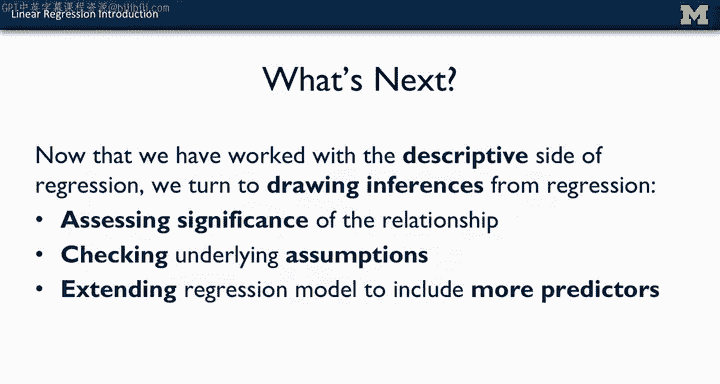

# 密歇根大学《使用Python的统计学（理解并可视化数据、因果推断、建模）｜Statistics with Python》中英字幕 - P74：8_线性回归导论.zh_en - GPT中英字幕课程资源 - BV1dV411Q7j3

Welcome。In this lecture， we're going to get an introduction to linear regression。For our example。

 we're going to use our cartwheel study data。We had 25 team members， colleagues。

 all adults who were asked to perform a cartwhe。Now there were many variables that we did record。

 but our primary outcome of interest are our response variables going to be cartwheel distance in inches。

The distance traveled from the start to the end of that cartwheel。

So here's a quick look at some of the data。Cartwell distance is our quantitative response variable in inches。

And there are a few other variables that we might be interested in looking at to see if there's a relationship between。

 say， the height of the person and cart will distance。Or whether that completion status。

 whether they completed the carwhe。Did the cartwhe with the feet over the head and landed on their feet。

 whether that also impacts cartwel distance。So a possible research goal and some questions might be to develop a model to be able to predict the average cartw distance for our population of such adults。

In particular， is the height of the person going to be a useful predictor for cartwhe distance？

Does knowing if they actually completed the cartwhe make a difference in terms of that average cartwel distance？

Well let's first start taking a look at our main outcome of interest。

 here's a summary of our quantitative variable we have our histogram。

 QQ plot shows reasonable normality overall， but if you are needing to predict the cartwhe distance for the next randomly selected adult who's going to perform a cartwheel。

We would likely just use our data here and report an estimate of 82。

48 inches because that's our mean of our sample。But we know there could be other characteristics or variables that might influence what that cartinval distance might be。

In particular， we were wanting to see if there's a relationship。

 whether height could be a useful predictor for cartw distance。

Though process here would be that taller people might generally have a larger cartwhe distance be able to make a cartwel that goes further。

So is there a significant， positive， linear relationship between the height of a person and the cart will distance traveled？

To examine this relationship visually， we would make a scatter plot。

Our dependent variable or our response variable of interest is cart will distance on the Y axisxes。

And our independent variable our predicting variable or explanatory variables going to be height。

Now when looking at a scatter plot， we often like to write up a little summary about what we see。

Here's sort of a guidance of some of the things we might explain in that write up。Form direction。

 strength and outliers。So take a moment and come up with what your description would be regarding this relationship between cartval distance and height。

In looking at our scatter plot of cartwhe distance and height。

 we do see approximately a linear relationship it certainly is positive in its direction。

There's a bit of scatter in the points around that perceived linear pattern。

 so maybe be weak to moderate for the strength。And outliers。

 there is no individual that's substantially further away from our underlying linear model than any other。

So we might go ahead and start thinking about modeling this relationship。

Now to quantify that strength a little bit more， we might report the correlation coefficient。

Remember r is between negative 1 and1， so here it's positive indicating the positive relationship we see。

 0。33 really falling in that week to moderate range。

Another quantity that is important in regression is to look at what we call r squared。

And for one explanatory variable one response， that's both quantitative。

 r squared is just the square of our correlation coefficient。

And that's going to tell us that only about 11% of the variability in our cart will distances can be explained by this linear relationship we see with height。

Looking at just cart will distance on the Y axes， there is quite a bit of variability。

Anywhere from below 70 inches up to over 110 inches for that cart wheel distance。

But some of that variability can be explained by this linear relationship it tends to have with the height of the individual。

But only about 11%。So if we wanted to come up with a best fitting line。

 a line that we could use for making some predictions， cart will distance from height。

Most people think of a general line as being y equals Mx plus B。

When we're viewing that equation of line as being a linear model， a regression model。

We often use notation of Y hat because we're going to be using our estimated regression line to do predicting。

And then we have B0 and B1 as our coefficients for the interceptence slope。

This notation allows us to think about being able to build that model out further if we had another independent variable or explanatory variable。

 we could keep that going with plus B2 times W and so on。So what about our Y intercept。

 that usually visualize as being the estimated response when x equals 0。

That may not always be meaningful， depending on the context。

Usually the coefficient that's of more interest in a linear model is the slope coefficient。

We think of this as being the change in y over change in x or the estimated change in our response when we increase our x by just one unit。

So if we wanted to come up with a best fitting line。

We could look at our scatter plot and each person might put a line in that looks pretty good。

 but might be a little bit different， so we need a criteria for what is going to be best。

There are a number that we could choose from。But one idea would be， well。

 if we were going to use the line that we put in our scatterpot here as our predicting equation。

 we can see that of course， all the points fall on that line。And when they fall off。

 there would be an error in making that prediction using the line compared to what they actually did observe。

We have a 64 inch height adult who had a cart will distance that was observed to be a bit higher than what we would have predicted it to be with this particular line。

That vertical distance of the points from the line is our observed error。

And every individual point produces this observed error or sometimes called a residual。

We would like those errors to be small。Some will be positive， some will be negative。

So one criteria for coming up with the best fitting line。

Is to take all of those errors and let's not worry about the positive negatives canceling out。

 so let's square them。And add them up。Let's find the line that minimizes the total squared observed errors。

That is called the least squares regression line。So with that criteria。

 we can use software to come up with that best fitting line for us most the time you're going to see that information about the equation of your line in the coefficient section of the output。

In this case， the coefficient for the constant term or the y intercept term is 7。55。

And our coefficient that goes in front of our explanatory variable of height is 1。1。

So this slope estimate here。Would tell us that we would estimate an adult who is one inch taller than another adult。

Would be estimated to have a cartwhe distance that's about 1。1 inch longer on average。

So we can use our line now to do some predictions。What would you predict the cart will distance to be for an adult who is actually 64 inches tall？

Use our best fitting model and come up with that prediction。

We would like to use our predicting equation to come up with an estimate of what the adult who is 64 inches tall might do for a cart will distance。

While predictions are pretty easy， we just have to plug in our value for our explanatory variable in this case 64。

We would want to just make sure we're making prediction that's reasonable。

We want to make sure that our value of our x， our height in this case。

 is in that range of where we modeled the relationship and not outside that range。

 in which case we might be having a risky prediction called extrapolation。

But here 64 inches was right in the range of our height data。

 and so our predicted cart will distance would be 78。4 inches。

Now since every person who's 64 inches tall would be predicted to have a 78。

4 inch cart bill distance。We could also use the 78。

4 as an estimate of the average cartw distance for all adults who are 64 inches tall。In fact。

 that's what our regression model is really doing， it's giving us an estimated mean response。

 conditional on X。An estimated response。Based on the value of x。

Now that we have our actual predicted height， we can look back into our data set and see that we had a 64 inch tall adult who performed a cartwheel。

 and their distance was 87 inches。So now come up with that observed error or the residual for this one observation in our data set。

We had a 64 inch tall adult who performed a cartw of distance 87 inches。Using our predicted equation。

 we would estimate their carinal distance to be only 78。4 inches for a difference of 8。6 inches。

Residuals are defined to be the observed response minus the predictedant。And in this case。

 this particular observation had a residual or observed error of 8。6 inches。

We would be able to calculate the residuals for every observation in our data set。And in fact。

 those residuals will be used to do some model checking later。

So we have now worked more on the descriptive side of regression。

We looked at a scatter plot of the relationship， we came up with a best fitting model。

That fit our data well， we are now wanting to turn to drawing inferences from our regression。

Being able to assess if we have a significant relationship。And in order to do that assessing。

 we need to have some assumptions that might be met and checking whether those assumptions are reasonable。

We also might want to think about extending our regression model to maybe include more predictor variables。

