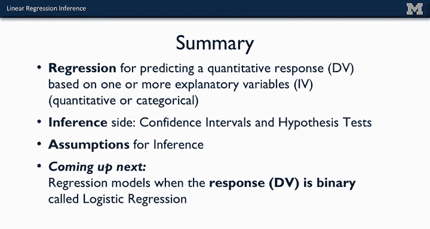

# 密歇根大学《使用Python的统计学（理解并可视化数据、因果推断、建模）｜Statistics with Python》中英字幕 - P75：9_线性回归推断.zh_en - GPT中英字幕课程资源 - BV1dV411Q7j3

Welcome。In this lecture， we'll talk about the inference side of linear regression。

We were looking at the regression of cartwhe distance on height。

We saw an approximate linear relationship， and we came up with our best fitting line using the least squares technique for predicting cart will distance as a function or conditional on the person's height。

Now， one of the questions of interest was to see if we have a significant positive linear relationship between our two variables。

In that case， we're really trying to focus on the slope。So let's think about it。

 what would it mean if the slope of our regression line was zero？Gt。Well。

 then no matter what value we plug in for our explanatory variable or x。

 we're going to estimate or predict the same response。So in other words。

 knowing the value of x is not really helping us to do a prediction。

The slope in R equation between cartwell distance and height was 1。1。But this， of course。

 is just an estimated slope based on some data。If we were to repeat the study again with another 25 adults。

We would likely not get the same exact slope estimate in that next study。

But we could potentially imagine。Having the entire population of all the data on cartval distance and height。

And if we started adding those observations to our scatter plot。

 our scatter plot's going to get busy very quickly。We'd be putting in all of these points。

 in fact some of them would start to stack up there'll be lots of people who are 66 inches tall and having different cart will distances。

But if we did have the entire population of data。We could fit the line to that population of data and come up with the true regression line。

There is a true underlying why intercept and slope。And it is that underlying true slope， beta 1。

Notice the parameter here is represented by a Greek letter beta。

For which we want to assess if that true slope is zero or not。In our case。

 we're looking to see if that true slope might be positive。So we have information on this inference。

Next to our coefficients， where we pulled off the values to give us our equation of our line。

 we've got some information that does test hypotheses about those underlying true interceptent slope。

Looking at the row with our label of height， we have our coefficient our estimated slope。

 our B1 of 1。1。Now that's not equal to zero， but we're interested in seeing how far away from zero is it to show if there's evidence to conclude that the true slope might not be zero。

Well， one piece of information we need is that standard error。So here this 0。67。

Is estimating for us how far away。Estimated slopes， like the one we got here。

 are going to be from the true slope on average。Taking those two pieces of information。

 we form ourT statistic。It is measuring how close is our estimated slope 1。

1 from zero in standard error units。Our estimated slope was 1。65 standard errors。Above 0。

So that's starting to be a pretty good distance from zero。

Converting that to a probability value our P value。Is given next， 0。112。Which is not that small。

 certainly not significant at even a 10% level， but this is the P value for a two sided alternative。

So if you wanted to assess whether the true slope is zero or not zero。

 we would report this level for our P value。Our initial research question was a significant positive relationship between our two variables。

 so our alternative theory would be looking for the true slope being greater than zero because that was the direction that made sense。

So ourP value would not be the two tails together for probabilities， but just the one tail。

So we need to take our two side of P value and cut that in half。

Our P value for assessing a significant positive linear relationship between cartal distance and height turns out to be 0。

056。Significant at a 10% level， but not at a 5% level， marginally significant。

We might also be interested in reporting a range of values for which we might say is reasonable for this true slope。

 a confidence interval。That is reported a little further down at a 95% level for us。

So with 95% confidence。The population mean change in cart will distance for a one inch increase in height。

Would be estimated to be anywhere from 0。2 inches shorter。

But up to as high as two and a half inches longer。We might have one other inference in mind。

Now we've used our regression line to estimate the average cart will distance for all adults who are 64 inches tall。

 We just plugged in that 64 and got our 78。4 inches as our estimate for the mean cartw distance。

We might want to take that estimate and make an interval around it。

An interval of reasonable values by going out a few standard errors。

This would be forming a confidence interval for the mean response at a given X。

And we could do that not only for those people who are 64 inches tall。

 but for any height in our range of our data。In which case we've added that to our scatter plot here and have formed these 95% confidence interval bands。

Now we can see that these bands are actually curved， they're not parallel to the regression line。

In which case， there is a point at which those bands are narrowest。The intervals。

 the confidence interval for a mean response is going to be narrower。

For values that are closer to our sample mean height。The average height in our data was 67。6 inches。

 and that's the value for which our conference interval bands will be the narrowest。

Little bit more risky， little more variability when we're trying to estimate averages that are further from that mean。

Now the formulas behind calculating these confidence intervals are a little messy。

 but we do have technology that can help form those values for us。

We might also be interested in taking a prediction for an individual adult who's 64 inches tall。

Taking that 78。4 and going out a little bit each way to represent a range of values for an individual outcome。

Those are called prediction intervals instead of a confidence interval for the mean。

Prediction intervals can also be created for individual responses and they will tend to be always wider than the corresponding confidence intervals for the mean response。

It's a little harder to predict for individuals， little more variability that needs to be counted for than to try to estimate the mean。

All of these inference techniques require some underlying assumptions to be reasonably met。

We fit a regression model。 We regress cart will distance on height。

So here's the expression for that model， an individual cartwhe distance。

iss listed as being a linear function of height， and this is that true mean response at a given height。

 and of course any individual cartw distance is going to vary from the mean。

 and that's what that E represents that random error。

These errors should be normally distributed around zero。

And have a constant variance that does not depend on the height。

So these are some of the things that we're going to have to check out and see if it's reasonable focusing on those assumptions。

 those parametric assumptions about the error terms。Now。

 the true errors need to be normally distributed。But we can't look at the true errors。

 we don't have the true regression line to get the true distance of each point from the line。

 we have an estimated line from data。Those observed error terms。

 those residuals or realized values of the error terms are what we can then use to make appropriate graphs to check for that normality condition。

Here' is a QQ plot of our residuals from our regression model。

And if we remember in a QQ plot we're tryinging to see our values from our data。

 match up well with the theoretical values for a true normal distribution and if they do。

 they should fall along this straight line with a positive slope pretty well。

Normallyorality seems to be pretty reasonable here based on our residuals。

We're also hoping to have these error terms be normally distributed around zero with a constant variance。

 so here is a residual plot， a plot of our residuals now against the height。

And what we can see after taking out the linear part。

We want to see a random scatter of points around zero。

With the points falling sort of in a constant horizontal band。

 that variability at low values of height and the variability of the higher heights is about the same。

And that is evident here。The data can also be used to come up with an estimate of that constant standard deviation。

 How far off are the observed values from the predicted values on average。

 that standard deviation sigma。Can be estimated with the data and we would have here about 14 and a half inches。

So we have a good amount of variability still to deal with。Our overall model fit then looks fine。

But can we do a little better。Let's consider adding another variable， another independent variable。

 in this case， figuring out whether knowing they actually completed the cartw or not。

 would that make a difference in terms of what we might estimate the average cart will distance to be？

So're going to be working with the variable that was the completion status。

 did they complete the cartwhe yes or no， which we have coded into an indicator variable。

One indicating complete， zero indicating not complete。Here are the results of our regression。

We have a new estimated intercept， an updated coefficient for height。

 and now we have a coefficient for this complete status， this indicator variable。

That coefficient of six is telling us that shift that is expected when you move from a baseline level。

 a reference level of not completing zero to being a completed cart it was done。A shift of 6 inches。

Let's look at how we might interpret these coefficients now that we have more than one independent variable in our model。

Are high coefficient now we'd be looking at。Say two adults that had the same completion status。

 whose height differ by 1"ch。We would say would tend to have a cartwell distance that differs by about one and a quarter inches。

Are completion status coefficient？Can be talked about when we're comparing then adults who completed a cartwheel versus one who did not。

 but they have to be of the same height。Then the completer will on average。

 have a cart will distance that's about6 inches longer。

So important in a regression where you have more than one explanatory variable in the model is that each coefficient is only going to be meaningful when you're comparing across the same level for all the other variables。

Are height coefficient to 1。26 only meaningful when we're comparing two adults that are at the same completion status for that indicator variable。

The complete coefficient of about six inches only meaningful when we're comparing to adults that are at the same height。

Here's a nice visual picture of that shift of six inches。

The regression line for completers and noncomprs with the red or taller line above being the one for the completion status。

And then we also would want to take a look at some of the residuals for helping us assess if our inference would be reasonable。

 and here's our residual plot showing again a nice random scatter。

Around zero with the constant variance。So now maybe our inference question is。

 after adjusting for completion status， do we seem to have a significant positive。

 linear relationship between cart will distance and height？Looking at our results。

 we have our coefficients and we want to work with that information we have here on the inference to address this question。

So take a moment to think about what your answer would be and what information from this output you're pulling off and using to make that assessment。

We've brought in another variable into our model completion status， so after adjusting for it。

 our estimate of the height coefficient is now 1。26 inches。And the standard error is about 0。7。

Our P value for assessing if we have a significant positive association now between height and cart will distance after adjusting four completion status will take that two sided P value of 0。

085 and cut that in half。04So we do have a significant positive association between height and cart will distance after adjusting four completion status。

Our estimate of how far off our predictions might be from the observed values is still though about 14 and a half inches。

In summary。We have started looking into regression。

Regression for being able to predict a quantitative response or dependent variable based on one or more explanatory variables or independent variables。

 and we've even seen how we can have both a quantitative or categorical variable in our model。

On the inference side， we looked at some confidence intervals and some hypothesis tests to assess if we have significant relationships。

These inferences do require some underlying assumptions to be reasonable。

And we've learned how to state those assumptions and check them。

Coming up next then is how to handle the regression models when our response variable。

 our dependent variable， is not a quantitative response， but rather binary。

A one or zero this is called logistic regression。