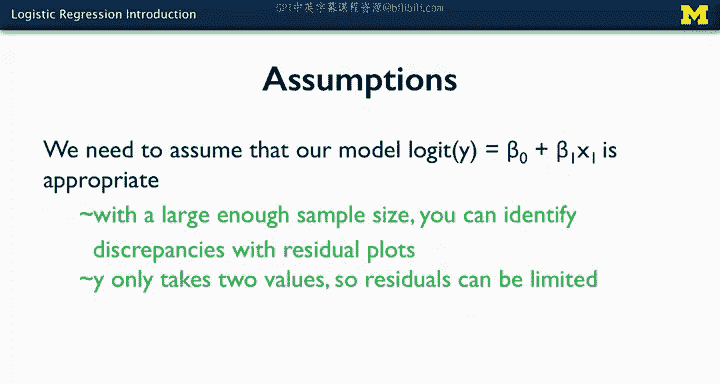

# 密歇根大学《使用Python的统计学（理解并可视化数据、因果推断、建模）｜Statistics with Python》中英字幕 - P77：11_逻辑回归导论.zh_en - GPT中英字幕课程资源 - BV1dV411Q7j3

Welcome back In the last few videos you've been learning about linear regression for the next couple of weeks。

 we'll be extending that framework of linear regression。 So if you're a little shaky about it。

 you might consider going back and revisiting that topic。😊，In this the next two sets of videos。

 I'll be talking about logistic regression， which is an extension to linear regression。

In our case we'll be using that cartwheel data still。

 so remember that we took a random sample of 25 adults and asked them to attempt a cartwheel。

Our primary variable of interest will be whether or not that individual completed a cartwheel。

 whether they started the cartw， put their hands on the ground， had their feet go over their head。

 and landed with their feet in front of where they started。

So looking to see whether they completed the cartwhe。😊。

And we're going to estimate whether they completed the probability that they completed a cartwheel based on their age。

 so we want to know if there is some sort of relationship between age and the probability that a person can complete a cartwheel。

Now let's take a look at the data， we'll start with a scatter plotot of age versus whether or not they completed a cartwheel。

The first thing to note is that our complete cartwhe takes only two values。

 it's either a zero that they were not successful in completing the cartwheel or a one that they did successfully complete a cartwhe。

We can see that our ages range from about 22 to a little bit over 55。But the bulk of our data。

Fall between about 22 and about 35。 most of our observations were in that range。Now。

 last time you learned a little bit about linear regression。

 so let's look at what would happen if we fit a linear regression model。

This is what the model looks like。In our case our wise are going to be the predicted probability of successfully completing a cartwheel。

 We don't fall either in the zero or the one category in this case。

 so we have that linear regression line that's estimating the probability of successfully completing a cartwheel。

Now we can see that this line crosses the y equals one line。

 that complete heartwheel line at about the age of 45 roughly。So what that means is that。

 say for somebody who's 50， their probability of successfully completing a cartwheel is about 110%。

Now， does that make sense for somebody who's 50 to have a guarantee of completing a cartwhe。

 which is what it means if we had a probability of over 100%？Now。

 it doesn't make a whole lot of sense。You can't have over 100% probability of something in general when we're talking about statistics。

And so this linear regression line doesn't quite fit correctly。

 but to take a look at what line that is， we do have that our Y hat equals 0。34 plus 0。

015 times the age。We'll want to rethink about how we can modify this linear regression line for the fact that we do only have two values。

 0 and 1， and all of our estimates for our y should be between that0 and 1。

 we shouldn't have anything more than 100% likely or less than 0% likely。

What we'll do is instead of predicting the completion status using a linear regression model。

 we'll predict a transformed version of the probability of success。

In our case we' use the Loit function。 This is also often called the log odds。

 The reason for this is that we use P here to represent the probability of success。

Ods are when you take P divided by 1 minus p or you compare the probability of success and divide that by the probability of a failure or 1 minus P。

 and then in this case we'll transform it using the natural log。

We can see a graph of what that transformation looks like on the right here。

Let's look at how this transformation affects the values of the probabilities of success。

To start with， if your probability of success is 50%。

 if you're equally likely to have a success as a failure。

We can see that our transformation ends at zero， so our value for exactly likely or equally likely to have a success in a failure maps over to the logit value of zero。

Now， one other thing that we can note is that if we have a probability of success of 0。75。

Or a probability of success of 0。25。Which both fall roughly here。

We can see that the values that they map to on the LoGit function are negatives of each other。

So we have somewhere around 1。75 for that 75% probability of success and somewhere around negative 1。

75 for that 25% probability of success。If we chose to reframe what a success is。

 we could switch that success and failure labels。We see that we would have the positive or the negative of what we had before。

So that indicates that this is a symmetric distribution。

 which is a really nice characteristic to have。In general， though。

 one thing to note is that the higher the value on the logit function you are。

 the higher the probability of success， and the lower the value on the Loit function。

 the lower the probability of success。One other thing to note is that even though on this particular graph。

 it looks like we might have minimums and maximums of that function of around negative 7 and 7。

 it actually goes to infinity and negative infinity， there's nothing that stops it at 7。

 you could have a value of 10，100， a million， or as large a number as you can think。

So using that Loit function， what we'll do is we'll fit a model using the logit of the probability of successfully completing a car wheelhe。

 our Y hat， and use that in place of our Y we'll still use the same general format where we have a slope and an intercept that will fit to model how our probability of successfully completing a car wheel is associated with age。

But we have that transformation of the why。Now to give you a sense of what that logistic regression line looks like。

That we have， we've added it on top of the scatter plot that you saw before。

You can see that the logistic regression line to estimate the probability of success is a curved line that it's not perfectly straight this happens because we're looking at that probability of success scale if we looked at the log odd scale from before it would be a straight line the thing is that it's much harder to interpret the log odds so we' for the most part look at the probability of success when we're looking to interpret it。

😊，Now this doesn't give you a good view of what that line typically looks like。

 so I' have extended our age range to show what the line looks like from  zero to about 60。

We can see here that it has an S shape that is very curved and it starts off looking like you're going up a hill now this is one version that the logistic regression line could take。

 it could also look like the mere image of it so it could look like you were skiing down a hill instead of climbing a hill if you go from left to right。

Now， based on this graph。Do you think it would be reasonable to estimate the probability that somebody who's 15 could successfully complete a cartwel？

This isn't the most reasonable to consider the probability of somebody who's 15 completing a car wheel。

 we can estimate it from the line， we see that the probability of successfully completing a car wheelhe should fall somewhere around 20%。

But one thing to note is that our ages， our youngest individual that we measured。

 their cartwhe attempt， was about 22。This is quite a distance away from 15。

 so we're not entirely sure that it extends all the way to 15。

We really should think about whether it's appropriate to estimate the probability of successfully completing a car wheel for an individual who is 15。

It's called extrapolation when we extend beyond the range of the ages that we've observed and isn't the most reliable way to estimate the probability of completing our car wheel。

So now let's look at what we get from the output from the logistic regression model。

If we were to go to Python， we can see that we have fit a generalized linear model。

 this is a form of maximum likelihood estimation， it's not that important。

 but what it does is that it uses all of the data we have to come up with the best fit line for all of those observations。

We can see that our model family is binomial， what that means is that our Y only takes two values。

 either a success or a failure。And that link function is a logit function that I showed you the graph of before。

The big thing to pay attention to， at least for the moment， are the coefficients。

 we can see that the coefficient for the intercept is negative 4。42。And for the age is 0。21 roughly。

So now to write out the logistic regression equation， we'll have the Loit function of our Y hat。

 the predicted probability of successfully completing a car wheel。Is equal to negative 4。

42 that intercept。Plus， 0。2096 times the age， so our slope found from the Python output。

Now let's think about how we can interpret the slope。

The slope isn't the easiest to interpret as it is in the linear regression context because our y isn't as simpler or isn't as simple in this case。

For each increase in age by one year， the log odds of a successful cartwheel increases by about 0。

2096 on average remember that the Loit of Y hat is the log gods function。

We can interpret this a little bit differently， so for each year increase in age。

 the odds of a successful cartwheel increases by about 1。23 times that of the younger age on average。

 that 1。23 is calculated by doing E to the slope to that 。2096。

What this means is that for each year increase， the odds of successfully completing a cartwhe increases by a multiplicative factor。

 so you're multiplying it to the previous odds。In essence。

 what it means when the odds are greater than one or when the odds increases greater than one is that each year you're more likely to successfully complete a cardwhe。

 if it were less than one， you would be less likely to successfully complete a cardwhe。

Now let's think about what we can do with this regression line。For someone who's 36。

 what is their predicted log odds of a successful cartwhe using the model？We'll go ahead。

 we can plug that 36 that age into the equation。And plug and chug through to get the log adds。

 the Loit of Y hatt， we see that this is 3。13。Now knowing that it's 3。13。

 do you expect somebody who's 36 to have a predicted probability that's greater than 50% or less than 50%？

Now we can transform the log odds directly from that 3。13。

 but it's a little bit easier to use the graph that I've shown you before， U the graph on the right。

 we can estimate their probability of success fairly well。So。Using this。And solely。

 based on eyesight。It looks like。Ourour。Probability of success is about 95%。

 so for somebody who is 36， we would expect their probability of successfully completing a car wheel to be around 95%。

Now， for every line， every regression line that we fit， we have some uncertainty。

This line we're not exactly sure that it's a perfect line and so we can create bands of prediction uncertainty these are the gray shaded areas around that blue line。

Now this shows the log odds of completing a cartwheel and we can see that where most of our data are。

 so we're near where the mean age is around 26， our prediction bands are much smaller。

 where we have fewer data or fewer observations， our prediction bands are quite a bit wider。

This gives us a sense of how much we trust the line。

 how accurate we think that line might be for the average probability of success for an individual of that age。

Now this shows the log odds， it's a little bit harder to interpret。

 so let's transform these log odds back into probabilities and see what those prediction and bands look like。

Here we see that the prediction uncertainty certain bands are still a little bit curved。

 but aren't quite as smooth。This is something that happens because we've gone from those log odds。

 which are on the linear scale to something that's not on the linear scale。😊。

We can see that if we look at our maximum age， our predicted probability estimates go from about zero to about 100%。

 so we see quite a variety of where that line might fall。

 we're not especially sure that it's an accurate line。And this is。

Partly as a result of the fact that we do only have 25 observations。

Now there are some assumptions that we have， the primary assumption is that we do need to assume that our model。

 the is correct， the loit of y is linearly associated with age。So if that's correct。

 it's appropriate to fit the model。Now， the assumption that this model is correct is a little bit challenging to check。

 One way that we can check it is with residual plots。

 These will be very similar to what you saw in the linear regression context。

If we had a largein of sample size， we might be able to identify discrepancies with those residual plots。

Keep in mind the residual plots show you your y， your observed success or failure。

 minus the predicted probability， or the predicted probability of a successor failure。

 given that our y only takes those two values our residuals will be limited at a given x to only two values。

 so residual plots within logistic regression aren't quite as helpful。

One thing that can make them more helpful is if x takes a wide range of values。 So in our case。

 x was limited from most of our points fell between about 22 years old to about 35 years old。

 We had a couple of upper outliers， but we had the primary。Ages fall within the small range。

So if x took a wider range of values， we'd have a more informative residual plots。

If we had additional covariates， that would be another way to make more informative residual plots。

 you can see a few more Y's because you have a few more values of x and a few more values of Y hat that you can have for a given x。

In the next video， we'll continue talking about logistic regression in this context。

 so looking at that cartwheel data， we'll look at inference。

 looking at confidence intervals and hypothesis testing for this slope。

