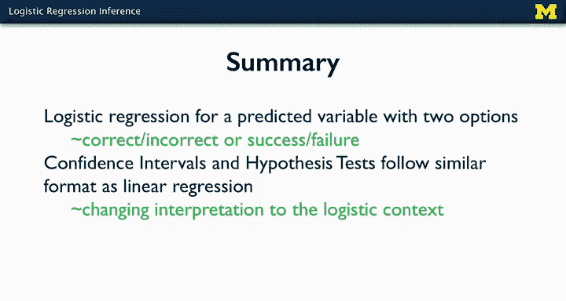

# 密歇根大学《使用Python的统计学（理解并可视化数据、因果推断、建模）｜Statistics with Python》中英字幕 - P78：12_逻辑回归推断.zh_en - GPT中英字幕课程资源 - BV1dV411Q7j3

In this video， we'll continue looking at the logistic regression example that we had in the previous video。

 We'll be looking at inference， so confidence intervals and hypothesis testing for that slope。

So as a reminder， we're looking at the cartwheel data。

 we have a random sample of 25 adults who attempted cartwheels。

 and our primary variable of interest is whether or not they completed a cartwheel， either， yes。

 they successfully completed a cartwheel， which is a1。

 or no they didn't successfully complete the cartwheel， which is coded as a zero。We want to know if。

 based on age， we can predict whether our cartwhe is completed or not。

So in the last video we fit a logistic regression line。

 we talked about reasons we might fit a logistic regression line。But when we fit it。

 we can see that line takes a curved form。And we can look at how it relates to the age of the person attempting to cartwheel。

So the line shows the predicted probability of successfully completing a car wheelhe。In addition。

 we got the output that's shown on the right we talked a little bit about how you make the equation out of the coefficients that we were given we didn't delve into any of the other columns that were included in the output。

 but we'll talk about those a little bit more in today's video。So to start with。

 we can create a confidence interval for the slope。

This takes the same form that you've seen previously in course2。And last week。

 where you looked at the best estimate， plus or minus a margin of error。

 you want to take your best estimate and give it some uncertainty because you're not perfectly sure of what that margin of error is or what that value is。

In our case， we'll take the slope from our 25 observations that we have。

And add and subtract a few of the estimated standard errors。

 So we'll go ahead and start thinking about making a confidence interval for that coefficient for age。

 This takes a similar form to everything that we've seen before。

 Remember that's best estimate plus or minus some margin of error。In our case。

 we'll use the sample coefficient or the sample slope。

 plus or minus a few of those estimated standard errors。

Now this will take a similar form to what you saw in the linear regression video the only difference here is that we do use a Z test statistic rather than the T distribution。

 so our form for that confidence interval will be B sub1。

 our sample slope plus or minus z star times the standard error of our B sub1。

We can get a lot of that information from the output that we have from Python， so we can use that 0。

2096 for our estimated coefficient in place of the B sub 1， and that standard error， that 0。

171 in place for that standard error of B sub1。Now。

 because we're looking at a 95% confidence interval， we also know what our Z star is。

 we can go ahead and plug all of those numbers in that 0。2096 plus or minus the 1。96， the 95% Z star。

Times that standard error 。171。Once we get through those calculations we see that our confidence interval goes from negative 0。

126 to 。545 we can also see these same interval or that same interval。

Listed here in the output that Python gives us Now the Python output only gives you the 95% confidence interval。

 so something to be careful about， but it does give you that same result that we get when we do a hand calculation。

 the same way that we've been doing throughout course2 and the last couple of weeks。Now。

 does it seem reasonable based on our confidence interval that there is a significant slope that our coefficient is significantly different from zero？

I'll let you think about it， we'll come back to it once we've gone through the hypothesis testing situation that we'll go through next。

So we can test very similarly the hypothesis testing framework we'll start with our null hypothesis of beta1。

 the population slope or the true slope is equal to zero， and our alternative will be too sided。

 we don't necessarily know how age should affect the probability that you successfully complete a cartwhe。

 so we're just looking to see if age has any effect on completing a cartwheel。

And we can go through and calculate the test statistic similarly to how we have been doing in the past。

 we take our best estimate， our B of one， subtract off our hypothesized value。

 so that's zero in this case coming from the null hypothesis。And divide by our standard error。

So we can look at our Python output again to substitute it in those values for our estimated coefficient and the standard error。

We can go ahead and substitute those into that formula。

And go through the calculation that division and we get our test statistic of 1。225。Now again。

 this matches with what we see from the Python output。

 we see that we are given that Z test statistic already。

 but that it does match with what we've been given。We're also given a P value。

 we could calculate this either by hand or using a calculator。

But Python already gives us that output so we can go ahead and use that。Now with this P value of 0。

221， would you reject the null hypothesis？If you're asking me or if you're saying I can't make that decision without knowing an alpha level。

 that's great we'll use an alpha of 0。05 based on that we should with our two side P value of 0。221。

Fail to reject the null hypothesis our 0。221 is much larger than the 0。05。

 so we can't reject the null hypothesis， and therefore we cannot conclude that we have a significant linear relationship between age and the log odds of the probability of successfully completing a cartwheel。

Now if we go back to that confidence interval situation， our confidence interval， the negative 0。

126 to 0。545 does contain 0， that indicates that  zero is a reasonable value for or coefficient。

And if zero is a reasonable value that also agrees with our decision here。

 that we cannot conclude that there is a significantly linear relationship that our slope is significantly different from zero。

So to summarize， we have seen that logistic regression is used when we have a predicted variable that only has two options。

 we either have a correct or an incorrect， a success or a failure。😊。

We see that the confidence interval and hypothesis testing formulas follow a very similar format as linear regression。

 so they look really similar to linear regression， but we do need to change some of those interpretations to the logistic context。

 and in particular thinking about what our predicted variable is。

 whether it's whatever our Y is or the fact that we're using the log odds that Loit function for logistic regression。

😊。

And coming up， we'll get to a chance to look at an example from NHAs using blood pressure and smoking。

