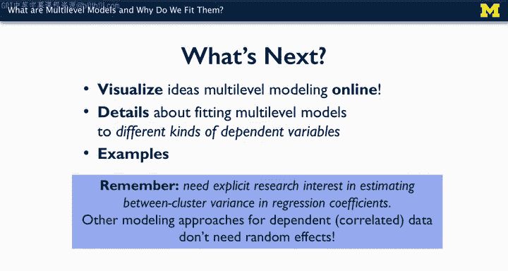

# 密歇根大学《使用Python的统计学（理解并可视化数据、因果推断、建模）｜Statistics with Python》中英字幕 - P79：13_多层级模型的定义与应用场景.zh_en - GPT中英字幕课程资源 - BV1dV411Q7j3

Okay， so welcome to week3 and this week we're going to start talking about statistical models for dependent data。

 so data sets where the observations are correlated with each other for one reason for another or another thus far in this course。

 we've been talking about regression models for independent observations and this week we're going to start talking about appropriate statistical models for data sets that are generated by study designs that introduce dependencies in the data and the first type of models that we're going to talk about are multilevel models。

 so we're going to talk about what multilevel models are in this lecture and why we fit them in practice。

Okay， so as an overview， we're going to now start talking about fitting statistical models to dependent data where the observations are correlated due to some feature of the study design。

So several observations might be collected at one time point， for example。

 from different sampled clusters of analytic units。

 so maybe from neighborhoods or schools or clinics。

 observations nested within these clusters may be correlated with each other People in the same neighborhood。

 for example， may share the same attitudes or have similar socioeconomic status or whatever the case may be。

We could also have the case where several observations are collected over time from the same individuals in a longitudinal study。

 so in this case， the repeated measurements collected over time from the same person are likely to be correlated with each other。

The models that we fit to these types of data sets need to reflect the correlations。

 the models that we were talking about in week two basically assume that all the observations in our data are independent of each other。

 Now we're talking about data sets where these observations might be correlated and we have to make choices when specifying models for these data such that the models fitted reflect these correlations in the observations。

So the first type of models that we're going to talk about are called multi level models。

And multi level models are a general class of statistical models that can be used to model dependent data。

 where the observations that arise from a randomly sampled cluster may be correlated with each other。

In these multilevel models， what makes them unique is that the regression coefficients that we were talking about in previous weeks are allowed to randomly vary across these randomly sampled higher level clusters。

 So the regression coefficients no longer have to be fixed constants that we're trying to estimate we can allow those coefficients to randomly vary across these higher level units and estimate the amount of variability in these coefficients。

 which， for example， could describe relationships。So the coefficients in our models are allowed to randomly vary across these randomly sampled higher levelvel clusters。

 Let's consider an example of a longitudinal study where time might be a predictor of some outcome of interest or are interested in studying trends in different outcomes over time。

 We could fit a model where the intercept and the slope in our model are allowed to randomly vary across the randomly sampled subjects that we've included in our study。

 So in other words， each subject in our study could have their own unique intercept and their own unique slope instead of assuming that everybody follows the same general relationship or the same general pattern and multilevel models allow us to estimate the variability among subjects or clusters in terms of these coefficients of interest。

😊，So in multilevel models， we still estimate regression parameters。

 These are still regression models。 We're still interested in fixed parameters that describe relationships between variables。

 specifically between predictors and outcome variables。

 but we go above and beyond what we talked about in the previous weeks and we estimate the variability of those coefficients across these clusters that have been randomly sampled at higher levels。

 so in addition to estimating overall relationships。

 we also estimate parameters that describe the variability of those relationships across these higher level clusters。

So what this means is that multilevel models allow us to expand the types of inferences that we can make from fitting models to the data。

So first of all， we can still make inference about the relationships between predictor variables and outcomes。

 that doesn't change。 but on top of that， we can make inference about how variable the coefficients are in the larger population from which these clusters。

 for example， schools or clinics were randomly sampled。 That's new。

 Something else that's new about the inferences we can make is that we can try to explain that variability among these higher levelve clusters with cluster level predictor variables so we can use some feature of those randomly sampled clusters to try to explain that variability in the coefficients。

 That's another way that we can expand our inference with multilevel models。

So let's think about how multilevel models look when we're writing down equations。So a question。

 what changes allow the coefficients to randomly vary in the models that we werere fitting。

 And the answer to that question is the inclusion of random effects of these higher level。

 randomly sampled clusters in the model。 We explicitly include additional effects of these higher level randomly sampled clusters。

So let's think about this level1 equation here。 We have a dependent variable Y。

 which is defined for a given observation I nested within cluster J。

Notice how we write that dependent variable as a function of coefficients。

 But those coefficients have a subscript denoted by J。

 What that means is that those regression coefficients are now determined by what cluster J we're referring to。

 They randomly vary， depending on the cluster J。 So we refer these coefficients now as random coefficients。

 These are not parameters。 These are random variables。

 These variables are allowed to change depending on the cluster。

 beta 1 J captures the relationship of the predictive variable X with y4 cluster J。

 And we still have that error term E associated with observation I within cluster J。Now。

 what gives this multilevel model its name that defines the regression function for the observations at level 1。

 the values of the dependent variable。 so that could be subjects in a clustered study。

 or it could be repeated measurements in a study where we're collecting repeated measurements over time from the same subjects in the multilevel model。

 We then have equations at level 2 of the data hierarchy。

 So these are equations for those random coefficients at level 1。

 So you see that we have a unique equation for beta0 J。 and we have a unique equation for beta 1 J。

 That slope that's specific to cluster J。 So in this example。

 that intercept specific to cluster J is defined by a fixed intercept beta 0。

 That's our regression parameter。 That's the fixed parameter that we're trying to estimate。

 But we add this u term that u term is a random variable， a random effect。

 That u term is what allows each cluster J to have its own unique intercept that u0 J Sam thing is true for the slope。

😊，For cluster J， we added another random effect called U1 J。

 That's a random variable that allows each cluster J to have a slope that deviates somewhat from the overall fixed slope defined by beta 1。

 So thus far in in the course， We've been talking about estimating beta 0 and beta 1 in regression models。

 This shows how multi levelvel models add these random effects that allow each cluster J to have its own unique。

 coefficient。So we have this level 1 and level 2 model。

 The random effects that are unique to multilevel models allow each cluster denoted by j to have unique coefficients。

 These random effects are random variables。 So the values for different clusters are assumed to be randomly drawn from some larger population of possible random effects。

 a very common assumption that we make is that those random variables U follow normal distribution with an average of0。

 So the average cluster looks like the overall fixed effect beta 0。

 but then there's variability in those U。 and it's that variance that we're trying to estimate we're interested in estimating the variable of the U。

 So how variable are those coefficients around the overall coefficient beta 0 and the overall coefficient beta 1。

So multilevel models are defined by this explicit inclusion of random effects。

 and by including these random effects， we're saying that observations coming from the same cluster are correlated with each other statistically。

 so when we include these random effects， we're allowing observations coming from the same cluster to be correlated。

 that's how we model the correlation of these observations。

If we didn't include random effects in our model， just like we did in week2 when talking about linear and logistic regression。

 we're making the assumption that observations from the same cluster are independent of each other and that that correlation of observations within clusters is 0。

 That can be a really strong assumption when we're working with dependent data。

 So random effects allow us to model that correlation。

Accounting for these correlations in our modeling often substantially improves model fit when we work with dependent data。

 so it's important to consider whether we get significant improvements in model fit when we add these random effects and we're going to talk about how to do that。

So multilevel models also allow us to decompose the unexplained variance in a given outcome into between and within cluster variance that isn't accounted for by the predictors。

 So the random effects that we include capture the between cluster variability。

 The error terms at that level1 equation they still capture the within cluster variability。

 the observations that's not been explained by the predictor variables that were included。

So a key question that we try to answer with multilevel models is how much of the unexplained variance due to this between cluster variance arises in the intercepts or the slopes for a given model。

 so how much of the variability in our observations is actually coming from between cluster variability in the intercepts and slopes。

 that's a key research question that we try to answer with multilevel models。

 if we don't care about that between cluster variants we may not need to use multilevel models for our analysis。

So we need explicit research interest in estimating the variances of these random coefficients。

 if we're not interested in estimating that variance。

 we can easily consider other models for dependent data that we're going to be talking more about later this week。

Okay， so why do we fit multilevel models I've already hinted at this a little bit。

 but all of these points need to be true to warrant multilevel modeling。 First of all。

 we need to have a data set that's organized into clusters， so clinics， subjects， schools。

 neighborhoods， etc， where there are several correlated observations collected from each of the clusters so we have some reason to believe based on the study design that the observations on our dependent variable are going to be correlated within one of these sample clusters。

Second of all， the clusters themselves need to be randomly sampled from a larger population of clusters。

 So in other words， we can't treat variables like gender or race ethnicity as cluster variables。

 These are group variables where we have all the possible groups represented in the data set when we make the decision to include random effects of higher level clusters。

 we're assuming that those higher level clusters are randomly sampled。

 We don't randomly sample values of gender or values of race ethnicity from a larger population of values on these variables。

 we do randomly sample neighborhoods or clinics or hospitals or whatever the case may be。

 and the random effects allow us to make inference about that larger population from which the clusters were sampled。

Third， we wish to explicitly model the correlation of observations within the same cluster。

 so the study design gives rise to this kind of dependency and we want to model that correlation when we fit a statistical model to the data。

Fourth， we have explicit research interest in estimating that between cluster variants in the selected regression coefficients that define our model。

 again， there are other models for dependent data that we could use if we're not explicitly interested in that between cluster variants。

So， given this explicit research interest in estimating between cluster variants in these selective regression coefficients。

 here are some examples of the kinds of questions that we might want to answer with multilevel models。

 so for example， how much of the unexplained variance among hospitals in mean patient satisfaction is due to the size of the hospital。

 so is there variability among hospitals and can that be explained by how big the hospital is。

Second example， how much variance is there in long term trends of substance use for a sample of drug users。

 so do different drug users follow different trends in terms of their long term substance use。

 we can estimate that variance with multilevel models。

Multilevel models also offer advantages over other approaches for dependent data。

 So when we fit these models， we estimate one parameter that represents the variance of a given random coefficient across the clusters。

 And this is instead of estimating unique regression coefficients for every possible clusters。

 So this purely stratified approach where every cluster gets their own unique fixed regression coefficient。

 We just estimate one parameter that describes the variance of those random effects。

 This is a much more efficient approach to fitting these kinds of models。

 especially when we have a large number of clusters。In addition。

 clusters with smaller sample sizes in our dataset set do not have as pronounced of an effect on that variance estimate as the larger clusters do。

 So the effects of the smaller clusters shrink toward the overall mean of the outcome when we use this random effects approach。

 This is called shrinkage。 And this really matters when a lot of the clusters have smaller sample sizes。

 You don't want them to have as large of an influence on that overall variance。

So with multilevel models， we estimate the variance in a given random coefficient across these higher level clusters。

 and when we do that， we can add cluster level predictors to those level2 equations for the random coefficients。

 and we do this to explain variance in those random effects。

 So recall the model that we introduced earlier， where we had the level 1 equation for the deep in variable。

 and then we had level2 equations for those random coefficients that were varying across clusters。

 Let's take a longitudinal example， where y is our dependent in in variable。

 x is our predictor of interest， which in this case might be age。

 T is a subscript that represents the time point at which the measurement was collected and I is the subject that's repeatedly measured。

 So you see we have unique intercepts and unique coefficients in this model for each subject。

 Notice that how at level 2。 How we're adding a subject level predictor T with a subjectscript I。

 We can use t to explain variable in those u's。 Just like we would in any other linear regression model。

 You can think of the level2 equations as many。😊，Regression models for those random coefficients。

 So by adding T and its corresponding regression parameter beta 01 or beta 11。

 we're trying to explain variance in those random coefficients。

 We're trying to explain some of that between cluster variant。

So we can add these regression parameters for that subject level covariate t to those level 2 models to try to explain variability in the random intercepts and random slopes。

 And again， we can view those level 2 equations like many regression models by adding those cluster level predictors。

 we try to explain variants in those random cluster effects don by you。

 we can test hypotheses about the regression parameters for t。

 So once we estimate beta 01 and beta 11 and test hypotheses about those parameters。

 if those parameters are significant， that means we're explaining some of the between cluster variants。

 so we can make statements like 45% of the between subject variance in the relationship between age and the dependent variable y can be explained by that subject level predictor T。

 and this is a unique advantage of multilevel models。

 we can make inference about how much variances in the random effects gets explained by these higher levell covariates。

So we've provided a broad overview of multilevel models in this lecture。 What's coming up next。 Well。

 next， we're going to see how to visualize the idea of fitting multilevel models online。

 You're going to see a very cool website that allows you to visualize what it means to fit models where slopes and intercepts vary across higher level clusters。

 Then we'll get into more details about fitting multilevel models to different kinds of dependent variables。

 continuous binary count whatever the case may be and we'll look at a large number of examples。

 Just as a reminder， When we fit multilevel models。

 we need to have explicit research interest in estimating between cluster variance in regression coefficients。

 there are other modeling approaches for dependent data that don't need random effects。😊。

