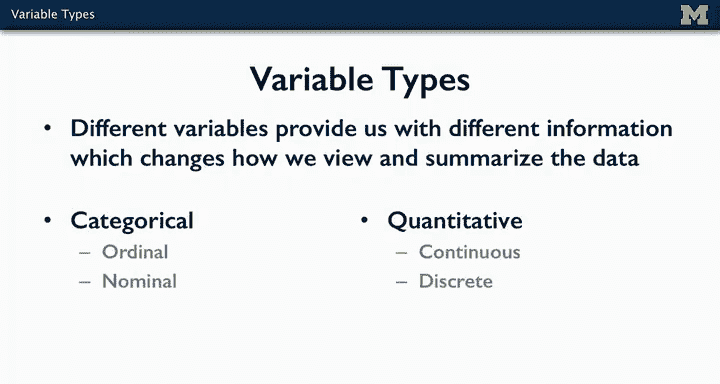

# 密歇根大学《使用Python的统计学（理解并可视化数据、因果推断、建模）｜Statistics with Python》中英字幕 - P7：6_变量类型详解.zh_en - GPT中英字幕课程资源 - BV1dV411Q7j3

Hello and welcome back。 My name is Mark Roowski and I'm a lecturer in the Department of Statistics here at the University of Michigan。

 Today， we're going to be talking about the different types of variables that exist。

 depending on the different type of variable you have might change the way you view or summarize your data。

First， we're going to start by looking at four different variables from the NHANS data set。Remember。

 N HaAnes is the National Health and Nutrition Examination Survey。

It aims to assess the health and nutrition of children and adult in the United States。

Here in the table， we have five different individuals。

 as noted by the five different ID numbers on the left side of the table with the four corresponding variables。

The first is BMI or body mass index， which is a height to weight ratio measurement。

 The second is race and is coded as shown at the bottom of the slide。

 A value of one represents Mexican American。 A value of2 represents other Hispanic，3。

 non Hispanic white，4 non Hispanic black， and 5 represents other。

The age variable is next and age just simply represents the age of the individual at the time of the survey。

The final variable here is an adult indicator variable where the variable is coded as a one if the individual is 18 years or older and is zero if they are not。

We'll start by just looking at the first two variables here， body mass index and race。

 Think about it。 Could we reasonably compute the average response for each of these two variables separately。

Looking at body mass index， yes， it would be reasonable to take the average of this variable。

 if we think about it， we could find the average of all the individuals of our data set and get some sort of center for this variable。

If we were looking at race， it wouldn't make as much intuitive sense to do this。

 Remember that each of these values is coded differently for a different race category。

 So if I went and took the average of all of the data set and got a value of， say，2。7。

 this doesn't give us very meaningful information。Note that we do include an asterisk here because there are some analysis methods that do like to take the average of categorical variables such as race。

So first we'll talk about quantitative variables， a quantitative variable is simply a numeric。

 measurable quantity in which arithmetic operations often make sense。

 such as we saw with body mass index on the previous slide。With quantitative variables。

 there's two different subtypes， continuous and discrete。

A continuous quantitative variable could take on any value within an interval and could be many。

 many possible values。As we saw with body mass index。

 other examples of continuous quantitative variables could be height or weight for a person。

 Another very common continuous variable is anything dealing with time。

 such as the time it takes an individual to run a mile or the time it might take you to complete a homework assignment for this course。

The other type of quantitative variable we have is a discrete quantitative variable。

 This is a finite set of countable numbers。 A good example of a discrete quantitative variable would be something like the number of children in a household。

 You could have one child in a household or you could have 10 children in a household。

 but you can't have 2。3 in a household。 So discrete has to be some set number of countable values。

The other type of variable we have is a categorical variable。

 often referred to as a qualitative variable。This variable simply classifies individuals or items into different groups。

 such as we saw with our race variable a couple slides ago。Again， like quantitative variables。

 categorical variables have two different subgroups as well， Ordinal and nominal。

 an ordinal categorical variable simply has some sort of order or ranking associated with it。

 A very common ordinal variable might be a class ranking in either high school or college。

 Students could be classified as freshmen， sophomores， juniors， seniors。

 but usuallyll leave them in this order。 This natural ranking。

A nominal variable doesn't have any associated ranking with it。

An example of a nominal categorical variable is like race， as we saw earlier。

 or something like marital status， where if you move around the different categories in this variable。

 it does not change the meaning at all。Now we're going to take a short in video quiz。

 just two questions along to help review the concepts we just learned。Okay。

 so coming back to the Nvi quiz that you just took， we'll go over the answers now。

 So if we look at age， age is reported as an integer。

 so some people can see this sometimes as a discrete quantitative variable。

 but here with a value such as time as we mentioned earlier。

 we'd like to model this as a continuous variable。 If you think about it if you ask a child what their age was。

 they might often tell you that they're eight and a half years old or something like that。

If in the state of Michigan， you' are looking to get a driver's permit。

 you need to be 14 years in9 months。 So although age here is reported simply as an integer value。

 the variable itself can be modeled as a quantitative continuous variable。

The second variable adult indicator， as we talked about earlier。

 is simply just coded one if the variable is an adult and0 if they are a minor。

Although age is a quantitative variable， we can see that we can easily transform it into a categorical variable。

 although NHAnes chose to code this as1 for an adult and0 for minor。

 we could also choose to code this as an a for an adult and m for minor。

 and this is why this variable is considered a categorical nominal variable。In summary。

 we've seen the different types of variables that we have。

 we have both categorical and quantitative and two subgroups within both in future lessons we'll see how we can summarize and view this data differently。

