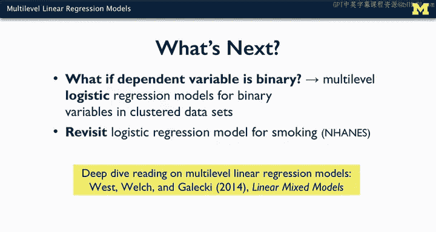

# 密歇根大学《使用Python的统计学（理解并可视化数据、因果推断、建模）｜Statistics with Python》中英字幕 - P80：14_多层级线性回归模型.zh_en - GPT中英字幕课程资源 - BV1dV411Q7j3

Okay， so welcome back to our discussion of statistical models for dependent data and we're starting this week with a discussion of multilevel models in this lecture we're going to talk specifically about multilevel linear regression models for continuous dependent variables。

Okay， so let's review the European Social Surve data that we talked about in week two when we introduced linear regression。

 so these are data that were collected in face to face survey interviews from a national sample of 1。

703 adults in Belgium。The variables in the data include the respondent ID， the interviewer ID。

 22 different variables that measure attitudes and opinions of the response on various topics。

 and specifically in this investigation， we're interested in interviewer effects on the data so the idea that different European social Sur interviewers could have different effects on the data collected if they ask questions in different ways where they recruit different types of respondents we want to model the variability among interviewers。

We also have final respondent weights based on a complex sample design so the European Social Survey uses a complex sample design involving cluster sampling。

 and in addition to those final respondent weights we have interviewer specific response rates。

 so what was the response rate of each individual interviewer。

 we can think of that as an interviewer level covariant。

So let's revisit the idea of random effects that we talked about in the previous lecture。

 remember that random effects are random variables that allow the coefficients in a regression model to randomly vary。

 depending on the randomly selected cluster， for example， a neighborhood or a subject， for example。

 in a longitudinal study。Multilevel models in different fields。

 they might be referred to using different names， so they might be called random coefficient models because the coefficients are allowed to randomly vary。

 They might be called varying coefficient models。 They might be called subject specific models in more of a longitudinal context。

 they might be called hierarchical linear models in some fields of social science。

 and they might also be called mixed effects models in fields like statistics。

 because we have a mix of fixed regression parameters or fixed effects。

 and also these random effects。 we have a mix of fixed and random effects。

Let's revisit our model specification specifically for continuous dependent variables Y。

 and that's the focus of this lecture。Let's suppose we have a continuous dependent variable Y that's measured on person I within cluster J。

So we can write that regression model， including fixed effects you see here， pointed out in blue。

 these are beta 0 and beta 1 note that those regression coefficients don't have a subscript J。

 Those are fixed parameters that we're trying to estimate that capture the overall intercept in the model and the overall relationship of x with y We then have a predictive variable x。

 which is measured on each person I within cluster J。

 and then we add these random effects like we talked about going above and beyond the standard linear regression model。

 and adding these random effects that capture between cluster variance。

So U0 J allows each cluster to have a unique intercept in the model and notice that U1 J is multiplied by that predictor x1j。

 so what that means is that we can combine u1 J with beta 1 to define the unique slope coefficient for each cluster J and again。

 we also have that error term， meaning the errors capturing what's not predicted by the regression coefficients and the random effects。

So the fixed effects making this terminology clear。

 these are regression coefficients or regression parameters that define unknown constants and these define the relationships between predictors and dependent variables that we wish to estimate the fixed effects are largely used to define the mean of our dependent variable in the model specification。

The random effects on the other hand， are random variables。

 so because they're random variables and not fixed constants。

 we need to define distributions for these random variables。

So recall that multi levelvel models are used because we have explicit interest in estimating the variability of these random cluster effects as part of our research question。

So what distributions do we assume for those random effects， U 0 J and U1 J。 Very commonly。

 we assume that the random effects follow a normal distribution with an overall mean of 0 and specified variances and covariances。

 In the case of this particular model that we're considering here。 We have two random effects。 U0 J。

 which allows for a unique intercept for each cluster and U1 J。

 which allows for a unique slope for each cluster。 because we have these two random variables。

 We assume that these two random variables follow byvari normal distribution。

 That's what this n denotes here。The 0，0 corresponds to the vector of means for those two random effects。

 we assume that on average， each of those random effects is equal to 0。

 So an average cluster looks like we would expect in terms of beta 0 and beta 1。Now。

 that other matrix， which we call D here。 that's the variance covariance matrix of these random effects。

 So the variance of the u 0 js is sigma squared 0。 The variance of the U1 js is sigma squared 1。

 In addition， we allow those two random effects， the random intercept in the random slope to covariary。

 So that sigma 01 off the diagonal of that d matrix that's the covariance of those two random effects。

 So it could be possible that the higher a random intercept， for example， the lower the random slope。

 that covariance might be negative。 That's just one possibility。

 but we allow for that when specifieding this model。

 We also assume that the error terms within clusters follow a normal distribution with a mean of 0 and a variance of sigma squared。

 So you can see we're actually estimating three varianceance components。

 Sigma squared Sigma squared 0 and sigma squared 1。

 In addition to the covariance of those two random effects， sigma 01。

So another way of writing down this model is the multilevel specification that we introduced in the last lecture so we can write we can break the model down into the level1 model where the dependent variable is defined by the random coefficients associated with the clusters and then the predictive variable of interest measured at the same level as the dependent variable So that could be the age of an individual within a cluster。

 for example， and then the error term EIj。 notice how everything that's included at level1 has an Ij subscript in terms of the actual data。

 Yj and Xj， these are all variables measured at the same lowest level where the dependent variables measured。

 And remember， the random coefficients are not parameters。

 The random coefficients are defined by a parameter and a random effect。

 So we see those definitions at level 2 where the random coefficient is defined by a fixed regression parameter and then that random effect that allows that coefficient to randomly vary。

 When we combine the level 2 and level 1 equations。

 we end up with the exact same model that we talked about a couple slides。

We can just plug those equations for beta 0 j and beta 1 j into the level 1 equation。

 and we end up with the same regression equation for the overall model。

So why do we think about the multilevel specification。

 This specification clearly defines the roles of covariates that are measured at higher levels in the multilevel model。

 So again， you can view each level2 equation for a given random coefficient as an intercept only regression model in this specification so beta 0 j is defined by a fixed intercept beta 0 plus an error term that random effect that allows each cluster to have a unique coefficient。

 We aim to explain variance in those random effects by adding the fixed effects。

 the fixed regression parameters of level 2 covariates to the models。So here's an example。

 Let's just take the equation for that random intercept beta 0 j。 Initially。

 we define it by a fixed parameter beta 0 plus that random disturbance U0 J associated with a given cluster。

 We fit the model and we compute the estimated variance of the random intercepts。

 So let's suppose our estimate of the variability of those u0 js is 2， just for example purposes。

Now we include a fixed effect of subject gender in the model let's assume we're using a longitudinal study where J denotes the subjects that are measured repeatedly Gen is something that doesn't change over time。

 so notice that when we add mail to the model， it has Subscript J。

 it doesn't have Subscript IJ if I were to denote the time points。

We also add a fixed effect of that subjectspec covariate beta 2。

 so we seek to estimate beta 2 and in doing this， we're expecting that the variability of those u0 js is actually going to go down because we're adding a predictor of beta 0 j and if that's a good predictor of beta 0 j male in this case。

 we expect the variance of those random effects U0j to go down just like we would expect the variance of the random errors to go down in a standard linear regression model by adding predictors Now after reffitting the model with that fixed effect of male in the model。

 we see that the estimate of sigma squared0 becomes one。

 So if we compare that to the model that did not include male as a predictor we can see that we've explain 50% of the variability in those intercept。

 simply by adding the fixed effect of gender to our model This is one of the main inferential objectives of multilevel modeling is to see if we can identify predictors at these higher levels。

 cluster level predictors that can explain。these random effects。Okay。

 so how do we estimate the model parameters， the computational technique that we use that you're going to see how to use in Python is called maximum likelihood estimation or MLE。

 The basic idea of maximum likelihood estimation is we want to know what values of the model parameters make the observed data the most likely。

So we can use software like Python to compute the MLEs of the fixed effects， the beta 0， the beta 1。

 beta 2 if we added male， and the variance components that sigma squared， sigma squared0。

 sigma squared 1， in addition to standard errors of all these estimated parameters。

 so maximum likely is a very useful technique for trying to find the best estimates of these kinds of regression parameters。

We can also make inference about the model parameters using specialized tests for these kinds of models。

 so first of all， we could compute confidence intervals or test hypotheses for the model parameters like we've talked about in previous weeks。

Specifically， we can test all hypotheses that certain parameters are0， for example。

 a fixed effect is 0 or variance component is 0， using a technique known as likelihood ratio testing。

 So the idea of likelihood ratio testing， is does the probability or the likelihood of the observed data change substantially if we take a given parameter or parameter out of the model。

 So if we remove certain variance components， which means we're removing random effects。

 does that significantly reduce the likelihood of the observed data。

 meaning that we're making the fit of the model worse。

 This is what we use likelihood ratio testing for。In a reading for this week。

 you're going to see very specific details on how to perform these types of likelihood ratio tests for the parameters in multilel models。

 In this lecture， we're just going to look at the results of those tests。Okay。

 so let's get back to that E SS example。 Remember we're interested in the variability among ESS interviewers in terms of their measurements on the dependent variable of interest。

 So we assume that the interviewers in EsS are random selections from a larger pool of interviewers that might have been hired。

 remember when we talked about multilevel modeling。

 One of the key features was that the higher levell clusters are randomly sampled from some larger population。

 In the case of the interviewers here， we assume that the interviewers are randomly selected from a larger pool of interviewers that might have been hired。

😊，We're interested in the relationship of trust in police with a person's attitude about whether people generally try to help others。

 remember we considered this example in week two when talking about linear regression and estimating this relationship。

 we're going to extend that example now to include random effects of the ESS interviewers thinking that the interviewers might introduce clustering in the collected data。

So the observations are clustered by the interviewer。

 those interviewers are randomly sampled clusters， and if those interviewers are having effects on the data。

 we can include random effects in our multi levell model to account for this。

So we fit a multi levell model to see if the interviewers are having an effect on the intercept and or the slope in our model that's of primary interest。

So here's our example。 We use software like Python to compute the maximum likelihood estimate of the fixed effect that overall regression coefficient。

 defining the relationship of trust in police with perceived helpfulness and that estimated regression coefficient is positive0。

14 and significant。 So for a test statistic we take that estimated coefficient divided by its standard error and refer that test statistic to a t distribution。

 we see that the probability of seeing a test statistic that large is very， very small。

 So the coefficient， the fixed effect in this case is very large relative to the standard error。

 So we would conclude that this relationship is nonzero and significant。

 So what this means is that those with higher levels of trust in the police tend to have higher levels of faith in people helping others。

😊，But remember， we go above and beyond the standard regression analysis in this case。

 we go above and beyond estimation of those regression coefficients。 So in addition。

 we're going to think about estimates of our variance components。

Let's think about the overall intercept that beta 0 in our model。

 The maximum likelihood estimate of that intercept is 3。89 using the same testing approach。

 we find that that parameter is also significant with a P value that's very small。

 So what this means is that the mean on our helpfulness scale ranging between 0 and 10 for people with 0 trust in the police when the predictor is equal to 0 is 3。

89。 That's another fixed effect that we try to estimate。

 So these are our estimates of the two fixed effect。 The overall intercept and the overall slope。Now。

 remember with multilevel models， we go above and beyond that standard regression analysis and we estimate the variability of those random effects。

 so the estimated variance of the random intercepts is 0。696。

 the estimated variance of the random slopes is 0。012 and when we apply the likelihood ratio testing to make inference about these variance components which will be talked about in that additional reading this week。

 both of these variances are significantly greater than 0 based on the likelihood ratio test。

 So there's evidence of variability among interviewers that's clearly non0 in terms of both the intercepts in the model and the slopes in the model so these describe the variances of the u0j and the u1j in our overall model and both of these variance components are non0。

So what does this mean， this means that the ESS interviewers are varying significantly around those overall fixed effects on the last slide。

 so the interviewers definitely have unique intercepts and unique slopes。

 they may be collecting higher means on helpfulness in general may because of the way they're asking the questions or because of who they're recruiting。

 but in addition to that they're recording unique slopes with their collected data。

 so different interviewers are producing different estimates of the relationship between trust and police and perceived helpfulness。

Okay， so we also need to examine model fit and look at some of the model diagnostics。

 We want to examine whether our assumptions about the distributions of the random effects and random errors were in fact reasonable。

 so does the model seem to fit well。So first we're going to look at a distribution of the residuals just like we did in linear regression。

 Do they seem normal， do they seem to have constant variance。

 But then because of those additional random effects in the multilevel model。

 we're going to look at distributions of predicted values of those random interviewer effects or e buffs as they're called that stands for empirical best linear unbiased predictor。

 remember those are random variables so we can't estimate them directly based on the model once we fit the model。

 we can calculate predictions of what those random effects are and we want to see if there's outliers in terms of particular interviewers。

So here's a normal quantile quantile plot of the residuals based on the fitted model。

 And you can see that all the residuals lie pretty much perfectly on that straight 45 degree line。

 So this Qq plot suggests that the residuals are normally distributed and we don't see any outliers that deviate substantially from that normal distribution。

 So that looks very good in terms of that assumption。What about constant variance of the residuals。

 Here's a plot of the residuals against the predicted values based on the model。

 And this scatter plot suggests no concerns with constant variability of the errors。

 We see that unique appearance of this scatter plot because there's only 11 unique values on the dependent variable ventures。

 So that's why you see those straight parallel lines in this plot。What about the e bs。

 These are remember predictions of the random effects for the interviewers that were included in the model。

 First of all， looking at the e bs for the random intercepts。 remember。

 we assume that they were normally distributed with mean 0 and constant variance。

 This Q Q plot suggests that these random effects do seem to be normally distributed of the different interviewers。

 but there's one interviewer who pops out。This is interviewer number 4976。

 and we're going to look at their data in more detail to see why they were unique。

What about the predicted random effects for the random slopes， those slope coefficients in the model。

 Once again， we see general evidence of those random slopes following a normal distribution。

 But again， there is an interviewer that pops out as being unusual。

 So we want to look at their data as well。So first of all。

 for that interviewer who had a unique random intercept， this was 4976， if we plot their data。

 their helpfulness measures against their trust and police measures。

 you see that they have an unusually large number of responses that are less than four for helpfulness。

 So maybe they were asking that question in a weird way or were they were leading people to respond about their perceived helpfulness in a different way。

 maybe they were making suggestive statements or something like that。

 but this interview is definitely unique in terms of the measures that they were collecting on the deep variable hence。

 they had a lower intercept than would be expected。What about the interviewer with a unique slope。

 Interer 7，5，1，9。 Well hear's something very interesting about the E SS data emerges。

 So when we plot their helpfulness against perceived trust in police。

 look at that cluster of points on the left hand side。 And then there's that one point way out there。

 Well， that one point has a value of 88 on that predictor variable。 trust in police。

 And in the E S S data，88 corresponds to missing data。

And so when we prepare for this kind of analysis， whether it's multilevel modeling or regression modeling。

 we need to look at descriptive statistics very carefully and make sure that any missing data are recoded appropriately to true missing values in the data set。

 When we did this analysis， that 88， which was a special code assigned by the E SS to missing data。

 was treated like a real value。 So this interviewer's slope used that 88 in the analysis。

 And this caused their slope to be very flat。 If we include that point in the analysis。

 That's why they had a lower than expected slope compared to all the other interviewers。

 So we would need to rerun the analysis after recoding that value of 88 to missing data。😊。

This is why descriptive statistics are so important because this interviewer jumped out as being very unique due to this one data point。

So what conclusions can we draw from this example provided that we deal with the missing data issue。

 The ESS interviewers are in fact， producing unique intercepts and slopes in this overall analysis。

 Now we want to see if that holds up after dealing with the missing data。

 but that would be our conclusion。This variance in this context isn't necessarily a good thing。

 It adds uncertainty to the estimates of our parameters。

 because the interviewers are introducing variability in those estimates。

 So we should reevaluate that interviewer variance after removing the outliers。

 If each interviewer was really working a random subs sampleample of the full sample。

 they should be producing similar intercepts and slopes。 assuming that our model of interest holds。

 defining that relationship between trust in police and perceived helpfulness。

So a next step in the analysis might be to add interviewer level covariates to those level2 equations to try to explain this variance in the intercepts and slopes so we could add the interviewer level response rate that's in the data set。

 or if we had measures of interviewer attitudes about these things like helpfulness and trust and please。

 maybe the interviewer attitudes would explain some of this variability。

 maybe that's leading into the way they asked their questions。

So what's next we talked about multilevel linear regression models for continuous variables in this lecture Next we're going to turn to deep variables that aren't continuous and specifically binary variables so we'll discuss multilevel logistic regression for binary variables in cluster data sets and we're going to revisit the logistic regression model for smoking that we considered earlier for the NHANS data。

If you're interested in reading more details about multilevel linear regression models。

 we would refer you to the book Linear mixed Model。

 a practical guide using statistical software by myself， Kathhy Welch and Andre Goweetssky。

 though the second edition of which came out in 2014 we provide a lot more detail about the idea of fitting these models in that particular book。

