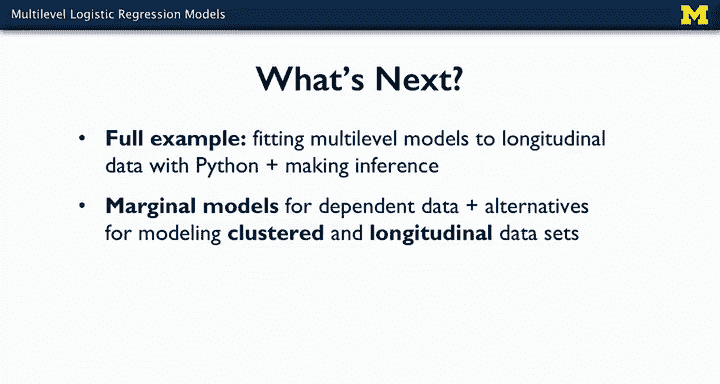

# 密歇根大学《使用Python的统计学（理解并可视化数据、因果推断、建模）｜Statistics with Python》中英字幕 - P81：15_多层级逻辑回归模型.zh_en - GPT中英字幕课程资源 - BV1dV411Q7j3

Okay。

Okay， so welcome back to our discussion of fitting multilevel statistical models to dependent data in this lecture we're going to be focusing on multilevel models for binary dependent variables so we'll be talking about multileve logistic regression models。

So let's think about the way we write these kinds of models when we have binary dependent variables Last week we learned how to write the model for a binary dependent variable using this logit link。

 this natural log of the odds that the dependent variable is equal to1 so we see that we write the natural log of the probability that a binary dependent variable measured on person I within cluster j is equal to 1 divided by one minus that probability we call that the logit function recall so we write this as the log of the probability that that dependent variable y is equal to1 and in the multi-level specification。

 we again have this combination of fixed effects these are the fixed unknown constant parameters that we want to estimate that describe the relationships of the predictors with the log odds of the dependent variable being equal to1 and then we also have these random effects that are capturing these dependencies within the same higher level cluster in this case dennoted by J so this is an example of a random coefficient。

where we have the random effect u0 J， which allows each cluster to have a unique intercept in the logistic model。

 and then we have the random effect u1 J， which allows each cluster J to have a unique relationship of x with the log adds that the dependent variable equal to 1。

We could also rewrite this using the multi levell specification if we so desire this is just the single level equation incorporating the random effects。

So we make the same distributional assumptions that we did in multilevel linear regression models about these random cluster effects。

 We assume that they're normally distributed， that they have a mean vector of 0。

 that means the mean of each random effect is 0， and the random effects have unique variances and covariances。

 so same distributional assumptions as we would have made in the multilevel linear regression model。

And recall， we're fitting a multilevel model because we have explicit interest in estimating the variance of the random cluster effects。

 so part of our research question involves estimating the amount of between cluster variances in the dependent variable of interest in this case in the log adds that the dependent variable is equal to1。

 remember that has to be an explicit part of our research question。

When we fit these kinds of generalized linear regression models tonormal outcomes and we include random effects。

 estimation becomes a lot more difficult mathematically。

 We're not going to dive into the math in this particular lecture。

 but it's a much more difficult computational problem to estimate these models for nonnor dependent variables。

 So again， the clear motivation for fitting these multi-level models that explicit interest in estimating the variance of random cluster effects becomes very important because it does take longer to fit these models。

 computationally。So in estimating the model parameters。

 we fit multilevel models to nonnormal outcomes。 and in these cases。

 it's difficult to write down a likelihood function。

 We talked a little bit about the likelihood function previously。

 when introducing these kinds of models in the case of nonnormal outcomes。

 it becomes much more difficult to write down that likelihood。 and in some cases。

 we may not even be able to write it down。 there may not be what's called a closedform solution for that likelihood function。

 So what we have to do in practice in many cases is first of all。

 approximate that likelihood function。 So we use mathematical methods to come up with an approximation of what the likelihood of the observed day would be under the given model specification。

 Then once we approximate that likelihood function， we find the estimates of the parameters。

 the fixed effect parameters， the variances， the covariances that maximize that approximate likelihood。

 So that's a key aspect of fitting multilevel models to nonnormal dependent variables like binary variables。

 Oftentimes we can't write down the likelihood explicitly and。

Part of the computational process involves first approximating the likelihood and then maximizing it。

 finding the parameter estimates that maximize it。 So long story short。

 it just takes longer to fit these models from a computational perspective。

One possible approach to this process is called adaptive Gausian quadriture。

 This is just an estimation method that involves approximating the likelihood and then maximizing net likelihood。

 We've included a deep dive reading for this week by Kim and colleagues where they perform some simulation studies to evaluate alternative estimation approaches for these types of multilevel models。

 and they found that adaptive Gausian quadature generally works well in a variety of scenarios。

 especially for smaller samples。What about testing the model parameters so using the methods that we've talked about in the previous course in previous weeks。

 we can again compute confidence intervals or test hypotheses for the parameters that we're interested in estimating we would test null hypotheses about the parameters of interest that is a fixed effect is zero or variance component is zero meaning that the random effects don't vary。

 we can test these null hypotheses again using likelihood ratio testing。

So we would use the same likelihood racial testing approach for multi levelvel logistic models that we discussed for multilevel linear models。

 assuming that we have large enough samples of clusters and observations per cluster。So again。

 there's a reading this week that provides specific details on how to perform these types of likelihood ratio tests for the parameters in multilevel models and that'll be part of our materials for this week。

So let's revisit that NHANS example where we introduce logistic regression and recall that we fitted a logistic regression model to model the probability of ever smoking 100 cigarettes in your lifetime as a function of selected predictiveor variables so if you think back to week two。

 we talked about fitting this kind of logistic model to the smoking data within NHAS。

In that analysis， in week 2， we assumed that all Nhan's observations were independent of each other。

 And in reality， this is not true because of the study design that was used for the Nhans in the Nhans multi stage probability sampling was used where there were several stages of random selection of sampling clusters or geographic areas more generally。

So the observations on this indicator of ever smoking 100 cigarettes in your lifetime。

 they come from these randomly sampled clusters as a part of the NHAN sample design。

 and because we have many people nested within the same cluster in that sample design。

 their observations on this indicator may in fact be correlated with each other for one reason or another。

 so we can't make the assumption that all NHA's observations are truly independent of each other when fitting models to the NhanAs data。

If， in fact， the smoking observations are correlated within areas。

 the standard errors in the kind of naive logistic regression analysis that we performed in week two are likely understated。

 So what does that mean That means our estimates of the regression parameters describing the relationships of these predictors with the probability of ever smoking 100 cigarettes or the mean of that binary dependent variable。

 These estimated coefficients will have standard errors that are too small。

 So we're basically saying that the sampling variability is smaller for those estimates than it really should be。

 Why should it be larger because those observations on the dependent variable are correlated within areas。

 and that increases the sampling variance of our estimates。

 So we need to make sure that our model accounts for that aspect of the study design。

 and including random cluster effects is one possible way to account for that fact。

 that observations are correlated within the areas。

 That's generally going to increase the standard errors standard errors of our estimates accurately reflecting the study design。

In addition to the modeling aspect of this， where again。

 we want to make sure that we're accounting for that between cluster variability or in other words。

 that within cluster correlation in the values of the binary dependent variable。

 we may also have explicit interest in estimating the variance between the unhan sampling clusters in terms of the probability of smoking。

 So it's a combination of making sure that we get the model right and that our standard errors accurately reflect the sample design but we also have this ability to make inference about the variance between sampling clusters in terms of the probability of smoking as a part of the multi-level modeling approach。

So here's a graph where we can visualize the amount of variability between the Nhaned sampling clusters in terms of this probability of ever smoking 100 cigarettes。

 So each of the bars in this graph corresponds to one of the unique nhaned sampling clusters reflecting the complex sample design that was used and the size of each bar represents the proportion of individuals in that cluster who have ever smoked 100 cigarettes。

 so you can see that these bars bounce around a whole lot across the different sampling clusters that's a visualization of that between cluster variant in the mean of the deepen a variable of interest that we're worried about estimating when we decide to fit multi-level models。

 So again， we may have explicit interest in estimating the amount of this between cluster variant and we use random cluster effects to capture that variance。

So let's think about fitting our multilevel logistic model in the model that we're going to consider we include random effects of those randomly sampled and Has clusters。

 What this means is that the intercepts in the model that we're fitting are allowed to randomly vary across those sampling clusters。

 For this example， we're not considering the case of random slopes。

 So the coefficients for all of our predictive variables。

 we're going to assume that those are constant across the sampling clusters we're only interested in estimating variability in the intercepts。

 allowing each cluster to have a different proportion in expectation。

So when fitting this kind of model to the unhaned data。

 what we end up with is very similar inferences regarding which predictors are significant compared to week 2。

 when we weren't accounting for the random effects。

 We see slight changes in the estimated fixed effects。 But for the most part。

 we see the same coefficients in terms of the relationships of these predictors with the probability of ever smoking 100 cigarettes。

 But one key difference is that the standard errors of the estimated fixed effects are now larger because。

 again， the sampling variance is reflecting that between cluster variability that's being captured by the random effects。

In addition， the estimated variance of the random cluster intercepts was 0。046。

 Now that doesn't seem very large， but to truly evaluate that variance component。

 we have to perform a likelihood ratio test in order to make inference。

 So when performing that likelihood ratio test， we find that we would reject in all hypothesis that the variance of those random cluster intercepts at 0。

 we definitely have strong evidence that there is between cluster variability in those intercepts after including all of the various covariates or predictive variables in this particular model。

 So it seems like including those random cluster effects is an important contribution in terms of our model fit。

So even after adjusting for all those other predictors of smoking。

 the randomly sampled clusters still vary in terms of their smoking prevalence and again we're capturing this via those random effects。

So let's think about model diagnostics， we see that including random cluster effects in the logistic regression model improve the fit of the model based on that likelihood ratio test。

 so that's a good thing。But let's look at the distribution of the predicted values of these random effects or the e buffs。

 are there potential outliers。 And remember， there are no residuals to worry about in the simple logistic regression model。

 The variance of the dependent variable is defined by the mean like we discussed in week2。

Another key consideration is that we might center continuous predictor variables so that the intercept is interpretable。

 so depending on whether our variables are continuous。

 we might center those variables at the mean so that we can interpret the intercept as representing an expectation of the log adds of the probability of smoking when the predictive variables are set to their means。

So here's a graphic of the predicted random effects or the e buffs for the random intercepts in this particular logistic regression model。

 This normal Q Q plot suggests that the random effects on the intercept due to the unhan sampling clusters are normally distributed。

 You see that all the points lie on that 45 degree line。 In addition。

 we don't see any evidence of outliers。 like we saw when analyzing the European social survey data。

 We saw that some interviewers were outliers in this particular graphic。

 we see that everybody tends to file the same distribution and there are no very unusual outliers in terms of the randomly sampled andhans clusters。

So what conclusions can we draw from this example compared to the model where we did not account for the random cluster effects。

 we find the same predictors of smoking， so the same predictors of smoking that we found in week two are still important。

But given the significant unexplained variants in these random cluster effects that we included in the multi levelvel model。

 we might take a next step of trying to explain variants by including fixed effects of cluster level predictors。

 So， for example， we might include an indicator of the socioeconomic status of a given and hand sampling cluster in an effort to try and explain that variability in the random intercepts。

However， when we compare variance components between multi-level models that have different cluster level fixed effects。

 so we're trying to explain that variance， both of the models fitted must include the same respondent level fixed effects so we can't change the predictors that are being measured at the respondent level when trying to evaluate these changes in variance components。

 we have to make sure that both models are fitted using the same cases。

 the exact same number of observations and they include the same respondent level fixed effects。

For a deeper dive reading on this issue in terms of the magnitude of the variance component and why we need to keep this set of predictors at level1 fixed。

 we would refer you to the textbook， multilevel analysis。

 techniques and applications by Upos and colleagues， this is now in its third edition and Section 6。

5 in that textbook explicitly talks about this issue of comparing variance components between different multilevel models。

 so for all practical purposes， we just want to make sure that the level1 predictors stay the same when comparing these variance components。

So what's next now that we've talked about multilevel modeling and different approaches to using multilevel models to account for this kind of dependency based on the study design。

 we're going to look at a full example of fitting multilevel models to longitudinal data with Python and making inference based on those fitted models we're also going to do an exploration of a web application that allows us to visualize the fits of these kinds of models。

 Then we're going to turn our focus to marginal models for dependent data and alternatives for modeling clustered longitudinal data sets that don't rely on these random effects of higherlevel clusters。

