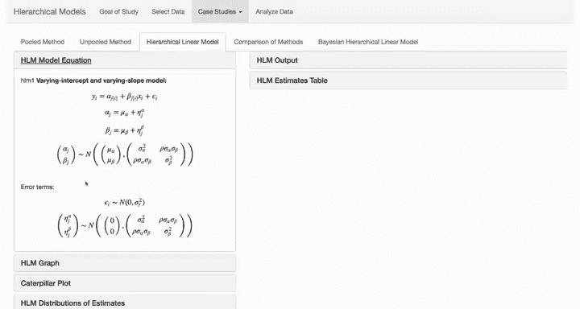

# 密歇根大学《使用Python的统计学（理解并可视化数据、因果推断、建模）｜Statistics with Python》中英字幕 - P82：16_多层级建模实践：Cal Poly应用案例.zh_en - GPT中英字幕课程资源 - BV1dV411Q7j3

Okay， so now we're gonna get a chance to look at a web application and illustrate some of the techniques that we've been referring to in the concepts that we've been referring to regarding multilevel models。

 So what we have up here right now is a web application you can find this website together with the materials for this week so that you can play around yourself but this is a web application that was developed by the Cal Poly Sta department specifically we want to acknowledge Jimmy Wong who designed this app this is an app that allows you to play around and practice a little bit with some of these key concepts about multilevel models。

 So we're just going to walk through this app and see what happens here So you can see that Jimmy and this app refers to this as hierarchical modeling and that's another name recall for multilevel modeling you might hear these referred to as hierarchical linear models and a key point that's illustrated in this app is this notion of a pooled method analyzing data versus an unpooled method So in a pooled method we just analyze all the data together and we don't explicitly account for the random。

Effects of clusters。 We just assume that everybody follows the same general effects。

 The unpoled method。 we include an explicit fixed effect for every single cluster。

 So not random effects。 but rather， we're doing a unique analysis for each of the different clusters。

 That's what's referred to as the unpoled method。 Multilevel models， as noted here。

 are a compromise between those two approaches completely ignoring the effects of the higher level units versus doing a separate analysis for each of those higher levelve units。

 Multilevel models with random effects represent a compromise。

And one of those points they emphasize in this application is this notion of borrowing strength from the information across clusters and shrinkage。

 where estimates from smaller clusters are not going to have as big of an impact on the overall model estimates that were computing So they again refer to the multileve idea of having level1 units the units observed at the lowest level and then level 2 units are the groups at the higher level in which the level 1 units are nested。

 So in this application after this goal page you can then go to this tab that says select data and they have a data set that's built in。

 So this is a sample data set in a music application。

 This is actually from a peer reviewed article where they collected data on 37 undergraduate music majors who filled out performance theories over the whole academic year。

 And before each of the performances， each musician completed a positive affect。

 negative affect schedule or the Panis in which two different variables were measured。

 Ne affect which is a measure of anxiety before the performance and positive affect which。

Is a measure of happiness。 So in total， we had these variables measured on the musicians and each of their performances。

 So this is the multilevel structure of the data。 You can see in the table here。

 you have multiple observations on the same I。 So Id or the musician is the level 2 unit。

 and then you have multiple diaries collected from each I。

 So the observations are the measurements on the diaries represent the level1 observations。

 So that's our multilevel structure。😊，And so in the app， if you use this dataset。

 the analysis is going to focus on the dependent variable as being negative affect and you'd like to develop a multilevel model for negative affect where you're predicting negative affect with characteristics of the musicians and characteristics of the performances like the type of performance。

 the audience and so forth。 So these are potential predictor variables that you see in this particular table Now in this app as an alternative。

 you can also upload your own data。 It's a really cool feature of this app。

 you can upload your own dataset sets， they might become a separated or tab separated。

 but you can bring in your own data sets and then fit multi-level models to those data sets So that's a very cool feature of the app。

 And when you bring in those datas， you can customize the models that you're fitting so you can pick your dependent variable you can pick the level 2 cluster I。

 the level 1 predictors and so forth and so on For this illustration。

 we're just going to focus on the musician data and the example models that they already have built in for the data。

😊，Okay， so then we can go to the case studies tab of the application and you can see that they have three different examples here。

 One where you have random intercepts。 you have a random effect that allows each higher levell cluster to have a unique intercept one where you have varying intercepts and varying slopes。

 so those are the kinds of random coefficient models that we've talked about in the lectures。

 especially for the ESS data， for example， where you have random effects allowing the intercept to vary and random effects allowing the coefficients or the slopes of particular predictors to vary and then third。

 they have a case where you have a varying intercept and a varying slope and they try to explain vary and those random intercepts and slopes with a higher level predictor like a feature of the musician in this application So just to have a simple example and building on the Nhan smoking example that we just looked at we're going to look at a case study with a varying intercept model So we just have one random effect that allows the intercept to vary for different higher level clusters in this case。

 musicians。So when you choose one of these case studies， you see some nice visuals in the app。

 The first tab of these visuals here shows what you would expect to see under the pooled method。

 So again， where we're not accounting for any of those random musician effects or random cluster effects more generally。

 This is just a histogram of the deep in variable negative effect with the pooled mean imposed。

 you see that vertical dashed line。 that's the pooled mean of the deep variable negative effect。

 and you see the general distribution here。 So this pooled method where we're ignoring the random music effects completely pools all those level1 observations。

 it ignores the nesting of diary measurements within the higher level units or the musicians。

 So the pooled mean is simply the overall mean of the deep variable not accounting for the variance among the level 2 observational units。

 And so you see the overall mean is about 16。2。Now。

 if you click on the unpooled tab now you see a visualization where you see a separate box plot for each of the different musicians。

 We're doing a different analysis of the dependent variable for each of the musicians separately from each other。

 So you can see from this box plot， there's a ton of variability among the musicians in terms of this negative affect before performances Some tend to have a lot larger larger values on average。

 some tend to have a lot lower values。 Some have a lot more variability than others。

 but this is a nice visualization that shows that between musician variance in these data。

 So it seems like a random effects approach to account for this variability would make a lot of sense here so you can see this nice visualization and down below in the table。

 you can see the mean and the variance in addition to the sample size for each of the different musicians。

 So very nice descriptive feature of the app in this sense。😊。

Then we can click on the hierarchical linear model tab and now you have all different kinds of tabs to look at different aspects of this multilevel model。

 so you can look at the model equation， for example。

 remember that we wanted to fit a random intercept model。

 So you see that the mean is defined by a random intercept exclusively in addition to a fixed effect。

 So the random coefficient is defined by the overall mean。

 which in this case is mu alpha and then the random effects are denoted by ada here， ata j。

 So slightly different notation than we were introducing。 but the same general concept。

 And this is the multilevel specification。 you can click on this box to show the singlele equation。

 So you can see the equivalent specification in just a single equation relative to the multilevel specification。

 You also see the clear definition of the distributions for the random errors and the random effects here。

 So these are the two variance components that we would want to estimate。

 So you can click on these other tabs like a caterpillar plot。 This shows， for example。

 what the distributions would look like of the random effects。 when we calculate。😊，ranom effects。

 you see the distributions， the sampling variance for each of the random effects and again this plot illustrates the variability among the groups or the musicians in this case and there are various other calculations that you can perform in these tabs。

 for example， you can look at the distribution of the estimates in this case this is a histogram of all of the different means for the different musicians along with the overall meme you can calculate the estimated correlation within individuals so this is called the interclass correlation coefficient as a function of the different variance component so if we show that calculation。

Ohoops。We see that the estimated correlation of negative affect observations within the same musician。

 which is being captured by those random musician effects is about 0。181。

 So there's a pretty strong correlation of any two observations nested within the same musician。

 So all these different descriptive aspects of the model that we're fitting here to get a sense of that variability And then in these other tabs you can actually look at the output from fitting this model that's called the HLM output here。

 and you see some computer output automatically generated by the app。

 which shows the estimate of the fixed intercept， we haven't include any predictors yet。

 So the overall means about 16。2， and you see the estimated variance of the random music effects。

 that's about 4。95 and the estimated variance of the residuals， which is about 22。46。

So you also see output from fitting that model and looking at the different estimates。

Then we can click on this tab that says comparison of methods if we want to see how these different methods varying intercepts。

 varying intercepts and slopes compared to each other now so far we've only fitted one model。

 but we can try these other case studies to see what would happen here。

And then in the larger analyze data tab here is where you can customize the model that you're fitting。

 So for example， we could add a level1 predictor variable， some kind of musician level predictor。

 So for example， maybe we want to account for performance type as a level1 predictor and then we can say to fit the model by adding that level1 predictor and the output you see is going to be updated to account for that predictor that we added。

 so now we see an estimated fixed effect of performance type now we can see how our different estimates changed once we added performance type to the model as a predictor and so forth。

😊，Notice in this case that actually we get a message about convergence。

 so we can't really trust these estimates because when adding that predictor。

 we didn't converse to a solution。 The maximum likelihood estimation didn't necessarily conversege to a solution。

 And you see some suggestions for what you might try there。

 So you can change all of these different tabs， depending on whether you're with your own data set or you're analyzing the musician data set。

 you can try these different combinations of fixed effects and random effects in the analyze data piece。

So just as a final illustration， suppose we wanted to add random slopes as well。

 I can click on this case study。 And now if you start to look at the data in the pooled method。

 here's the relationship of the variable previous in the data set with negative effect doesn't seem like there's a strong relationship in this scatter plot。

 That's the pooled method where we pool all the data。 in the unpooled method。

 We have a separate regression line for every single musician。

 So you see those different regression lines for each of the individual musicians。

 This plot shows how there's evidence of variance among the musicians in terms of this relationship。

 So this is visual motivation for including a random effect that allows the relationship of previous with negative effect to change。

 depending on the musician。 So this is good Again， visual motivation for adding a second random effect。

 allowing that slope to randomly vary for different musicians。😊，Again。

 we can look at the hierarchical linear model tab， look at the graph。

 look at the model equation that we're thinking about now we're including that predictor variable X。

 so now you see two level2 equations for the random random coefficients。

 one for the intercept alpha j1 for the slope beta j the assumed distribution for those random effects。

 the two variance components that we' estimating and then the variance of the errors associated with the level 1 observations。

 again， you can look at the HLM output from fitting that model make sense of the relationship。

 So you see the fixed effect of the predictor here is estimated to be about negative 0。

11 not quite significant at the 0。05 level。 So overall， it doesn't seem like there's an on average。

 a strong effect of that predictor but we're really interested in the variance of those random slopes is 0。

07816 and whether or not that variance is significant we could perform a likelihood ratio test to get a sense of whether that variance is important。

 So this app is very cool because it illustrates the underlying。

It allows you to visualize the data。 It automatically fits models for you and generates the output and the apps freely available。

 So this is a very nice contribution。 And again， I think the Cal Poly folks for putting this together。

 So again， there's a web link this week where you can play around in this app， try different models。

 try different predictors， try different deep variables and learn a little bit more about how multilevel models work using this free tool。

😊。