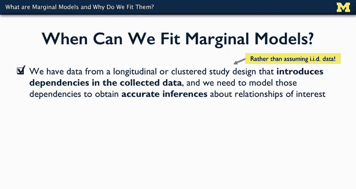

# 密歇根大学《使用Python的统计学（理解并可视化数据、因果推断、建模）｜Statistics with Python》中英字幕 - P83：17_边际模型的定义与应用场景.zh_en - GPT中英字幕课程资源 - BV1dV411Q7j3

嗯。

Okay， so welcome back。 We're going shift our discussion now from talking about multilevel models as tools for accounting for the dependency in data introduced by a study design to an alternative modeling approach where we're not actually including explicit random effects in the models that we're fitting。

 So in this lecture， we're going introduce the concept of a marginal model for dependent data and talk about why we fit these kinds of models。

 So what do they offer us how do we make inference based on these models and really what are the reasons that we fit these models to dependent data。

Okay， so so far we've discussed the use of multilevel models with random effects。

 remember where we were explicitly including random effects of these higher level sampling clusters or individuals。

 musicians， interviewers， area clusters or cluster samples in the and HaAs data where we had different geographic areas that were randomly sampled and we wanted to include random effects of those particular areas so far we've been using these random effects to capture dependencies in cluster and longitudinal data sets。

Now we're going to shift our focus to marginal models。

 again as alternative tools for capturing these within cluster correlations。

Now the key distinction in this kind of approach is that in marginal models。

 we do not include random effects because we're not interested in estimating between cluster variants in the coefficients in the intercepts or the slopes。

 whatever the case may be， we're not explicitly interested in that as part of the analysis。

 but we still want to accurately model the within cluster correlations。

 so that's an important feature of the data set that we have in hand。

 and we want to make sure that our models that we fit to the data are capturing those within cluster correlations introduced by the study design。

 whether it's randomly sampled clusters represented geographic areas like in Nhans or interviewers in the case of the European social Sur or musicians in the example of the web application that we looked at。

So what exactly are marginal models Well， this refers to a general class of statistical models that are used to model dependent data where observations within a randomly sampled cluster may in fact be correlated with each other for one reason or another could be due to the environment could be due to shared attitudes。

 whatever the case may be what we're interested in is the estimation of overall population average relationships between independent variables of interest or IVs and dependent variables of interest or DVs across all of the different clusters so before when we were using the multilevel modeling approach remember that we were explicitly controlling for random cluster effects in the model so we had those random cluster effects kind of like they were other predictors in the model now when we exclude those random cluster effects and again we're interested in these overall relationships where estimating relationships across all the different clusters rather than conditioning on a given cluster and thinking about what that。

And looks like。So as a reminder， in marginal models。

 we don't allow the coefficients of our model to randomly vary across clusters。

 this was a key feature of multile models。Our goal with fitting marginal models is to make inference about these overall marginal relationships and make sure that the standard errors of our estimates reflect the cluster sampling inherent to the study design。

 So again， if we fail to account for the fact that observations are correlated within the same higher levelve cluster。

 we run the risk of understating our standard errors。

 We need to make sure that our standard errors reflecting the sampling variance of the regression coefficients that we're trying to estimate adequately reflect the correlations within these higher level clusters。

 that's a key feature of marginal models， and we can do that in a way that doesn't require the use of random effects。

So， multilevel models capture dependencies in the data by allowing coefficients to randomly vary across clusters。

In contrast， marginal models simply look at overall relationships across the clusters and make sure that the standard errors of the estimated fixed effect parameters reflect these dependencies in the data。

 So what you see here is a visualization showing the difference in the fits of these two kinds of models。

 If you look at the panels here in this particular plot。

 you see each of these plots corresponds to a different child in a given data set。

 So childild 46 Child 48， child 49 and so forth。 and children have up to five measurements on a dependent variable called VSAe collected across time。

 So this is a longitudinal data set。 So you can see that different kids have different trajectories。

 in terms of these five observations on that dependent variable。 VSAE。 recall。

 we looked at this in the Python example of fitting multilevel models。

So the multilevel fit that you see in this plot is reflected by the dashed lines。

 so you see that in the multilevel approach， each individual child is allowed to have their own unique trajectory。

 Some children are flat in terms of their growth on this dependent variable。

 some children are really increasing at a fast rate。

 but there's variability among the different kids and the random effects capture that variability。

 allowing each kid to have their own unique relationship。Now， when we fit marginal models。

 the fit of the marginal model is represented by that solid line in each of these different plots。

 And what you notice is that that solid line remains the same。

Regardless of what child we're talking about， we're estimating an overall relationship of that predictor with the dependent variable。

 That's the only thing we're interested in， is what's the overall relationship。

 not the variability among individual higher levell clusters。

 but just what's the overall relationship， we don't want to make inference about that between child variance。

 And you can see that the fit of that marginal model is the same regardless of what child we're talking about。

 So we'd have the same expectation for what the predicted dependent variable would be。

 regardless of who the child is， depending on the time point。

So what steps do we follow when fitting marginal models first of all。

 we explicitly select a structure for the mean of the dependent variable。

 so remember we're modeling the distributional features of a given dependent variable and we start by selecting a structure that defines the mean of that dependent variable the mean as we've talked about in previous lectures is usually defined by regression coefficients and predictive variable so this is same as we've discussed before。

Then we select a structure that makes sense for the variances and covariances of observations that are coming from the same cluster based on our study design。

 and that structure needs to reflect the variances and covariances of these observations that are not explained by the selected predictive variables that we've used to define the mean of the dependent variable。

Then we compare the fits of different marginal models with different choices for this variance covariance structure and we choose which model has the best fit。

 so in later lectures， we're going to go through this process and understand how to compare models with different choices for the variance covariance structure identifying the model with the best fit and that's the model on which we would base our inferences。

So let's think about an example。 Sose that we have continuous longitudinal measurements on a dependent variable for subjects in a clinical study。

 so something like headache pain， supposeuppose that headache pain was a dependent variable and we measure headache pain over time。

 maybe in response to a treatment or an experimental drug or something like this。

 and we want to study what happens to that dependent variable over time。

After accounting for the relationships of time and experimental group with the dependent variable。

 maybe there are different trends over time for different experimental groups。

 these are the predictors that we include to define the expected mean of the dependent variable。

 we're still going to have these leftover errors So we weren't able to predict the values on on the headache pain variable exactly。

 we're gonna to have leftover errors， these are the residuals that we've been talking about when fitting models。

 But given the longitudinal design of the study， these leftover errors in the measures of the dependent variable within a subject might follow an autoregressive covariance structure。

 So what does that mean the errors， again， this failure of the model to exactly predict headache pain。

 these leftover errors in the observations on the dependent variable after we've accounted for the fixed effects。

 errors associated with the same subject that are close to each other in time So right next to each other in terms of time point1 time。

2 those errors might have a stronger correlation than errors that are further apart。

This is what it means to have an autoregressive covariance structure。

 there's a stronger correlation of observations that are next to each other in time than there is for observations that are farther apart in time。

Furthermore， this autoregressive covariance structure is defined by observations having constant variance over time。

 so at all the different time points， those errors tend to have a constant variance。

 regardless of what time point it is， but we add this fact that observations closer to each other and the errors therefore closer to each other have a stronger correlation than errors that are further apart。

 This is one possible covariance structure that we could consider for the data。

 and we evaluate different possible covariance structures and marginal models to see which one really has the best fit for a given set of data。

So for cluster data， this headache pain example was in the case of a longitudinal study for cluster data like observations within neighborhoods or observations on smoking in the enhancedhan example。

 we might assume that the errors follow what's called an exchangeable covariance structure as another alternative for the covariance structure。

 So what this means is that the observations have constant variance。

 All the observations in the same cluster of constant variance but there's a constant covariance of these observations over time。

 So any two observations that you look at within a randomly sampled cluster are going to have the same correlation that's different from the autoregressive structure where observations closer to each other in time had a stronger correlation than observations further apart with the exchangeable correlation structure it doesn't matter what two observations we're talking about they're always going to have the exact same correlation That kind of structure might make sense for cluster data where there's not a temporal element to the data collection。

So when can we fit these kinds of marginal models Well， first of all。

 we have to have data from a longitudinal or a clustered study design that introduces dependencies in the collected data。

 so the study design itself has to introduce some form of dependency in the collected data that we need to account for in our modeling。

 and again， this is different from assuming IID data There's a dependency in the data that we need to account for。

 and we need to model those dependencies to obtain accurate inferences about the relationships that we're really interested in between the predictors and the dependent variable。

Second， we have no interest in estimating between subject or between cluster variants。

 depending on the study design in terms of the coefficients of interest， so again。

 were in multilevel models， we had explicit interest in estimating those variance components and making inference about between subject or between cluster variance。

 we don't have interest in that added level of inference in the case of any marginal models， again。

 we're only interested in overall relationships and accounting for the clustering when calculating our standard errors。

So again， third， we wish to make inference about the overall marginal relationships between independent variables and dependent variables in the target population。

 so we don't want to condition on random effects of subjects or clusters in the modeling。

So why do we fit these models？ Well， these models do offer some advantages over other approaches for dependent data。

 And again， we've talked about multilevel modeling as one potential competing approach。 First of all。

 when we fit marginal models， it's much easier to fit them computationally。

 So we have much quicker computational times。 and there's faster estimation in general。

 so it doesn't take as long to fit the models， especially for dependent variables that aren't continuous or normally distributed。

Second， we can calculate robust standard errors that reflect the specified correlation structure。

 so standard errors that give us a good idea of the sampling variance in our estimated coefficients that arises due to the clustered study design。

Third， we can more easily accommodate non normalormal outcomes。

 remember when we talked about multilevel modeling in multilevel logistic models。

 we made the point that they're harder to estimate it's a much more difficult computational problem。

 so multilevel logistic models can take much longer to estimate then marginal logistic models where we're accounting for correlation of the observations and we're going to see examples of that coming up。

Remember， though， we can no longer make inference about between cluster variants in the coefficients of interest when fitting marginal models。

So what's next after this overview， we've introduced the ideas of marginal modeling Now we're going to go back to our earlier examples of multilevel modeling so we looked at the European Social Sur with interview effects。

 we looked at the NHANS data with the effects of randomly sampled clusters on smoking probability and we're going to consider alternative marginal modeling approaches to fitting models to these particular data sets and see what changes in terms of our inferences so we'll discuss how to estimate these marginal models and then we'll discuss techniques and methods for assessing model fit Finally。

 we'll look at some examples again using the ESS and NHANS data and then you'll be able to walk through examples of fitting these models yourself using Pythonons。

 so you'll get some handson practice as well in fitting these models。

