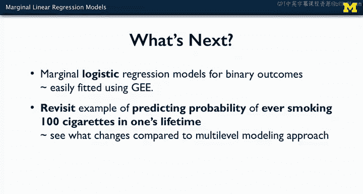

# 密歇根大学《使用Python的统计学（理解并可视化数据、因果推断、建模）｜Statistics with Python》中英字幕 - P84：18_边际线性回归模型.zh_en - GPT中英字幕课程资源 - BV1dV411Q7j3

Okay， so welcome back to our discussion of marginal modeling for dependent data。

 we're now going to turn to a discussion of how to fit marginal models to continuous dependent variables that may be correlated due to observations being collected from the same individual or from the same randomly sampled cluster so again we're focusing on an alternative modeling approach for dependent data where something about the study design introduces dependentencies in the observed values of the dependent variable and we're starting our discussion with continuous dependent variables so we're going to be talking here about marginal linear regression models。

So as a review for marginal modeling approaches， remember that the researcher may not care about estimating between cluster variants in slopes or intercepts。

 the researcher may only be interested in marginal fixed effects across all of the higher level clusters。

Furthermore， the researcher may only be interested in overall marginal relationships。

 possibly for different subgroups， so we're not interested in subject specific or cluster specific relationships。

 but rather overall marginal relationships across all the clusters or across all the subjects。

So there are alternative methods for fitting marginal models。

 the one that we're going to focus on this week is known as generalized estimating equations or GEE。

So let's think about what a marginal linear regression model would look like again。

 where we have a continuous dependent variable that we can assume marginally is normally distributed when we fit marginal models to normal dependent variables。

 we estimate the parameters that are defined by the model that you see here and an important thing to note remember is that marginal models do not include explicit random effects so if we look at this particular regression model where we actually have p different predictor variables that we're looking at notice that there aren't any of those u terms included in this model which remember in our discussions about multilevel modeling。

 those reflected random effects in this marginal model all that we see is an error term that explains the difference between the observation on y and the predicted value on y defined by that regression function that linear combination of the beta parameters and the predictor variables so we would write down the vector of observations on a given cluster I that's the notation that we see here y sub I those are all。

observationsations where there are n subi observations in total coming from cluster I we assume that that vector of observations on y follows a normal distribution with a mean defined by that regression function。

 that linear combination of the fixed effects or the beta parameters and the predictive variables delivered by x sub I and then this additional variance covariance structure defined by v sub I that's a general variance covariance matrix and it could take on many possible structures the key point here is that in that v sub matrix unlike standard linear regression。

 we allow observations from the same cluster to have a non-zero covariance in that v sub by matrix and there are many possible structures that could define those different covariances。

Again， an important point here， we don't explicitly estimate the variances and covariances of random cluster effects because there simply aren't any in the model。

 the correlations of observations within the same cluster are being captured entirely by the correlations of those error terms and those correlations are being captured in that visa by matrix。

 so an important part of fitting these models is choosing a structure for that visa by matrix we're going to talk a lot about that in the next couple lectures。

So let's talk a little bit more about generalized estimating equations as a technique for fitting marginal models when we fit models to dependent data using GEE。

 we're actually trying to find estimates of the parameters that define our model that solved the following score function or another name for this is an estimating equation that's where the GEE technique getss its name Generalized estimating equations so you can see that the score function is a function of the regression parameters。

 the beta parameters that we're interested in we're going to see where those enter here in a second but we want to find the estimates of the parameters that solve this particular equation here where we're setting that particular expression that summation equal to0 so let's break down these terms a little bit D sub I raised to the superscript or the power T which really refers to a transpose is actually an ni by P matrix。

 remember there are ni observations within a given cluster I and has different elements that represents taking the derivative of that mean function。

TI with respect to the regression parameters so when we try to find the parameters that minimize this function or solve this function。

 we need to do a little bit of calculus here and take some derivatives with respect to the parameters that we're trying to estimate to find the values of those parameters that minimize this particular expression。

V subi as we talked about earlier， this is an ni by N variance covariance matrix for those observations on cluster I and this is something that's users specified。

 so as a user when you fit these models you choose what v sub matrix you'd like to fit in this particular model and again different v sub matrices have different covariance structures depending on what covariance structure you think makes the most sense for the observed data so that defines D and that defines V but what about y and mu here in this equation Well y subi this is a vector or a column of the outcome measures collected for the Ih cluster we saw that in the expression of the model on the previous slide。

 so that's the values on our dependent variable of interest for the Ih cluster and then mu subi that's a vector of expected means for those outcome measures based on the model that youve selected and this is where the fixed effects enter into this estimated equation that's where the beta parameters enter that mu sub i is defined by the regression function。

It's the mean or the expectation of the dependent variables and the regression parameters and the predictiveor variables are what define that mean。

 as we saw in the specification of the model on the previous slide。

 so that mu subbi is defined by our predictors and our regression parameters and that's how they enter this into this equation。

 so we want to find the estimates of those parameters that define mus subbi that solve this score equation。

So how do we do that， we solved the equation using something called iteratively weighted least squares or other algorithms such as the fiser scoring algorithm。

 these are all iterative techniques that attempt to identify the estimates of those beta parameters that solve this particular score equation。

So this GEE methodology was first introduced by a couple of statisticians Liang and Zieger in a very important 1986 paper that you'll see as a deep dive reading for this particular week。

In practice we seldom know what that true variance covariance matrix is for the observations。

 we like to specify a visa by a matrix， but we seldom know what it actually is so in practice we attempt to define a working correlation matrix this is like a plausible guess for what we believe that true correlation structure is for observations coming from the I cluster we typically specify correlations or expected correlations of these observations and not covariances because for many non-normal outcomes which are what GEE is often used for。

 the variances of the observations are actually defined by the mean structure of the model So in practice we're more focused on choosing a correlation structure and not worrying as much about the variances of the dependent variable that comes with the definition of the mean for many different types of models。

And this general approach allows this methodology to be easily adapted to nonnormal dependent variables。

 so poson distributions， binomial distributions， and so forth。

 and we're going to revisit that when thinking about marginal logistic regression models。

 but right now our focus is on the continuous normal case and we're focusing on marginal linear regression models。

How do we make inference so variances of the parameter estimates are computed what's called a sandwich estimator and this is also described in that Liang and zieger paper and that estimators based on a specified working correlation matrix so you might choose。

 for example an exchangeable correlation structure which means that the observations have a constant correlation within a cluster and again the variance covariance matrix of the observations would be based on the expected means from the fitted model。

So estimators of our fixed effect parameters， those betas are going to be consistent now what does that mean that means with a large enough sample size our estimates of those fixed effect parameters will converge to the true values of those parameters so this is a very good property when using GEE our estimators of the fixed effect parameters are consistent even if we missspecify that working correlation matrix so if we choose a correlation matrix but it's actually not close to the true correlation matrix。

 we're still going to get good consistent estimates of our regression parameters so that's a very attractive feature of this methodology。

 bad choices of that working correlation matrix for again the dependency within the I cluster。

 those affect the standard errors not the estimates of the fixed effect parameters so remember we estimate the variances of the parameter estimates。

 the variances of the sampling distributions using this sandwich estimation technique that reflects the clustering of the observations。

 but if we misspecify that working correlation matrix。That has implications for our standard errors。

 they may be too large or they may be too small， we want to make a good choice of that working correlation matrix to make sure that we have good standard errors for estimates。

 but we're still going to get consistent estimates of our regression parameters。

 the fixed effects themselves and that's a very nice feature of this technique。Okay。

 so what are some choices for that working correlation matrix that defines that V sub I varianceance covariance matrix when we're using GEE there are generally four main choices that we can consider for that v sub matrix。

 one is independent that's where we simply assume that there's zero correlation and that observations within the same cluster are independent this is kind of like a starting point where you know it raises the question why we're even using GE in the first place if we think that observations are independent within a given cluster a second option is exchangeable which I mentioned a little bit earlier。

 this is where we assume that there's a constant correlation of observations within the same cluster it doesn't change depending on what two observations you're looking at。

A third option is the first order autoregressive correlation structure。

 where observations closer to each other in time have a stronger correlation than observations farther apart in time this structure is characterized by that decaying correlation over time。

And then finally we have an unstructured option， which is a completely general correlation structure for the observations。

 so any given pair of observations from the same cluster is going to have a unique correlation。

 so as you can imagine that involves estimation of more correlation parameters because it's a completely general correlation structure and Liang and Zieger in that 1986 paper。

 they proposed estimators for each of these correlations that define the GEE models。

Our focus though when using GEE is primarily on the fixed effects， again。

 those regression parameters， those betas， we're not focused primarily on making inferences about these nuisance correlations。

 whether we choose an exchangeable structure or first order autoaggressive structure。

 we're really focused not on the estimates of the correlations。

 but rather on the fixed effects and making inference about those fixed effects。

 we really view these correlations as more of a nuisance， again。

 primarily to capture dependency within the same cluster so that we make reasonable inferences about our fixed effects that reflect that dependency of observations within the same cluster。

So our inference is going to be robust to this possible variance covariance matrix misspecation like we talked about earlier and we can use walled tests based on these sandwich estimates of the standard errors so this is a fairly standard technique that allows us to perform hypothesis test for our fixed effects we can also look at information criteria that have been adapted to this GEE setting one example is this QicC criteria and these information criteria can be used to compare the fits of competing model say with different correlation structures so good specification of the mean structure including interactions or nonlinear predictors in our model is definitely important we want to do as good of a job of possible as specifying that mean structure it's okay if we get that working correlation structure incorrect for the fixed effects remember our fixed effects will still be consistent consistently estimated but again a poor choice of that correlation structure is going affect our standard errors so we want to make a reasonably good choice of that correlation。

tri as well but we're primarily focused on making a good choice in terms of our mean structure with pretty large data sets。

 alternative choices of working correlation matrices aren't going to make a huge difference for our inference unstructured usually make sense as a general correlation structure but with large data sets it's really not going to make a huge difference we can still consider different potential correlation structures to see what kind of impact they have on our standard errors before we ultimately make inference。

So again， poor choices of the working correlation matrix will affect our standard errors and our inferences。

 so we try to choose a reasonable model based on comparing the information criteria from different models。

 the QIC again is popular and fairly widely implemented but it does have a couple shortcomings in choosing the correct correlation structure we would try to identify the model that has the smallest value of QIC and that would suggest that that's the correlation structure that represents the best fit recent work by Westgateate and Burt in 27 team describes better alternatives for identifying the correct correlation structure and these authors provide some software to fit GEE models using their advocated information criteria as alternatives to the QIC。

But whatever criterion you ultimately use， you would again identify the model that has the lowest information criterion value is representing the best fit。

So let's apply GEE to that European social Surve analysis that we were discussing in earlier lectures。

 so let's revisit that ESS model and now apply the GEE technique。

 recall that we were interested in the relationship of trust in police which was our independent variable with a person's attitude about whether people generally try to help out others and that was our dependent variable。

Remember in the multilevel modeling examples that we accounted for the clustering of observations by interviewer by using multilevel models with random interviewer effects and back in week two we completely ignored the dependency in the data and we just took standard linear regression approaches Now we're going to use GEE to account for this dependency as an alternative to multilevel modeling。

So we've fit a marginal linear regression model using GEE and we start with an exchangeable correlation structure。

 that's our choice of the working correlation structure。

 which again assumes constant correlation of observations within the same interviewer and we use this method to make inference about the overall marginal relationship between these two variables。

 trust in the police and whether or not people generally try to help each other and that inference is going to account for the dependency of observations within the same interviewer。

 again a dependency that was introduced by the study design。

Okay so when we fit this model using GEE now， we fit this marginal model。

 our GEE estimate of that fixed effect of trust in the police is again positive。

 it's estimated to be 0。04 but now now that we look at those sandwich estimates of the standard errors in the marginal model that fixed effect would not be considered significant at the 5% level a P value was 0。

054 the estimated intercept in this model was 4。47 that parameter was in fact significant at the 0。

01 level so compared to the multilevel model， the estimate of the fixed effect of 0。

04 suggests a similar direction for this relationship that the relationships positive but the marginal estimate of 0。

04 is only one thirdd of what the fixed effect estimate was in the multi-level model where it was 0。

12 and remember in the multilevel model we explicitly controlled for those random interview effects so let's think about our different interpretations here in the multilevel model because we had those explicit random interview effects in the model we would say for。

interviewer a one unit increase in trust in police leads to a 。12 expected increase in helpfulness。

But in the marginal model where we're fitting the overall model across all interviewers and we're not explicitly conditioning on these random interviewer effects。

 we would make our interpretation as follows， we would say across all interviewers。

 not conditional in any one interviewer but across all the interviewers a one unit increase in trust in police would lead to an expected 。

04 increase in helpfulness， so we can see how we make slightly different inference because we're not conditioning on random effects of the clusters in this case interviewers and we're just looking at the overall relationship across all interviewers。

😊，Now let's think about some model diagnostics， we assumed a constant correlation within interviewers and our nuisance estimate of that correlation was 0。

05 the corresponding QIC for this particular model was 6790。

61 so by itself that QIC value isn't that useful we use it to compare the fits of different models。

When we think about alternative working correlation structures。

 unstructured and first order autoaggressive correlation structures。

 they don't really make a whole lot of sense in this case because there's no explicit time ordering of the cross-seal observations within each interviewer we can't really use that first order autoaggressive structure because again there's no time element we can't say the observations on persons1 and2 have a stronger correlation than the observations on persons1 and 10 same thing really goes for the unstructured correlation structure it's hard to specify why we would expect different pairwise correlations of observations within the same interviewer depending on when those observations were collected。

 there's really just no time element here so that leaves the independent structure where we just assume that observations within the same interviewer are independent of each other there's zero correlation the  Qic for that particular model is 6791。

55 so if you compare these two  Qic values again we want the model with the lower Qic value so that provides evidence in favor of the exchangeable。

correlation structure， so there's slight evidence of a better fit for the exchangeable model and that would suggest that it is important to account for that correlation within interviewers。

So let's draw some conclusions from this example， marginally when looking at the overall relationship across interviewers。

 we didn't find as much evidence of a relationship between trust and please and perceived helpfulness as we did when controlling for the interviewer effects explicitly。

😊，And accounting for the dependency rather than assuming independence of observations within each interviewer did seem to improve model fit slightly。

 so when you're using GEE comparing models is very important so remember when fitting marginal models。

 we can no longer make inference about between cluster variant。

 we were just controlling for that nuisance correlation within clusters when making inference about our fixed effects of interest。

So what's next next we're going to turn to marginal logistic regression models for binary outcomes and these can be easily fitted using GEE。

 we're going to talk about GEE models for other types of dependent variables and we're going to revisit that example of predicting the probability of ever smoking 100 cigarettes in one's lifetime we've already considered a multi-level approach to that analysis now we're going to consider the marginal modeling approach and we're going to see what changed relative to that multilevel modeling approach。

