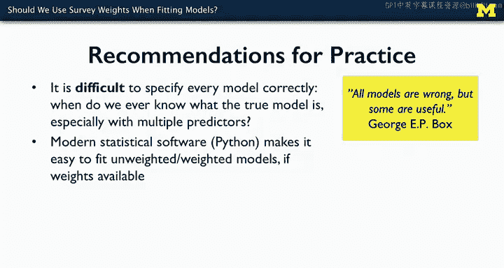

# 密歇根大学《使用Python的统计学（理解并可视化数据、因果推断、建模）｜Statistics with Python》中英字幕 - P86：20_模型拟合中是否应使用调查权重.zh_en - GPT中英字幕课程资源 - BV1dV411Q7j3

Okay， welcome back in this special topic we're going to be talking about whether we should use survey weights when fitting regression models。

 we've talked about a lot of different regression models at this point and one thing we haven't discussed is whether or not we should use weights associated with a given probability sample when fitting these different types of regression models。

 so this particular special topic is going to talk about what to think about with respect to using survey weights when estimating regression models。

Okay， so let's review what's meant by survey weights and this goes back to when we talked about understanding and visualizing data and we talked about the notion of a probability sample。

 so recall that survey weights may be available in data sets that are collected from complex probability samples and that these weights account for at the very least。

 unequal probabilities of selection into the sample for different cases。

 so cases with a lower probability of being selected into the sample will get a higher weight in the overall analysis。

In theory， these weights are designed to enable unbiased estimation of selected parameters for a finite target population。

 so recall that we have a finite target population of interest and we use these weights to make inference about that finite target population。

 and the weights enable unbiased estimation， meaning that on average。

 our estimates will be equal to the true finite population parameters of interest。Therefore。

 we consider the case where an analyst wants to fit a regression model to a given deep in a variable collected from a probability sample。

 and we know from looking at the data that there are weights in that data set that represent again。

 at the very least different probabilities of selection and the question is do we need to account for those weights when actually fitting the regression model and making inference。

 that's what we're going to be discussing in this lecture？

So should we use these weights in estimation using survey weights to fit regression models first of all ensures that the estimated regression parameters will be unbiased with respect to the sample design。

 so taking the sample design into account we ensure that on average the estimates of our parameters across repeated samples will be equal to the true population regression parameters however。

 those survey weights do not protect analysts from poor model specification。

 so as an analyst you still have to do a good job of specifying the mean structure of the model。

 the variance covariant structure of the model， the weights aren't going to protect you from leaving out important predictors or misspecing- nonlinear relationships。

 some of the issues that we've talked about that go into specifying good models。

So suppose that an analyst fits a poorly specified model but still uses the survey weights and estimation and computes weighted estimates of the regression parameters what's the result of this kind of analysis Well first of all。

 the analyst is going to produce unbiased estimates of the regression parameters with respect to the sample design so that's a good thing。

On the other hand， the analyst has misspecified the model for the finite population of inference and that's a bad thing。

 so in this situation the analyst is going to come up with good unbiased estimates of a really bad population model so in practice we want to try to turn both of these indicators to good when fitting models to survey data we want unbiased estimates of the regression parameters and we want to do our best to specify a correct model for the finite population of inference。

So let's look at some examples of what we mean by this first of all。

 consider the case where we have weights in the analysis and we use those weights for estimation。

 but we've done a poor job of specifying the model。

 so in this example data set that you see plotted here。

 the size of each point represents the survey weight for that case。

 so the larger the circle or the larger the bubble， the more weight that that particular case gets。

Now this scatter plot shows that there's a nonlinearar relationship between x and y。

 so you see that for smaller values of x， the value of y dips down to around0 or around5 and then as you get larger in terms of values of x。

 there's an increase in the predicted value of y to a point。

 but then the relationship between x and y more or less flattens out so it seems like there's a nonlinear relationship and it's cases that have larger values on x and y that tend to get more weight。

 so if we just plotted the data， it definitely seems like there's a nonlinearar relationship between x and y but the analyst has misspecified the model and they're fitting a model that assumes a linear relationship。

Now， the analyst uses the weights and estimation because they've heard that accounting for those survey weights when fitting linear regression models will give you unbiased estimates of the regression parameters with respect to the sample design so we get unbiased population estimates of what these regression parameters look like for the overall population。

So in this case， you see when we fit that straight line model that regression model fit is drawn to the points that have higher weight。

 you see the straight line goes through all the points that have the highest weight。

 but we're still doing a really poor job of modeling those observations at the lower end of the distribution on both x and Y so unbiased estimate of what the best linear model would look like in this particular population or the best model that assumes a linear relationship between x and y。

 we have unbiased estimates of the regression parameter but we don't have a well-specified model and we're missing that important feature of the relationship here。

So suppose that we instead ignore the weights in the estimation and we still missspecify the model。

 so suppose that the analyst goes back， refs the model。

 ignoring the weights and missspecifies the model now you see what happens is that that straight line regression fit is now drawn further towards the points at the lower end of the distribution the line is no longer drawn towards the points that have the highest weight in the overall analysis so the line is shifting downward a little bit relative to the model where we were estimating the regression parameters using the weights。

So what this is is a biased estimate of the relationship because we're not using the weights and estimation。

 so we're not getting an unbiased estimate of the finite population regression parameters。

 we're getting a biased estimate and that biased estimate is based on a poorly specified model so it's kind of the worst of both worlds in this particular case we're ignoring the weights so we no longer get unbiased estimate and we're misspecing the model so we're missing that nonlinear relationship and assuming that that straight line relationship did hold in the population we're not getting the right estimate of that straight line relationship for the values of interest So again。

 not the situation that we want to be in in practice and again note that the fitted regression line is drawn toward the low weight points and we really want to take steps to avoid this situation in practice because again。

 we're getting the worst of both inferential worlds in this case。

So let's consider an alternative where the analyst actually does a good job of specifying the model and in the regression model they allow the relationship of x with y to be nonlinear。

 so they might include x squared as a predictive variable to model that curveline relationship。

 but they ignore the survey weights in the actual analysis。In this particular case。

 we see that the well specified model provides a good fit to the observed data。

 you see that the fitted regression model accurately reflects the relationship between x and Y with a little bit of error。

In this model based approach if the model is correctly specified。

 we may not ultimately need the weights to capture this relationship in the population。

 and that's the key point here if we do a good job of specifying that relationship and we look at our data and we look at scatter plots。

 we may not ultimately need to use the weights to describe what's going on in the population。

 we can capture this relationship between X and y with a wellspecified model。

 as you can see here in the fit。So what happens if instead we use the weights and estimation and again we do a good job of specifying the model。

 so the analyst uses the weights to estimate the model and correctly specifies the model。

 so kind of the best of both inferential worlds。We get an unbiased estimate of that relationship from a well specified model again you can see that the model fits well。

 but if you look at these two different slides， the fit is essentially the same。

 it doesn't look like the fit of that model allowing for the curvaline relationship looks any different。

 whether we're using the weights or we're not using the weights。

 so we would arrive at the same conclusions。The drawback is that using the weights and estimation if you've done a good job of specifying the model。

 describing this relationship， if you use those weights in estimation。

 you can inflate the standard errors of your regression parameter estimates and remember when testing hypotheses about regression parameters we generally take an estimate divided by its standard error and refer it to A distribution that's a common hypothesis testing technique if we use the weights and estimation and the model's been well specified that standard error can get inflated unnecessarily just because we're using those variable weights in the estimation and that increases the sampling variance of our estimates so in this case we probably would not want to use the weights because we've done a good job of specifying the model and we don't want to affect our inferences by having estimates that are unnecessarily variable from using those nuisance weights in this particular case because again we've captured the relationship by doing a good job of specifying the model。

So if you summarize what we talked about on these previous slides with these different pictures。

 here are some recommendations for practice when you find survey weights in a given data set。

 so if survey weights are available for a probability sample and you wish to fit a regression model first and foremost。

 do the best that you can to specify the model correctly。

 so think about your subject matter knowledge， think about the predictive variables that you have available。

 look at the data， look at some scatter plots and make sure that you're capturing relationships to the best of your knowledge in specifying the regression function for a given dependent variable。

Second， fit the model with and without using the survey weights。

 statistical software like Python or other packages。

 they make it very easy to fit these models very quickly with and without using the survey weights。

 so you can examine the sensitivity of your results and your inferences to the use of survey weights for estimation。

 again in theory we're using those weights to come up with population estimates of these regression parameters。

 so that's important in theory but there is that drawback where if we've done a nice job of capturing relationships using the weights and estimation can inflate our standard errors so we need to be careful about this and compare the estimates with and without using the survey weights。

Now if the estimated coefficients remain similar when following these two approaches。

 but the weighted estimates have larger standard errors。

 it's likely that your model has been specified correctly to some extent。

 and the weights may ultimately be unnecessary and again。

 what the weights might be doing is only inflating the sampling variance of your estimates。

 so this is where comparing the estimated coefficients relative to the changes in the standard errors when using these two approaches becomes very important。

Now， the other case， if the estimated coefficients changed substantially。

 the model may have been misspecified and in this case where we're not sure if we've specified the model correctly。

 the coefficients changing substantially means that the weights carry information about the relationship that you're trying to model in the population of interest so in this setting the weighted estimates should be reported to ensure that they're at least unbiased with respect to the sample design。

 if we're not sure that we have the model correctly。

 we still want to report what the population estimates of those regression parameters would be so that we can make inference about the finite population if that model has not been specified correctly so if we assume that we've left out a predictor or maybe we weren't able to measure some important predictors we should at least report the weighted population estimates so that we get a good unbiased estimate of our potentially misspecified model。

So there's a very famous quote in statistics says all models are wrong， but some are useful。

 whether we're making prediction or making inference about relationships between different variables that can be attributed to the statistician。

 George B and in practice it's difficult to specify every model correctly and the question that really comes up here is when do we ever know what the true model is what exactly what predictor variables should be included。

 exactly what functional relationships between variables we should be modeling。

 what covariant structure we should be modeling， do we ever really know what the true model is in our population of interest。

 especially when we have multiple predictors it's very difficult to do this in practice and this is where regression modeling can really become an art trying to identify the best predictors for a given dependent a variable。

So in that setting， again， modern statistical software like Python makes it very easy to fit both unweighted and weighted models if survey weights are available so you can examine the sensitivity of your inferences to using weights in the actual analysis and follow those recommendations that we talked about on the previous slide。

There are also formal tests that exist for comparing weighted and unweighted estimates when using survey weights to fit regression models。

 and you can find out a lot more on those formal tests in the deep dive readings for this week。

