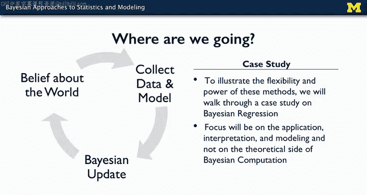

# 密歇根大学《使用Python的统计学（理解并可视化数据、因果推断、建模）｜Statistics with Python》中英字幕 - P88：22_贝叶斯统计与建模方法.zh_en - GPT中英字幕课程资源 - BV1dV411Q7j3

Hello everyone， today we're going to be talking about Bayesian approaches to statistics and modeling and we're going to be talking about how they vary from some of the stuff that we've been doing from earlier in the class。

And I want to illustrate this by means of a case example。Right overall。

 we've been trying to use maximum likelihood， this method that fits models to the data and it picks the best values。

 it picks a single value right， if we're fitting means we're trying to say the mean， yes。

 our best estimate is that it's at five， but we don't say much about the uncertainty until we talk about standard errors。

Prob in this frequency setting is a long run frequency。

 it's something about the long run expectation if I do this many times。Baesian methods。

 on the other hand， think about these problems in a fundamentally different way。

 so let's illustrate this by an example。So imagine that someone end up coming up to me and they say。

 hey， Mark， I want you to determine the average IQ of students at the University of Michigan。

They say， hey， what do you think the average IQ of University of Michigan students might be？

So the first thing that I do right I have some maybe views on the topic or because I don't know much about IQs。

 I'm just going to go online， I'm just going to say， hey。

 I end up looking up and the overall distribution for the US population it's mean 100 standard deviation 10 right I'm just going to assume that the total population right that's going to be my first belief for what's actually going on I'm going to say yep my mean is at 100 my standard deviation is 10 this may not be the best belief but it's the one that I'm going to start with it's what I hold in my head someone else can have a different belief。

At the end of the day， it's totally okay。So what does this starting belief look like。

 so I'm going to plot it out。And this is going to be my starting belief。

So all I did was I ended up going online right， I found out that the overall population has a mean of 100。

 a standard deviation of 10， so this is going to be what I'm going to start out with。Similarly。

 anybody else could have done this， right， and they can have any other belief。

Maybe they believe that you know， the distribution of score or yeah。

 the distribution of IQ scores for U of M students。

 let's say they say that they're a little bit higher。This belief is totally okay， too。

 Someone else comes to the analysis， they end up saying， no， I actually think that it's skewed。

So they can end up saying something like this， let's say that， you know。

 I believe that it's actually skewed right。I believe that I actually could find some really intelligent people on this tale。

 Someone who are coming up and they say， no， it's multimodal。

 I think that we're going to have a bunch of normal people。

And then we're going to have a bunch of really， really high IQ people。Each of these are just beliefs。

 but the one that I'm going to hold in my head right is going to be this normal 110。A belief。

These beliefs also can have smaller variants and this is something that I want to point out I'm pretty uncertain with my belief of where the mean IQ score of U of M students is going to be so I say yeah it's center at 100。

It's centered at 100， right？But I have quite a large variance。

Whenever I decrease the variance of my estimate， what I'm implicitly saying is I have a more certain belief over where that IQ score might be。

But at the end of the day， these are just beliefs that I hold before I observe any data。

 Let's go observe some data and let's see what ends up changing about my belief。So I have my belief。

 right？I'm going to go out and I'm going to test it。So I go out and I find someone。

 they have an IQ of 125。So I have my belief， I see someone who has an IQ of 125。

 how should my belief change？How should my belief change given that I observe the data point？

should it shift left， right or stay the same？And the answer is。

 I observe someone that is greatly larger than what I originally believe the mean to be。

 so I should expect my mean。My mean overall， to be kind of pulled in this direction。

And maybe my me might look like this。This is how my belief should update right so I originally had this belief。

 this was my original belief。This is going to be my updated belief now that I've observed someone with an IQ of 125。

So this is my original belief。I observe someone。With an IQ of 125。Here is my original。

We can see that it shifted right， and I originally thought that the mean was at 100。

 I now think that it's probably around 124。So this indicates that the mean of my original belief might actually be higher than why I originally thought。

I now observe someone who has an IQ of 115。So I go about， I observe someone with an IQ of 125。

 that's this distribution。So this is my 125 distribution。This is my original belief。

This is the distribution of having observed 125 and someone with an IQ of 115。The first question is。

 why did it shift left？I originally thought now that the mean was this after observing 125。

 115 is less than that， so I expect the distribution to shift a little bit。

But we can also see that now if I observed two data points， the variance of my belief goes down。

I originally had a lot of uncertainty。I now have far less。

And that's what we hope whenever we observe more data， we get to be more certain about our estimates。

I'm going to continue to do this， I'm going to keep going around campus right。

 I'm going to observe someone with an IQ of 125， 115， I observe another 115， a 120， I observe a 125。

 I observe a 117 each time I'm taking my original belief。So this is my original belief again。

And I'm updating it until eventually I get this belief right here。

 so this is my belief after seeing data。Bice。About IQ。After seeing data。

So this is my belief after seeing a bunch of data。We can see that because all these points are bigger than 100。

 I expect the mean to increase a bit。And because all of these points are relatively centered。

 let's say， around that 117118 area， that's where I expect my mean to be。

 and they're all relatively clustered within that range。

So my belief of the average change is quite a bit。We can see that more data allows us to better focus on belief。

 our belief about the mean IQ of students at U of M。

 and the process that we just went through actually has a name。

This idea of starting out with a prior， my original belief in updating it with data。

 using some sort of a function in a Bayesian way is called Bayesian updating。

And this is how Bayesians think about the world。 This is a class of statistics。

 They think about the world。 This new distribution that I get is called a posterior。

So imagine that I was doing this in a frequentist analysis， I would actually get a point estimate。

 I would say that my point estimate。Point estimate。Is equal to some number。

 let's just call it 118 for argument's sake， in a frequententous analysis。

 I would get something just like this， just a single point。In a Beijing scenario。

 I actually get an entire distribution。So I get a distribution on the belief。In this distribution。

It's called a posterior。So the way that I update my belief。

 I eventually get the thing called a posterior， this posterior allows us to update and answer questions about our quantity of interest。

So I just now applauded my posterior， I originally had a normal 110 distribution。Originally had this。

I've observed all this data。I now have a posterior distribution。That looks like this。

We can see that it's centered roughly at about 119 and I can ask a bunch of questions using the other tools of this course about this distribution to try to see what I'm actually working with。

 What can I actually say about my new belief about the mean， what can I talk about。Right。

I can ask a lot of questions， so someone ends up coming up to me。

 my friend comes up to me who asks me this question and he says， what is our expected belief。

 What do you think your best guess of the IQ scores are and I can end up saying well my belief has a mean of 119。

55。so I can end up saying the mean of this distribution is right here。119。

55 What is the most likely value， what what's if you had to put all of your money on one point？

WellI'd probably choose this point right here， this is called the map estimate。Ass an aside。

 but this is the most likely value。As a side note， this is actually a normal distribution。

So these two equal each other。ok。What is the median if I had a different distribution similarly。

 I could end up calculating the median in my median for this case。

 this is also a normal distribution， as I just said。So the median is the same as the me。

Imagine someone started out with a skewed prior， right， imagine that their posterior looks like this。

They would have a different。Expected belief in me because they had a different prior。

 and this is totally okay。We can now ask things about ranges of values。

 What's the 95% credible interval All a credible interval is。

 is it's analogous to a confidence interval in frequent statistics。

But it talks about probability instead of confidence。So in a frequent setting。

 I would say I'm 95% confident that if I would repeat the study many times that the true mean IQ of U of M students falls between 116 and 122。

In a Bayesian setting， I can say that there is a 95% probability。

Right that the belief is between this and this， we can say different things because we think about them in different ways。

 we can get this all from the posterior distribution。Being able to say things about probability。

This is very powerful。But nothing comes for free and we'll talk about that at the end of this lecture about what are of the downsides of actually having what are some of the downsides of having this improved interpretation of what I'm talking about。

So this distribution on the quantity of interest is called the posterior。Right。From this standpoint。

 we can talk about kind of the Bayesian model of thinking we start out with a belief about the world。

So we start out about a belief about the world， this is our prior。

We then collect data and we run it through a model。

So this is the step that we'll talk about in the case study， so this is modeling。

And then what we do is we use our model to update our belief of the world。

This is taking the posterior。And using it now is a prior for new analysis。

So let's talk about that a little bit。This cycle is。

Basically analogous to what we do in Beijing statistics， take a belief， update it， update our prior。

 and continue to go around the circle until we converge on what we think。

The steps to a Beijing analysis so as I said we need to establish a belief。

 this was originally the belief that the IQs were distributed normally with a mean of 100 a standard deviation to 10。

 I'm going to collect a bunch of data， this was whenever I went up to a bunch of people and I asked them for their IQ scores。

I'm going to update my beliefs， I get a posterior。I'm going to repeat now steps two and3。

 so I'm going to go to two and3。And I'm going to keep doing this。

 keep collecting more data until one of two things happen。 Number one。

 I get the resolution that I want。Or number two， I run out of people to ask and then I can use my posterior to ask a bunch of different questions about my belief about the average IQ of U of M students。

So Bay methods and posteriors， let's take a step back and let's ask ourselves why would someone want to do this。

 right， The first thing is all questions about our beliefs of our quantity of interest can be found via the posterior。

We combine this with a loss function for optimal decision making。

 and we can really use this to get a better model of the world。

This is a very powerful idea now that we have distributions and not just point estimates。

 we can combine this with ways of optimizing loss to really get at this idea of decision making under uncertainty。

Right， however。This interpretation of being able to think about probability。

 this interpretation of being able to think about these methods in a different way has some downsides。

 We have to rewrite our entire definition of probability to make this work。And mathematically。

 the process can be quite difficult， it can sometimes even be intractable。

 and at the very least it is usually pretty computationally expensive depending on the model。

So we talked about we need to change our view of probability。

 it requires us to flip probability on its head。Freeququs， what we've been doing originally。

 view probability is a long run limiting frequency。

parameters are fixed and unknowable and constants parameters are fixed un noble constants and the data itself is random。

There is some mu。There is some mu。I have a bunch of data。In a frequency scenario。

 and I'm going to try to estimate mu as best as I can， and my best estimate is called X bar。

In the Bayesian setting， Bayesians view probability as a degree of belief。

 They treat data as fixed and they po the parameters of random variables。

 So what does this look like， Imagine this is my data。In a Beijing setting。

I don't believe that there's a single mu， I believe that there's an entire distribution of them。

And we're going to try to infer what this distribution is using the data。In a frequentist analysis。

 this is a constant that we don't know we try to estimate in a Bayesian analysis。

 this is a belief that we keep updating with new data。

And this is a very different way of thinking about the world。Nothing is free， though。

 these enhanced interpretations， right？Arc sometimes very difficult mathematically。

 unless you work with very specific priors， the math can get very difficult， very quickly。

 involve very high dimensional integrals， involve computational problems。

 Some of these models are so complex that we have no choice but to use sampling methods to estimate the results。

And as a result， we actually sometimes end up having to dip our feet into computational methods just to even get the fits from these。

To illustrate kind of why we would want to use these methods and what this entire idea of flipping probability on its head actually means。

 we're going to try to illustrate this via case study。

 the focus for this will be on the application and interpretation and on the modeling and not necessarily on the theoretical side of Bayesian computation。

The entire idea is that we want to try to see what this looks like from a modeling standpoint and maybe some of the advantages of doing a Bayesian model。

 while also getting noticed to the downsides， these things can be quite difficult to fit and they can involve a lot of time actually trying to fit them。

Thank you so much for your time。