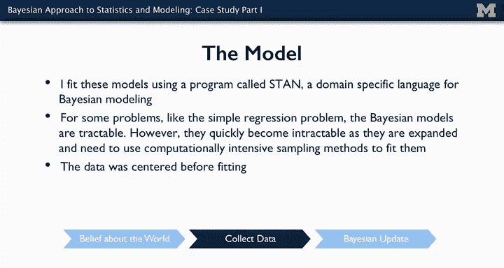

# 密歇根大学《使用Python的统计学（理解并可视化数据、因果推断、建模）｜Statistics with Python》中英字幕 - P89：23_贝叶斯方法案例研究(上).zh_en - GPT中英字幕课程资源 - BV1dV411Q7j3

Hello everyone， today we're going to be talking about the first of the three sections of the case study on Beijing approaches to statistics and modeling。

So we're going to be walking through a multi-level regression problem using one of these Bayesian frameworks in Bayesian frameworks they're an incredibly flexible way of doing things such as variable selection。

 regularization， kind of akin to the laso models and the ridge models that we've seen earlier fit models where the number of parameter exceeds the number of observations and we can model dependence hierarchical structures and a lot more all within the same model because we have these ideas of posterior distributions on all of our parameters we're going to barely scratch the surface of methods but we want to kind of explore the Bayesian workflow for modeling and most importantly we want to kind of get an intuition as to what's going on with these methods。

The one thing that I do want to say is that if you are familiar with these methods。

 I'm going to kind of gloss over some of the math， I'm going to kind of gloss over some of maybe even the best practices in order to try to get at the heart of what we're trying to do。

So please be patient if you end up noticing something like that。

 it's something that we definitely emphasized but there was a trade off because this is a special topics part of the course。

So before we end getting started， if you are interested in a lot of this analysis。

 I recommend two books， the first one is doing Bayesian data analysis。

 it's also called the Puppyiess book， this is a very approachable。

 great introduction to Bayesian statistics and it is by far in my personal favorite on the subject。

 and then the second one is Bayesian data analysis by Andrew Gellman and El。

 he ends up writing this beautiful book that's typically used at the graduate level。

 he's one of the authors of Stan and he's overall just a great person to follow in the statistics community。

 especially whenever it comes to Bayesian data analysis。Before we into proceeding。

 we kind of need to get back to this idea of what Bayesian data analysis is。And in order to do this。

 we need to talk about the three steps that we typically go through whenever we build up one of these models。

The first thing is we need to establish a belief about the world。

 This includes a prior and likelihood functions。 you can kind of think of this as setting up the model and making sure that all of the working parts are in place。

The second thing that we need to do is we need to use data and probability right we need to update our beliefs。

 we need to check that the model agrees with the data， this is checking fits。

 this is making sure that our model is actually trying to capture as much of reality as we can。

And then the third thing that we need to do is we need to update our view of the world based on the results from our model。

 given our data and given our model， how should we change our beliefs so that we can go about conducting this process all over again if we explore new data。

So for this case study， we could have used a lot of different data。

 the one that I ended up choosing was based on the National Longitudinal Survey of You。

It has 434 observations and is trying to look at the kid' IQ score given the IQ score of a mother right so imagine your mom in this first example has an I IQ score of 121 right your mom went to high school。

Let's highlight some of these variables here if so your mom went to high school。Right。

 your mom has an IQ score of 121， your mom is 27， I'm going to try to see if I can predict your child's IQ score based on these three variables。

And that's going to be at the heart of this analysis， the data set is pretty large。

 but it's still small enough that we can start seeing kind of the benefits of Beijing data analysis。

For this， we're going to be using a linear model。 and for better or worse。

 I end up choosing a linear regression model to start out with。 We in frequency statistics。

 see this all the time， right， We express the form of our model。

In this form we say that a child's IQ。Is equal to some intercept term。Plus。

 some slope term times the mother's IQ。Plus， some slope term times the mom's age。

I'm going to start out with this very basic regression model we're not going to include the high school variable and we're going to do this for a few reasons。

 the first one is to keep it simple at first and we'll build out a more advanced model in a second and the second thing is we want to really see what's going on how does this compare to traditional models if I just fit this in a frequentist way what kind of advantages and what disadvantages do I have with doing this in kind of a more beesian way。

So up until now， we haven't done anything more different than what we've done in the past。

But in the Beijing framework， we need to specify prior distributions on our beliefs。

 and this is something that's kind of new。So a key point， and this is the first key point。

 every parameter must begin with a distribution that captures our belief。

 these distributions that we place on these parameters are called priors。Right。

 just as we did in the intro case， imagine that I have the belief in this model that I intercept。

 Let's go back to this slide。 Imagine that I believe that my intercept。Should be be centered on0。

And look like this。I may express this with using a normal product。Similarly。

 someone else could go about this analysis， they may have more information than me。

 and let's say they say no， this should actually be skewed。So they could make that argument。

 they could say this should look like this。Similarly， for beta 1。Similarly for beta 1。I have no idea。

 I've never dealt with this type of IQ data before。 And so I am going to say， hey。

 maybe it's centered at one。 Maybe I think that a child's IQ。Is perfectly predicted by a mother's IQ。

 so center at one。But I'm going to include a lot of variance in mine。

This idea is that if I don't know something for sure。

 if I don't know for sure that it should be centered on one。

 I should make sure that I include a lot of variance in my prior belief。

RightAnd we state these via distributional assumptions。

So the first step in a Bayesian analysis is to state， hey， what are my priors。

 What do I actually think that things are going to look like before。I go about doing my updates。

 and ideally we do this before we even see the data。Okay。

 so we want to establish these before we see the data just so we can try to get our prior beliefs done on paper。

A good practice is to often write out what all of your priors are and write a short little sentence about why you chose them。

So my initial prior， and once again， I'm not an expert in this area。

 but I put a relatively weak prior after centering my data on the intercept。So once I center my data。

 I know that my intercept is probably going to be centered at zero or it should be。

But I'm going to give it a variance of 20。Right， I want to make sure that this parameter is not constrained。

 I put a really weak prior on this one， right I'm not largely concerned about the intercept， though。

 the two terms that I'm the most concerned about in this model。Or beta 1 and beta 2。Right。

 if we remember， right this。Beta 1 corresponds to the mom's IQ。

And this beta2 corresponds to the slope term on the age of the mother。ok。

My belief is that whenever I'm coming into this analysis， the mom's IQ explains most， if not all。

Of the IQ of the child。 And so I express that by saying， let's say that a mom。Has an IQ of 110。

I'm going to have my prior belief be that the child。Has an IQ of 110 as well。

Is this a correct assumption， no， but it's the one that I'm going to go with？RightHowever。

 even though this is a ratio term， even though this is a slope。

 I'm still going to put a relatively wide prior on it。

 I have no idea how this data is going to play out and because of this。

 I don't want my prior to affect the way that my model is going to fit more so than anything else。

And similarly， I'm going to say that whenever I have a mother， irre of her age。

It's not going to make a difference on the IQ。I could have ended up putting a different prior on this。

 I could have said， oh no， I actually think that you know older mothers may produce children because of the way that they're raised or something similar that is independent。

Right of this B1 variable of this IQ variable， and this may have a positive association。

So these are going to be my priors， these beliefs can be anything that you want。

 but ideally you inform them with your best guesses。

The last thing that I'm going to say is I'm going to say given my mean， right。

 so I'm going to have this be my mean。So this is my mean function。 It's a linear function。

 I'm going to say that child IQes in general。Are distributed normally with this mean。And then some。

 I'm just going to call it sigma error， right， This is just going to be the general error in the model。

Zhenronong。air。And this is going to give me an idea of hey。

 how far away on average were my estimates from the reality。

 and hopefully we want a really small sigma error ideally。

 because it tells us that our predictions are quite good。Xiao。

The one point that I need to drive home though is why did I end up choosing these specific distributions。

 why did I go about putting these exact priors？I end up explaining them in these sentences。

And this is always a good practice， always try to write out what your priors are。

But the thing about Beijing statistics is， and this is why some people may shy away from it。

 it inherently allows subjectivity on the part of the modelers， right two different people。

May have used different priors。May have used different priors， and as a result。

 they can conclude two different things。If you have the belief。That this term is actually zero。

In this term is actually one， or， you know， it's perfectly cord。

 I'm going to remove one because that's not going to be true but。

Let's to say that this is some constant。That's non zero。 if I have that belief。

The model predictions that you're going to have are going to be wildly different than mine。

This induces a little bit of subjectivity。 If this model seems subjective because of my assumptions。

 that's the point though， and that's what I want to drive home。

 My assumptions are mine and they're brought to the forefront of the analysis。

 I am not an expert in this area I've never dealt with this data。

 so I'm trying to express that in the uncertainty about my estimates I'm trying to say I have no idea what they might be。

 so I'm going to give my model a lot of room to try to interpret what they possibly could fit。

I don't want my protor to influence my measurements too much。

This is some another point that I want to drive home。

 Often it's a great idea to maybe ask experts to incorporate prior data。

 and this is where Benian analysis really shines If you have an idea from a previous experiment。

That let's say that the intercept term is actually 0。5。

So like let's say that someone did an analysis on a different IQ set and said， hey。

 this actually could be 0。5。You should do that， right， And furthermore。

 you would hope that he would increase。Theperience， you might make this you know one or two。Right。

This idea that we update our beliefs， we update our priors based on previous knowledge。

 I talk to an expert。 they say， no， the age actually matters a lot。

 You shouldn't have it centered at zero。These things can work their way into my priors before I see my data。

 and they allow me to have a better parameter estimate if they're in line with the data。Right。

Before we end up getting into what the actual model fits look like。

 I need to say a few things about the model fit， so I fit these models using a program called Stan。

 which is a domain specific language for Bayesian modeling。

 All this means is it's specifically designed to do Bayesian modeling。

 we can interface through Python in order to work with Stan， but we do need to build up some scripts。

For some of these problems like simple linear regression。

 the Bayesian models themselves are tractable， so this is the flip side if we want all the upsides of Bayesian statistics。

 we need to deal with the downsides。However， the math can quickly become intractable and because of this。

 we sometimes need to use sampling methods， so instead of getting this beautiful curve。

On our estimates like this， it may actually be。Something that looks like a histogram。

 And this is fine。 so long as we have good samples from a sampling algorithm that approximates this。

Then we're usually okay and the last thing that I need to say。

 so this data was centered before fitting。Whenever we take a step back。

 what would it mean if a mother had an IQ of zero？Or an age of zero。

 and we' trying to predict their child。We're trying to predict their child's aQ。

It doesn't really have an interpretation。So the one thing that I did was I centered the data and the predictors before we got started。

 and this was just to try to build in a little bit of interpretation about the mean。

 and it also removes that noisy intercept term that we would get because we're fitting data quite far away from zero。

So let's hop into the actual model and I'll see you in part two， thank you。

