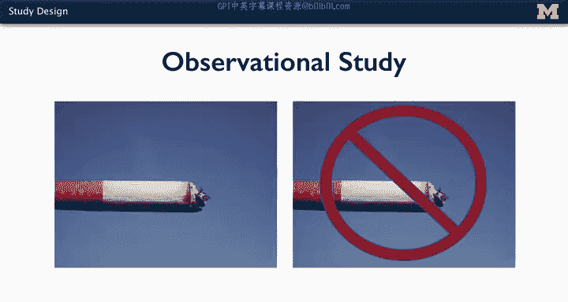
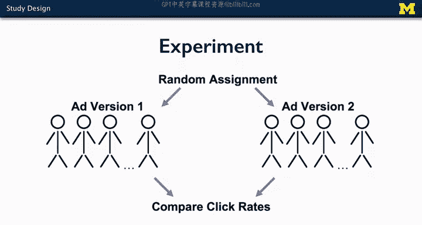

# 密歇根大学《使用Python的统计学（理解并可视化数据、因果推断、建模）｜Statistics with Python》中英字幕 - P8：7_研究设计方法论.zh_en - GPT中英字幕课程资源 - BV1dV411Q7j3

Yeah。

Hello。We're going to talk about study design。There is a spectrum of study design options from the exploratory analyses of data that happens to be available all the way up to those very highly planned efforts for collecting and analyzing data aligned to a specific question。

Study design encompasses everything in that preparation for data driven research。

There are a lot of different fields that have very advanced techniques and ideas about study design。

 and even though we might not be part of one of these fields。

 we can learn a lot from those experiences。Clinical trials for drugs and other medical treatments。

In the manufacture industry， we have reliability and quality assurance studies。Human health。

 a lot of observational studies are conducted。And then those vast public opinion surveys or polls。

Studies that are on administrative data or incidental data。

Market research and the agricultural field trials。There are many ways to classify study designs。

 and sometimes a study may not fit perfectly into just one category。

So we're going to go through a few notions about study design。

That will include exploratory versus confirmatory studies。

Studies that are more comparative versus the non comparative。

And then a pretty foundational idea of observational studies versus experiments。

The scientific method。Its goal is to have a specified falsifiable hypothesis and then test it。

Collecting data to address that single pre specified question。

Now those confirmatory research studies are in comparison to exploratory。

 in which we're collecting and analyzing data without first having a pre specified question。

Both exploratory studies can be informative， but we do have to watch out for issues of overfitting of models。

 multiple testing and P hackcking。The more questions you ask from a data set that you're exploring。

 the more likely you are to draw a misleading conclusion from it。

Many of the research studies are comparative in nature。

Where the goal is to contrast one quantity to another。Let's take a look at a few examples。

We can compare yields of oranges in plots of land that are treated with different fertilizers。

We can compare the preference of voters for one candidate for office to another。

We might want to compare the rates at which viewers will click on one of two different versions of an online ad。

In non comparative research studies， the focus is now on estimating or predicting absolute quantities。

 not explicitly comparative。Maybe we want to predict the value of a company's stock one year from now。

Perhaps we want to estimate the absolute reduction in blood pressure。

Following a treatment by a certain drug。

One of the most important aspects of empirical research with data comes from whether those comparisons are made observationally or experimentally。

Obsservational data arises naturally。The contrasts are going to be based on self selection of the units into groups。

Whereas in experiments， the experimenter deliberately treating units differently in different ways。

There's often manipulation or assignment of the subjects to a treatment。And yes。

 these are pictures of my oldest son， observing and experimenting that he said it was okay to include。

Observational study。Perhaps to identify the health effects of smoking。

 we might compare lifespans or maybe some other outcome variable like lung cancer status between smokers and non smokers。

If we want to identify the impact of teacher experience on student learning。

We might compare standardized test scores between students that are in classrooms with teachers that have less experience to the scores for students in classrooms where the teachers have more experience。

On the experiment side， perhaps we want to compare the yield of lettuce in fields that are treated with and without fertilizer。

Now， here we could take the field and divide it up into plots。

 randomly assign certain plots to be treated with the fertilizer and others to be left untreated。

We want to assess whether people are more likely to click on one of two versions of an online ad。

We can randomly expose people to one version or the other， and then compare those click rates。

Now in experiments， we're often looking at random assignment of the subjects to the different treatment arms。

In observational studies， it's more likely to be said that the subjects are exposed to a condition rather than being assigned。

So it's more passive and self selected。And of course， observational studies are important。

 they have to be used when random assignment is impractical or unethical。In general。

 more data yield more information。But the manner in which that data is collected is very important。

If in a study， the data that's being collected has too little information about the question of interest。

 while the results will not be very informative。Power analysis is a process by which we can assess whether a given study design is likely to yield meaningful findings。

How power is calculated depends on the analysis that's going to be performed。

 but we will touch base on that immateri coming ahead。

Biaas is another issue that can result when the measurements are systematically off target。

 or perhaps it's the sample that's not representative of the population of interest。

Bs can be a problem in any type of study， but observational studies are a little bit more vulnerable to it。

So we've talked about a few notions of study design。

 and they will become a little more clear when we start to work with actual data and look at some more examples in the material ahead。

