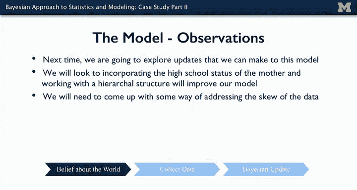

# 密歇根大学《使用Python的统计学（理解并可视化数据、因果推断、建模）｜Statistics with Python》中英字幕 - P90：24_贝叶斯方法案例研究(中).zh_en - GPT中英字幕课程资源 - BV1dV411Q7j3

Yeah。

Hello everyone， so right now we're going to go through the second part of the case study。

 we're actually going to look at what that model fit produced， using a Bayesian framework。

 we're going to try to see if we can tease out some important facts about the way that the model is fit and maybe about our parameter estimates。

So we're going to walk through once again our multi level regression problem。

We can do a lot of different things within this framework and sometimes whenever we get all of our parameter estimates at the end。

 we need to kind of massage them a little bit to try to figure out what we can do and what we can estimate from them。

So the first thing that we need to realize is that once again， just like in the intro。

Whenever we fit models in a Bayesian sense， we do not get point estimates。Okay。

 so if I was fitting these in the usual frequent sense， I get my R output or I get my Python output。

 And what I notice is that the output in that scenario would look something like this。

 They would say， hey， your best estimate of the intercept。It's probably zero， right。

 your best estimate of the IQ coefficient。It's probably 0。61。Same with the age coefficient。

 so this one's probably if I calculate the mean for argument's sake， let's make it 0。45。

And for argument's sake of the standard deviation， let's just make it like 18。2。

So this is what I would expect to get whenever I do kind of a frequentist analysis。

 I get some point estimate， and then I get something called a standard error so I can end up saying。

 you， the standard error for this guy is probably 0。05。This would be my estimate。

And this would be my standard error。In a Bayesian framework。

 things are kind of flipped on their head and the reason why they're flipped on their head is because now we have distributions on the parameters instead of just point estimates using maximum likelihood。

 and because of this we get a much more rich set of definitions。

We can notice too that this is actually a histogram。This is actually a histogram。

Instead of a density， and the reason why is that we use sampling techniques。

Use sampling techniques to actually fit this model instead of a lot of math。

So this is one of the benefits of using a computational paradigm is that we can end up exploiting it to create these really fancy models and we'll see how this can be used in the next set of videos in order to do more complex analysis。

 but for right now we simply need to know that we get distributions on my parameters。

So the distribution of the intercept， it looks like it's between2 and 2 centered at about0。

 Let's see I should come down here。 It's centered at about 0。I can calculate a bunch of statistics。

 this should not be a surprise because at the end of the day I centered my data。Oops。

So I center my data， and as a result， I expect that my intercept should be right around zero。

My IQ coefficient is kind of interesting it's saying that if I were to take a mother's IQ and multiply it on average by about 0。

6， that's going to be one of my best estimates of the child's IQ。

 We can see that this estimate varies from 0。5 to 0。7。So if I have my child IQ。

Is equal to my intercept term plus beta 1 times the mom's IQ plus beta 2。Times the age of the mother。

I would put some numbers between 0。5 and 0。7， that's my best estimate to this beta 1 term。

Between0 and 2 for this guy。And for my age coefficient， we originally expressed the idea that hey。

 maybe zero is a reasonable value for this guy， so we can see that in the IQ coefficient。

 it's above zero， we can see that on average， there's not a perfect relationship between the mother's IQ and between the child's。

 but on average， it's between 05 and 0。7。The age coefficient， on the other hand。

 we can see that zero is actually a pretty reasonable value。

 it's still with well within the bounds of my distribution。Thus， there could be no relationship。

 but in general， we don't have much certainty over this parameter。Right。

 unlike in the frequententous case where we use standard errors to try to gauge how wide our estimates are。

In the posterior distribution， we can actually see， hey， this number probably should be between01。

 but at the end of the day， we don't have much certainty over it and as a result。

My age coefficient is going to be quite wide。The standard deviation of the air at the end of the day is going to be how far on average from my mean estimate from this guy。

So how far from my child like you hat was my actual observation we can see that it has an average。

 I think we said 18。2 a little bit earlier。What this is telling me is if I end up predicting that something is。

 let's say， I don't know。85。And here's my distribution。The standard deviation on the sky。

Will be roughly 18。2。 that's going to be my uncertainty。

So that's what these distributions are telling me and we can see that this is really powerful。

 we can see that in a frequentist analysis we only get one number in this thing called a standard error in a Bayesian analysis we get an entire distribution on the values。

 and this allows me to do something really cool which we'll see in a few slides。

 which is to calculate distributions on my estimates。

So another thing that we can do is we can actually plot the samples up against each other。

 we can try to see if there's any correlation perhaps between the IQ coefficient and the age coefficient so here are my three histograms smooth out。

And we can see that because of the joint plots are all relatively their cloud life。

 they're kind of stretched out， we don't see much correlation to be totally honest between any of the coefficients。

 that means that we probably don't have much colinearity in this model。

 this is actually a pretty good model the lack of multicolinearity is pretty evident because these coefficients themselves are not correlated in a positive or a negative way and this tells us a lot about how the coefficients interact with each other。

In order to kind of understand what's going on and before we do something called predictives。

 we need to think about what's actually going on in one of these analyses。

So what we do in a Bayesian analysis is we take a bunch of data。So we have a bunch of data。

And I have some belief about a parameter， right so this will be。

 let's say that this is the IQ coefficient。SoThis is the IQ coefficient。 This is coefficient on IQ。

 What I do is， is I have some belief on this guy。And I'm going to update him。Using my data。

And this is going to give me a distribution。On the IQ coefficient。

I'm then going to use this distribution。Along with a bunch of others。

 so I'm going to use the age distribution as well。I'm going to use the distribution of the intercept。

I'm going to use the distribution of the IQ coefficient。And because I have uncertainty。

 I'm now going to use them kind of like a machine。To get predictive data。 So like。

 let's say that my boss ends up coming up to me and he says， hey， I have a mother with this IQ。

 this age。 Let's say that， you know， the IQ。Is， I don't know， 100， the age is 25。It is 25。

 and let's say that， you know， I have some belief for the intercept。 he's going to say。

 what's your best estimate？What's your best estimate for what the child's like you might be？

And so I'm going to ask myself this question in a frequentist argument。

 I'm going to get a point estimate， I'm going to get one single point。

 and so this would be a frequent test estimate。And it's going to be one single point and then I have some standard errors which are asymptotically going to be what my error I predict on this point is in a Beijing estimate I'm actually going to get an entire distribution on the errors。

 going to get an entire distribution to predict and this is one of the things that I want to show you right now。

So what I did here was I took the first observation。

I took the first observation and I ran the model and once I have my estimates on all the coefficients。

Once I have all of these estimates right here， all I did was I now generated data conditional。

On those distributions to determine what the distribution of my output should look like。

And here's what I found。 So for my first data point， here's the distribution that I expect。

My new observation should follow， let's say that I were to put it through the model again。

The real value was this blue one in the 95% credible interval is from this red line。

Is from this red line over to this red line。And we can see that it just falls outside。

 so in this case， my 95% credible interval did not capture what I was looking for。

 right my predictive interval did not capture what I was looking for。

In this one we can see my estimate was probably right around here， my mean estimate。

 this was pretty close to the actual parameter。Similarly right here。

 this is the distribution around my prediction for observation 3。

 We can see that observation 3 once again was inside of my interval。 observation 4 was as well。

We can do this for all of the points and we can kind of get an idea of how well our model may actually be fitting the data。

May actually be fitting the data given what we've observed。

so the way that we think about this is imagine that I'm going to look at。

Let's say this distribution right here， this predictor distribution。So it goes from。

Let's say for argument sake 70。All the way up to， let's say， 140 for argument's sake。

What I'm going to do。The first thing I'm going to do is I'm going to plot 70 down here。140 up here。

These will be my bounds。My point was。In this case， just below 70， so my point was right here。

And here is my interval。 and so we can see that my point fell slightly outside of it。RightSimilarly。

 for the second one。We have a lower bound， we have an upper bound， but the point fell inside。

 I think it fell a little bit high。So we're going to put the point right here。

 and I can do this for every single set across。 All I did was。

And to make this plot a little bit easier to visualize， I standardize this to one for every interval。

 and I standardize this to minus one for every interval。And so what does this look like。

 what does this new plot look like？This is the normalized posterior predictive interval spot。

What this tells us is we can see for the very first point。Exactly as we predicted， right。

 it's going to be falling a little bit outside of my credible interval。My second one is a， third one。

 fourth one。If I go back， my second one is a little bit high。

So I should see that in my predictive interval。My third one was a little bit lower。

I see that right here。And what this plot tells me is this plot tells me all of the blue dots if I were to estimate them in the model。

My posterior interval， my 95% posterior interval， would have covered them。

And would have made the correct prediction。All the points that are outside， all of these red points。

These are all the points that my posterior interval would have missed。

So this type of plot can give me an idea of， hey， maybe my model is not predicting things as it should。

 The good news is is that roughly 5% of the points fall outside of this。

 So these are good predictive intervals。 The one downside is that we look like we have a lot of points on this left tail that we're missing。

😊，RightSo this is something that we'll get to in a second， but this predictive distribution。

 we might be missing these lower tails and sometimes we're committing massive errors because of this。

And so this plot basically tells me， hey， to have a symmetric belief about the air。

 to have that normal distribution might not be correct。

We can also talk about what the width of our uncertainty is。

 so if I look at the histogram of the width of the predictive intervals。

 let's look at this one first。This predictive interval， let's say it was from 70 to 140。

 this width would have been 70， let's say that this one was from you know 60 to 130。

 this one again would have been 70。What this is telling me is that for all of the intervals in this plot。

The average width was right around 71 in some change。

And so this tells me that I don't really have a good certainty around all of my predictions right。

 someone ends up saying， hey， can you predict for this point and yes， I can end up saying， oh。

 it's probably 100 plus or minus 35 on average。That's what this width of the post predictive intervals is telling me。

And because of this， I need to be super careful whenever I'm making estimates。

The good news is that in a frequent distance analysis。

 we would just have a point estimate and we would have some idea of the standard errors in a Bayesian analysis。

 we can end up seeing that all of my uncertainty is pretty wide and as a result。😊。

Of the wideness of each of these intervals， I may not have good resolution on what my actual estimates are。

AndSo this is something that we can see directly in a Bayesian setting。

 and it's pretty cool that it tells us that our model is not fitting all the best。

These are the histogram of the errors， so all I did was I took the mean of the prediction。

So let's go back to one of our predictions。For this one， I might have chosen。

 let's say the mean is right here。So let's say it's like 98。

Let's say that this point for argument's sake， was right around 60。So that。

Air here would have been about 38。Similarly， I'm going to say that the mean of this one is。

 let's say， roughly about 85。This point may around 98， so the error on this one would be 13。

And I do this for all of the points。I plot this histogram of errorss and two things that I notice here。

 number one。My model is doing a decent job of keeping most of the errors within about 15。

 so we can see them。Pretty good majority of the data isn in here。

We can also see that it has this far right tail and specifically for these two estimates。

 some bad things are happening。Some estimates where we miss over 40。

 this is telling me that my model may not be the best in predicting everything。

And it's also telling me that there are some definite outliers in the mean structure that I need to account for。

This last plot， I think， is one of the most interesting。

 and this is called the posterior predictive check。And so what is this plot telling me？If I were to。

 plot a histogram。Of all of the child's IQs in the original data set。

 I'm going to get this blue curve， so I'm going to get this guy right here。

So this is the distribution of the actual values in the data。

Then for each of my predictive intervals， let's say that I made predictions on every single data point。

 and I plotted the density of that。 So like this。Could have been one of my sets of predictions。

 This could have been another set。 And because I'm using a Bayesian framework。

 these sets have variability。What this is telling me is this plot can tell me if I have systemic。

Bs in either direction， and it can also tell me if the variance of my estimates are approximately correct。

So I see that the width of this interval。Is roughly equal to the width of the interval。

 I'm not too worried。But two things jump out at me。Whenever I look at this plot， number one。

 the mean of all my predictions。The mean of all my predictions。Looks to be。

Perhaps a little bit off center from what the mean of this blue distribution is。Furthermore。

 we have this tail right here。What this is saying is this is saying I predict that very few people will have IQs。

 right， maybe less than 50 or from this like 50 to 70 range。

But I predict a lot more we'll have maybe from this like 80 to maybe from like 70 to 85 range。Right。

So I'm over predicting， sorry， I'm under predictdting the amount here。

 but over predictding the amount here。And because of this。

This is telling me that my estimates may be bias， and furthermore， my estimates may be pulled。

In general， my estimates may be pulled。To the left， try to account for this。Od fat tail right here。

Overall， all of my estimates are heading that way。And so this is something that I can pick up on。

Imagine。And just so we can get a better intuition of these plots。

 imagine that my predictions were perfect。imagine that this was the plot of the data。

If my predictions were perfect， I should see a bunch of lines that very closely follow。

The actual data。Or close to perfect。So I should expect to see this？But instead， I'm seeing this。

And this tells me that the distribution that I'm actually producing on results may actually not be the best。

And so that's something that I may want to account for。

So a few observations about the model that we've seen so far just kind of looking at all of these plots right first thing we didn't include the high school education variable and this is something that we may want to include。

The second thing， we have a reasonable number of observations。

The fall outside of their 95% predictive intervals。

 that means that overall our error intervals are doing what we want。

 but the width of these intervals themselves are a little bit wide。

 our uncertainty about each of the estimates is pretty wide。

 so we want to see if we can do a little bit better on that。

We systemically overestimate IQs about 65 to 80 and underestimate those of 90 to 1 on 15。

 we saw this in this plot。And furthermore， the posterior predictive check right shows that our model is perhaps not accounting for these children in that left tail。

So if the errors actually were distributed normally， we would expect that this distribution itself。

 this blue curve， might actually be a little bit closer to normal， but in general。

 it seems like our predictions are getting pulled towards that left tail to try to account for that。

So next time we're going to explore updates that we can make to this model we're going to look to incorporate the high school status of the mother and work with the hierarchical structure to improve our model。

 and we will also want to come up with some way of addressing that skew in the data so we can take advantage of that left tail and not have our estimates be all biased downwards towards that tail。

Thank you， and I'll see you in part 3。