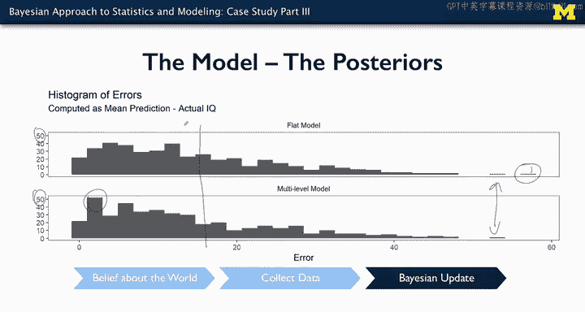

# 密歇根大学《使用Python的统计学（理解并可视化数据、因果推断、建模）｜Statistics with Python》中英字幕 - P91：25_贝叶斯方法案例研究(下).zh_en - GPT中英字幕课程资源 - BV1dV411Q7j3

。

Hello， everyone。 Right now， we're going to go over part 3 of Beijingian approaches to statistics and modeling。

 and we're going to finish up the case study， making a few edits to the case that we end up just doing in part 2。

 And so in part 2， we focused mainly on trying to find a simple model， seeing how the fits worked。

 And we introduced a few plots。 And kind of had to glaze over quite a bit of the math and everything else。

 But the idea is that we tried to use plots to try to see how our model working and maybe some places that we could try to improve it。

Right， so the first thing that we want to take into account is we want to take into account in our new model to improve upon the last one。

 this mom high school variable， right， did the mother of the child go to high school and hopefully this will take into account perhaps a more implicit grouping。

Right， what variables， though should we cluster on， right， Should we only do high school。

 Should we include different IQ buckets， right， Are we going to do both。

And it depends on the belief that we're expressing。So in this analysis right。

 we can cluster on a bunch of different things and what that's implicitly saying。

 just like in any other multile model or hierarchical model。

Is it saying that the data comes from the same process if you're in the same group in a slightly different process if you're coming from a different group？

For this analysis we're going to keep it simple， we're going to only cluster based on the binary variable of whether a mother came to high school or not or went to high school and similarly I'm going to bucket IQ into three ranges。

 the first one is going to be low IQ so if you have an IQ of less than 85。

 we'll call low IQ medium IQ for the mother is 85 to 115 and high IQ is above 115。Okay。

 so we'll have six variables in the mix， six buckets， if you will。

 and we'll see how these things will play out。So in the model we are going to allow for each of the three parameters to vary right We're going to allow for a different intercept。

 as well as a different coefficient on the mother's IQ and a different coefficient on the IQ of the age right but we're going to have six of them。

 one for low medium and high IQ mothers who did not go to high school and another three for low medium and high IQ mothers that did go to high school so we have six different intercept parameters we have six different slopes on the age。

 we have six different slopes on the mother's IQ and this will hopefully try。

To bucket the data and hopefully give us a better idea of what's going on by allowing these slopes and these intercepts to vary。

We're also going to say， and this is going to be another assumption that each of these intercepts come from a common distribution themselves we're going to say the same thing about the slopes on the age and the same with the slopes on the IQ。

 and we're going to do this to kind of regularize these values。

In a traditional hierarchical model or a multi level model。

 we allow these things to vary as much as they want。 in this Beijingian model。

 we can actually constrain them even at a higher level。

 So this is going to be almost like a three stage model。modelodeing in a Beijing way， though。

 as I've said before， focuses us to state a lot of our assumptions outright。

And I want to make this point before we end up getting started， right， stating these assumptions。

 stating these priors allows someone to challenge them。

I make a hierarchical assumption on these parameters。

 and is this belief right is the first question you should be asking， and the answer is。

 of course not。Whenever you're modeling， always ask why a decision is being made， try to back it up。

 My belief right， is that there is a relationship between the IQ of the mother and how the age variable ends up relating towards each group each of these groups I believe may have different slopes and I'm going to try to account for that belief。

We could have used different modeling techniques， we could have used a variety of other methods。

 but this is the one that I decided on just to keep it relatively approachable in this topic。

At the end of the day， all models are subjective， Bayesian or not。

 and as we remember this as we increase the complexity。

 these are modeling choices based on our updated beliefs from our first model。

 they're not ground truth。So all modeling is subjective， even in the frequent sense。

 Bayesian statistics just forces us to lay a lot more out on the table。

So this is going to be the form of the model。 What we're going to say is we're going to say that child IQ。

is a function of my intercept term， so we have six intercepts。We can see this right here。

 So we have six different intercepts。Similarly， we have six different slopes on the mom's IQ in six different slopes on the mom's age。

Right， so if I have a mom who went to high school， so high school equals one and the IQ。Is highi。

I'm going to have a different set of parameters。Then similarly， if the mom did not go to high school。

So， high school equals one。And maybe IQ medium。I'm going to have a different set of parameters for this person as well。

 This allows me to have multiple groups。And then we use each of these individual intercepts corresponding to what the mom's IQ was in her group and the mom's age was to now predict the child's IQ。

So how does this look pictorialily and I think that this is probably one of the easiest way to think about hierarchical models。

 Imagine that I had some distribution right on beta 0 itself。

So I had some distribution on be and nott itself。This is going to be the belief that I'm going to start out with。

I'm going to have similar distributions on beta 1 and beta 2。

 and these are the global beta 1 and beta 2s that we actually fit in the last model so I have some belief on them。

What I'm going to do is from these models， I'm going to draw now individual means。

 So we're only going to talk about the mean structure in this picture。

 I'm going to draw means from these models。So like， let's say that I get， let's say a mean of。

 I don't know，5 for my intercept。Right， this will be5。

 This will now be a normal five with some standard deviation distribution。Let's say on this one。

 I draw zero。This will be now a normal0。Blan， I don't know what the error on this distribution is。

RightSimilarly， I could have drawn another one， let's say that you know， I end up drawing now。

 So the second one was zero， let's say that I draw out a third point out of here。

Let's say it's you know what2。This will now be a normal true distribution on the air。

So what this is saying is draw the mean of each of these beta knots。

 one for each group from some parent distribution。This is the hierarchical assumption。Okay。

I'm going to do the exact same thing。I'm going to do the exact same thing for beta 1。

 so I'm going to draw six beta 1s out of the hat。Rang。Another six beta twos out of the hat。

Going to do all those。 So now I'm going to get。These six draws for the intercept。Now。

 what I'm going to do is I'm going to build up a response distribution。

 So what this is saying is this is saying that the mean。The mean itself。

Is equal to some beta n right that I'm going to get from this first guy。Plus。

 some beta 1 that I'm going to get from somebody over here。Plus。

 some beta 2 that I'm going to get from somebody over here。In this response distribution。

 like let's make the assumption right， So this is high school yes， IQ low no。

 so this will be the response distribution for high school equals yes。IQ equals low。RightSimilarly。

 this one over here， this would be the response distribution for high school equals no。IQ equalsi。

How do I get my data， I'm actually sampling from that response distribution。

And so this is what the full picture of what's going on is if it looks confusing。

let's actually walk the model back。My responses。My responses themselves are first grouped based on their mom's IQ level。

And also based on whether their mom goes to school。 So this will be the all the distribution。

 These are all sorry， the observations of whenever high school equals， yes。And IQ equals low。Okay。

I use these to come up with a response distribution。

This response distribution gets its intercept from this guy over here。

So it gets its intercept from this distribution。 This is a posterior distribution on the intercept for that particular high school equals yes。

 IQ equals low group。And similarly， all of my beta zeros， all of my intercepts。

 get their mean from this guy， from this global beta n。

So we can think about the model as being generative， top down。

Or right or we can think of about as being kind of inferential。 What is my data in this group。

 is my data down here， Tell me about the response distribution。

 What does that tell me about the distribution of the group of the intercepts。

 What does that tell me about the global intercept as a whole。So there's a lot going on。

These models often have a lot of moving parts， as we can see in the graphic。

 but they can model really complicated relationships in a more intuitive way。

 kind of thinking about things generatively。 How did our data come about。 One of the downfalls。

 though， is that fitting one of these models in a Beijing framework can be very computationally difficult。

And so in a lot of circumstances， whenever we're fitting these models， right。

 we do have to do some simulation and we do have to sometimes work out quite a bit of math。

The model updates。 So we have six new intercepts， right。

 Each of these are going to be constrained by that hierarchical relationship。

 that kind of global relationship。 And then we're also going to change the distribution of the errors。

 And I wanted to do this to try to capture that left tail。We originally saw。

 we originally saw that our data was kind of shaped like this。

And our predictions were kind of like this。So what we want to do is we want to hopefully give a distribution a little bit of skew so that it can capture this tail。

 but at the same time， be able to also generalize to most of the rest of the distribution。

We could have done this with a mixture model or a bunch of other methods。

 but overall I think that this was the easiest next step to illustrate for perhaps this case analysis。

Right so just like before we'll run the model we'll get the posterior distributions。

 This time we can compare each subgroups intercept all six of them and see if they have any relationships。

 Why didn't we incorporate nonlinear terms instead of creating a hierarchical model right that would be expressing a different belief It's expressing the belief that different IQ groups come from different distributions is what I'm doing with a hierarchical model right a nonlinear extension implies that they all come from the same model。

But perhaps they just vary in a nonlinear way。 We can do both。

 We can have hierarchical models with nonlinear terms to keep it simple。

 We just did hierarchical models with linear terms so that we don't have lots of coefficients running around to visualize。

So if we print out all the distributions， this is what we get。

 The distribution for the intercepts are relatively boring because we centered all the data so we would expect each of the intercepts to be centered with a mean0。

The one thing that we do notice， though， is that some of the intercepts have a much worse resolution。

 For instance， if someone went to high school and their IQ was low。

 we don't have much information about this intercept。Because the posterior is very wide。Similarly。

 we have quite a bit of information about this guy and this guy because the posterior distribution is small。

This is because n is small in this group。If I remember right。

 it's something like 10 or 15 observations， it's very small。

 whereas we have quite a few more people in these groups so we get better resolution of what's going on。

Similarly， we also have posterior distributions for the IQ coefficient。

 so these are the actual posteriors。RightWe can see that our resolution on this parameter here is pretty small。

 So if you had a mom who went to high school and her IQ is low。

 we really have no idea what's going on with the relationship between her IQ and yours。

 It's kind of all over the place。But if your mother didn't go to high school and our IQ was medium。

 we have a pretty good idea of what's going on。 So this tells us that we have good resolution around that parameter。

 but poor resolution around this one。 We have a lot of uncertainty。The one odd man out is this。

Observation right here， we can see that if your mom did not go to high school， but her IQ is high。

 you have a negative relationship。Between her IQ and your IQ。

And this may be because whenever your mother's IQ is high。

 you may actually have a little bit of regression towards the mean。

 You may actually be a little bit more normal taking into account maybe your father or other factors。

 right。What's interesting， though， is that if your mom did go to high school and her IQ is high。

 it's actually positive coefficient， so there's something going on here。Right。

 the certainty is pretty good。 We still can't rule out 0 in either one of these two distributions because 0 is reasonably within those intervals。

 But what we can say is this would be an interesting relationship to maybe look into。

 We have good resolution on these parameters because the distributions are firmly to one side or another。

And so that's something that we may want to look at。We look at the age coefficient。 It seems like。

 except for。Perhaps this estimate right here， everybody contains zero。

 So there's nothing that we can really say about the age coefficient。

 We have very low resolution right here。We can see that even that this is a minus5 to5。Varance。

 a lot of these， we can't really tell what's going on with the relationship between age。

 except maybe in these two cases。And there's really not much that we can say about the sage coefficient because our variance of all these parameters is so high。

 there seems to be some relationship that if your mom goes to high school and she's medium or high IQ。

 we can end up seeing that the age actually does make a difference。

 it appears as if older moms actually do produce children than end up having a higher IQ and we don't know if that's a relationship that we should study or not。

 but it is something we can look into。We also have this thing called a SU parameter。

 so for this distribution assumption on the errorss， I end up saying that a child's IQ。

 so a child's IQ。Was distributed with this distribution called a Sw normal。

So it's distributed Skew normal。 What does this mean。

 This means that it's basically a normal distribution， but I have a third parameter to control Skew。

If the parameter is negative。Then it has a skew that looks like this。 It's a negative skew。

And if the parameter is positive。Right， then it'll have a distribution that looks like this。

And so these are ways of giving using the Skew normal distribution， ways of getting skew data。

What we can actually see is whenever I fit the model based on this S parameter。

 I can actually see that largely I do have a tail。For a skew of a negative number。

 what this tells me is there actually is some left skew to my data。

If the normal model that we originally used was correct。

 that we should expect all of this would be really clustered around zero。But we can see that nope。

 we actually have quite a bit of skew because most of this distribution is negative。

 we can actually say that with reasonable certainty。

 this data actually might be left swed in general， and hopefully this will help us account for for some of those errors in the model。

Just like last time we built up these predictive distributions。If we remember in the last model。

 observation1， our estimate was actually outside of the interval。 In this case， it's actually inside。

 So in this case， we actually did a pretty good job of capturing our estimate。

 same with observation 3， observation 4， observation 2。😊，We did a pretty good job。

Of capturing all these。When we end up looking at the plot。

 I think it's because all these things are so close。

 but we can see that we're still doing a pretty good job of capturing all of these points in the posterior。

The histogram of the width of the predictive intervals。

 this one is pretty interesting because originally we had a distribution。

 it was pretty strongly centered on 70， looked a lot like this。So it was basically， a。

 all of my variance is relatively about 70 wide， all of my intervals。

 all of my predictive intervals are roughly about 70 units wide。Each of these。

We're roughly about 70 units wide。We can see here now each cluster actually has a different width。

And the result of this， we can see that down here， I don't have a lot of data。

 I think this is actually high IQ mothers that did not go to high school。

So we can see that we have quite a bit of certainty。

 Maybe they didn't have a very large in group variance。 Similarlyly。

 I can see that individual groups actually stick out quite well。

 We don't have a lot of resolution for some groups。 We have high uncertainties。

 We do have high certainties for some groups。This may be overfitting because we don't have a lot of data。

 but at the end of the day， this characteristic that each of these intervals are different in terms of width is actually pretty interesting。

The history of the errorss。So we can see that once again， if a mother's。

IQ was high and she didn't go to high school。 We don't have a lot of data。

 but it looks like we nailed those estimates。 They probably just don't have a very high anger variance。

Otherwise， it looks like most of these distributions are centered around zero。

 we have a long tail on the left side for moms that did go to high school， but they't have a low IQ。

The interpretation of these errors at the end of the day is that they look relatively homogeneous。

 we may need a little bit more data to see if there's any clear trends。But overall。

 the errors look pretty good。The histogram of the air is overall。

 So we don't have numbers like way out in the 50s and 60s anymore for the air。

 We now just have some concentrated around 40。RightSimilarly。

 most of our data now is relatively within 15。 We still have this right tail。

 so we didn't do a phenomenal job predicting。But we did do a little bit better job than before。

And lastly， our posterior predictive check， so if you'll remember from last time。

Our original estimates kind of looked like this， so they went under， came up like this。

 and then they came back down。Right， so we heavily underestimated here， heavily overestd here。

 We still see a little bit of this trend going on， but we don't nearly have as much white space here and here and here as we did before。

 We can see that we're better capturing。This entire Sw。We're better capturing this。

And so this is something that we wanted to try to capture whenever we did this。

 we're actually getting slightly better estimates from a distributional standpoint。And overall。

 this is a great thing。 The one downside is， is that it looks like we still missed。

It looks like we still miss this hump。 And so maybe a mixture distribution or something is in order to capture the points that fit down here。

 These low IQ predictions that we just can't seem to fit with this model either。

The histogram of the errors， we can see that they look relatively the same。 once again。

 the flat model has this air that's way out in the right tail。

 it appears as if we still are overestimating one point pretty precisely。But overall。

 we can see the scale on this one is 50。In 50， we have a big bar right near 0。

The histogram of the errors is not impressively different， but it is a little bit different。

And as a result， we also have much more estimates on our parameters。

So the multi levelvel model for this data isn't a massive improvement in the predictionability。

 but it is an improvement in an inference。 We can now tease out individual group effects。

 provide insight into the slopes， into the intercepts。

But this also means that there's an increased variance for the parameter estimates as a result。

 We don't have as much data in each of the groups as we had in the first model。

Because each of these groups are a subset of the total population， and as a result。

 each of our parameter variances have to blow out just a little bit。

 and this creates fatter distributions and maybe a little bit more uncertainty overall。

The next steps in modeling， we may want to account for that over inflated left tail using a mixture distribution or another technique。

 maybe even something highly non distributionional， right。

 And then we may want to also find more intelligent groupings for IQ。 You know。

 I arbitrarily chose 85 and 1，15 as my cut off points。 I could choose more intelligent。

Points as well， I would use these to update my belief about the world， and to model。

As a few party notes， as we went through this case。

 we saw that Bayesian models because they give you distributions on the parameters。

They are computationally intensive， but they can model very complex relationships。

 We just modeled a two stage hierarchical model very quickly， right， We can perform regular。

 There's a bunch of math that allow us to take a lot of the methods and frequency statistics and model them using the same principles kind of all under the same framework。

 And this can be a very powerful idea。These methods originally were very intractable due to the amount of sampling that you need and due to computational power。

 but the method always remains the same creatively about the world， collect data and model。

 do your updates。And with the advances and sampling techniques in computational power。

 especially of the cloud， a lot more computational power can be used to make these models and to make better inferences。

modelling is an iterative process is something that's filled with assumptions and is subjective by its very nature。

 And sometimes capturing the variance of an estimate is sometimes more important than the estimate itself。

 If I get an estimate on that age parameter， you know， of， I don't know 0。

2 when I get an estimate on that IQ parameter of 0。6， I don't really care。

 What I care more about is how certain am I about that relationship。

 And we can see that as we get less data， or're less certain about a lot of things。

 La posterior intervals， indicate large uncertainty in the estimate。

Given the model and given the current data。 And this is something that we definitely need to watch out for。

 And Bay methods bring this to the forefront。 whenever we have a bad fitting model or a model with a lot of variance。

 which I think we do in this case， These models of IQ are very， very noisy。

But especially with this IQ data， we now get a better idea of what's going on and perhaps better ways to tackle the modeling to get closer to what might actually be going on in the real world。

So thank you， everyone， for walking through this threepart case study on how to go about Bayesian modeling。

 We saw a lot of different types of pictures and a lot of different ways that we can go about modeling data。

 We can go about updating our beliefs， and we can go about trying to understand what possibly our model might be trying to tell us Bayesian methods because of their power allow us to do a lot of very complex analysis。

 But at the same time， their downsized such as computational complexity and sometimes a little bit of mathematics。

 make them a little bit more inaccessible， but sometimes that increase in the power and that increase in really trying to get a better model of the world can be quite worth it。

 So thank you so much once again， I hope you enjoyed the special topics on Bayesian statistics。

 goodbye。😊。