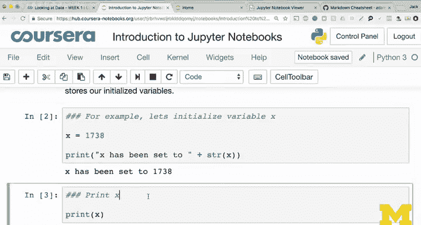
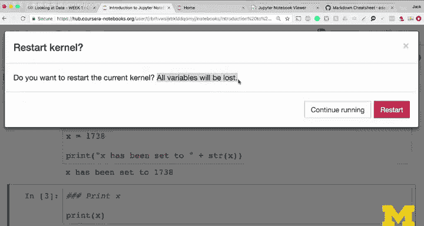
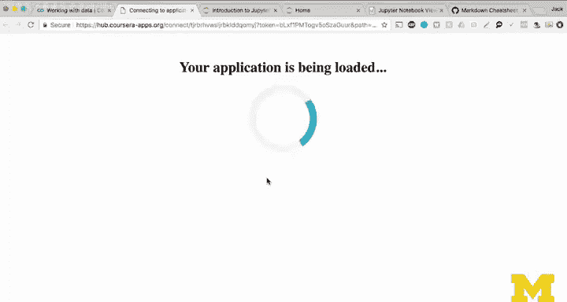

# 密歇根大学《使用Python的统计学（理解并可视化数据、因果推断、建模）｜Statistics with Python》中英字幕 - P9：8_Jupyter Notebook入门(选读).zh_en - GPT中英字幕课程资源 - BV1dV411Q7j3

。

Hi， I'm Jack Schchaefffer， a data science student and programmer at the University of Michigan Today we'll take a dive into Jupiter and notebooks as it will be our primary tool for running Python code throughout this course Following the tutorial you'll be prepared to utilize Jupiter notebooks and create your own interactive documents let's begin。

So what is Jupiter Notes Jupiter is a web based interactive development environment that supports multiple programming languages。

 however most commonly used with the Python programming language。

The interactive environment that Jupiter provides enables students， scientists。

 and researchers to create reproducible analysis and formulate a story within a single document。

Now let's take a look at an example of a completed Jupiter notebook written by one of Michigan's very own Richard Steyren。

As you can see， he actually utilizes an interactive document to curate and。A full on research paper。

 and what's interesting about this is not only does it include text， but he's able to embed。

Python code directly into the document， and that's what makes Jupiter Notes so special。Now to start。

 we're to look at a few of Jupyter notebook's features， the file browser。

 the markdown cells and syntax， kernels， variables and environment， and the commandverse edit mode。

 and additionally shortcuts to improve your workflow。Now to jump into the file browser。

 you can go here to file out the menu bar and hit open。

And you'll see that it takes me to a directory of where I have all of my files。

You have the capability of uploading from your own PC and then creating new text files， folders。

 terminals， or any notebooks with your specific library。Our specific programming language。

Now let's jump back here， so now that we've taken a look at what the file browser looks like。

 let's discuss what markdown really is。And essentially it's a markup language that uses plain text formatting syntaxt。

 This means we can modify our text with the use of various symbols on our keyboard as indicators。

 and some of the affording that we can do is creating headers， modifying text with thes bold。

 creating ordered and unordered lists， links to different websites and URLs， tables。

 embedding images， and much more。Now， to start， I'll just showcase a few examples of how this formatting is done。

As you can see to create headers， we simply use a hashtag and we'll put as many hashts as we would like and that would specify。

How big our header is。Now here's an example of what the output would look like。

Now for text modifications， we can use asterisks or underscores。To either create ittalics or bold。

 depending on the quantity of the asterisks that we use。

We can also combine asterisks and underscores to create a bold itallysis text。

 as you can see here with underscores。You know，Additionally。

 we can do things like scratching through text with Tildo。

And those are just a few examples of how we can modify our text specifically。

Now you can see that there are a list， you can make ordered list by specifying a number。

 you can make sublists and unordered lists can use asterisks or minuses or pluses。

 so there's a lot of flexibility here。Next we'll talk about some links。

 you can see here we're linked to the University of Michigan website and we can also create a。

Caption for a link as well。Now one thing I do want to mention is that there are lots of markdown syntax references out there。

 I've included one on this notebook and here's the link here， as you can see。

 this is really thorough example of how to create all of these different formattings in your Jupyter notebook。

Now， that's it from for marked on specifically。Now let's get into what kernelel's variables and our environment mean in terms of a Jupyter notebook。

A notebook kernel is a computational engine that executes the code contained in a notebook document；

 there are kernels for various programming languages。

 however we are solely using the Python kernel which executes Python code within our document。Now。

 just as a side note， when a notebook is opened， the associated kernel is automatically launched for you for our convenience。

 and you can see what our kernel is up the top right corner， Python 3， which is what we'd like。

Additionally， you can go to the menu bar， click on kernel， Change kernel。

 and select all of these various options， however we're going to stick with Python 3。

Now I'll mention what a Python code so looks like。You can execute this code by going to the top bar and hitting this run。

As you can see， this Python cell has been ran and we've printed our output。

 this is a Python code cell。Now， to reiterate， a kernel is the back end of our notebook。

 which not only executes our Python code， but stores are initialized variables in environment。

Let's take a look at an example of how when we initialize a variable。

 it'll get stored in our environment。Here we'll initialize variable x with the number 1738。

 and we'll print that and we can see our output is there。

And then let's just go ahead and print it once more。Now， like I had mentioned。

 our variables are stored in our kernel environment。 Now if we were to restart our kernel。

All of our variables would then be lost， so it's important to note that if you ever have complications with your kernel。

 you'll have to reinitialize your variables。

For example， because now that we've restarted our kernel。

Our variable x is now not defined and we get an error in the document。Now， if we reinitialize x。

This code executes properly。An additional point I'd like to make is that you can actually embed user input in your document。

So this is exactly what this code chunk does。Name equals input， what is your name。

 print the name you've entered as plus name， what is my name， my name is Jack。And then this。

Code cell executes properly。Now， one thing that's important to mention。

Is that Jupyter Notes has in line cell execution。That means that a prior cell must complete its operations prior to another cell being executed。

Now， an example of this would be if we ran the code junk that accepts input。

 and then we attempt to run this line below。We can see that this asterisk indicates that our prior cell that we attempted to run has not for fully been executed。

Now you can see if we type in our name here again。The asterisk is gone away， replaced with a number。

 and these cells are now printed out。That is definitely something you would like to keep in mind and it would avoid multiple complications going forward when using these notebooks。

Now， one of the last things I'd like to discuss is command versus edit mode and additionally discuss shortcuts and how they can improve your workflow。

So there's an edit and a command mode for Jupyter notebooks and the mode is easily identifiable by the color on the left border of the cell for example。

ll see here we're in green and we're in edit mode so we can。Remove you know add text， however。

 if we want to go to command mode we can see that we have a blue state here on the border of our cell。

And what this enables us to do， it enables us to go up here and type in。Different settings。

 for example， if we wanted to toggle， sell line numbers。

 we would be able to do that when we're in command mode。And now you can see on the left hand side。

 our line numbers are now present。Now to kind of segue into shortcuts。

 we can do simply toggle line numbers by pressing the letter L on our keyboard。

First we have to be in a command mode， of course， indicated by the blue bar。L removes。

And toggles your line numbers。Now lastly， I'd like to discuss additional shortcuts because there are a lot that can improve your productivity while using Jupyter notebooks。

 so rather than having to go up to the menu bar， file， edit， view， insert。

 you can simply use command mode using different combinations of keys on your keyboard。

 and this resource will be available for you to view later， which I truly do recommend。Now lastly。

 how do you install Jupyter Notes It's important to note that Coursair provides embedded Jupyter notebooks within the course。

 thus the download is not requirement unless you wish to explore Jupyter further on your own computer。

You can check out the official installation guide。And in fact。

 it'll actually just recommend that you use the Anacona platform。

 which is compatible with the Windows， Mac OS and Linux systems and it's actually what I use on my personal computer here I have my Anacona Navigator below in my dock。

One last thing that I would like to touch on is how you as a learner will view these notebooks。

So if we go into week one and re scroll down to the assignments。

 we can see that there is a notebook here。If we click on that。We can open a notebook。

And this is how you go about doing it throughout the course。Application is being loaded。

 it will pop up soon here。

And here we are。So I hope that this basic tutorial of the introduction to Jupyter Notes was extremely helpful and I hope you're excited to get deeper into them going further in the course。

 thank you。