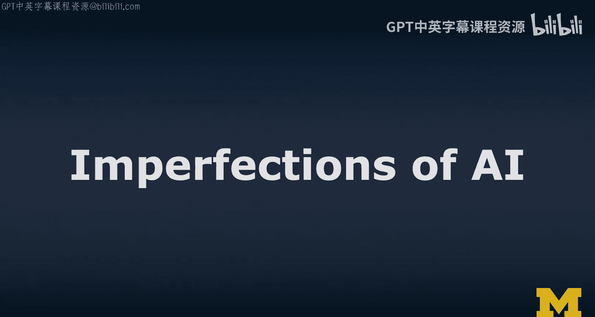
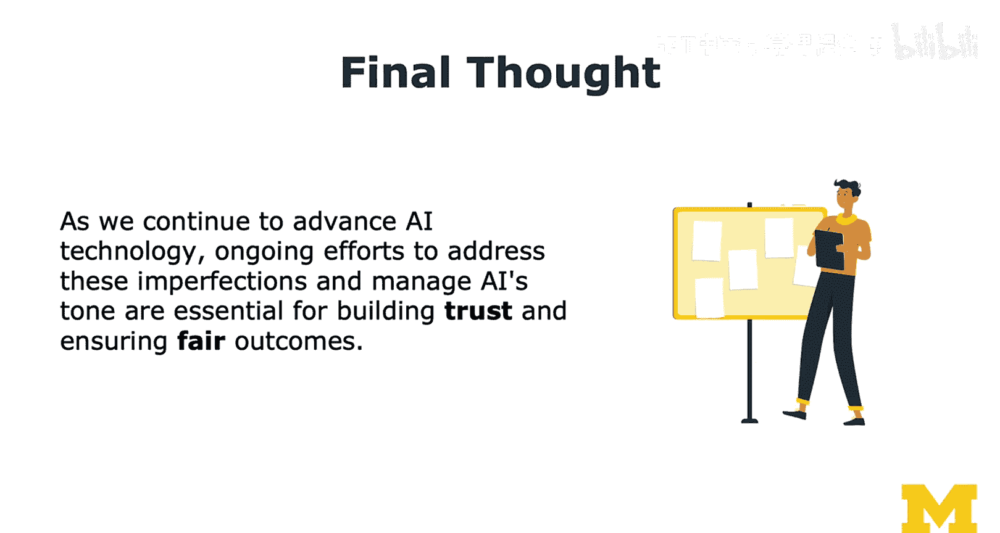
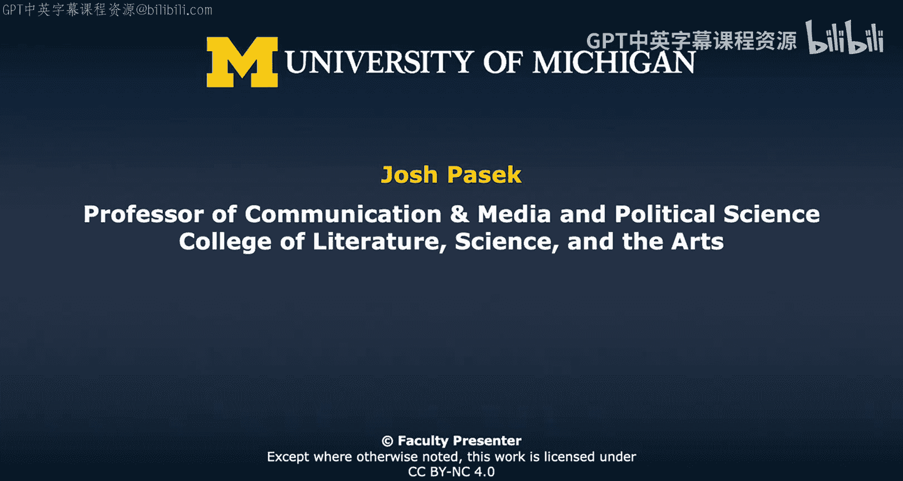

# 密歇根大学《应对颠覆：工作场所的生成式人工智能｜Navigating Disruption： Generative AI in the Workplace》 - P10：9_人工智能的局限性.zh_en - GPT中英字幕课程资源 - BV159uyztEfn

Artificial intelligence opens a new range of abilities for its users and potentially for humanity as well。

Yet AI can be substantively limited and can lead to problematic outcomes if users don't fully understand what's going on with the system。

Recognizing how AI generates its content and what it learns from it is critical for understanding where AI can go wrong。

In this lecture， we'll talk about some of the imperfections of artificial intelligence and what can happen if you don't look for and recognize some of those key issues。

 We'll also come back to these issues again in a later course。

One of the significant challenges that researchers have identified with artificial intelligence across a variety of contexts is known as hallucinations。

Hallucinations occur when artificial intelligence generates information that appears plausible。

 but is actually incorrect， nonsensical， or even dangerous。For example。

 an AI might write an article with fabricated statistics or explain facts that don't exist。

In many cases， if you ask an artificial intelligence agent about a particular person。

 if the agent doesn't have memory on the specific information about that person。

 it'll make things up and it will sound confident in doing so。As an example of this。

For some of the earlier iterations of chat GP， if I were to type in my own name as a scholar。

 it would frequently correctly assert what university I taught at and a few other valuable pieces of information。

 but might get where I got my degree or the year wrong based on an understanding of where and when other people in positions like mine had done it。

This happens because artificial intelligence tries to present complete outputs when it doesn't have information to fill in all of the gaps in its knowledge。

 it will guess things that might fill those gaps effectively based on other patterns it has learnt。

Part of the challenge here is that artificial intelligence has a limited understanding of the context。

 had insufficient training data to be able to know something completely or may simply have a sense of what something should be。

 but not actually know the answer。Now， this is not a particularly big deal as a hallucination。

 but it reveals a broader challenge。 AI can introduce information that seems correct， but isn't。

It's continuing to work off the patterns in its data set。

 rather than relying on some kind of formal memory。

There are ways to mitigate hallucination to some degree in the training data and possible ways to adjust whether AI should give back more deterministic or more varied responses。

But all in all， it's a hard challenge for the design of AI。

 and it's something that can't really be dealt with directly by most end users。

Many of the hallucinations that AI will give are sufficiently plausible seaing。That friend users。

 it's not actually obvious that a piece of information is wrong unless the user's an expert on the topic camera or herself。

What this means is that AI needs to be consistently checked with critical thinking and verification from reliable sources。

Now it's possible that as AI algorithms get better at incorporating information about where the information in its own output came from。

 this will be reduced， but for now， there's a consistent concern that AI may have hallucinations that inject inaccurate information amidst otherwise accurate information in ways that can be difficult to detect。

😡，Another challenge that most users of AI should be aware of is that artificial intelligence often provides repetitive answers to questions。

Because it draws in the same relationships repeatedly。

 it may struggle to go into depth on a topic and instead reiterate the same basic points repeatedly。

This is actually not too different from what you sometimes encounter when an undergraduate wrote a paper at the very last minute。

 where they repeat kind of the same information in every paragraph。

Being aware of this is a potential problem helps users to identify when artificial intelligence is failing to provide as much useful information as the amount of content produced seems to imply。

😡，The repetition occurs because when an artificial intelligence agent is referring back to the patterns of relationships it has。

 it may find that many of those relationships iterate frequently。

It can often happen because of a lack of sufficient diversity in the training data。

And because the AI algorithm doesn't have access to a broad enough set of information about certain topics。

 leading to circumstances where the same thing appears again and again。

This challenge can be mitigated by considering types of data used to train an AI algorithm。

 and if it's an AI algorithm being trained toward a particular task。

 having rich and relevant training data toward that task can be particularly helpful。

It can also be valuable in certain circumstances to use algorithms that are going to prioritize novelty and variability in the responses a little more。

 or what AI researchers call tuning down the temperature of the artificial intelligence model。

But absent these approaches， it can be a challenge for end users。

 and it can lead to cases where the product of AI can be tedious to read and may not be as informative as it initially seems。

😡，But simply， AI needs to be checked to ensure that it's not being repetitive and to ensure that users have the potential to extract valuable information from the output rather than something that merely seems reasonable。

😡，Artificial intelligence can also introduce biases into all sorts of processes that it works with biasas and AI comes because the outputs are based on training data that in many ways reflects bias that exists among humans in other contexts。

Therefore， if much formal work implies a particular relationship。

 then that relationship is going to emerge again in an artificial intelligence model。

In certain cases， when a piece of information is not in the data that something learns from。

 but where historical data of other sorts happens to reinforce that piece of information or pattern of bias。

 an artificial intelligence agent can end up learning about the improper or biased association without even trying to。

This can occur with respect to something like housing loans where lots of information about neighborhoods can be put into an algorithm。

 Even if the race of people in a neighborhood isn't put into the algorithm。

 histories of how individuals in different racial groups have lived in different places may end up getting baked into that algorithm。

 nonetheless， and yielding different outputs on who qualifies for a loan or how much a house should be worth。

The algorithms then end up reproducing these biases in seemingly novel ways。

 or in ways that may be difficult to detect。This occurs because the training data reflects existing societal biases。

 and the model simply learns what we've told it to maximize on。

 which is how these things relate to one another and copies these biases in ways that aren't obvious。

There are multiple approaches to mitigating this kind of bias。

 One involves trying to carefully curate training data sets to make sure that the data being trained on are not biased or by auditing the algorithms to make sure that they're not producing biased results。

But again， for end users， it can be difficult to both identify and correct for biases without understanding where the training data is coming from and how those biases may have gotten there in the first place。

It's important to recognize that there is this possibility and to look for the possibility that AI is in fact reinforcing bias。

The challenges I've noted so far also are made more challenging by some inherent features of the sorts of data that artificial intelligence is most heavily trained on。

Namely， things like journal articles， newspaper articles， and books。

What this means is that artificial intelligence has in many respects。

 learned to sound highly authoritative， like it knows what it's talking about。

This makes for more difficulty in trying to detect things that might have been hallucinated。

 things that may seem repetitive or things that are biased。

 because they're stated with such authority。We need to unlearn our tendencies to assume that authoritatively written texts are indeed accurate as we evaluate AI。

Another challenge that can emerge in the use of artificial intelligence is that artificial intelligence agents are designed to produce what they think is the highest density area of the outcome distribution。

Artificial intelligence will sometimes create very conventional sentences。

 or will give bse responses to things that are standard。

 rather than engaging with the full domain of what's possible。

Recognizing that narrowness can be important。I'm going to highlight a number of other concerns that are worth attending too。

 but many of these are beyond what we can discuss in this particular course。😡。

There are privacy risks that can exist from sharing data with artificial intelligence。

 When you put a piece of data into an artificial intelligence system。

 that system is often able to learn based on that piece of data。

Which can introduce these privacy risks？The relations that an AI agent learns may be based on stuff that shouldn't be shared with the model。

AI agents for instance， can learn to recognize individually presented faces。

In various visual dataset sets which can present privacy risks。

Many AI models operate also as what you would call black boxes。

 where the decisions they make are opaque and difficult to understand。

This makes it hard to figure out why you're getting back the data that you're getting back。

 and if the process used was reasonable。When dealing with algorithmic bias。

 it's important to understand we often can't observe the processes underlying AI because the models have so many different parts built into them and are so complicated。

Another concern comes from the rules around artificial intelligence。

The regulatory framework for artificial intelligence。

 such as copyright and what's legal and illegal in various contexts has not yet been well established。

 and the rules are very much in flux。Recognizing that it's important to ensure that you're not inadvertently violating rules as they emerge。

Is important。And also trying to ensure that your ethical is distinct from making sure that you match the rules as they currently are。

 which can produce a whole series of challenges。It's also worth noting that artificial intelligences are rapidly changing technology。

This means both that there are new features and developments that one must keep up with。

As well as that what one gets out of an artificial intelligence model at a particular point in time may not be what you will get out of that same model at a later point in time。

 because what's produced is produced at that particular moment with a particular training data set and a particular algorithm and thus won't be replicable。

Finally， it's worth noting that as we continue to advance artificial intelligence technology。

 many of the questions are going to need to be readaddressed。

 and these imperfections are going to change。 It's important to be aware that just because you're using artificial intelligence effectively。

 legally or otherwise at any given time doesn't necessarily mean that you recognize all of the potential risks around AI。

