# 密歇根大学《应对颠覆：工作场所的生成式人工智能｜Navigating Disruption： Generative AI in the Workplace》 - P11：10_人工智能能否通过图灵测试及其意义.zh_en - GPT中英字幕课程资源 - BV159uyztEfn

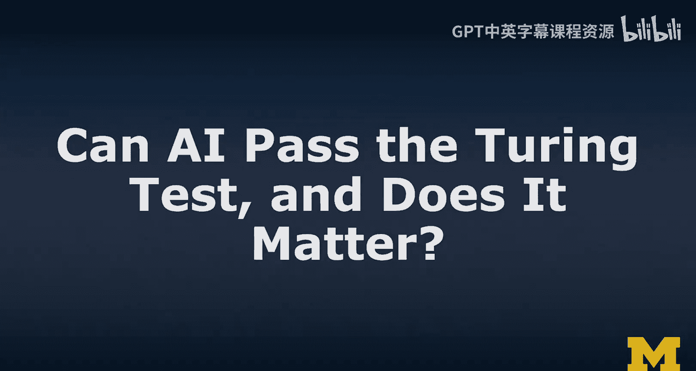

In 1950， Alan Tring published his paper， forecasting that at one point。

 machines might be able to exhibit intelligent behavior that would be indistinguishable from that of a human。

He devised a test。To assess when computers could be considered artificially intelligent。

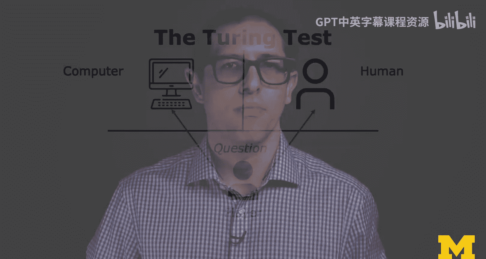

This test， based on a game show at the time called the Iitation Game。

Presented the idea that if you provided equivalent questions to both a human and a computer。

And couldn't tell which one was which。We could refer to the machine as artificially intelligent。

So if an evaluator couldn't figure out which one was the computer and which one was the human。

 we would say that the computer had passed the Tring test。

The notion that computers can be intelligent is itself a tricky concept。

What does it really mean to be intelligent and how would we really know。

 Is Tring's test sufficient or isn't it。In practice。

 it's become increasingly clear that intelligence is defined typically in a way that's problematic rather than based on some overarching underlying concept。

 That is， we infer intelligence and give them to things when they have the ability to perform tasks that we think of as requiring human like cognitive functions。

 like learning， reasoning， problem solving and understanding natural language。

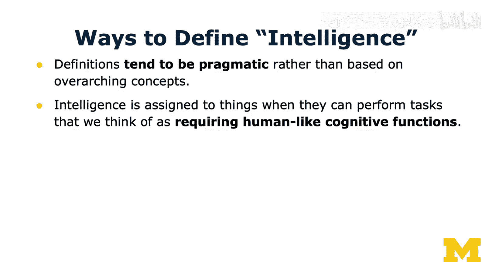

When we look at an artificially intelligent agent， its ability to seem conversational can strike us as intelligence。

 much as Tring predicted。

But there are all sorts of other benchmarks that we could use to think about whether an artificially intelligent machine is really intelligent。

 and， in fact， how intelligent it is。What kinds of performance does it have on particular tasks？

How adaptable is it and how well can it generalize knowledge from one context to another？

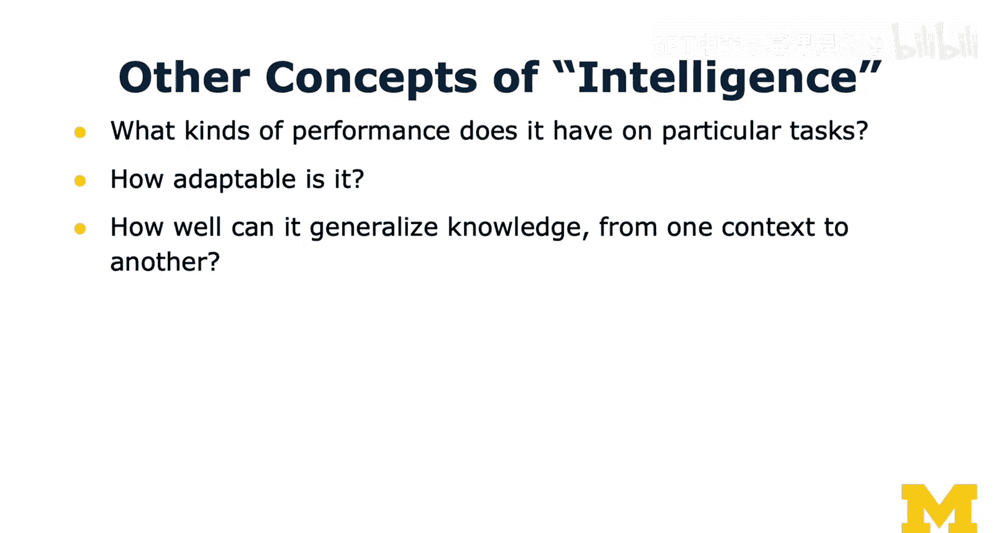

Early research on artificial intelligence revolved in many ways around artificial intelligence beating humans in complex games。

When the computer deep blue， defeated world chess champion Gary Casperrov in Philadelphia。

 there came a realization that many of the tasks that we thought of as inherently human could now be accomplished by machine。

But the effort to assess whether a computer is really intelligent and what it means if it is。

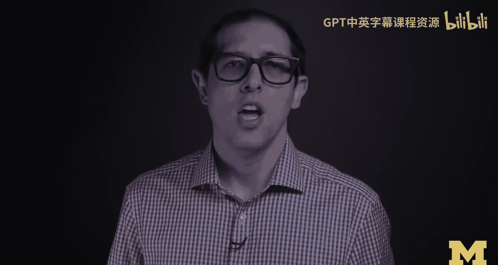

Is， in fact， a bit of a red herring。In practice， for many purposes。

 the Tring test is not really all that relevant。As users of artificial intelligence。

 we need to think of what we're using as a tool。A tool that may look quite different from most of the other tools we've encountered in our lives。

 but a tool nonetheless。And it is a tool that aids in the performance of a series of specific tasks。

 not simply an entity to which we should imbue human like intelligence。

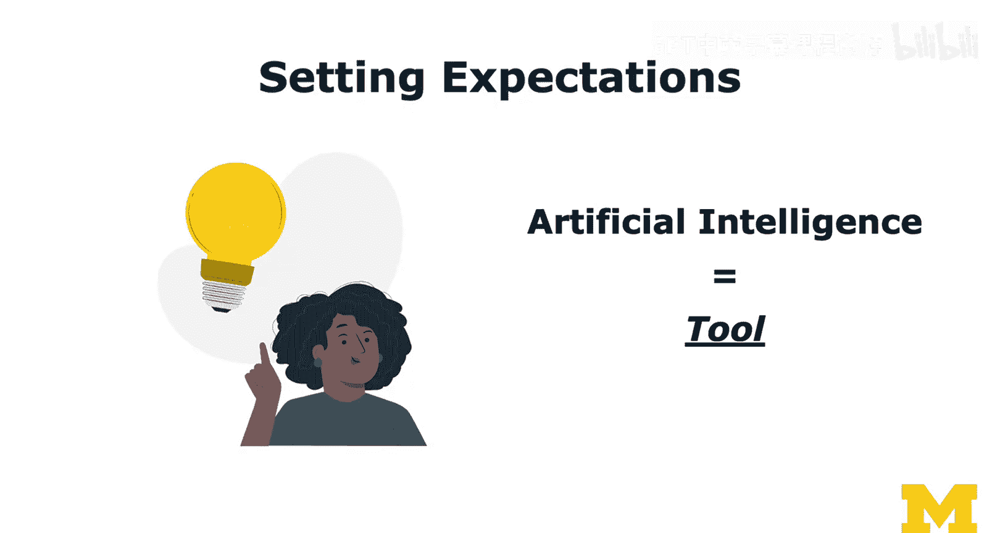

If we recognize AI as a tool， we can think about how we can use artificial intelligence in areas like data processing。

 pattern recognition and automation to aid ourselves， our workplaces and society。

We should focus on practical applications， how AI will aid us in solving real world problems。

 and where might AI take us down the wrong path？It doesn't help to simply evaluate whether AI can mimic human conversation。

 It helps to think about what role artificial intelligence will play in healthcare care or finance or transportation or customer service。

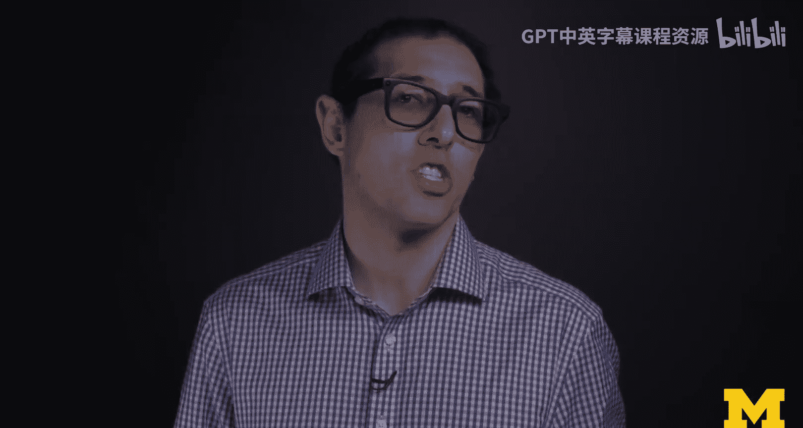

As we integrate AI into more and more aspects of our social， professional and personal lives。

 the question is going to be how that integration proceeds。

We need to think of the integration of artificial intelligence as a sociotechnical interaction。

 That is that technology is going to provide certain abilities。

 and it's going to shape the way that we act as human beings and that interaction between our social。

 professional and other roles and the use of the technology as we proceed in those roles is what defines both what a technology will do and what kind of impact it will have。

To understand the role of artificial intelligence in the workplace。

 we should not debate whether intelligence is artificial。 Instead， we should look to the past。

 You can find the historical parallels such as how the printing press revolutionized the dissemination of knowledge and how the telegraph changed the speed at which we could communicate。

We are transforming the nature of information processing。

 decision making and the speed at which certain things can be accomplished。

 The impacts of these prior technologies were not immediate。 In fact。

 it wasn't just the technology that defined their impact。

 but also the social reaction to that technology。

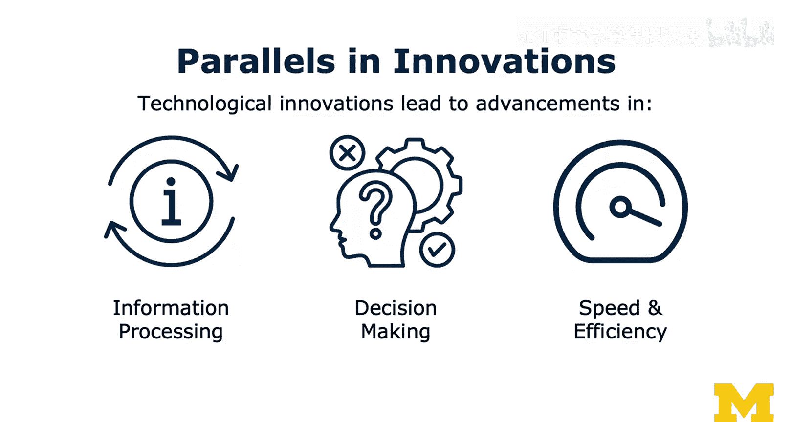

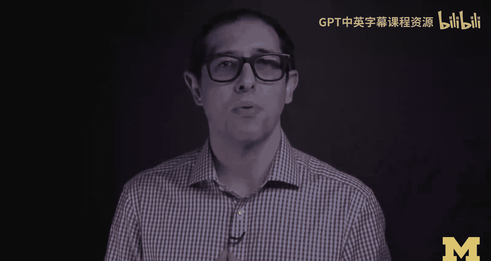

For example， the printing press's impact grew as more people learned to read and write。

 and the telegraph became powerful through systems for quick information transfer。Similarly。

 we must recognize AI's disruptive potential。 It can democratize information access。

 enhance productivity， drive innovation or spread inaccuracies。

The real impact of AI will depend on how we use it and integrate it。As we look to history。

 we can see how prior developments can guide our approach to artificial intelligence。

 We need to consider potential disruptions。 What kinds of ethical considerations we need to have。

 Who needs to have access and how to retrain individuals in their own roles。

 as well as larger units to adapt to the changes that AI is introducing。

We also need to figure out how to integrate processes of continuous learning。

 engagement and the concerns that people may have into those processes moving forward。

I submit to you that artificial intelligence has indeed passed the Tring test。

And thus can be considered an intelligent agent in a way that humans could only have imagined 70 years ago。

However， passing this threshold isn't the ultimate measure of AI's value or intelligence。

 Its true value lies in our ability to integrate it as a tool that we can use to accomplish tasks and practically improve how we operate in society。

We need to learn to live with AI。Through a social technical integration。

 reflecting on the printing press provides insight into AI's potential for significant societal change and likely changes we can't fully imagine yet。

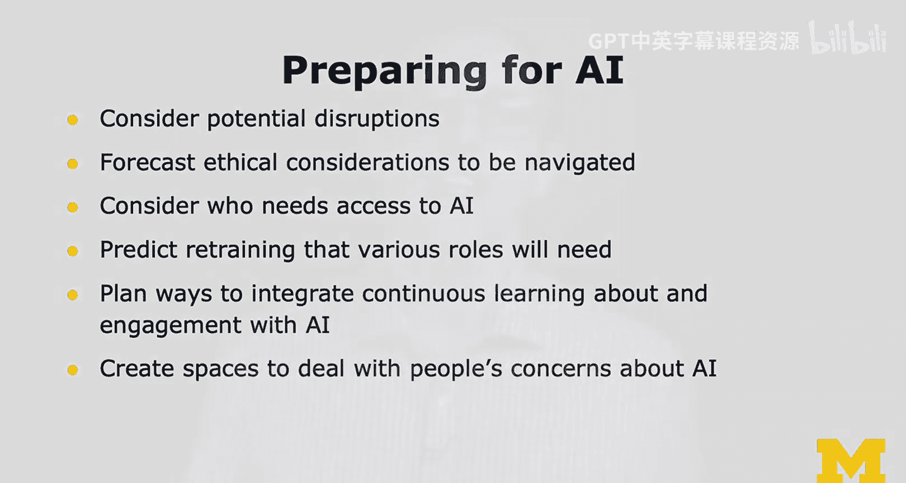

But from that perspective。We can think about this technology。What it does。How it does it。

And what it doesn't do as well as where it can go wrong。

 providing a basis for thinking about the future。In other courses in this series。

 we're going to delve deeper into the roles of AI in the workplace。

 how it will influence particular jobs。How it will change the workplace more generally and the other kinds of risks that we need to be thinking about as we imagine an AI driven future。

Thinking about other technologies that have yielded similar disruption can help us ground the way we imagine artificial intelligence。

Get ready for both the real disruption that artificial intelligence will cause and perhaps help us ignore some of the hype that may overstate both the benefits and the dangers。

😊。

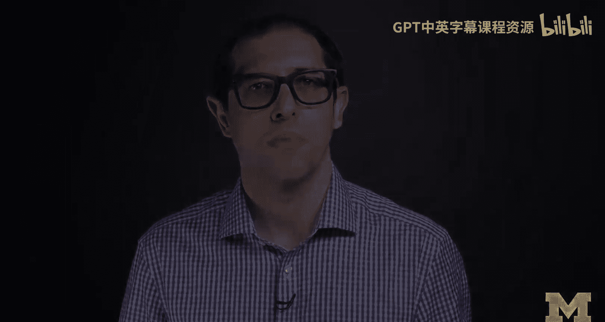

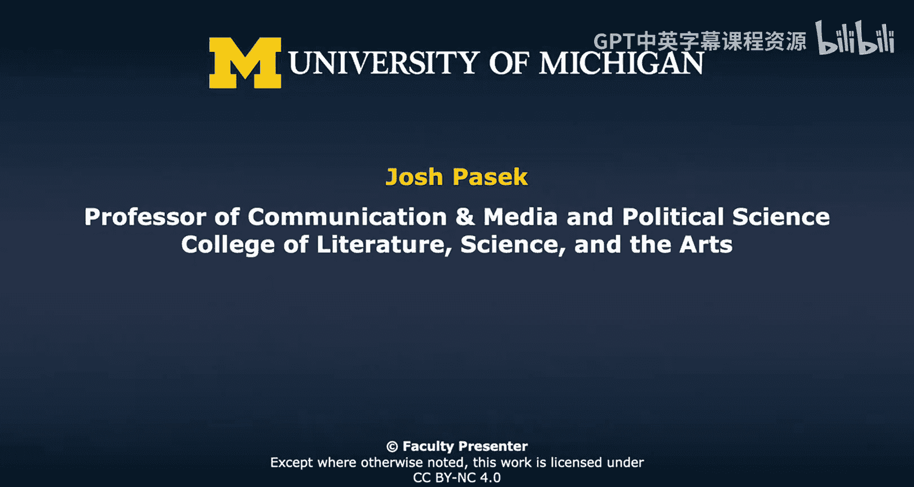