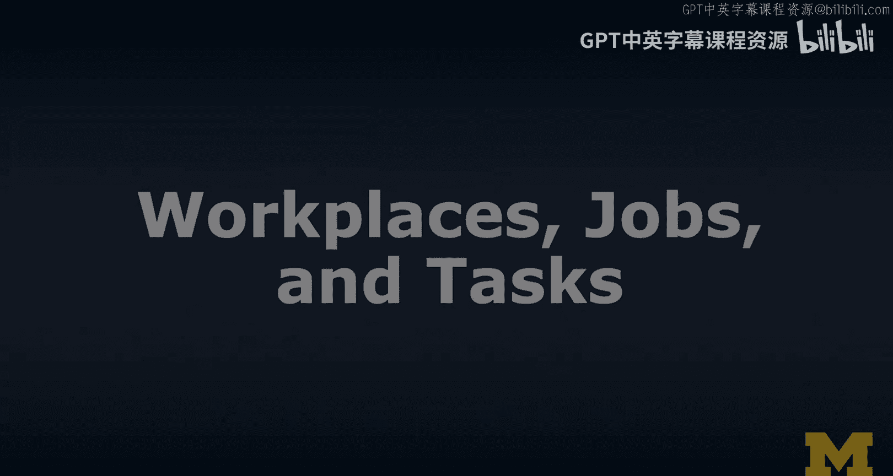
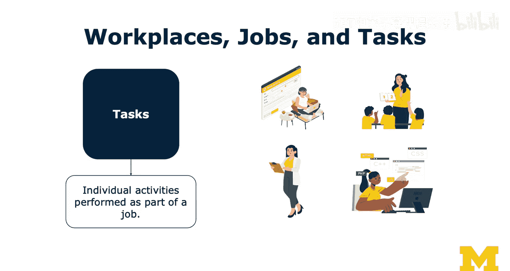
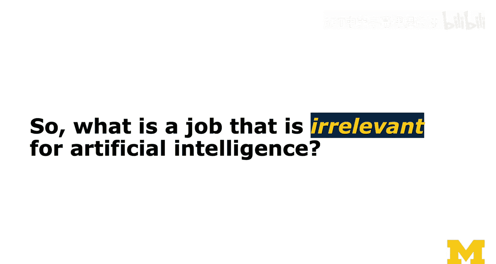
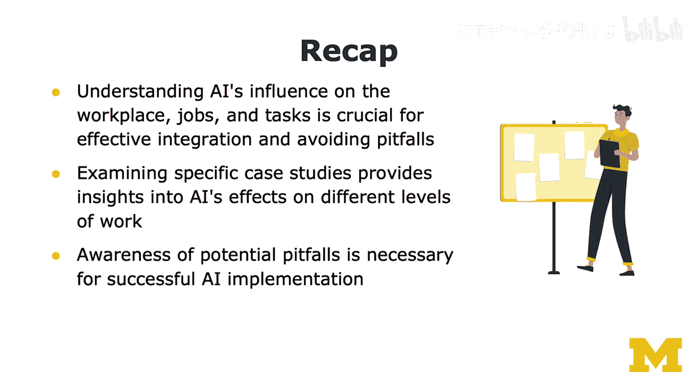
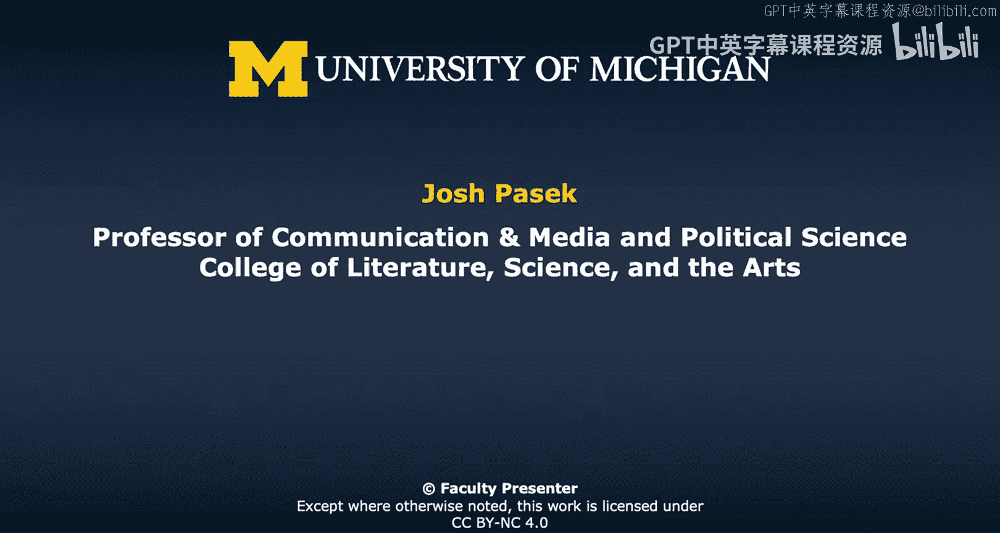

# 密歇根大学《应对颠覆：工作场所的生成式人工智能｜Navigating Disruption： Generative AI in the Workplace》 - P13：1_工作场景、岗位与任务.zh_en - GPT中英字幕课程资源 - BV159uyztEfn

As generative AI makes its way into the workplace， its relevance across various sectors will continue to grow。

The question we'll explore in this lecture and future ones is what kind of impact this will have？

In this segment， we'll cover how generative AI will affect the workplace， job roles。

 and specific tasks。We need to think about all these levels to fully understand what's going on and what kinds of changes we can expect to observe。

By workplace， I'm referring to the full array of organizations or environments where work is performed。

 This ranges from corporate offices to factories， schools， hospitals。

 construction sites and even restaurants。 that is anywhere people go for their jobs。

It's important to recognize that workplaces are structured in very different ways。

 and people have various different types of jobs across these different workplaces。

The jobs that people have。Are essentially the set of roles that individuals take on within their workplaces。

For example， someone might be a project manager， teacher， nurse or software developer。

 Each job includes a variety of roles and responsibilities that exist within that particular workplace。

And these roles are what we define as tasks。 They're the individual activities that people perform as part of their job。

Tasks may include data entry， teaching a class， conducting patient checkups。

 writing code or other activities。 It's at the task level where artificial intelligence is likely to have its primary impact。

Some tasks have the potential to be heavily influenced by artificial intelligence。

 while others are much less likely to be impacted。

It's helpful to think of tasks as divided into four categories。

Those where artificial intelligence will be irrelevant or largely irrelevant。

Those where artificial intelligence can augment how people perform the task。

 those where AI might fully replace the need for individuals to do the task and tasks where AI may shift the role of what humans do and what's automated。

Let's consider each of these categories with examples。

 as understanding them will help us think through the role of AI in specific workplaces and jobs throughout this course。

So what is a job that is irrelevant for artificial intelligence？

Well， there are a variety of such tasks。Care roles such as therapists or social workers may not be reasonable to replace with artificial intelligence because those roles are primarily defined by human interaction。

Other roles are likely to be irrelevant for generative artificial intelligence。

Such as manual roles like construction workers or janitors。

 It's hard to imagine artificial intelligence doing much to influence my hairstylist， for instance。

Additionally， certain creative arts， where the goal is to highlight human experiences may not be particularly relevant for generative artificial intelligence。

 as A I can't replicate the human touch， creativity or the emotional intelligence required in these positions。

Generative AI may also be able to simulate some artistic outcomes。

 but it can't really replicate that humanness that is inherent to the art。

Next， we have roles where artificial intelligence can augment， but not really replace human labor。

Here we're thinking about things where AI can enhance human capabilities and perhaps allow for more efficient or effective performance。

As an example， artificial intelligence can assist in the development of a marketing campaign。

Marketers may find it helpful to conduct creative brainstorming with virtual assistance。

 AI could augment human tasks， increasing productivity。

 reducing error rates or freeing up time from more strategic work that still requires a human touch。

In these cases， AI and humans working together can be synergistic。

 enhancing overall task performance。There are also situations where artificial intelligence can fully automate tasks。

 This is the case where we're concerned about job displacement or significant job transformation。

In certain cases， artificial intelligence may be able to take relatively formulaic content or customer service tasks that once require a human and automate them。

This can lead to job loss and necessitate reskilling or upskilling to adapt to new roles。

There are also a series of ethical considerations around these kinds of replacements。

And that raises questions about how transition should be conducted in a workforce on a larger level。

But they can also relieve some roles that may be part of a person's job。

 but may be less central to a task。 Finally， AI can shift a number of roles that humans do。

This is where AI is going to change the nature of a job。

 may prioritize new skills or approaches that are different from what happened before。For example。

 content creators might use AI to draft initial versions of their work。

 with humans refining and editing the content。Similarly。

 programmers might use AI to generate initial code， which they then modify and improve。In this case。

 there are different tasks that humans do now than they may have done previously。

Instead of producing the initial output， now artificial intelligence might produce the initial version of the output。

 and humans work on modifying and updating it。This creates new opportunities for productivity。

 potential job growth， and evolving job roles。But it requires flexibility from workers who are willing to be ready to shift to continuous learning and adaptation。

While we can't cover every field， understanding how to think through AI's influence on the workplace。

 Jo and tasks will be crucial for integrating AI effectively and avoiding potential pitfalls。

By examining specific case studies， we can gain insights into how AI affects different levels of work and develop strategies for effective integration into our professional lives。

Mind you。 These case studies are inherently limited because I can't reasonably cover the whole gamut of different fields out there that artificial intelligence is going to influence in this short course。

 Nevertheless， knowing how to think through the process of how artificial intelligence has its influence both on the workplace level and the jobs level is going to be important for thinking through how to integrate AI effectively and how to avoid the places where it may cause problems。

