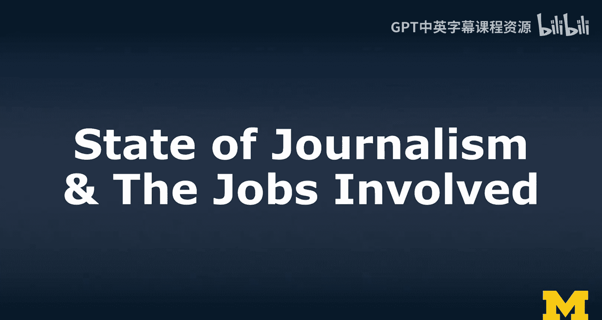
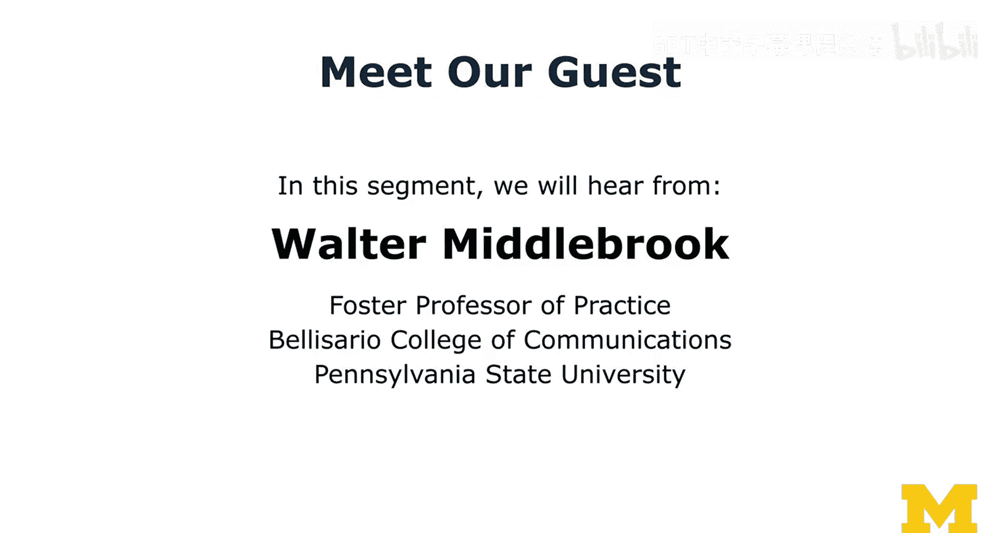
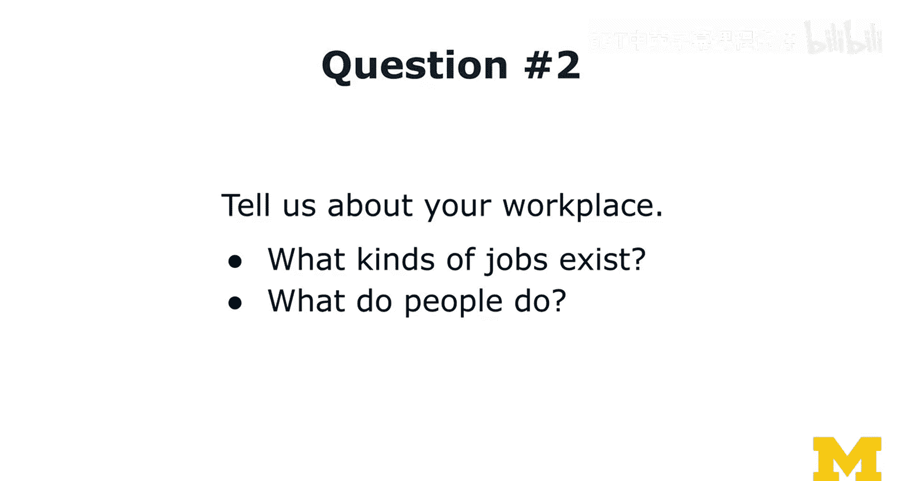
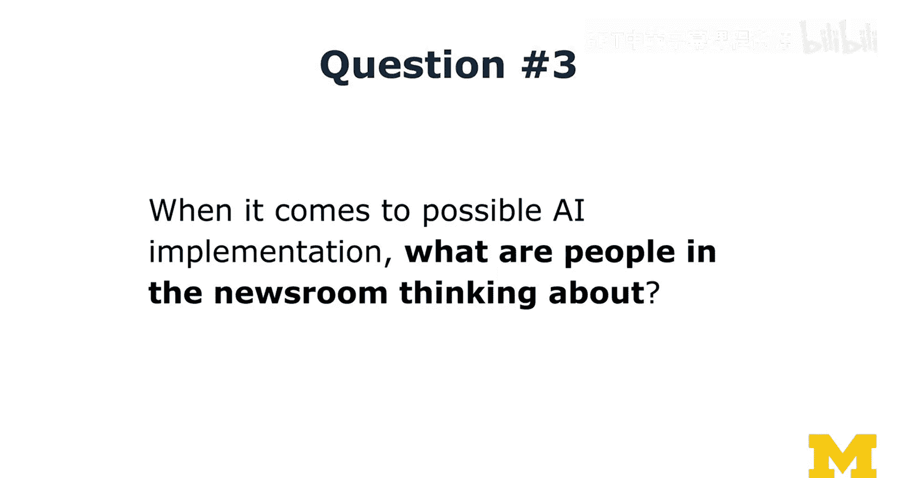
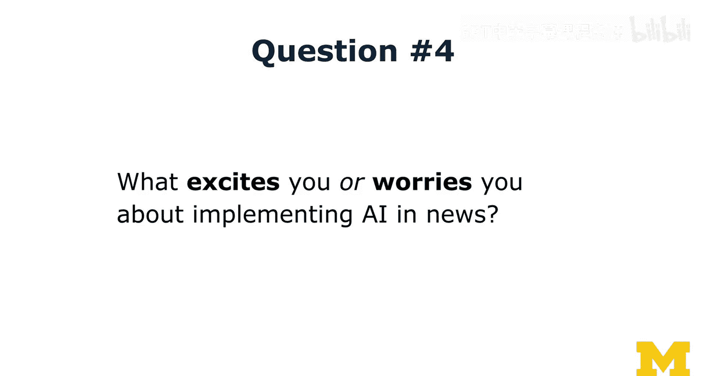
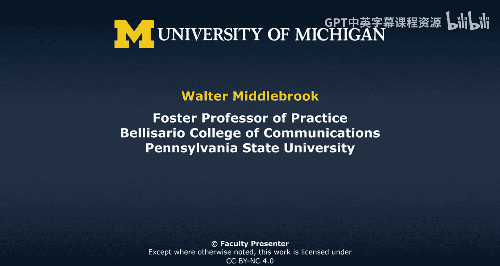

# 密歇根大学《应对颠覆：工作场所的生成式人工智能｜Navigating Disruption： Generative AI in the Workplace》 - P14：2_新闻业的现状及相关职位.zh_en - GPT中英字幕课程资源 - BV159uyztEfn

I'm Walter Middlebrook， the Fo Professor of Practice in the Belisariio College of Communications at the Pennsylvania State University。

I joined the university's faculty after more than 20 years as a senior editor and major news organizations。

 including the Detroit News， News Day of Long Island， New York， The New York Times， and USA A Day。

I have been a continuing working journalist since the late 1970s。

The newsroom and related news organizations are evolving mechanisms When I started a news organization involved hundreds of people and consisted of a complete community that included a newsroom of editors。

 riders and photographers， and a cadre of support systems ranging from production a mini steel plant to marketing and sales to distribution many truck and transportation companies to human resources and medical facilities。

Today， as a result of consolidations and downsizing。

 most news organizations are lucky to include a small staff and recruit that can produce and publish a multimedia online news site。

News organization managers are surely looking at AI from two perspectives， editorial and business。

Both disciplines are exploring how AI can be used to eliminate redundant tasks in activities such as writing。

Writing and posting business stories on company earnings reports or split stories on game updates and the actual game reports。

To advertising， booking， selling， and possibly creating copy for advertisements and the advertisements themselves。

And while there may be some advantages to having AI as a compliment to a reporting staff in bigger news gathering projects。

 those same staffers are concerned that AI will be used as an excuse for cutting back on the number of individuals working and doing the reporting。

AI could also likely be used in some newsrooms to help streamline their operations。

Deciding and planning long term projects and such。Some might possibly be looking to AI to offer suggestions on how writers and editors can fill in holes or blanks and stories。

 as we call them in bigger stories and the research needed for those stories when under deadline pressures。

But there is a concern of how much we can trust those efforts。Covering news is an organic process。

 and while it might be from a business perspective。

 good to have AI generate the story by just feeding the program the scores of a game。

 the editorial site worries and has seen how AI often misses the subtleties of language。So far。

 the experiments of AI generated sports and business copy have all failed miserably。

And our greatest worry came to light recently in the fact that a working reporter for a reputable news organization published AI generated quotes for a story。

This breach of journalism ethics was only discovered when a competing reporter fact checked the story by going to the quoted sources to confirm that they had actually given the comments that were used in the story。

This ethical violation is just another reason why people are losing trust and faith in media。

Newsrooms need an editor who provides checks and balances in producing news copy AI so far cannot serve in that role no matter the task it is performing。

